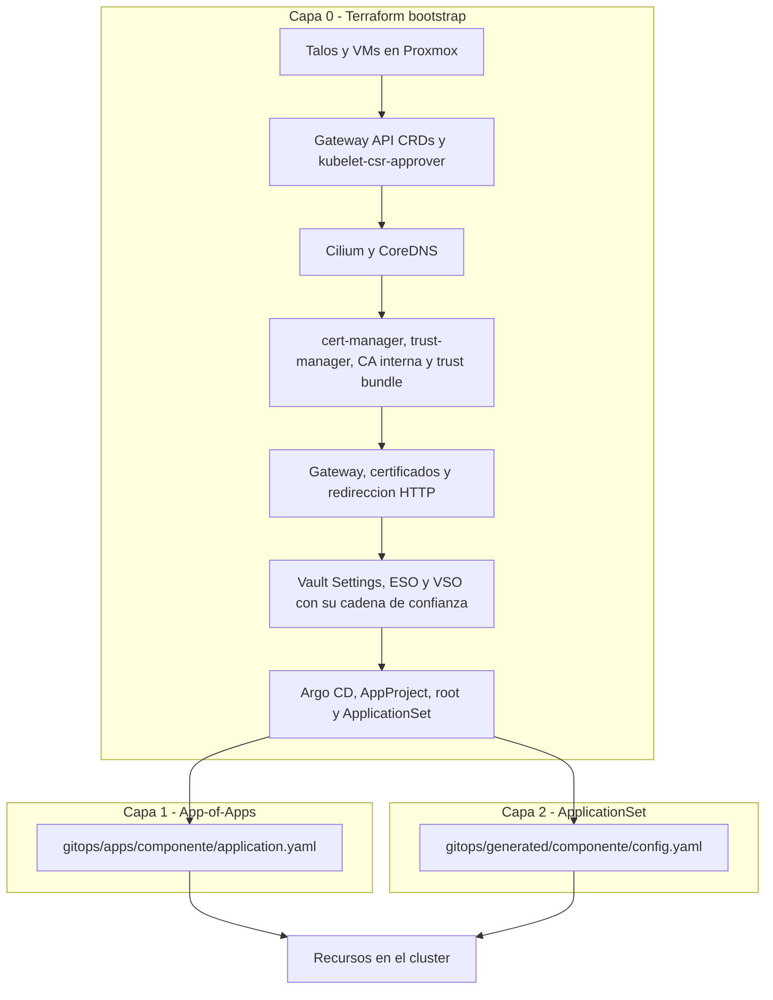
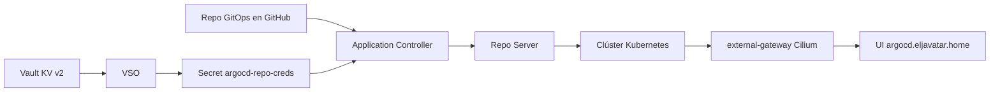
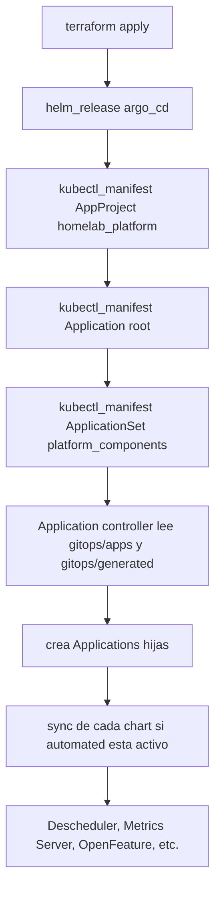

# Introducción

Este repositorio está dedicado a mostrar el proceso de creación y configuración de un homelab, el cual albergará sobre Proxmox un clúster de Kubernetes usando Máquinas Virtuales (VMs) de Talos Linux, lo cual facilitará la configuración de las VMs y creación del clúster desde Terraform.

La iniciativa de crear un homelab dedicado a albergar un clúster de Kubernetes partió de la necesidad de poder ejecutar diversos servicios que uso en el desarrollo de mis aplicaciones.

Inicialmente, usaba Kind en mi máquina local (una Macbook Pro) para levantar un clúster de kubernetes con un control-plane y 3 workers. Con las 16 GB de RAM de dicha máquina, en principio era suficiente para correr un par de aplicaciones y un par de DBs de Postgres, y eventualmente un servicio de almacenamiento de objetos tipo S3 como lo es SeaweedFS. Sin embargo, cuando quería levantar servicios de Observabilidad, el clúster se colgaba debido a la falta de recursos de mi Macbook (principalmente por falta de memoria RAM).

En ese orden de ideas tenía 2 opciones:

1. Buscar algún proveedor económico en la nube para crear mi clúster de Kubernetes.
2. Crear mi propio homelab en casa.

Teniendo en cuenta que esto es algo que pienso mantener por bastante tiempo, y que eventualmente tendré más servicios en mi clúster (como por ejemplo un servicio de mensajería tipo Kafka o Apache Púlsar), la opción 1 podría volverse un poco costosa a largo plazo (con valores que fácilmente podrían llegar a superar los 200 USD mensuales).

Por tanto, me decidí por la opción 2, para lo cual tuve que adquirir un router, un switch, un par de Mini PCs, cableado, etc. Así pues, la configuración de hardware que uso para este homelab es la siguiente:

- **Internet:** Starlink gen 2 con el respectivo adaptador Ethernet.
- **Router:** Tp-link Archer AX55 (eventualmente pienso cambiarlo por un router que me de redundancia de conectividad como por ejemplo el Tp-link Omada ER706W-4G).
- **Switch:** Tp-link Tl-SG108E.
- 2 Mini PCs GMKtec M7 Ultra (con Ryzen 7 Pro 6850U (8C / 16T)) con 32 GB de RAM y 1 TB de almacenamiento cada uno (1 NVMe) (eventualmente pienso agregar más mini PCs).
- Macbook Pro desde la cual accedo a todo (a la interfaz web de Proxmox, al router, al switch, al cúster de kubernetes vía `kubectl`, etc).

**Tecnologías Usadas**

- Proxmox v9.2
- Talos v1.13.4
- Kubernetes 1.36
- HashiCorp Vault v2.0.4 (sobre un LXC con Debian 12)
- Terraform v1.15.6
- Helm v1.4


## Estructura de carpetas del proyecto

El repositorio está organizado por **capas de responsabilidad**, no por tipo de fichero: cada carpeta responde a "quién lo ejecuta" y "en qué orden". Así el árbol de ficheros funciona también como mapa mental del bootstrap.

```text
kubernetes-homelab/
├── terraform/                 # Infraestructura como código (Proxmox, Talos, bootstrap de K8s)
│   ├── main.tf                # VMs, red, VIP y módulo de nodos Talos
│   ├── talos-patches.tf       # Aplica los patches de talos/patches/init
│   ├── k8s-bootstrap.tf       # Todo lo que se instala y configura tras el bootstrap
│   ├── locals.tf              # k8s_path, talos_path, gitops_path y el mapa de VMs
│   ├── variables.tf           # auto_config_cluster, sync_with_tf, is_development, gitops_branch, use_prod_domain...
│   └── modules/talos-node/    # Módulo reutilizable por cada VM
├── talos/
│   ├── patches/init/          # Machine config patches por nodo (red, labels, VIP)
│   └── configs/               # Generado por Terraform; no se versiona
├── k8s/
│   ├── bootstrap/             # TODO lo que aplica Terraform (ver tabla siguiente)
│   └── apps/                  # Cargas de trabajo posteriores: una carpeta por aplicación
├── gitops/
│   ├── projects/              # AppProject (permisos y repositorios permitidos)
│   ├── bootstrap/             # Application raíz (patrón App-of-Apps)
│   ├── apps/                  # Applications con spec propia
│   ├── appsets/               # ApplicationSet para componentes homogéneos
│   └── generated/             # Un config.yaml por componente del ApplicationSet
├── vault/policies/            # Políticas HCL de Vault (KV, PKI, plantillas por SA)
├── scripts/                   # gitops-publish, gitops-health, validate-cluster, clean_kubeconfig
├── tests/                     # Manifiestos y scripts de las pruebas documentadas
├── Makefile                   # Entrypoint único de automatización
├── README.md                  # Este documento
└── VAULT_README.md            # Guía de Vault (instalación, políticas, PKI)
```

| Carpeta | Qué contiene | Quién la ejecuta |
|---------|--------------|------------------|
| `terraform/` | Aprovisionamiento de Proxmox, Talos y el bootstrap del clúster | `make tf-plan` / `make tf-apply` |
| `talos/` | Parches de machine config y los configs generados | Terraform (`talos_machine_configuration_apply`) |
| `k8s/bootstrap/` | Manifiestos y values que dejan el clúster en estado "ready to work" | Terraform (y Argo CD para los values) |
| `k8s/apps/` | Manifiestos y values de las aplicaciones que se despliegan **encima** del bootstrap | Argo CD o `kubectl`/`helm` manual |
| `gitops/` | `Application`, `ApplicationSet` y `AppProject`: la fuente de verdad de Argo CD | Argo CD |
| `vault/policies/` | Políticas de Vault para ESO/VSO y para la PKI | Operador (CLI de Vault) |
| `scripts/` | Automatización de apoyo: publicar GitOps, comprobar salud, validar el clúster | `make` ó ejecución directa del `.sh` |
| `tests/` | Manifiestos y scripts de las pruebas de cada sección | Manual o `scripts/validate-cluster.sh` |

### Dentro de `k8s/bootstrap/`

`k8s/bootstrap/` es exactamente el universo que Terraform aplica: `local.k8s_path` apunta ahí (ver [`terraform/locals.tf`](terraform/locals.tf)), así que **todo lo que se añada a esa carpeta es responsabilidad de Terraform**.

| Subcarpeta | Qué contiene | Criterio para decidir si algo va aquí |
|------------|--------------|--------------------------------------|
| `config/` | `Namespace`, `Certificate`, `ClusterIssuer`, `ServiceAccount`, RBAC, `CiliumLoadBalancerIPPool`/`CiliumL2AnnouncementPolicy` y CRs de operadores (`VaultConnection`, `VaultAuthGlobal`) | Objetos que **configuran** el clúster, no que ejecutan cargas de trabajo |
| `deployments/` | Values de Helm (`*-values.yaml`), manifiestos de workload propios (`vault-cert-syncer-cronjob.yaml`) y `cloudflare-tunnel/` | Todo lo que **ejecuta** algo |
| `gateway-api-crds/` | Copia vendorizada de las CRDs de Gateway API (`v1.4.1/`) | Material de terceros que se quiere tener **offline** |
| `templates/` | Solo ficheros `.tpl` que se renderizan con `templatefile()` desde Terraform | Necesitan variables de Terraform en el momento del apply |
| `optional/` | Manifiestos documentados (en [`VAULT_README.md`](VAULT_README.md)) que no forman parte del bootstrap aplicado | Referencia que se conserva sin aplicarse |

> `k8s/apps/` sigue otra convención (una carpeta por aplicación, con subcarpetas solo cuando hacen falta) documentada al final de este README en [Convenciones de organización de manifiestos](#convenciones-de-organizaci%C3%B3n-de-manifiestos).

---

## Arquitectura Física y Conectividad

El TP-Link Archer AX55 manejará el enrutamiento y el Wi-Fi, mientras que el switch administrado TL-SG108E será el corazón de la red cableada. La conexión física se da entonces de la siguiente forma:

1. **Starlink (Modo Bypass/Puente):** El cable del adaptador Ethernet de Starlink va directo al puerto WAN del TP-Link Archer AX55.
2. **Router a Switch:** Se conecta un cable Cat6 desde cualquier puerto LAN del Archer AX55 hacia el Puerto 1 del Switch TL-SG108E.
3. **Mini PCs al Switch:** Se conecta la Mini PC 1 al Puerto 2 y la Mini PC 2 al Puerto 3 del switch.
4. **MacBook Pro:** Se conecta vía Wi-Fi al Archer AX55 (gracias al router, tendrá visibilidad total hacia el switch y las Mini PCs).


### Diseño del Direccionamiento IP y Segmentación (La Red)

Para un homelab con Kubernetes (Talos) y Proxmox, no es buena idea tener IPs dinámicas, ya que si un nodo cambia de IP, el clúster se rompe. Por tal razón, debido a que el Gatwey de mi router es `192.168.0.1`, usaré la subred estándar `192.168.0.0/24`, pero dividiendo el direccionamiento de forma estricta:

- **Rango de IPs Estáticas (Para Infraestructura):** `192.168.0.1` a `192.168.0.149` (Aquí irán el Router, Switch, Nodos de Proxmox y las VMs de Talos).
- **Rango DHCP (Para dispositivos personales):** `192.168.0.150` a `192.168.0.254` (Aquí entrará la MacBook por Wi-Fi, celulares, etc.).


### Plan de IPs Inicial:

| Dispositivo / Servicio | Dirección IP sugerida      | Tipo de Asignación              |
|------------------------|----------------------------|---------------------------------|
|Router TP-Link AX55     | `192.168.0.1`              |Estática (Por defecto)           |
|Switch TL-SG108E        | `192.168.0.2`              |Estática                         |
|Proxmox VE - Nodo 1     | `192.168.0.10`             |Estática (Configurada en la ISO) |
|Proxmox VE - Nodo 2     | `192.168.0.11`             |Estática (Configurada en la ISO) |
|Futuras VMs (Talos K8s) | `192.168.0.30` en adelante |Estáticas / Reservas DHCP        |

---


## Dependencias (en Macbook Pro)

Estas dependencias son requeridas para trabajar con Terraform y Kubernetes desde la máquina local (en mi caso, como estoy usando una Macbook, usaré `brew` para instalar paquetes; en caso de usar Linux también se podría usar `brew`, aunque dependiendo de la distribución se podría usar el gestor nativo (`apt`, `dnf`, `yum`, `pacman`, etc.); en caso de usar Windows, se podrían usar alternativas como `winget`, `chocolatey` o `scoop`):

- **Homebrew** (para instalar paquetes en Mac):
```sh
/bin/bash -c "$(curl -fsSL https://raw.githubusercontent.com/Homebrew/install/HEAD/install.sh)"

# Validar instalación
brew --version
# Homebrew 5.1.0

# Ejecutar upgrade
brew upgrade
```

- **Terraform** (para automatizar creación de VMs sobre Proxmox y configuración del clúster):
```sh
brew tap hashicorp/tap
brew install hashicorp/tap/terraform

# Validar instalación
terraform version
# Terraform v1.15.6
```

- **Talosctl** (para interactuar con el sistema operativo inmutable de las VMs de Proxmox):
```sh
brew install talosctl

# Validar instalación
talosctl version
# Client:
# 	Tag:         v1.13.4
# 	SHA:         undefined
# 	Built:       2026-06-09T15:34:28Z
# 	Go version:  go1.26.4
# 	OS/Arch:     darwin/amd64
```

- **Kubectl** (para administrar el clúster de Kubernetes una vez esté vivo):
```sh
brew install kubernetes-cli

# Validar instalación
kubectl version
# Client Version: v1.36.2
# Kustomize Version: v5.8.1
```

- **k9s** (para monitorear y gestionar clústeres de Kubernetes desde la terminal):
```sh
brew install derailed/k9s/k9s

# Validar instalación
k9s version
# Version:    v0.51.0
```

- **Helm** (para instalar servicios en el clúster de kubernetes):
```sh
brew install helm

# Validar instalación
helm version
# version.BuildInfo{Version:"v4.1.3", GitCommit:"c94d381b03be117e7e57908edbf642104e00eb8f", GitTreeState:"clean", GoVersion:"go1.26.1", KubeClientVersion:"v1.35"}
```

- **Helmfile** y plugins de helm:
```sh
brew install helmfile

# Validar instalación
helmfile --version
# helmfile version v1.4

# Instalar plugin helm diff (se requiere haber instalado previamente helm):
helm plugin install https://github.com/databus23/helm-diff --verify=false
helm plugin install https://github.com/jkroepke/helm-secrets --verify=false
```

- **Cilium-cli** (para administrar y depurar Cilium CNI en clústers de Kubernetes):
```sh
brew install cilium-cli

# Validar instalación
cilium version
# cilium-cli: v0.19.5 compiled with go1.26.4 on darwin/amd64
# cilium image (default): v1.19.4
# cilium image (stable): v1.19.5
# cilium image (running): unknown. Unable to obtain cilium version. Reason: release: not found
```

- **Watch** (para pruebas y monitoreo de procesos en tiempo real):
```sh
brew install watch

# Validar instalación
watch -version
# watch from procps-ng 4.0.6
```

- **Stern** (para visualizar logs de Kubernetes de forma rápida):
```sh
brew install stern

# Validar instalación
stern --version
# version: 1.33.1
```

- **Vault** (para gestionar la bóveda de secretos de Vault a través de su CLI):
```sh
brew tap hashicorp/tap
brew install hashicorp/tap/vault

# Validar instalación
vault version
# Vault v2.0.4
```

- **Plugin de Argo Rollouts** (para monitorear estado de rollouts BlueGreen y Canary de Argo Rollouts)
```sh
brew install argoproj/tap/kubectl-argo-rollouts

# Validar instalación
kubectl-argo-rollouts version
# kubectl-argo-rollouts: v1.10.0+d90700a
```

- **CLI de ArgoCD** (para gestionar ArgoCD vía CLI)
```sh
brew install argocd

# Validar instalación
argocd version
# argocd: v3.6.1
```

Para validar que tenemos instaladas las dependencias que requerimos, podemos ejecutar `make check-deps`.


### Configuración Post-Instalación de Dependencias (Opcionales)

#### Terraform

- Autocompletado de comandos:
```sh
# Bash
terraform -install-autocomplete

# Zsh (añadir a vvv)
autoload -U +X bashcompinit && bashcompinit
complete -o nospace -C /usr/local/bin/terraform terraform
```

- Variables de entorno útiles:
```sh
# Deshabilitar telemetría (opcional)
export CHECKPOINT_DISABLE=1

# Establecer nivel de logs
export TF_LOG=INFO  # TRACE, DEBUG, INFO, WARN, ERROR

# Archivo de logs personalizado
export TF_LOG_PATH="./terraform.log"

# Plugin cache para acelerar downloads
export TF_PLUGIN_CACHE_DIR="$HOME/.terraform.d/plugin-cache"
mkdir -p $TF_PLUGIN_CACHE_DIR
```

---


# Instalación y Configuración de Proxmox VE

Con la red lista, se preparan las Mini PCs:

1. **Preparación del medio:**

   - Descargar la última versión estable de Proxmox VE ISO Installer desde su página oficial; en mi caso, la `9.2`.
   - Flashear la ISO de Proxmox VE en una USB (de por lo menos 4 GB) usando BalenaEtcher (o si se desea, también se puede usar Rufus en Windows). En caso de usar Rufus, si pregunta en qué modo escribir, seleccionar "DD Image mode".

2. **Instalación en Mini PC 1 y Mini PC 2 (Nodos de Proxmox):** Para esto, conectamos temporalmente un monitor y teclado a cada Mini PC (también podríamos usar un JetKVM en caso de disponer de uno), introducimos la USB, encendemos la Mini PC presionando la tecla para entrar al menú de arranque (Boot Menu, en mi caso, `ESC`) y seleccionamos la USB. Desde el asistente gráfico de Proxmox, seguimos las siguientes instrucciones:

   - **Target Harddisk:** Seleccionar el disco NVMe de 1 TB.
   - **Country / Timezone:** Configurar la ubicación y zona horaria.
   - **Password and Email:** Definir la contraseña de `root` y un correo electrónico para alertas.
   - **Management Network Configuration:** Aquí es donde se define la identidad estática del nodo:
     - **Management Interface:** Seleccionar la tarjeta de red Ethernet cableada (por lo general, Proxmox ya indica la interfaz que está conectada).
     - **Hostname (FQDN):** Para la Mini PC 1, `pmx-01.eljavatar.local` (o el dominio interno que se prefiera); Para la Mini PC 2, `pmx-02.eljavatar.local`.
     - **IP Address:** Para la Mini PC 1, `192.168.0.10/24`; Para la Mini PC 2, `192.168.0.11/24`.
     - **Gateway:** `192.168.0.1`.
     - **DNS Server:** Usar `1.1.1.1` o `8.8.8.8` para resolver directo con Cloudflare o Google respectivamente (también se podría asignar el Gateway del router (`192.168.0.1` en mi caso) para usar el del Proveedor de Internet (ISP), sin embargo, suele ser más lento, además de que los ISPs son más propensos a realizar ataques de intermediario (man-in-the-midle) y no suelen cifrar las consultas).

   Al finalizar, el instalador mostrará un mensaje confirmando el éxito y la URL de acceso, por ejemplo: `https://192.168.0.10:8006/`. El sistema se reiniciará indicando que se debe desconectar la USB. Ahí ya se puede desconectar también el monitor y el teclado de la Mini PC ya que de aquí en adelante todo es remoto.

3. **Verificación Final:** Ir a la máquina local (en mi caso la Macbook Pro), conectarse al Wi-Fi habitual y abrir el navegador. Dentro del navegador intentar ingresar a:

   - `https://192.168.0.10:8006` (Aceptar el aviso de certificado SSL inseguro).
   - `https://192.168.0.11:8006`

   Ahí se debería ver la pantalla de login de Proxmox en ambas direcciones. El usuario es `root` y la contraseña es la que se definió en la instalación.


## Limpieza de Repositorios, Mensaje de Suscripción y Herramientas Utilitarias

Por defecto, Proxmox viene configurado con repositorios de pago (Enterprise). Como estamos en un entorno de Homelab, lo cambiamos al repositorio comunitario gratuito y removemos el molesto aviso de "No-Subscription" que sale cada vez que se inicia sesión.

Para esto, se siguen los siguientes pasos en ambos nodos de Proxmox (pmx-01 y pmx-02):

1. En la interfaz web de Proxmox, seleccionar el nodo en el menú de la izquierda.

2. Ir a la sección *Shell* (la consola web de comandos).

3. Para automatizar este proceso de forma segura, utilizamos un script comunitario muy famoso y verificado en el mundo de los Homelabs ([Proxmox VE Post Install](https://community-scripts.org/scripts/post-pve-install)). Ejecutar el siguiente comando en la Shell:
   ```sh
   bash -c "$(curl -fsSL https://raw.githubusercontent.com/community-scripts/ProxmoxVE/main/tools/pve/post-pve-install.sh)"
   ```

4. El script hará unas preguntas interactivas en la consola:
   - **Repositorios `enterprise`:** Se le puede indicar que los deshabilite o directamente eliminarlos.
   - **Repositorios `pve-no-subscription`:** Indicarle que los active.
   - **Deshabilitar el banner de suscripción:** Indicarle que Sí (y).
   - **Opciones de HA:** El clúster lo vamos a gestionar directamente con Kubernetes, así que esto lo podemos deshabilitar; además, no es muy recomendable configurar un clúster de Proxmox con solo 2 Nodos (eventualmente configuraremos backups, el modo datacenter, entre otros, pero eso será en otro momento).
   - **Actualizar el sistema ahora:** Es recomendable decirle que Sí (y) para que el nodo quede al día con los últimos parches de seguridad.

5. Adicionalmente, también sería recomendable instalar [ProxMenux](https://proxmenux.com/en/docs/installation/), ya que contiene muchas herramientas útiles. Existen muchos tutoriales que explican las utilidades de ProxMenux, por lo cual, a continuación solo dejaré el script de instalación y en el siguiente paso mostraré cómo lo vamos a utilizar:
   ```sh
   bash -c "$(wget -qLO - https://raw.githubusercontent.com/MacRimi/ProxMenux/main/install_proxmenux.sh)"
   ```

   Una de las cosas interesantes de ProxMenux, es que nos instala un monitor al cual podemos acceder desde el navegador a través del puero `8008` de cada uno de los Nodos en los que hemos instalado Proxmox. En mi caso, accedería a este monitor a través de `http://192.168.0.10:8008` y `http://192.168.0.11:8008`.

6. Los discos NVMe son rápidos, pero usan memoria NAND flash (Non-Volatile Memory Express), con un número limitado de ciclos de escritura. En un servidor Proxmox que está encendido 24/7 se generan escrituras constantes (logs del sistema, servicios, contenedores, máquinas virtuales, etc.), lo cual no representa un problema inmediato, pero sí genera un desgaste acumulativo con el tiempo. Por tal razón, pensando en extender la vida útil de nuestro NVMe, conviene reducir escrituras inncecesarias. Para esto, vamos a instalar una utilidad que viene dentro de las opciones de **ProxMenux** (las opciones de los menús pueden cambiar entre diversas versiones, por tal razón, en caso de que sean distintas, se debería buscar en la documentación cómo llegar hasta la opción de *Script post-instalación perzonalizado*):
   - En el Shell, ejecutar el comando `menu`.
   - Esto abrirá un menú de opciones, el cual tiene muchas opciones que se pueden revisar en su documentación. En este caso, entramos a la opción `Settings post-install Proxmox` > `Customizable post-installation script`.
   - Aquí se pueden seleccionar muchas opciones, las cuales se pueden revisar en la documentación. Sin embargo, en este caso solo marcamos las siguientes opciones (con barra espaceadora marcamos o desmarcamos):
     - Install common system utilities
     - Optimize journald
     - Optimize logrotate
     - Optimize Memory
     - Remove subscription banner
     - Install and configure Log2RAM
   - Pulsamos Enter, y debido a que habíamos seleccionado `Install common system utilities`, se nos abrirá una lista de herramientas a instalar. De este listado, las que suelo seleccionar son: `dos2unix`, `htop`, `btop`, `iftop`, `iotop`, `iperf3`, `s-tui`, `ipset`, `iptraf-ng`, `net-tools`, `unzip` y `zip`.
   - Al pulsar Enter, se empezarán a instalar estas herramientas.
   - Posteriormente, para la configuración de `Log2RAM`, se nos pide el tamaño máximo (en MB) para `/var/log` en RAM, que para nuestro caso lo dejamos en `512`.
   - Luego, se nos pide elegir el intervalo de sincronización (en horas), que para nuestro caso, lo dejaremos en 6 (cada 6 horas).
   - Cuando nos pregunta que si queremos habilitar el sincronizado en caso de que `/var/log` exceda el 90% de su tamaño (de los 512MB que asignamos), le decimos que Si.
   - Al finalizar la instalación nos pide reiniciar, a lo cual le decimos que Si para que se apliquen correctamente los ajustes.
   
   Este proceso lo debemos realizar en cada nodo (para más detalles, podemos ver [este video en YouTube](https://youtu.be/wNQ12uVFxyc?si=TaZryg4934bu8qWe&t=1654) a partir del minuto 27:34).

---


## Optimización de Consumo de Energía

Aplicar optimizaciones de energía en un Homelab de alto rendimiento basado en Kubernetes es un dilema clásico entre el ahorro en la factura eléctrica y la estabilidad transaccional de los servicios.

Al analizar mi hardware (2 Mini PCs M7 Ultra) y mi catálogo de servicios (especialmente ScyllaDB, Apache Pulsar, PostgreSQL y Keycloak), podemos deducir que tiene sentido aplicar algunas optimizaciones, pero de forma selectiva y con extrema precaución, ya que un mal ajuste puede degradar el rendimiento o corromper las bases de datos.

A continuación, veremos un desglose del impacto real, lo positivo, lo negativo y cuál es la mejor estrategia para este escenario en particular:


### 1. El Gobernador de CPU: ¿`powersave` o `performance`?

Es importante aclarar un mito técnico: en los procesadores modernos de Intel y AMD (que usan los controladores `intel_pstate` o `amd_pstate` de forma nativa en el Kernel de Proxmox), el modo `powersave` no significa "vuelve mi computador lenta".

- **Cómo funciona realmente:** El modo `powersave` actúa como un regulador dinámico inteligente (similar al antiguo `ondemand`). Cuando las Mini PCs están inactivas de madrugada, baja las frecuencias al mínimo (~800 MHz) reduciendo drásticamente el consumo en vatios. En cuanto una de las aplicaciones en Java o una consulta pesada en ScyllaDB exige potencia, el Kernel eleva la frecuencia al máximo en microsegundos.
- **Impacto Positivo:** Reducción notable de la temperatura en reposo, menos ruido de los ventiladores de las Mini PCs y una extensión de la vida útil del hardware.
- **Impacto Negativo (Latencia de Cola / Latency Spikes):** El microsegundo que le toma al procesador pasar de 800 MHz a 4.0 GHz genera micro-latencias. Para los backends de Java o Go esto es imperceptible; sin embargo, para ScyllaDB y Apache Pulsar, que procesan miles de operaciones por segundo y exigen predictibilidad estricta, ese cambio de ritmo continuo puede inflar la latencia de las consultas de 2ms a 15ms de forma errática; en el caso de mi Homelab, latencias de 15ms es algo tolerable, por lo que no sería contraproducente activar el modo `powersave`.


### 2. El comando powertop `--auto-tune`: El verdadero peligro en Kubernetes

`powertop` es una excelente herramienta para laptops, pero ejecutar su bandera `--auto-tune` a ciegas en un servidor de Proxmox con almacenamiento NVMe acoplado a Kubernetes es altamente desaconsejable.

`powertop --auto-tune` activa de forma agresiva las siguientes funciones automáticas:

1. **ASPM (Active State Power Management) en buses PCIe:** Pone a "dormir" las ranuras PCIe de la placa. Esto provoca que los discos NVMe (donde correrá el almacenamiento de OpenEBS para Scylla y Postgres) entren en estados de ahorro de energía profundos. Al despertar bajo un pico de escritura de la base de datos, el disco puede tardar de más, provocando timeouts de I/O en Kubernetes y corrupciones latentes en el sistema de archivos de Talos Linux. 
2. **Autosuspend de USB y Tarjetas de Red:** Si las Mini PCs usan adaptadores de red de alta velocidad internos o externos que admitan este modo, `powertop` podría bajarles la energía durante segundos de baja actividad, provocando caídas momentáneas en los latidos (*keepalives*) del clúster de Talos, asumiendo falsamente que un nodo murió.


### 3. Recomendación para Optimizar el Consumo de Energía para este Homelab

Para lograr un balance perfecto (ahorrar energía sin poner en riesgo las bases de datos), seguiremos la siguiente estrategia en la Shell de Proxmox de pmx-01 y pmx-02:

- **Paso 1: Usar el gobernador dinámico (Solo si el Kernel lo soporta):** Para esto, primero debemos ejecutar en la Shell de Proxmox de cada Mini PC:

  ```sh
  cat /sys/devices/system/cpu/cpu0/cpufreq/scaling_available_governors
  ```

  Si el resultado nos muestra `performance powersave` (típico de drivers modernos de Intel/AMD (`amd_pstate`/`intel_pstate`)), deberíamos dejarlo solo en `powersave`; si nos muestra algo como `performance powersave ondemand conservative userspace`, debemos configurarlo en `ondemand` para asegurar el escalado (esto aplicaría para procesadores de generaciones antiguas donde el Kernel de Linux no usa el driver nativo moderno de AMD/Intel, sino el driver ACPI genérico (`acpi-cpufreq`)).
  
  Para esto vamos a hacer uso de **ProxMenux** (las opciones de los menús pueden cambiar entre diversas versiones, por tal razón, en caso de que sean distintas, se debería buscar en la documentación cómo llegar hasta la opción de *Gobernador de escalado de CPU*):

  - En el Shell, ejecutar el comando `menu`.
  - Entramos a la opción `Proxmox VE Helper Scripts` > `Proxmox & Virtualization` > `PVE CPU Scalling Governor`.
  - Ahí nos mostrará cómo queremos ejecutar el Script, si desde `GitHub` o desde el `Mirror`; en mi caso selecciono que lo haga desde `GitHub` y luego seleccionamos `Yes` para proceder.
  - En mi caso me indica que CPU Scaling Governor está configurado en `performance`, así que en la lista que muestra, marcamos la opción `powersave` (con la barra espaceadora) y pulsamos Enter (en caso de que aparezca `ondemand`, seleccionar esta opción, ya que en el driver genérico antiguo, el modo llamado `powersave` bloquea la CPU a la frecuencia mínima absoluta de por vida (por ejemplo, fija el procesador a 800 MHz y nunca lo deja subir aunque servicios como ScyllaDB o Apache Pulsar estén colapsando)).
  - Luego nos muestra un mensaje diciendo que el CPU Scaling Governor ha sido configurado en `powersave`, y pulsamos Enter para continuar.
  - Luego nos indica que si queremos configurar un `crontab` para que la configuración se mantenga incluso después de reiniciar las Mini PCs, seleccionamos la opción `yes` y pulsamos Enter.
  - Luego nos muestra la terminal en donde nos indica que pulsemos Enter para retornar al menú principal.
  - Finalmente salimos de ProxMenux.

  Con esta configuración el procesador escalará por sí solo ante la demanda de los contenedores.

- **Paso 2: Usar `powertop` solo para auditar, NO para auto-tunear:** Instalamos `powertop` ejecutando `apt install powertop`, lo abrimos y revisamos la pestaña de *Tunables*. En lugar de usar `--auto-tune`, activamos manualmente únicamente las optimizaciones relacionadas con los controladores de audio integrados o puertos de video que no estemos usando en las Mini PCs. Jamás deberíamos tocar los parámetros relacionados con "SATA link", "PCIe ASPM" o las interfaces de red Ethernet/Fibra.

- **Paso 3: Confiar en la inmutabilidad de Talos Linux:** No deberíamos intentar meter herramientas de ahorro de energía dentro de las VMs de Talos. Talos ya viene compilado de forma minimalista a nivel de Kernel y no tiene procesos basura de fondo corriendo en los workers, garantizando que cuando la CPU de Proxmox se relaje, las VMs se relajarán al máximo de forma natural.


## Optimización del Almacenamiento Interno

Teniendo en cuenta que en mi caso instalé Proxmox en máquinas con un solo disco de 1 TB, el instalador por defecto creó dos particiones de almacenamiento lógico visibles en la interfaz:

- **local:** Espacio destinado para almacenar imágenes ISO, templates de contenedores y respaldos.
- **local-lvm (o local-zfs):** Destinado exclusivamente para los discos virtuales de las VMs.

Dado que se van a manejar servicios pesados de datos (como SeaweedFS, Postgres y MongoDB), es crucial verificar que el almacenamiento asignado a las VMs sea de tipo **Thin Provisioning (LVM-Thin)**. Esto permitirá sobre-asignar espacio de manera flexible sin que se reserve el 100% del tamaño del disco virtual desde el primer día.

*Verificación:* Ir a Storage en la vista de Datacenter y asegurarse de ver local-lvm con soporte para Disk image y Container.

Además, no está de más asegurar que la interfaz de red virtual (`vmbr0`) esté lista para bridgear el tráfico de las futuras VMs hacia el switch (esto se valida en Datacenter -> pmx-01 > System > Network).

---


# Instalación de HashiCorp Vault en Proxmox

Para ver cómo Instalar y Configurar HashiCorp Vault en nuestro HomeLab (el cual usaremos como almacen y administrador de secretos para nuestro clúster de Kubernetes), ir a su respectivo [README](VAULT_README.md) que se encuentra en este mismo repositorio.

---


# Preparación para la Automatización (Terraform + Talos)

## Planificación de la Topología para el Clúster de Kubernetes (Talos Linux)

Ahora que los Nodos de Proxmox están listos y preparados para correr VMs, definimos la arquitectura del clúster de Kubernetes para que soporte con holgura los servicios requeridos.

### Análisis del Stack de Servicios

1. **Heavy Hitters (Consumo Crítico):** Apache Pulsar (Java/JVM, intensivo en RAM/IO) y ScyllaDB (C++, optimizado para exprimir el almacenamiento y la CPU).

2. **Storage Line (I/O Intensivo):** SeaweedFS, Postgres y MongoDB.

3. **Observabilidad Eficiente:** Se eligió VictoriaMetrics + OpenObserve, ya que es infinitamente más ligero que el stack LGTM completo y consume una fracción de la RAM y CPU.

4. **Runtime & Core Apps:** Keycloak, Knative/OpenFaaS, Redis, Etcd, microservicios en Java (Spring Boot) y Go, y el Frontend.

### Distribución de VMs

Para aprovechar al máximo los 32 hilos y 64 GB de RAM, dejando aproximadamente un 15% de margen libre en cada Mini PC para que el hipervisor Proxmox opere con holgura (unos 4-5 GB de RAM libres por máquina), creamos 3 Control Planes y 4 Workers especializados en total.

1. 🖥️ **Mini PC 1 (pmx-01)** (Disponible: 16 vCPUs / 32 GB RAM -> Consumo estimado: 14 vCPUs asignadas y 26 GB de RAM):
   - `cp-01` **(Control Plane 1)**: 2 vCPUs, 3 GB RAM, 20 GB Disco.
   - `cp-03` **(Control Plane 2)**: 2 vCPUs, 3 GB RAM, 20 GB Disco (cuando agreguemos una tercera Mini PC, moveremos este control plane a dicha Mini PC).
   - `worker-data-01` **(Worker de Bases de Datos y Storage)**: 4 vCPUs, 10 GB RAM, 400 GB Disco.
     - *Servicios asignados:* Postgres (Primary), MongoDB (Primary), SeaweedFS (Master/Volume 1), Redis, Etcd.
   - `worker-apps-01` **(Worker de Aplicaciones y Serverless)**: 6 vCPUs, 10 GB RAM, 100 GB Disco.
     - *Servicios asignados:* Apps en Java y Go, Knative/OpenFaaS, Keycloak, Frontend.

2. 🖥️ **Mini PC 2 (pmx-02)** (Disponible: 16 vCPUs / 32 GB RAM -> Consumo estimado: 14 vCPUs asignadas y 26 GB de RAM):
   - `cp-02` **(Control Plane 3)**: 2 vCPUs, 3 GB RAM, 20 GB Disco.
   - `worker-heavy-02` **(Worker para Cargas Pesadas e Infraestructura)**: 6 vCPUs, 12 GB RAM, 200 GB Disco.
     - *Servicios asignados:* Apache Pulsar (BookKeeper, Broker, ZooKeeper), ScyllaDB.
   - `worker-ops-02` **(Worker de Observabilidad y Réplicas)**: 6 vCPUs, 11 GB RAM, 400 GB Disco.
     - *Servicios asignados:* VictoriaMetrics, OpenObserve, Pyroscope, Grafana, Réplicas de Postgres/MongoDB (en caso de armar clusters de DB), SeaweedFS (Volume 2).

### Beneficios de esta distribución:

1. **Aislamiento del "Vecino Ruidoso" (Noisy Neighbor):** Apache Pulsar y ScyllaDB pueden llegar a estresar mucho la CPU y la memoria. Al aislarlos en su propio Worker (`heavy-02`), se garantiza que un pico de tráfico en la mensajería no deje sin recursos a Keycloak o a las APIs de Go/Java que están en `apps-01`.

2. **Facilidad de Migración:** Al tener los servicios separados lógicamente por etiquetas de Kubernetes (usando `nodeSelector` o `tolerations`), si el día de mañana se quiere hacer mantenimiento en la máquina que aloja el nodo 2 de Proxmox, se puede desalojar (`kubectl drain`) la VM de aplicaciones o de observabilidad hacia el nodo 1 de Proxmox de manera transparente, ya que el dimensionamiento está pensado para que puedan coexistir temporalmente en situaciones de emergencia.

3. **Aprovechamiento del Almacenamiento:** SeaweedFS se distribuirá entre el worker de datos y el de observabilidad, permitiendo simular un entorno S3 distribuido real usando los discos NVMe locales de ambas máquinas físicas.

---


## Configurar Acceso para Acceder a Proxmox desde Terraform


### Configuración de las Credenciales que usará el Proveedor de Proxmox desde Terraform

_**Nota:** Los pasos a continuación describen la forma en que creamos el API Token de Autenticación en Proxmox que usaremos desde Terraform, sin embargo, en [este enlace](https://registry.terraform.io/providers/bpg/proxmox/0.110.0/docs#api-token-authentication) se detalla cómo podríamos hacerlo a través de la shell de cada Nodo de Proxmox._

Para que Terraform pueda conectarse a las Mini PCs y crear las VMs, necesita un token de acceso seguro. Se debe hacer este proceso en ambas Mini PCs (`https://192.168.0.10:8006` y `https://192.168.0.11:8006`):

1. Abrir la interfaz web de Proxmox.
2. Ir a Datacenter > Permissions > **Users**.
3. Hacer clic en Add y crear un usuario llamado `terraform-prov@pve` (en caso de que solicite asignar contraseña, se puede dejar en blanco o asignarle una temporal).
4. Ir a API Tokens (justo debajo de Users) y hacer clic en Add.
   - Seleccionar el usuario `terraform-prov@pve@pam`.
   - Poner un ID al Token, por ejemplo: `tf-token`.
   - Desmarcar la casilla "Privilege Separation" (para simplificar los permisos del Homelab). Esto lo que hace es indicar que el usuario que se está creando heredará los permisos del usuario que lo está creando, que en este caso es el usuario *root*.
   - Hacer clic en Add.
5. ⚠️ **MUY IMPORTANTE:** Proxmox mostrará en pantalla el Token ID y el Secret. Se deben copiar y guardar en un bloc de notas temporal ya que No se volverán a mostrar.
6. Ir a Datacenter > Permissions > click en Add > **API Token Permission**.
   - Path: `/`
   - Token: Seleccionar `terraform-prov@pve@pam!tf-token`.
   - Role: Seleccionar `Administrator`.
   - Propagate: Debe estar seleccionado.
   - Hacer clic en Add.
7. Ir a Datacenter > Permissions > click en Add > **User Permission**.
   - Path: `/`
   - Token: Seleccionar `terraform-prov@pve@pam`.
   - Role: Seleccionar `Administrator`.
   - Propagate: Debe estar seleccionado.
   - Hacer clic en Add.

*Se deben repetir exactamente estos mismos pasos en la segunda Mini PC para obtener su respectivo token.*


### Generar llave SSH para Acceder a Proxmox desde Terraform

Aunque Talos no usa SSH de forma nativa (se administra 100% vía API con `talosctl`), y aunque el proveedor `bpg/proxmox` utiliza la API web (puerto `8006`) para casi todo (crear la estructura de las VMs, asignar RAM, CPUs y encenderlas), la infraestructura de Proxmox sí requiere la conectividad SSH de Terraform para preparar el terreno (que para nuestro caso de configuración automática, será para subir los snippets con la configuración 0).

1. El primer paso es generar la llave en nuestra máquina local:

   ```sh
   ssh-keygen -t ed25519 -C "correo@email.com" -f ~/.ssh/id_proxmox_terraform
   # Contraseña: Al pedir una passphrase, presionar Enter dos veces para dejarla en blanco ya que queremos que
   # Terraform automatice las conexiones sin pedir claves interactivamente.
   ```

2. El siguiente paso es configurar el archivo SSH Config para que la máquina local sepa exactamente qué clave usar cuando se conecta a Proxmox. Para esto, editamos el archivo de configuración:

   ```sh
   # Abrimos el archivo
   nano ~/.ssh/config
   ```

   Y en el archivo que se abre agregar las siguientes líneas:

   ```text
   Host 192.168.0.10 192.168.0.11
       User root
       IdentityFile ~/.ssh/id_proxmox_terraform
       IdentitiesOnly yes
   ```

   `IdentitiesOnly yes` evita que la máquina local intente usar otras llaves, previniendo bloqueos por demasiados intentos fallidos.

3. Copiar la llave pública a ambos nodos de Proxmox para autorizar el acceso:

   ```sh
   ssh-copy-id -i ~/.ssh/id_proxmox_terraform.pub root@192.168.0.10
   ssh-copy-id -i ~/.ssh/id_proxmox_terraform.pub root@192.168.0.11
   ```

   Al intentar copiar la llave en cada servidor de proxmox, debemos ingresar la contraseña del usuario `root` que se configuró al instalar Proxmox (Que es la misma con la que se accede a la interfaz web de Proxmox).

Para validar que nuestra llave funciona, podemos intentar acceder a ambos servidores vía SSH y deberíamos poder acceder sin que se nos pida ingresar la contraseña:

```sh
ssh -i /Users/andres/.ssh/id_proxmox_terraform 'root@192.168.0.10'
ssh -i /Users/andres/.ssh/id_proxmox_terraform 'root@192.168.0.11'
```

---


## Configurar Imagen inmutable de Talos Linux


### Obtener la imagen inmutable de Talos Linux

Talos Linux no utiliza instaladores tradicionales; funciona mediante imágenes de disco pre-construidas. Cuando el PC tiene un procesador AMD Ryzen moderno (como en el caso de mis mini PCs), es ideal que la imagen incluya el agente de QEMU para que Proxmox pueda ver métricas internas de la VM (como por ejemplo su IP real).

Para obtener la imagen preconstruída se deben seguir los siguientes pasos:

1. Abrir el navegador en la máquina local (en mi caso, en mi Macbook) y entrar a la herramienta oficial: [Talos Image Factory](https://factory.talos.dev/).
2. Configurar las opciones:
   - **Hardware Type:** Cloud Server (esta es para homelab environments como Proxmox).
   - **Talos Version:** Seleccionar la última estable (ej. `v1.13.x` o superior); en mi caso, fue la `v1.13.4`.
   - **Cloud:** Nocloud (ya que vamos a ejecutar sobre Proxmox).
   - **Architecture:** amd64.
3. En la sección de Extensions, buscar y seleccionar:
   - `siderolabs/qemu-guest-agent` (Fundamental para que Proxmox se comunique con la VM).
4. **Bootloader:** auto.
5. En el último step, se verán los links de descarga. Se puede descargar en formato `raw.xz` o `iso`; Sin embargo, en este caso copiamos el link de la versión `iso` ya que usaremos dicho enlace para descargar directamente la imagen en nuestos nodos Proxmox. Por lo general, este enlace tendrá la siguiente forma: `https://factory.talos.dev/image/.../v1.13.4/nocloud-amd64.iso`.
6. Adicionalmente, se debe copiar ambién el enlace de la sección *Initial Installation*, ya que este lo necesitaremos al momento de generar la configuración de Talos. Este enlace debería tener la forma `factory.talos.dev/nocloud-installer/...:v1.13.4` donde los `...` corresponden al mismo checksum del enlace del archivo `iso`.


### Descargar (o subir) la imagen en el servidor Proxmox

Después de haber generado la imagen de Talos, se debe agregar dicha imagen en cada Nodo de Proxmox. Aquí tenemos 2 opciones: subir un iso, o descargarla directamente al Nodo desde algún enlace.

En este caso, como en el paso anterior obutvimos un enlace, usaremos la opción de descargar desde un enlace. Este proceso se debe hacer en ambas Mini PCs (`https://192.168.0.10:8006` y `https://192.168.0.11:8006`):

1. Abrir la interfaz web de Proxmox.
2. Ir a Datacenter -> `pmx-01` (ó `pmx-02` según corresponda) -> `local (pmx-01)` (ó `local (pmx-02)`) > ISO Images.
3. Hacer clic en **Download from URL**.
4. En el campo URL, pegar el enlace que habíamos obtenido y hacer clic en **Query URL**.
5. En File name, podemos ajustar el nombre; Ese es el nombre con el quedará la iso en nuestro nodo Proxmox. En este caso, le pondré `talos-nocloud-amd64-with-qemu.iso`.
6. Hacer clic en **Download**. Esto mostrará un cuadro de dialogo con el proceso de descarga; se debe esperar hasta que muestre `TASK OK`; en ese momento ya se puede cerrar ese cuadro de diálogo.

---


## Creación del API Token de Cloudflare para la validación de nuestro dominio

_**NOTA:** (Opcional) Para realizar este paso es obligatorio tener un dominio asociado a nuestra cuenta de Cloudflare, ya sea que lo hayamos registrado ahí mismo en Cloudflare o que lo hayamos transferido desde otro proveedor; en mi caso, registré el dominio `eljavatar.org`._

Cuando configuremos nuestro Certificado TLS para tráfico seguro externo, lo haremos usando el emisor Let's Encrypt. Let's Encrypt necesita un API token de Cloudflare para automatizar la validación del dominio mediante el sistema DNS (desafío DNS-01). Específicamente, le permite crear registros TXT temporales, obtener certificados comodín (wildcard, como por ejemplo `*.eljavatar.org`) y renovarlos cada 90 días sin abrir puertos en el servidor ni intervención manual.

Para crear el API Token con las configuraciones que requerimos, debemos hacer lo siguiente:


### Creación det Token en Cloudflare

Para iniciar el proceso de configuración del token, debemos seguir los siguientes pasos, teniendo en cuenta que ya hemos de haber registrado previamente nuestro dominio dentro de Cloudflare:

1. Iniciar sesión en el panel de Cloudflare.
2. En la esquina superior derecha, hacer clic en el ícono del perfil y seleccionar **Profile**.
3. En el menú lateral izquierdo, hacer clic en **API Tokens**.
4. Hacer clic en el botón azul **Create Token**.
5. Ir a la sección **Custom token** y en la opción **Create Custom Token** (Crear token personalizado), hacer clic en **Get Started**.

Esto nos mostrará una serie de configuraciones que veremos a continuación para configurar de forma segura nuestro token, otorgándole solo los mínimos privilegios que requerimos.


### Configuración de la Política de Permisos (La Matriz Segura)

Configuraremos los campos exactamente de la siguiente manera para restringir el acceso:

- **Token name:** `k8s-homelab-cert-manager-dns01`
- **Permissions (Permisos):**
  - En el primer permiso: **Account** |> **Account Settings** |> **Read** (manteniendo el principio de mínimo privilegio, le otorgamos un permiso que tendría el menor impacto posible para nuestra cuenta).
  - Agregar otra fila y seleccionar **Zone** |> **DNS** |> **Edit**
  - *(Opcional pero recomendado para depuración):* Añadir otra fila con **Zone** |> **Zone** |> **Read** (Permite a cert-manager listar nuestros dominios para verificar que el ID de la zona es correcto).
- Account Resources:
  - Dejamos seleccionado **Include** |> **All accounts** (el alcance lo limitamos de forma estricta usando Zone Resources, y por tanto, el token queda bloqueado exclusivamente para ese dominio; además, el token no tendrá permisos para hacer nada en ninguna cuenta, ya que no le asignamos ningún permiso crítico a nivel de `Account` en la matriz anterior).
- **Zone Resources (Recursos de la zona):**
  - Seleccionar **Include** |> **Specific zone** |> **`eljavatar.org`**
- **TTL (Tiempo de vida):** Lo dejaremos en blanco para que no expire, ya que `cert-manager` lo usará continuamente cada 60-90 días para renovar los certificados automáticamente.

Finalmente, hacemos clic en **Continue to summary** y luego en **Create Token**.

**⚠️ Importante:** Debemos copiar el API token generado inmediatamente y guardarlo en un lugar seguro ya que Cloudflare no nos permitirá volver a ver el valor del token por motivos de seguridad.

---


## Habilitar Acceso desde Internet con Cloudflare Tunnel

_**NOTA:** (Opcional) Para realizar este paso es obligatorio tener un dominio asociado a nuestra cuenta de Cloudflare, ya sea que lo hayamos registrado ahí mismo en Cloudflare o que lo hayamos transferido desde otro proveedor._

Es posible dar acceso a los servicios y aplicaciones alojados en nuestro clúster local (y en general a cualquier aplicación que tengamos corriendo en el clúster) configurando un DNS público en Cloudflare apuntando a la IPv4 que nos asigna nuestro proveedor de internet, y configurando nuestro router físico para que haga un *Port Forwarding* de los puertos externos `80` y `443` hacia los respectivos puertos internos `80` y `443` de la IP de nuestro Gateway (que en nuestro caso será la `192.168.0.70`).

De esta forma, el tráfico desde internet viajaría así: `Usuario -> Cloudflare (Proxy) -> Nuestro Router -> Cilium Gateway (192.168.0.70:443) -> HTTPRoute -> Service -> Deployment (Pod de la aplicación)`.

Sin embargo, hacerlo de esta manera significa que estaríamos abriendo los puertos `80` y `443` en nuestro router, lo cual, por motivos de seguridad, es una práctica no recomendada para la administración de un Homelab profesional, ya que expondría nuestra IP residencial a escaneos maliciosos de Internet.

La solución a esto es usar **Cloudflare Tunnels** (aunque también existen otras alternativas a Cloudflare). Este mecanismo funciona mediante un modelo *Zero Trust*: en lugar de que nuestro router abra un puerto para "escuchar" conexiones que vienen de fuera, un pequeño agente que corre dentro de nuestro clúster de Kubernetes abre una conexión **saliente y segura** hacia los servidores globales de Cloudflare.

El tráfico de Internet entra a Cloudflare, viaja cifrado por ese tubo saliente y llega directamente a nuestro clúster de Kubernetes, sin necesidad de abrir un solo puerto en nuestro router, sin importar si nuestra IP residencial es dinámica o si estamos detrás de un CGNAT de nuestro proveedor de internet (la tecnología que usan los ISPs para que varios clientes compartan una misma dirección IP pública).

De este modo, el flujo de tráfico se daría de la siguiente forma:

`Usuario -> Cloudflare (Internet) -> Cloudflare Tunnel (Pod) -> Cilium Gateway (192.168.0.70:443) -> HTTPRoute -> Service -> Deployment (Pod de la aplicación)`.

De esta forma obtenemos los siguientes beneficios en cuanto a seguridad:

- **Perímetro Ciego:** Nuestro router residencial mantiene bloqueados todos los puertos entrantes (`80`, `443`, etc.). De este modo, *Shodan* o cualquier escáner de malware de internet verá nuestra IP pública como totalmente cerrada.
- **Protección DDoS Gratuita:** Al pasar todo por la red de Cloudflare, si alguien intenta atacar nuestro dominio (`eljavatar.org`), la mitigación ocurre en los servidores perimetrales de Cloudflare y nuestra conexión residencial nunca se saturará de tráfico basura.

Así pues, los pasos para crear nuestro túnel son los siguientes:

1. Ir al panel de Cloudflare y en el menú izquierdo hacer clic en **Zero Trust**. Si es la primera vez que accedemos, probablemente nos saldrá una Landing page de bienvenida a *Cloudflare Zero Trust*, en la cual debemos seguir los siguientes pasos:
   - Hacer clic en **Get started**.
   - Selecionar el plan gratuito **(Zero Trust Free)**.
   - En la págna de *Activate Zero Trust Free*, aceptar los términos y hacer clic en **Activate**.
   - En la página de confirmación y resumen, validar que el costo es $0, y hacer clic en **Continue to Zero Trust**.

2. Ir a **Networking** -> **Tunnels** (o puede que solo diga **Tunnels**) y hacer clic en **Create a tunnel**.

3. Hacer clic en **Select Cloudflared**.

4. Le ponemos un nombre descriptivo al túnel (ej. `eljavatar_k8s_talos_cluster`) y damos clic en **Save tunnel**.

5. En la siguiente pantalla, Cloudflare nos mostrará los comandos para instalar el agente (`cloudflared`) en diversos sistemas operativos. Como tal no nos interesa instalarlo en nuestra máquina local, ya que lo que realmente necesitamos de ahí es un Token largo que aparece en el bloque de código. Así que copiamos cualquiera de los bloques que muestren el token para poder obtenerlo y lo guardamos en un bloc de notas. Al pegarlo en un bloc de notas, se vería algo así (copiaré uno de los bloques que se muestran para Mac):
   ```sh
   cloudflare tunnel run --token my_token_tunnel_clouflare
   ```

   **⚠️ Importante:** Debemos copiar el token del túnel generado inmediatamente y guardarlo en un lugar seguro ya que Cloudflare no nos permitirá volver a ver el valor de este token por motivos de seguridad.

6. Después de guardarnos el token, hacemos clic en **Next**.

7. Finalmente se nos muestra la página de *Route Traffic*. En esta página podremos configurar el acceso a algún servicio en específico dentro de la pestaña *Published applications* (o *Routes* o algo así). Aquí es obligatorio configurar un acceso (a pesar de que aún no tengamos levantado ningún servicio) ya que hay campos que son obligatorios (como el *Domain*, *Type* y *URL*) para poder completar la configuración. Así que agregaremos un hostname y service de prueba que después podremos editar o eliminar:
   - En la sección **Hostname**:
     - **Subdomain:** prueba (o el valor que queramos)
     - **Domain:** seleccionamos nuestro dominio
   - En la sección **Service**:
     - **Type:** HTTP
     - **URL:** localhost:8080

8. Para terminar, hacer clic en **Complete setup**.

Al finalizar, nos mostrará nuestro túnel en estado `Inactive`, ya que aún no tenemos ningún agente de `clauflared` corriendo, sin embargo, después de que levantemos dicho pod en nuestro clúster pasará a estado `Healthy`.

---


## Crear los archivos Terraform para crear el Clúster de Kubernetes

Para gestionar dos nodos independientes de Proxmox que formarán un único clúster de Kubernetes de forma limpia, utilizaremos el proveedor moderno `bpg/proxmox` (en este caso, la versión 0.110.0). Así pues, creamos en la carpeta `terraform/` los siguientes archivos (el contenido de dichos archivos se puede revisar en este mismo repositorio (excepto el archivo `terraform/terraform.tfvars`)):

- `terraform.tfvars`: En este archivo crearemos variables de entorno que usarán los otros archivos de terraform, como por ejemplo, el api_token de los nos nodos de proxmox (este archivo lo agregamos al `.gitignore` para evitar exponer secretos o variables sensibles):

  ```bash
  pmx01_token = "terraform-prov@pve@pam!tf-token=SECRET_DE_PMX01"
  pmx02_token = "terraform-prov@pve@pam!tf-token=SECRET_DE_PMX02"
  vault_token = "TOKEN_DE_LOGIN_DE_VAULT"
  # Estas variables a continuación solo serían necesarias si tenemos un dominio Cloudflare,
  # y ejecutamos terraform usando use_prod_domain=true
  personal_email = "personal-email@example.com"
  cloudflare_account_email = "cloudflare-account@example.com"
  # En secciones previas ya vimos cómo se crean estos tokens
  cloudflare_api_token = "TOKEN_DE_CLOUDFLARE"
  cloudflare_tunnel_token = "TOKEN_DEL_TUNNEL_DE_CLOUDFLARE"
  ```

- `variables.tf`: En este archivo especificamos las variables que usaremos, incluyendo las que definimos en el archivo `terraform.tfvars` para que sus valores puedan ser usados desde los scripts de terraform.

- `locals.tf`: En este archivo especificamos lo que se denominan como variables calculadas (las que se construyen por ejemplo a través de aplicarles una función) y las constantes que usaremos.

- `providers.tf`: En este archivo especificamos los provider de proxmox para cada una de los nodos, los cuales tendrán como endpoint la respectiva IP de cada nodo (`https://192.168.0.10:8006/` y `https://192.168.0.11:8006/`).

- `main.tf`: En este archivo especificamos las VMs que se crearán en cada uno de los nodos de proxmox, indicando detalles como por ejemplo el id de la VM, el Nodo sobre el cual se crearán (el provider), la memoria asignada, la cantidad de cores y el espacio en disco asignado; además, también hacemos el bootstrap automático del clúster.

- `k8s-bootstrap.tf`: En este archivo especificamos la configuración y componentes que requerimos para que nuestro clúster de Kubernetes quede en un estado Ready to Work (CNI, CoreDNS, CSI, etc.).

- `talos-patches.tf`: Actualmente este archivo no contiene nada, pero en caso de que en el futuro se requiera realizar un cambio directamente sobre una VM (como por ejemplo cambiar los DNS), lo definiríamos en este archivo.

---


## Inicialización y Despliegue de la Infraestructura

Una vez creados los archivos `variables.tf`, `local.tf`, `providers.tf` y `main.tf` y el archivo secreto `terraform.tfvars` protegido por el `.gitignore`, debemos ejecutar los siguientes comandos en la terminal (desde la ruta del proyecto donde se encuentran estos archivos, no en la `shell` de los nodos de Proxmox):

```sh
# NOTA: Por lo general se suele usar solamente comandos como 'terraform init', 'terraform apply', etc., sin
# embargo, para evitar saltar hasta el directorio 'terraform/' que es donde tenemos nuestros scripts de
# terraform, usamos el flag global -chdir, el cual le indica a Terraform que cambie temporalmente su entorno
# de ejecución a la carpeta especificada antes de correr cualquier subcomando

# 1. Descargar los plugins y los proveedores (bpg/proxmox, siderolabs/talos, etc.)
terraform -chdir=terraform init

# 2. Validar que la sintaxis sea correcta y no existan errores
terraform -chdir=terraform validate

# 3. Ver una previsualización de lo que Terraform va a crear en Proxmox
terraform -chdir=terraform plan

# 4. Crear de forma masiva las 7 máquinas virtuales (confirmar escribiendo yes)
terraform -chdir=terraform apply
# Por defecto, el script de Terraform está preparado para ejecutar con las siguientes propiedades:
# - auto_config_cluster=true -> Crea las VMs en Proxmox, hace el bootstrap del clúster y deja el clúster
#   con todas las configuraciones necesarias para empezar a usarlo. Si se asigna a false, Solo crea las
#   VMs y hace el bootstrap.
# - sync_with_tf=false -> Define si se un componente se debe gestionar con Terraform o no; en caso de que no,
#   debería ser instalado manualmente, ó gestionado con GitOps (ArgoCD).
# - gitops_branch=main -> Indica la rama de la cual el App-of-Apps (root) de ArgoCD se va a traer los cambios
#   del repositorio remoto de Git. Por defecto es 'main', pero si se están haciendo pruebas y no se quiere
#   ensuciar la rama principal, se puede usar una rama alternativa.
# - is_development=false -> Configura el admissionControl con la configuración `enforce: baseline`, lo que
#   significa que todos los namespaces que se creen tendrán por defecto esa configuración; por lo tanto, si
#   un pod debe crearse con privilegios (como por ejemplo OpenEBS), su namespace debe crearse aplicando el
#   label `pod-security.kubernetes.io/enforce: privileged` (Ver sección de Pod Security Configuration de
#   este README). Para casos de prueba puede dejarse en false, lo cual configuraría `enforce: baseline` y
#   haría que todos los namespaces lo tengan por defecto (No recomendado en entornos de producción).
# - use_local_iso=false -> Por defecto, el script descarga la imagen de Talos y la sube a cada nodo de
#   Proxmox. En caso de tener problemas de conectividad a internet, lo ideal sería asignarlo en true, pero
#   se debería subir la ISO como lo vimos anteriormente.
# - use_prod_domain=true -> Indica que va a crear el secret con el token de Cloudflare, además de el
#   respectivo ClusterIssuer para Let's Encrypt y agregar la respectiva configuración del listener en
#   el manifiesto del Gateway API (solo tiene efecto si auto_config_cluster=true).
# - use_letsencrypt_prod=false -> Indica que por defecto, Let's Encrypt firmará los certificados a través
#   de su servidor ACME de Staging (solo tiene efecto si use_prod_domain=true).

# Aquí vemos un ejemplo de cómo usar estas variables:
terraform -chdir=terraform apply \
  -var="auto_config_cluster=false" \
  -var="sync_with_tf=false" \
  -var="gitops_branch=test/some-branch" \
  -var="is_development=true" \
  -var="use_local_iso=true" \
  -var="use_prod_domain=false" \
  -var="use_letsencrypt_prod=true"

# Para ver más comandos y opciones de lo que podemos hacer con Terraform, podemos ver este recurso didáctico de 
# 90 días de DevOps con Roxs, donde dedican un par de secciones solo a Terraform:
# https://90daysdevops.295devops.com/semana-04/dia22/


# Alternativa para evitar pasar el flag '-chdir=terraform' en cada comando:
# Debido a que configuramos un archivo 'Makefile' podríamos ejecutar los comandos de terraform mediante 'make':
make tf-init

make tf-validate

make tf-plan

make tf-apply

# En caso de querer pasar parámetros:
make tf-apply \
  AUTO_CONFIG_CLUSTER=false \
  SYNC_WITH_TF=false \
  GITOPS_BRANCH="test/some-branch" \
  IS_DEVELOPMENT=true \
  USE_LOCAL_ISO=true \
  USE_PROD_DOMAIN=false \
  USE_LETSENCRYPT_PROD=true
```

Si no se obtiene ningún error, el `apply` creará las respectivas VMs en cada uno de los Nodos de Proxmox e inicializará el clúster (`bootstrap`). Además si se ejecuta con `auto_config_cluster=true`, se configurará todo el clúster de forma automática (CNI, Certificados, Almacenamiento, etc.).

> **Doble dueño:** si `sync_with_tf=true`, Terraform instala el componente; en ese caso el `application.yaml` de ese componente **no debe estar publicado** en la rama (o root lo volvería a crear). Las dos vías son excluyentes, por eso, si se quiere usar ArgoCD para gestionar componentes del bootstrap (como es el caso de este Homelab, `sync_with_tf` debería ser `false`).

---


# Bootstrap del Clúster (El Nacimiento de Kubernetes)

Por lo general, para inicializar un clúster con Talos se suelen seguir una serie de pasos mediante los cuales primero se genera una configuración usando `talosctl`, y se aplican dichas configuraciones a cada VM según corresponda (si es `controlplane` o si es `worker`), para finalmente hacer el `bootstrap` (inicialización del clúster). Sin embargo, mediante Terraform, y usando el provider de `siderolabs/talos` podemos generar toda esta configuración automáticamente. Así pues, aquí veremos estas 2 formas de inicializar nuestro clúster: la forma automática y la forma manual.


## Opción A: Bootstrap Automático (Recomendada)

El archivo `main.tf` está preparado para crear las VMs en Proxmox y aplicar la configuración 0 de las VMs de Talos. De este modo, al ejecutar `terraform apply` (ó `make tf-apply`), se realizan los siguientes pasos:

1. **Descarga de la ISO:** Terraform realiza la descarga automática de la ISO de Talos y se almacena en cada uno de los Nodos de Proxmox.
2. **Creación de Snippets de Inicialización:** Se generan archivos YAML mediante un bloque `data` de tipo `talos_machine_configuration` y se almacenan como snippets en cada uno de los Nodos de Proxmox.
3. **Creación de VMs y Primer arranque:** Terraform creará la VM con un disco `scsi0` vacío. Al encenderse, la VM intentará leer `scsi0`, fallará y pasará automáticamente a `ide3` (la ISO de Talos). Sin embargo, postponemos unos segundos su encendido para que cuando arranque la ISO ya se haya detectado la unidad Cloud-Init de Proxmox (`ide2`).
4. **Lectura de Configuración Estática:** Durante el arranque de la ISO, Talos detectará la unidad Cloud-Init de Proxmox (`ide2`), leerá el user-data (el YAML generado por el bloque `data` de tipo `talos_machine_configuration` de Talos) y aplicará inmediatamente la IP estática y hostname que se le configuró.
5. **Instalación:** Al procesar el YAML, Talos verá la directiva `install.image` y procederá a auto-instalarse en el disco local (`scsi0`). Al terminar, la VM se reiniciará sola.
6. **Segundo arranque:** Tras el reinicio, como `scsi0` ya tiene el cargador de arranque de Talos consolidado, iniciará directamente desde el disco duro ignorando la ISO de la lectora.
7. **Bootstrap:** Finalmente, después de esperar unos segundos, Terraform realiza el bootstrap del clúster, lo que da nacimiento al clúster de kubernetes. Adicionalmente, se extraen los respectivos archivos de configuración.

_**NOTA:** Como se puede apreciar en esta lista de pasos, con el modo automático no necesitaremos descargar manualmente la imagen en cada uno de los nodos de Proxmox, puesto que esto ya lo hace Terraform (el paso de obtener la imagen inmutable de Talos desde la Factory sigue siendo requerido, ya que necesitamos los enlaces). Sin embargo, si la conexión a internet es inestable o lenta, podría ser conveniente tener con antelación la imágen en cada nodo de Proxmox, y hacer el apply de la siguiente forma: `terraform apply -var="use_local_iso=true"`; de esta forma le indicamos a Terraform que no descargue una imagen sino que use la que se descargó previamente en cada nodo de Proxmox._


### Configurar el CLI local (`talosctl`)

Para que la máquina local (en este caso mi Macbook) sepa cómo y a dónde conectarse de forma segura, se deben ejecutar los siguientes comandos para configurar los endpoints:

```sh
# Esto es necesario para posteriormente mergear este contexto en el '~/.talos/config' global
export TALOSCONFIG=./talos/talosconfig
```


## Opción B: Bootstrap Manual

Este es el camino manual, y esto requeriría en primer lugar, eliminar (o comentar) el código del archivo `terraform/main.tf` y agregar el código que se encuentra en el archivo `terraform/main.tf.manual`; además debemos también eliminar (o comentar) el código del archivo `terraform/k8s-bootstrap.tf`. En tal caso de querer hacer el bootstrap del clúster a través de esta forma, las variables que explicamos anteriormente que se pueden usar al hacer el `terraform apply`, dejarían de cobrar relevancia, ya que se deberían realizar manualmente cada una de las configuraciones que se explican en las siguientes secciones.


### Generar los Archivos de Configuración del Clúster

En muchos tutoriales indican que primero se debe obtener la IP de la VM que será usada como Control Plane principal para generar la configuración con dicha IP. Sin embargo, las IPs que se les asignan a dichas VMs, están dadas por el servidor DHCP del router, y como ya habíamos indicado previamente, en nuestro homelab no es recomendable que estas VMs tengan IPs dinámicas.

Por tanto, en este caso vamos a generar la config con la IP `192.168.0.30` (que es la IP que escogimos como IP virtual del clúster para garantizar alta disponibilidad de los control planes), y posteriormente ajustaremos las IPs de las VMs.

En la terminal de la máquina local (en mi caso mi MacBook Pro), hay que asegurarse de estar en la carpeta del proyecto y ejecutar el siguiente comando para crear las plantillas de configuración:

```sh
talosctl gen config eljavatar-k8s-talos-cluster https://192.168.0.30:6443 \
    --output-dir talos \
    --install-image factory.talos.dev/nocloud-installer/ce4c980550dd2ab1b17bbf2b08801c7eb59418eafe8f279833297925d67c7515:v1.13.4
```

*(Nota: El puerto `6443` es el puerto estándar de la API de Kubernetes).*

Este comando generará 3 archivos cruciales en el directorio `talos` del proyecto (los cuales se deben proteger y añadir al `.gitignore` para no subirlos a GitHub):

- `controlplane.yaml`: La configuración que le aplicaremos a las 3 VMs de Control Plane.
- `worker.yaml`: La configuración que le aplicaremos a los 4 Workers.
- `talosconfig`: El archivo de credenciales de administración (equivalente al `kubeconfig`, pero para el sistema operativo).

**¿Para qué se usa `--install-image`?**

Talos Linux es un sistema operativo inmutable y efímero que corre inicialmente en la memoria RAM (gracias al ISO). Cuando se ejecuta un nodo por primera vez desde la ISO, Talos está técnicamente "en vivo" (live CD), pero aún no se ha instalado permanentemente en el disco duro virtual de la máquina de Proxmox (`scsi0`).

El parámetro `--install-image` le dice a Talos qué imagen de contenedor (Docker/OCI) debe descargar y "quemar" en el disco duro (`scsi0`) para que, cuando la máquina virtual se reinicie, inicie directamente desde el disco y no dependa de la ISO.

Si no se especifica `--install-image`, el comando `talosctl gen config` pone una imagen por defecto dentro del archivo YAML (usualmente algo genérico como `ghcr.io/siderolabs/installer:v1.13.4`).

Talos viene por defecto "desnudo" (sin controladores adicionales). Si el entorno requiere extensiones (como controladores de almacenamiento para Proxmox, QEMU Guest Agent, etc.), la Image Factory genera un instalador personalizado que empaqueta todo eso. Ese hash largo (`ce4c980550dd...`) es el identificador único de esa combinación de controladores.

Así pues, si se usa un instalador genérico (es decir, si no se le pasa `--install-image`), el riesgo es que se podría perder soporte optimizado para características específicas del entorno (como el QEMU Guest Agent que activamos en Terraform para reportar la IP a la interfaz de Proxmox de forma limpia).


### Crear los Parches de Red Estática (Machine Config Patches)

Para no agregar IPs estáticas a los archivos YAML principales (`controlplane.yaml` y `worker.yaml`, lo cual rompería la escalabilidad), creamos pequeños archivos de parche individuales para cada VM, los cuales ubicaremos en la carpeta `talos/patches/init` de este proyecto ([How to Configure Static IP Addresses in Talos Linux](https://oneuptime.com/blog/post/2026-03-03-configure-static-ip-addresses-in-talos-linux/view), [The Bare Metal Kubernetes Blueprint: Deploy Talos Linux](https://www.servermo.com/howto/deploy-talos-linux-kubernetes-bare-metal/)).

Estos archivos tienen la siguiente estructura:

```yaml
machine:
  nodeLabels:
    topology.kubernetes.io/zone: "pmx-01"
    custom-role: cp
  network:
    interfaces:
      - interface: eth0
        # Si no quisiéramos usar interface: eth0, podríamos usar un selector por mac address
        # pero esto implica tener que crear las VMs con esta misma dirección mac
        # deviceSelector:
        #   hardwareAddr: "52:54:00:12:34:56"
        dhcp: false
        addresses:
          - 192.168.0.31/24
        routes:
          - network: 0.0.0.0/0
            gateway: 192.168.0.1
        # SOLO PARA LOS CONTROL PLANE
        vip:
          ip: 192.168.0.30 # <--- Elegimos una IP LIBRE de la subred para el clúster HA
    nameservers:
      - 1.1.1.1
      - 8.8.8.8
  kubelet:
    extraArgs:
      rotate-server-certificates: "true" # Permite que el nodo pida renovar sus certificados automáticamente
    extraConfig:
      serverTLSBootstrap: true
    clusterDNS:
      - 10.96.0.10
    # Este extraMounts solo aplicaría a los Workers
    # OpenEBS Local PV necesita acceso a rutas de host específicas
    # Si no aplicamos este parche en la configuración de Talos (MachineConfig), los Pods fallarán de forma
    # intermitente al intentar escribir datos, o el clúster sufrirá de fugas de montajes (Mount Leaks) al
    # reiniciar nodos.
    # La Razón Técnica: Talos Linux gestiona el binario de kubelet dentro de un contenedor aislado con su
    # propio espacio de nombres de montaje (Mount Namespace). Cuando el agente de OpenEBS aprovisiona una
    # carpeta en el host (/var/openebs/local/...), el Kubelet de Talos no puede verla de forma nativa.
    # La Directiva rshared: Al añadir este bind-mount con la opción rshared (Recursive Shared), le indicamos
    # al kernel que cualquier subcarpeta o volumen que OpenEBS monte o cree dentro de /var/openebs/local se
    # propague de forma bidireccional e inmediata hacia el contenedor de Kubelet. Sin esto, las bases de datos
    # arrojarán errores de Read-only file system o Directory not found.
    extraMounts:
      - destination: /var/openebs/local
        type: bind
        source: /var/openebs/local
        options:
          - bind
          - rshared
          - rw
cluster:
  # Esta configuración es para deshabilitar Flannel (ya que vamos a instalar Cilium posteriormente)
  network:
    cni:
      name: none
  proxy:
    disabled: true
  coreDNS:
    disabled: true
  apiServer:
    admissionControl:
      - name: PodSecurity
        configuration:
          apiVersion: pod-security.admission.config.k8s.io/v1
          kind: PodSecurityConfiguration
          defaults:
            # 'enforce' es el único modo que BLOQUEA. En desarrollo se deja en privileged
            # para no frenar las pruebas (Cilium, OpenEBS y el connectivity test necesitan
            # capacidades privilegiadas), pero 'audit' y 'warn' se mantienen en restricted
            # para seguir recibiendo el aviso de qué rompería al endurecer el clúster.
            enforce: privileged
            enforce-version: latest
            audit: restricted
            audit-version: latest
            warn: restricted
            warn-version: latest
          exemptions:
            # Se deja vacío: Talos exime 'kube-system' internamente y declararlo de nuevo
            # hace fallar la validación por duplicidad (comprobado en Talos 1.13.4). Ahí
            # viven Cilium, CoreDNS, metrics-server y kubelet-csr-approver, que no cumplen
            # 'baseline'. Antes de endurecer 'enforce', verificar la exención con la sonda
            # de la sección de Pod Security Admission.
            namespaces: []
            runtimeClasses: []
            usernames: []
---
apiVersion: v1alpha1
kind: HostnameConfig
hostname: cp-01
auto: off # Desactiva la generación automática
```

En estos archivos podemos apreciar que configuramos una IP Virtual (VIP) integrada de Talos, lo cual es crítico debido a que vamos a levantar al menos 3 nodos de Control Plane. Si dejamos nuestras configs de kubernetes y talos apuntando rígidamente a la IP de un solo nodo de kubernetes (como `192.168.0.31`), en el momento en que la máquina física que aloja dicho nodo entre en mantenimiento o la VM se apague, perderemos el acceso a la API de Kubernetes, rompiendo el propósito de tener 3 planos de control.

**¿Cómo funciona la VIP de Talos?:** Talos utiliza el protocolo VRRP a nivel de sistema operativo. Elegimos una IP libre de la red de Proxmox (por ejemplo, `192.168.0.30`) que no pertenezca a ninguna máquina física ni virtual para que Talos la levante de forma flotante en el nodo de kubernetes que actúe como líder. Si ese nodo falla, la IP migra automáticamente a cualquiera de los otros dos Control Planes en milisegundos; además, para que esto se de, el `cluster endpoint` y el archivo `kubeconfig` deberán apuntar siempre a esa IP Virtual.

Así pues, creamos 7 archivos tipo `yaml`, en los cuales lo único que cambiamos es la propiedad `machine.network.interfaces[0].addresses[0]`, los `nodeLabels` y el `hostname`; además, para los que son de tipo control plane, también configuramos la `vip` y las configuraciones a nivel de `cluster`. A continuación vemos las IPs que usaremos.

IPs para los **control-plane**:

- `patches/init/cp-01.yaml`: `192.168.0.31/24`
- `patches/init/cp-02.yaml`: `192.168.0.32/24`
- `patches/init/cp-03.yaml`: `192.168.0.33/24`

IPs para los **workers**:

- `patches/init/worker-data-01.yaml`:  `192.168.0.40/24`
- `patches/init/worker-apps-01.yaml`:  `192.168.0.41/24`
- `patches/init/worker-heavy-02.yaml`: `192.168.0.42/24`
- `patches/init/worker-ops-02.yaml`:   `192.168.0.43/24`


### Aplicar la Configuración Combinada a las Máquinas Virtuales

Con los comandos que veremos en esta sección es que hacemos el cambio de IPs actuales que fueron asignadas dinámicamente por el servidor DHCP del router, por las IPs estáticas que indicamos manualmente en los anteriores archivos.

Pero primero debemos obtener primero dichas IPs dinámicas que tiene cada VM. Para esto, gracias a que nuestra imagen tiene el agente QEMU, podemos encontrarlas en Datacenter -> pmx-01 (ó pmx-02) -> 101 (talos-cp-01) (ó la VM que corresponda) > Summary (También se podría obtener de > Console, pero sin la máscara (`/24`)). En mi caso, las IPs fueron las siguientes:

Para los **control-plane**:

- `101 (talos-cp-01)`: `192.168.0.154`
- `102 (talos-cp-02)`: `192.168.0.187`
- `103 (talos-cp-03)`: `192.168.0.248`

Para los **workers**:

- `201 (talos-worker-data-01)`: `192.168.0.155`
- `202 (talos-worker-apps-01)`: `192.168.0.190`
- `203 (talos-worker-heavy-02)`: `192.168.0.170`
- `204 (talos-worker-ops-02)`: `192.168.0.191`

Antes de configurar las IPs estáticas, necesitamos saber los nombres de interfaces en nuestra máquina. Cuando ya estén encendidas las VMs (incluso en modo `maintenance`), ejecutamos lo siguiente (hacemos esto con al menos una IP de VM Talos de cada Nodo Proxmox):

```sh
# List network interfaces (identificamos las que estén up)
talosctl get --insecure links --nodes 192.168.0.154

# Get detailed interface information (identificamos la que tenga la IP que le estamos pasando)
talosctl get --insecure addresses --nodes 192.168.0.154
```

En caso de que el nombre de la interface sea distinto a `eth0`, debemos reemplazar en los archivos de patches anteriores por el valor correcto en la propiedad `machine:network:interfaces:[0]:interface`. Algunos nombres de interface que podríamos obtener serían `eth0`, `eth1`, `eno1`, `eno2`, `enp0s3`, `enp0s8`, `ens3`, `ens4`, etc.

Por otro lado, antes de aplicar los patches de configuración inicial, debemos crear el directorio que usará OpenEBS del directorio `/var` (podemos ver más acerca de la configuración de OpenEBS Local PV en Talos en [este tutorial](https://oneuptime.com/blog/post/2026-03-03-set-up-openebs-local-pv-on-talos-linux/view)):

```sh
# Creemos la ruta del host en cada worker antes de agregarlo como un bind mount de kubelet.
talosctl exec --nodes <IP_DINAMICA_ACTUAL_WORKER_DATA> -- mkdir -p /var/openebs/local
talosctl exec --nodes <IP_DINAMICA_ACTUAL_WORKER_APPS> -- mkdir -p /var/openebs/local
talosctl exec --nodes <IP_DINAMICA_ACTUAL_WORKER_HEAVY> -- mkdir -p /var/openebs/local
talosctl exec --nodes <IP_DINAMICA_ACTUAL_WORKER_OPS> -- mkdir -p /var/openebs/local

# Verificamos que se creó el path
talosctl ls /var/openebs --nodes <IP_DINAMICA_ACTUAL_WORKER_DATA>
```

Las IPs dinámicas que acabamos de obtener las debemos reemplazar según corresponda en las siguientes instrucciones que debemos ejecutar en la terminal desde la máquina local (en mi caso, la Macbook Pro):

```sh
# --- CONTROL PLANES ---
talosctl apply-config --insecure -n <IP_DINAMICA_ACTUAL_CP_01> --file talos/controlplane.yaml --config-patch @talos/patches/init/cp-01.yaml
talosctl apply-config --insecure -n <IP_DINAMICA_ACTUAL_CP_02> --file talos/controlplane.yaml --config-patch @talos/patches/init/cp-02.yaml
talosctl apply-config --insecure -n <IP_DINAMICA_ACTUAL_CP_03> --file talos/controlplane.yaml --config-patch @talos/patches/init/cp-03.yaml

# --- WORKERS ---
talosctl apply-config --insecure -n <IP_DINAMICA_ACTUAL_WORKER_DATA> --file talos/worker.yaml --config-patch @talos/patches/init/worker-data-01.yaml
talosctl apply-config --insecure -n <IP_DINAMICA_ACTUAL_WORKER_APPS> --file talos/worker.yaml --config-patch @talos/patches/init/worker-apps-01.yaml
talosctl apply-config --insecure -n <IP_DINAMICA_ACTUAL_WORKER_HEAVY> --file talos/worker.yaml --config-patch @talos/patches/init/worker-heavy-02.yaml
talosctl apply-config --insecure -n <IP_DINAMICA_ACTUAL_WORKER_OPS> --file talos/worker.yaml --config-patch @talos/patches/init/worker-ops-02.yaml
```

Estos cambios de IP se aplican inmediatamente sin reiniciar las VMs (aunque unos segundos después se reinician), por tanto, tan pronto los hayamos ejecutando podemos ir validando que se haya asignado la nueva IP en cada una de las VMs. Además en la consola también se puede apreciar que se actualiza el tipo de instancia, ya sea por `controlplane` o `worker` según sea el caso.

#### Problema de reinicio de los Control Planes

*NOTA: En nuestro caso, en el archivo `main.tf` agregamos la instrucción `boot_order = ["scsi0", "ide3"]`, lo cual evita este problema, sin embargo, lo dejo documentado ya que sirve para entender cómo funciona el proceso de instalación de Talos.*

Como mencioné anteriormente, el cambio de IP se aplica sin reiniciar las VMs, sin embargo, cuando aplicamos la configuración de los archivos `controlplane.yaml` o `worker.yaml` según sea el caso, se realizan otros ajustes que sí hacen que se reinicien las VMs unos segundos después, y para el caso específico de las VMs asignadas como control plane, estas van a reiniciar con la IP que tenían previamente y de nuevo con type `unknown`.

En este punto, si intentamos ejecutar de nuevo `talos apply-config...`, obtendremos un error como el siguiente:

```
error applying new configuration: rpc error: code = Unavailable desc = connection error: desc = "transport: Error while dialing: dial tcp 192.168.0.154:50000: connect: connection refused"
```

Este es un comportamiento directamente relacionado con la instalación en el disco duro virtual. Veamos qué es lo que pasa exactamente en este escenario:

1. **El primer `apply-config` gatilla la instalación:** Cuando se ejecuta el comando por primera vez, Talos recibe la configuración, aplica temporalmente el parche de IP estática y, al ver que es su primer arranque, procede a formatear el disco virtual (`scsi0`) e instalar el sistema operativo de forma permanente.
2. **La VM se reinició:** Al aplicar el cambio de IP no se reinicia la máquina; sin embargo, para completar la instalación del control-plane, Talos reinicia automáticamente la máquina virtual.
3. **El bucle de arranque de Proxmox (El problema central):** Al reiniciarse, debido al orden de arranque o a que la ISO sigue montada, **la VM volvió a arrancar desde la ISO en modo Live CD** en lugar de arrancar desde el disco duro donde se acababa de instalar.
4. **Por eso volvió a la IP dinámica:** Al arrancar desde la ISO de nuevo, toda la configuración estática que se le había enviado previamente se borra (porque la ISO es efímera y corre en RAM), el router le vuelve a dar la IP (en mi caso, `.154`, `.187` y `.248`) por DHCP, y el estado de la máquina pasa a `unknown` (porque vuelve al estado de fábrica, esperando configuración).
5. **El error de conexión rechazada (Puerto 50000):** Cuando se intenta enviar el comando de nuevo a la IP dinámica (por ejemplo a la `.154`), da `connection refused`. Esto pasa porque tras el reinicio desde la ISO, el demonio interno de Talos (`talosd`) a veces entra en un estado de protección o mantenimiento, o los certificados temporales cambiaron, bloqueando el puerto API 50000.

En los Workers esto no sucede porque ellos no intentan formar el cluster de inmediato ni sufren el mismo flujo crítico de votación de Etcd que los Control Planes al reiniciarse.

#### Solución al Problema de reinicio de los Control Planes

Para solucionar esto, se debe romper el bucle para que las VMs inicien desde el disco duro virtual donde ya está instalado Talos.

##### Paso 1: Cambiar el orden de arranque en Proxmox

Nos debemos asegurar de que el disco duro (`scsi0`) sea la prioridad número uno de booteo y, idealmente, remover la ISO de la unidad lectora de CD-ROM. Para esto, se deben seguir los siguientes pasos:

1. Ir a la interfaz web de Proxmox.
2. Seleccionar la VM correspondiente al `cp-01` (hacer esto para los 3 control planes).
3. Ir a Options -> Boot Order.
4. Hacer doble clic y desmarcar la ISO (o el CD-ROM, que en nuestro caso, es el `ide3`) y asegurarse de que `scsi0` (el disco duro virtual) esté marcado y en la **posición #1**.
5. *Opcional pero recomendado:* Ir a Hardware, seleccionar la lectora de CD-ROM con la ISO de Talos y darle a Edit -> seleccionar **Do not use any media** (quitar la ISO).

##### Paso 2: Reiniciar las VMs de los Control Planes

Apagar y encender las VMs de los control planes desde Proxmox para obligarlas a leer el disco duro.

Al arrancar desde el disco, se podrá notar una de dos situaciones dependiendo de si la instalación logró guardarse por completo antes del reboot:

- **Caso A (Ideal):** La VM levanta directamente con la IP estática que se le había asignado (la `.31`, `.32`, etc.). Si es así, ¡listo! Ya se puede continuar con el cluster.
- **Caso B (Lo más probable por el estado unknown):** La VM levanta desde el disco duro pero vuelve a pedir IP por DHCP (por ejemplo, la `.154`) porque no guardó el parche, por lo que debemos volver a aplicarlo en cada VM. Pero hay una gran diferencia: ahora que está corriendo desde el disco, el puerto 50000 volverá a estar abierto y receptivo.

##### Paso 3: Volver a aplicar la configuración (Si cayó en el Caso B)

Si las máquinas volvieron a tomar la IP por DHCP pero ya arrancando desde el disco, se debe volver a lanzar los comandos de `talos apply-config...` para los control planes. Esta vez se aplicará de forma definitiva, la IP cambiará a la estática permanentemente y los Control Planes comenzarán a inicializar el cluster de Kubernetes (`etcd`).

```sh
talosctl apply-config --insecure -n 192.168.0.154 --file talos/controlplane.yaml --config-patch @talos/patches/init/cp-01.yaml
talosctl apply-config --insecure -n 192.168.0.187 --file talos/controlplane.yaml --config-patch @talos/patches/init/cp-02.yaml
talosctl apply-config --insecure -n 192.168.0.248 --file talos/controlplane.yaml --config-patch @talos/patches/init/cp-03.yaml
```


### Configurar el CLI local (`talosctl`)

Para que la máquina local (en este caso mi Macbook Pro) sepa cómo y a dónde conectarse de forma segura, se deben ejecutar los siguientes comandos para configurar los endpoints:

```sh
# Decirle a talosctl dónde buscar el archivo de configuración creado
export TALOSCONFIG=./talos/talosconfig

# Configurar el nodo por defecto y los endpoints de confianza
# Como mencionamos anteriormente, 'config endpoint' debe apuntar a la IP Virtual,
# pero 'config node' si debe apuntar a una IP real (en este caso, la del CP 01)
talosctl config endpoint 192.168.0.30
talosctl config node 192.168.0.31
```


### El Bootstrap del Clúster

En un entorno tradicional se tendría que correr `kubeadm init`, configurar certificados, etc. En Talos, solo se necesita ejecutar el comando de `bootstrap` una única vez y apuntando exclusivamente al **Control Plane 1** (como el clúster aún no existe, la IP virtual flotante `.30` tampoco existe aún, por tanto, para hacer el bootstrap se debe apuntar a la IP real de una VM de tipo control plane):

```sh
# Ejecutar el Bootstrap (Solo una vez al Control Plane 1)
talosctl bootstrap -n 192.168.0.31

# En caso de que se desee pasar la configuración directamente (por ejemplo, porque en la sesión hay otra
# variable de entorno llamada TALOSCONFIG apuntando a otro cluster con una ruta distinta, y se quiera
# crear en la misma sesión del terminal otro clúster), se puede usar el siguiente comando
#talosctl --talosconfig ./talos/talosconfig bootstrap -n 192.168.0.31
```

Este comando le indica a `talos-cp-01` que inicialice la base de datos `etcd`. Una vez que el primer nodo esté listo, los otros dos Control Planes se unirán a él automáticamente para formar el quórum de Alta Disponibilidad, y posteriormente los Workers se acoplarán solos.

Para monitorear este proceso de inicialización, podemos ejecutar el siguiente comando (lo pongo como referencia, ya que en nuestro caso terminará lanzando un error por timeout (ver la nota a continuación para entender el por qué)):

```sh
talosctl health
```

_**NOTA:** Debido a que desactivamos el CNI por defecto (`cni: name: none`), los nodos del clúster entrarán en estado `NotReady`. Kubernetes necesita un CNI para asignar IPs a los pods y levantar componentes críticos como `coredns` (además, en nuestro caso haremos más adelante la instalación de CoreDNS manualmente mediante `helm`). Como `coredns` se quedará en estado `Pending`, el plano de control nunca se considerará completamente "saludable" y `talosctl health` se quedará esperando hasta lanzar un error por timeout._


## Asociar el kubeconfig de Kubernetes al archivo global

El proceso de inicialización puede tardar entre 2 y 3 minutos. Cuando se vea que los servicios de `red` (estos aún no los podremos ver en estado saludable por lo que explicamos anteriomente) y `etcd` están en estado saludable, asociamos al archivo de configuración global `~/.kube/config` el archivo de accesos para `kubectl` de éste clúster que se acabó de crear, ejecutando lo siguiente:

```sh
#talosctl kubeconfig ./talos/kubeconfig
#export KUBECONFIG=./talos/kubeconfig
talosctl kubeconfig ~/.kube/config --talosconfig ./talos/talosconfig
```

En muchos tutoriales se suele ver que esta configuración se hace ejecutando `talosctl kubeconfig ./talos/kubeconfig` y `export KUBECONFIG=./talos/kubeconfig` para crear el kubeconfig y crear la variable de entorno respectivamente. Sin embargo, si se cierra la terminal, o nos pasamos a otra terminal, deberíamos volver a asignar la variable de entorno.

Por tanto, en lugar de crear un archivo `kubeconfig` separado por cada clúster, se le puede indicar a `talosctl` que fusione las credenciales de este nuevo homelab dentro del archivo de configuración global de la máquina local (`~/.kube/config`), inyectando así el contexto `eljavatar-k8s-talos-cluster` de forma segura en el archivo global de la máquina local de desarrollo.

De esta forma, en caso de reiniciar la terminal, o de tener varios clústers de kubernetes, no es necesario ir hasta la carpeta del repositorio y configurar la variable de entorno para ejecutar comandos de `kubectl`.

Para asegurarnos de que el contexto de nuestro clúster se haya fusionado en el archivo `~/.kube/config`, podemos abrirlo usando:

```sh
nano ~/.kube/config
```

Así pues, para cambiar de un clúster a otro, simplemente se usaría el siguiente comando nativo de Kubernetes desde cualquier carpeta de la máquina local:

```sh
# Primero, obtenemos los nombres de contextos que tenemos configurados:
kubectl config get-contexts

# En caso de querer renombrar el contexto.
# En versiones recientes de Talos, el nombre del contexto se crea anteponiendo 'admin@', por tanto,
# si queremos renombrar nuestro contexto de modo tal que no tenga ese 'admin@', usamos esto:
kubectl config rename-context admin@eljavatar-k8s-talos-cluster eljavatar-k8s-talos-cluster

# Seteamos el contexto que queremos esté activo:
kubectl config use-context eljavatar-k8s-talos-cluster
```

Después de esto, se puede verificar que el clúster esté completamente operativo y reconozca los 7 nodos mediante los siguientes comandos:

```sh
# Verificar el clúster de kubernetes
kubectl cluster-info

# Verificar el estado de los nodos
kubectl get nodes -o wide

# Ver los miembros del clúster de talos
talosctl get members

# También se podría monitorear/validar con k9s
k9s

# Adicionalmente, podemos ver los servicios que se están ejecutando en algún nodo en específico
talosctl -n 192.168.0.31 services

# También podemos acceder al dashboard de un nodo en específico (por ejempo para ver logs del SO)
talosctl -n 192.168.0.31 dashboard

# También podemos ver los pods que están corriendo actualmente en el clúster
kubectl get pods -A -o wide
```

---


## Controlar `talosctl` globalmente sin pisar otros clústeres

Esto puede ser opcional, pero sería necesario si en algún momento se quisieran gestionar varios clústeres de kubernetes creados a partir de Talos. Si `kubectl` usa el contexto de `~/.kube/config`, ¿cómo sabe `talosctl` a qué clúster/nodo físico le está enviando un comando (como un parche, un reinicio o una actualización) si estamos parados en otra carpeta de la máquina local?

Talos resuelve esto exactamente de la misma manera que Kubernetes, utilizando **Contextos** dentro de su propio archivo de configuración, pero con una ventaja: se pueden fusionar las credenciales de Talos en un archivo global en el Home.

Para lograr que `talosctl` sea global y agnóstico de la carpeta donde se esté ubicado (como hacemos con `kubectl`), seguimos la siguiente estrategia:

### Paso A: Fusionar el archivo de Talos en la configuración global de la Máquina local

Así como Kubernetes usa `~/.kube/config`, Talos busca por defecto sus accesos en `~/.talos/config`.

Una vez creado el clúster actual, se puede fusionar de forma permanente el `talosconfig` local del repositorio dentro del Home ejecutando lo siguiente:

```sh
# Crea el directorio por si no existe
mkdir -p ~/.talos

# Forzamos a talosctl a escribir en el archivo global heredando el del proyecto
# Esto lo hacemos, porque a diferencia de otras herramientas, el comando 'talosctl config merge' toma por defecto
# el archivo que se tiene activo en la variable de entorno o en la ruta local actual y le fusiona el contenido de
# otro. Si el directorio actual en la terminal es la raíz del proyecto, el comando 'talosctl config merge' aplica
# el merge sobre el propio archivo local ./talos/talosconfig.
# Esto requiere que previamente se haya ejecutado 'export TALOSCONFIG=./talos/talosconfig'
TALOSCONFIG=~/.talos/config talosctl config merge ./talos/talosconfig
```

Para verificar que se mergeó, correctamente, podemos abrir el archivo de config global:

```sh
nano ~/.talos/config
```

Además, si ejecutamos `talosctl config contexts` desde otra terminal, deberíamos poder ver la lista de contextos globales. En mi caso, la salida es algo como esto:

```
CURRENT   NAME                          ENDPOINTS      NODES
*         eljavatar-k8s-talos-cluster   192.168.0.30   192.168.0.31
```

### Paso B: Cambiar de clúster en Talos

En caso de tener múltiples clústeres de Talos registrados en la máquina local de desarrollo, para saber a cual se está apuntando o cambiarlo, podemos usar los siguientes comandos:

```sh
# Listar los clústeres de Talos que la máquina local conoce
talosctl config contexts

# Ver información del contexto actual (opcional)
talosctl config info

# Cambiar el contexto activo global de Talos al que corresponda
talosctl config context eljavatar-k8s-talos-cluster
```

### Paso C: Cómo se aplican los comandos de forma segura (Ej: Agregar una 3ra Mini PC)

Cuando se ejecuta un comando operativo de Talos (como aplicar un parche de red estática a un nuevo nodo), Talos exige dos niveles de validación obligatorios en el comando para evitar desastres:

1. El contexto activo (que define las llaves criptográficas de cifrado).
2. El nodo específico (`-n <IP_DEL_NODO>`) al que va dirigido el comando.

Así pues, si en el futuro se agrega una tercera Mini PC (pmx-03) y se quiere patchear su IP, el comando se ejecutaría desde cualquier lugar de la máquina local así:

```sh
# Configurar una nueva VM
talosctl apply-config --insecure -n <IP_DINAMICA_DE_LA_NUEVA_VM> --file /ruta/al/repo/talos/controlplane.yaml --config-patch @/ruta/al/repo/talos/patches/init/cp-04.yaml

# Aplicar un patch a una VM ya existente:
talosctl patch machineconfig \
  --nodes <IP_FIJA_ALGUNA_VM_EXISTENTE> \
  --patch @/ruta/al/repo/talos/patches/some-patch.yaml
```

Talos validará: "*¿Tengo las llaves de cifrado del contexto activo para hablar con esta IP?*" Si coinciden, aplicará el cambio. Si por error se intenta enviarle un comando del Homelab a una IP de otro clúster (por ejemplo del trabajo), la firma criptográfica fallará inmediatamente y rechazará la conexión. El sistema es extremadamente seguro.

**NOTA:** Esta sería la forma manual de hacerlo, sin embargo, lo recomendable sería agregar el respectivo bloque `talos_machine_configuration_apply` en los archivos de Terraform; de esta forma, al ejecutar `terraform apply`, los cambios se aplicarán uniformemente a todas las VMs (o incluso a ciertas VMs en específico). De este modo, al configurar herramientas como FluxCD podríamos tener un flujo de Despliegue continuo en nuestro clúster.

Si no se desea usar la ruta absoluta del proyecto, siempre se puede igual acceder al directorio donde está el repositorio.

---


## Eliminar el clúster de Talos y Kubernetes (Opcional)

Por lo general, no vamos a querer eliminar nuestro clúster, pero si ese fuera el caso (porque por ejemplo quisiéramos usar nuestro servidor Proxmox con un propósito distinto), a continuación dejo los pasos para hacerlo (sin tener que eliminar manualmente las VMs desde la interfaz web de Proxmox):

### Paso 1: Destruir las VMs desde la máquina local

Dado que creamos la infraestructura con Terraform, no es necesario borrar nada a mano en la interfaz de Proxmox. Dejaremos que Terraform limpie su propio rastro para que su archivo de estado (`terraform.tfstate`) quede en cero.

Estando ubicados en la carpeta del repositorio (donde tenemos el archivo `main.tf`), ejecutamos lo siguiente:

```sh
make tf-destroy
# O: terraform -chdir=terraform destroy
```

Esto apagará y eliminará por completo las VMs de los nodos de Talos en ambas Mini PCs que estén configuradas en el archivo `main.tf` (que en este caso son 7), liberando CPU, RAM y almacenamiento.

### Paso 2: Limpiar los archivos de configuración locales

#### 1. Limpiar el archivo `~/.kube/config` (Kubernetes)

Como es posible que tengamos otros clústeres configurados localmente que no queramos perder, lo ideal es usar `kubectl` para remover solo el contexto de este clúster. Para eso, ejecutamos lo siguiente:

```sh
# Obtenemos el nombre del contexto:
kubectl config get-contexts
kubectl config get-clusters
kubectl config get-users

# Eliminamos el contexto
kubectl config unset current-context
kubectl config delete-context eljavatar-k8s-talos-cluster # Resultado de get-contexts
kubectl config delete-cluster eljavatar-k8s-talos-cluster # Resultado de get-clusters
kubectl config delete-user admin@eljavatar-k8s-talos-cluster # Resultado de get-users
kubectl config unset current-context

# Para verificar, abrir el archivo ~/.kube/config y corroborar que ya no exista el contexto de este clúster:
nano ~/.kube/config

# Además, si ejecutamos el siguiente comando, ya no nos debería aparecer este contexto:
kubectl config get-contexts
```

Este mismo resultado podemos lograrlo ejecutando el siguiente Script:

```sh
# Otorgamos permisos al script
chmod +x scripts/clean_kubeconfig.sh

# Ejecutamos
./scripts/clean_kubeconfig.sh # ó ./scripts/clean_kubeconfig.sh nombre-contexto
```

En caso de que no tengamos otros contextos de kubernetes configurados, podríamos simplemente ejecutar `rm -f ~/.kube/config`.

#### 2. Limpiar el archivo `~/.talos/config` (Talos)

Al igual que con kubernetes, es posible que tengamos otros contextos configurados que queremos mantener, así que del mismo modo, lo ideal es usar `talosctl` para remover solo el contexto de este clúster. Para eso, ejecutamos lo siguiente:

```sh
# A diferencia de kubectl, talosctl no permite eliminar un contexto que está actualmente en uso para evitar
# dejar la herramienta en un estado inválido.
# Por tanto, si tenemos otros clústeres en talosctl y no queremos borrar todo el archivo, se debe obligar
# a Talos a apuntar a "ningún lado" o a otro contexto antes de borrarlo:
talosctl config add temporal --endpoints 127.0.0.1
talosctl config context temporal

# Remover el contexto
talosctl config remove eljavatar-k8s-talos-cluster # Al pedir confirmación, presionar 'y'

# Opcional: Si se quiere dejar el archivo impecable después de esto, se puede ejecutar el siguiente comando
# después de recrear el clúster
# talosctl config remove temporal

# Para verificar, abrir el archivo ~/.talos/config y corroborar que ya no exista el contexto de este clúster:
nano ~/.talos/config

# Además, si ejecutamos el siguiente comando, ya no nos debería aparecer este contexto:
talosctl config contexts
```

*Nota:* En versiones anteriores de talos, no se podían eliminar contextos mediante `talosctl`, así que en esos casos, lo que habría que hacer es abrir el archivo de configuración usando `nano ~/.talos/config` y eliminar de las secciones `contexts` y `clients` únicamente las líneas correspondientes al contexto en cuestión.

En caso de que no tengamos ningún otro contexto, el archivo `~/.talos/config` se vería de la siguiente forma:

```yaml
context: temporal
contexts:
    temporal:
        endpoints: []
```

Si quisiéramos dejarlo limpio de contextos (sin tener que eliminar dicho archivo), podríamos reemplazar su contenido por lo siguiente:

```yaml
context: null
contexts: {}
```

Aún así, del mismo modo que con kubernetes, en caso de que no tengamos otros contextos de talos configurados, podríamos simplemente ejecutar `rm -f ~/.talos/config`.

También hay que asegurarse de borrar de la carpeta local `talos/` del proyecto, los archivos `controlplane.yaml`, `worker.yaml` y `talosconfig` antiguos para que no causen confusiones (si hacemos el bootstrap del clúster de la forma automática (Opción A) y no hacemos modificaciones o patches manuales sobre dichos archivos, el comando `terraform destroy` también los eliminaría automáticamente).

---


# Configuración del Clúster

_**NOTA DE DESARROLLADOR:** Cuando se ejecuta el comando `terraform apply` (ó `make tf-apply`) por defecto se hace con la variable `auto_config_cluster=true`, lo que significa que todo el proceso que detallo en esta sección de configuración se realizará de forma automática. Sin embargo, lo dejo documentado ya que fue el proceso manual que yo mismo seguí antes de pasar a automatizar todo con Terraform (y Argo CD). Además es una gran fuente de documentación en la que no solo muestro los comandos para ejecutar cada paso, sino que también trato de explicar lo más detallado posible cada una de estas configuraciones._


## Configuración de la Red de Pods (CNI)

Talos Linux viene preparado para trabajar con **Flannel** por defecto para ofrecer una experiencia inicial sencilla y lista para usar, ya que Flannel funciona sin depender de componentes complejos y cubre las necesidades básicas de red. Sin embargo, **Cilium** es el estándar de la industria preferido para producción debido a su mejor rendimiento y seguridad, además de que ofrece varias ventajas técnicas significativas frente a Flannel:

- **Tecnología eBPF:** Reemplaza las reglas tradicionales de `iptables` procesando la red directamente en el kernel de Linux, lo que reduce la latencia y mejora el rendimiento.
- **Network Policies avanzadas:** Mientras que Flannel se limita a asignar IPs sin bloquear tráfico, Cilium permite restringir la comunicación entre pods a nivel de capa 3, 4 e incluso capa 7 (por ejemplo, filtrando peticiones HTTP o cabeceras).
- **Observabilidad superior:** Incluye *Hubble*, una herramienta que permite visualizar gráficamente el tráfico de red del clúster.

Estas características permiten que en lugar de tener reglas de rango de IP que varían a medida que los pods se reinician, se puedan escribir reglas basadas en la identidad: por ejemplo, permitir que `role=frontend` acceda a `role=api`, independientemente de dónde se ejecuten. La aplicación de eBPF proporciona ese control, además de la posibilidad de observar a nivel de paquete qué pods se comunican y qué se descarta, sin necesidad de sidecars. En [este artículo](https://www.pimwiddershoven.nl/entry/networking-on-talos-linux-with-cilium/) se pueden encontrar más a detalle otras razones del por qué preferir Cilium sobre Flannel (también pueden versen algunos ejemplos de configuración de Network policies, ya que por defecto, no existe ninguna política, por lo que se permite todo el tráfico).

Recordemos que cuando levantamos las VMs y aplicamos las configuraciones de Talos, desactivamos el CNI de Flannel y desactivamos el `kube-proxy` predeterminado para que Cilium pueda reemplazarlo:

```yaml
cluster:
  network:
    cni:
      name: none
  proxy:
    disabled: true
  coreDNS:
    disabled: true
```

`kube-proxy` es el componente que programa las reglas de iptables para que los servicios de tipo `ClusterIP` y `NodePort` se dirijan a los pods correctos. Cilium puede realizar la misma función en eBPF interceptando el tráfico de servicio en el kernel sin escribir reglas de iptables, lo que resulta más rápido y proporciona visibilidad a nivel de servicio en Hubble; esta es la técnica de `kubeProxyReplacement`, y solo funciona si el `kube-proxy` predeterminado no está en uso.

Al deshabilitar `kube-proxy`, Cilium necesita otra forma de acceder a la API de Kubernetes. Para esto, Talos expone [KubePrism](https://docs.siderolabs.com/kubernetes-guides/advanced-guides/kubeprism) en `localhost:7445`, un balanceador de carga local que actúa como interfaz para los endpoints de los Control Plane. Así pues, Cilium utiliza este balanceador como endpoint de su API.

Adicionalmente, también deshabilitamos CoreDNS para que no se levante desde el bootstrap del clúster; esto debido a que queremos customizar algunos aspectos de su despliegue como por ejemplo la cantidad de réplicas y los nodos de Talos sobre los que queremos que se levanten sus pods,lo cual haremos más adelante usando helm.


### Aplicar CRDs de Gateway API

Antes de instalar Cilium, se deben aplicar manualmente los CRDs de Gateway API, ya que si no se aplican, el operador de Cilium fallará al arrancar y entrará en un ciclo de error (*CrashLoopBackOff*). El Helm Chart de Cilium con `gatewayAPI.enabled: true` asume que las definiciones de Kubernetes para Gateway API ya existen en el clúster, y como Cilium no las instala por uno de forma automática, debemos hacerlo manualmente (en algunos tutoriales no los aplican manualmente ya que instalan Cilium usando la herramienta de comandos nativa (`cilium install --set gatewayAPI.enabled=true`) la cual detecta que faltan las CRDs y las descarga de internet e instala automáticamente, pero como en este caso estamos configurando un `values.yaml` para Helm, estamos haciendo la instalación pura y Helm no automatiza esta descarga):

```sh
kubectl apply -f https://github.com/kubernetes-sigs/gateway-api/releases/download/v1.4.1/standard-install.yaml
kubectl apply -f https://raw.githubusercontent.com/kubernetes-sigs/gateway-api/v1.4.1/config/crd/experimental/gateway.networking.k8s.io_tlsroutes.yaml

# Verificación:
kubectl get gatewayclass
# Como no tenemos ninguno creado, deberíamos obtener algo como "No resources found"
```

**¿Para qué sirven estos dos manifiestos?**

Kubernetes no incluye de forma nativa los recursos de Gateway API (como `Gateway`, `HTTPRoute` o `TLSRoute`) en su núcleo básico, por lo tanto, se manejan como Custom Resource Definitions (CRDs) externas:

- **`standard-install.yaml`**: Instala las CRDs oficiales y estables del proyecto de Kubernetes (como `GatewayClass`, `Gateway`, `HTTPRoute` y `ReferenceGrant`). Esto le enseña al clúster de Talos a entender el nuevo estándar que reemplaza al clásico `Ingress`.
- **`gateway.networking.k8s.io_tlsroutes.yaml`**: Instala la CRD experimental para TLSRoutes. Esto es vital para bases de datos y mensajería en Proxmox (como Apache Pulsar o PostgreSQL), ya que permite enrutar tráfico cifrado directamente a nivel de TLS sin necesidad de romper el cifrado en el balanceador.


### Validar y Aprobar los certificados

Por defecto, cuando un nodo (VM) de Talos se une al clúster, Kubernetes aprueba de forma automática su certificado de cliente (para que el nodo pueda leer de la API). Sin embargo, por motivos de seguridad estricta, Kubernetes **nunca aprueba de forma automática los certificados del servidor `kubelet`**, y debido a que cuando levantamos las VMs de Talos añadimos el parámetro `rotate-server-certificates = "true"`, estos certificados se renovaron y por tanto deben ser aprobados manualmente (aunque a continuación veremos cómo se puede automatizar este proceso):

```sh
# Listar las solicitudes de certificados (CSR)
# Esto mostrará una lista de recursos con nombres como 'csr-xxxxx' o 'node-csr-xxxxx' con condition 'Pending'
kubectl get csr

# Se puede aprobar cada certificado con 'kubectl certificate approve csr-xxxx', ó usar el siguiente
# comando para aprobarlos todos a la vez:
kubectl get csr -o name | xargs kubectl certificate approve
```

Una vez aprobados los nuevos CSRs, la condición en `kubectl get csr` cambiará a `Approved,Issued`.

_**Nota:** Esta es la forma manual de aprobar certificados, sin embargo, lo recomendabe es que haya un proceso que realice esta aprobación de forma automática como lo veremos a continuación._

#### Aprobar certificados automáticamente

##### El problema del certificado del Kubelet

Cada nodo (VM) de Talos Linux tiene un componente llamado `kubelet` (el encargado de levantar los contenedores). El Kubelet expone una API interna cifrada (TLS) en el puerto `10250` de modo que cuando se ejecutan comandos como `kubectl logs`, `kubectl exec` o `kubectl port-forward` para por ejemplo ver qué pasa dentro de Apache Pulsar o Postgres o cualquier aplicación, el servidor central de Kubernetes se conecta al Kubelet del nodo (la VM de Talos) que está corriendo sobre Proxmox.

Por seguridad estricta, Talos genera un certificado al iniciarse el `kubelet` sin la intervención de ningún firmante, y dicho certificado es el que usa ese endpoint TLS que mencionamos antes; sin embargo este certificado vence cada pocos días. Cuando caduca, Kubernetes bloquea la comunicación y comandos como `kubectl logs` o `kubectl top nodes` dejan de funcionar, arrojando errores de certificados TLS expirados o inválidos.

Sin embargo, el problema no es solo que este certificado inicial caduque, sino que el tráfico del Control Plane interno del clúster entre el `apiserver` y cada `kubelet` está cifrado pero no autenticado. Cualquiera que se encuentre en una posición man-in-the-middle puede interceptar las sesiones de ejecución de `kubectl`.

##### Solución

La solución consiste en que `kubelet` solicite un certificado de servicio a un firmante real en lugar de autofirmarlo. Kubernetes cuenta con un firmante integrado para este propósito (`kubernetes.io/kubelet-serving`), respaldado por la CA (Certificate Authority) del clúster.

Cuando `kubelet` se inicia con el arranque del certificado de servicio habilitado, envía una solicitud `CertificateSigningRequest` al `apiserver` solicitando un certificado de servicio con el nombre de host y la IP del nodo como SAN (Subject Alternative Name: es una extensión de los certificados digitales X.509 que permite asociar múltiples nombres de host, dominios o direcciones IP a un mismo certificado) (*significa que el certificado digital validará y aceptará conexiones cifradas HTTPS/TLS dirigidas específicamente a ese nodo, ya sea que uno se conecte usando su nombre de red oficial (hostname) o su dirección IP directa*). Si se aprueba, la solicitud es firmada por la CA del clúster, `kubelet` obtiene el certificado y el `apiserver` (con `--kubelet-certificate-authority` configurado con la CA del clúster) ahora tiene algo con lo qué verificar.

**Paso 1: Activar el autorenovado en Talos (Bootstrap)**

Kubernetes tiene un sistema para renovar estos certificados, pero no los aprueba automáticamente por miedo a que un nodo falso se infiltre en el clúster, y por ende, requiere que un humano apruebe manualmente cada renovación de cada nodo todo el tiempo (tal como lo hicimos con `kubectl certificate approve`).

De esta forma, con la configuración `rotate-server-certificates: "true"` que estamos seteando al configurar las VMs, le decimos a Talos que el Kubelet tiene permiso de solicitar la renovación de sus credenciales:

```yaml
machine:
  kubelet:
    extraArgs:
      rotate-server-certificates: "true"
    extraConfig:
      serverTLSBootstrap: true
```

Adicionalmente, también podemos ver que agregamos `serverTLSBootstrap: true`. Por defecto, cuando un nodo se une a Kubernetes, genera automáticamente un certificado de cliente TLS para poder autenticarse y hablar de forma segura con el `apiServer` (un proceso conocido como `Node TLS Bootstrapping`).

Sin embargo como ya lo habíamos mencionado previamente, la comunicación en sentido inverso (cuando el `apiServer` necesita conectarse directamente al `kubelet` de un nodo, por ejemplo para ejecutar comandos con `kubectl exec` o leer métricas mediante Metrics Server (a través de `kubelet/metrics`)) se realiza usando certificados autofirmados generados de forma local por cada nodo. Esto expone al clúster a ataques de tipo Man-in-the-Middle (MitM) porque el `apiserver` no tiene una forma de validar rigurosamente la autenticidad de esa conexión.

Al activar `serverTLSBootstrap: true`, se obliga al proceso `kubelet` de cada nodo a solicitar de manera formal un certificado de servidor firmado por la **Autoridad de Certificación** (CA) interna del clúster. De este modo, el flujo se daría de la siguiente forma:

1. El nodo emite una petición de firma de certificado (*CSR* o Certificate Signing Request) pidiendo un certificado de servidor antes de que caduque (tras el siguiente reinicio (o al ejecutar `talosctl service kubelet restart`), cada nodo tendrá una CSR pendiente en el `apiserver`, a la espera de aprobación).
2. Por motivos de seguridad, Kubernetes *no aprueba estas CSR automáticamente*. Quedan en estado *Pending* permanentemente.
3. Aquí es donde entra el aprovador automático que veremos a continuación: intercepta esas peticiones en estado pendiente, analiza de manera segura que la IP y el nombre correspondan a un nodo del clúster legítimo (que en nuestro caso, son las VMs que levantamos sobre Proxmox en el rango de IPs `192.168.0.0/24` y con nombres que empiezan con `cp-` o `worker-`) y, si todo cumple con las reglas, aprueba la CSR en segundos.

**Paso 2: Instalar el aprobador automático**

Como Kubernetes no aprueba estos certificados solo, se debe desplegar el controller `kubelet-csr-approver`, cuya única función de vida será escuchar los CSR de tipo `kubelet-server` y aprobarlos al instante si provienen de un nodo legítimo del clúster. Este Pod actúa como un vigilante jurado: revisa si la solicitud de renovación viene de un nodo (VM) real y legítimo que levantamos sobre nuestro servidor Proxmox, y si es así, firma y aprueba la solicitud al instante:

```sh
helm repo add kubelet-csr-approver https://postfinance.github.io/kubelet-csr-approver
helm repo update

helm install kubelet-csr-approver kubelet-csr-approver/kubelet-csr-approver --version 1.2.14 \
  --namespace kube-system \
  -f k8s/bootstrap/deployments/kubelet-csr-approver-values.yaml

# Validamos instalación del CSR approver
kubectl get pods -n kube-system -o wide | grep -E "^NAME|kubelet-csr-approver"

# Para validar quién firmó el certificado
echo | openssl s_client -connect 192.168.0.40:10250 -showcerts 2>/dev/null | openssl x509 -noout -issuer -subject
# issuer=O=kubernetes
# subject=O=system:nodes, CN=system:node:worker-data-01
```

_**Nota:** Hay que tener en cuenta que al igual que los pods de `coredns`, debido a que en este punto aún no tenemos un CNI configurado en nuestro clúster, los pods de `kubelet-csr-approver` van a quedar temporalmente en estado `Pending`._


### Instalar Cilium

El paso a seguir será entonces instalar Cilium en nuestro clúster:

```sh
# Agregamos el repositorio
helm repo add cilium https://helm.cilium.io
helm repo update

# En caso de que en cilium-values.yaml habilitemos routingMode en native:
# En el archivo cilium-values.yaml, configuramos la propiedad ipv4NativeRoutingCIDR.
# Para confirmar el CIDR de los pods, podemos ejecutar lo siguiente (en caso de ser
# distinto de "10.244.0.0/16", actualizar el valor en el archivo cilium-values.yaml):
# kubectl get pods -n kube-system -l component=kube-controller-manager -o yaml | grep cluster-cidr
# kubectl cluster-info dump | grep -i podcidr

# Instalamos Cilium usando los valores configurados
helm install cilium cilium/cilium --version 1.18.0 \
  --namespace kube-system \
  -f k8s/bootstrap/deployments/cilium-values.yaml


# Validamos pods de Cilium y Hubble
kubectl get pods -n kube-system -o wide | grep -E "^NAME|cilium|hubble"

# NOTA: Si en este momento hacemos un 'kubectl get pods -n kube-system' veremos que el pod de
# hubble-relay tendrá en Ready 0/1 de pods (a pesar de que el status sea Running). Esto se debe a
# que aún no se ha configurado el servidor DNS del clúster (coreDNS), lo cual haremos a continuación


# Si en el futuro se quiere habilitar BGP (Ó modificar directamente el values):
# helm upgrade cilium cilium/cilium --namespace kube-system \
#   --reuse-values \
#   --set bgpControlPlane.enabled=true

# En caso de errores (Por el momento no podríamos ver logs con kubectl, así que lo hacemos con talosctl):
# Primero obtenemos la lista de containers
talosctl -n 192.168.0.31 containers -k # Reemplazar por la IP de la VM que queramos inspeccionar
# Y vamos inspeccionando los contenedores para encontrar la causa del error
talosctl -n 192.168.0.31 logs -k kube-system/cilium-wdk4z:cilium-agent:f75da14b594f
talosctl -n 192.168.0.31 logs -k kube-system/cilium-9dfmg:install-cni-binaries:9bd9be361811
talosctl -n 192.168.0.31 logs -k kube-system/cilium-envoy-rvvj4:cilium-envoy:80a0b64cfc3f
talosctl -n 192.168.0.31 logs -k kube-system/cilium-9dfmg:config:bcf171571b82
talosctl -n 192.168.0.31 logs -k kube-system/cilium-9dfmg:clean-cilium-state:90f8ccbda429
```

En el archivo `k8s/bootstrap/deployments/cilium-values.yaml` se pueden apreciar los bloques `cgroup` y `securityContext`, los cuales son específicos de Talos. Talos no monta automáticamente cgroup v2 como lo hace una distribución típica, por lo que es necesario indicarle a Cilium dónde encontrarlo.

Por otro lado, las listas de capacidades (`securityContext.capabilities`) son más limitadas que las predeterminadas de Cilium porque Talos funciona con un perfil de seguridad más estricto y rechaza los pods que solicitan más recursos de los necesarios. Esto se debe a que en los valores por defecto, se incluye la capacidad `SYS_MODULE`, la cual le permite a un contenedor cargar dinámicamente módulos directamente en el kernel de Linux, mientras que Talos es un sistema operativo minimalista y ultra-seguro que bloquea por completo la carga de módulos de kernel desde cargas de trabajo de Kubernetes; es por esta razón que en nuestro archivo de values sobreescribimos dicha lista de capacidades.


### Instalar CoreDNS

Por defecto, en Talos Linux la configuración y despliegue del servidor DNS del clúster (CoreDNS) se administra a nivel de clúster, y los manifiestos nativos que maneja Talos internamente para CoreDNS tienen prioridad sobre los `inlineManifests` (que son los que podríamos personalizar para por ejemplo especificar en qué nodo queremos que se levante) durante el bootstrap.

Esto quiere decir que si intentamos modificar el Deployment con `inlineManifests` sin deshabilitar primero el CoreDNS interno, Kubernetes ignorará los cambios o se generará un conflicto de reconciliación ("race condition"), y al deshabilitar CoreDNS (que es lo que estamos haciendo), si queremos que CoreDNS se levante desde el bootstrap del clúster, tendríamos que declarar en el `inlineManifests` todos los manifiestos para desplegarlo, lo cual sería bastante tedioso.

Por tanto, si queremos customizar el despliegue de CoreDNS, la [documentación oficial de Sidero](https://github.com/siderolabs/talos/discussions/10012) indica que se debe obligatoriamente deshabilitar `coreDNS: disabled: true` a nivel de cluster y luego desplegar manualmente CoreDNS, ya sea con manifiestos propios, o con Helm como lo haremos a continuación:

```sh
# Agregamos el repositorio
helm repo add coredns https://coredns.github.io/helm
helm repo update

# Instalamos CoreDNS usando los valores configurados
helm upgrade --install coredns coredns/coredns --version 1.46.0 \
  --namespace kube-system \
  -f k8s/bootstrap/deployments/coredns-values.yaml

# Validamos pods de CoreDNS
kubectl get pods -n kube-system -o wide | grep -E "^NAME|coredns"
```

En el archivo `k8s/bootstrap/deployments/coredns-values.yaml` especificamos reglas de `nodeAffinity` para que se instalen 3 instancias (para alta disponibilidad) de CoreDNS en nodos (VMs de Talos) de tipo `apps` (`worker-apps-01`), `data` (`worker-data-01`) y `ops` (`worker-ops-02`), en conjunto con reglas de `podAffinity` para indicarle además que intente por todos los medios no poner dos CoreDNS en el mismo nodo, pero si no hay otra opción, que las coloque juntas en pro de mantener las 3 réplicas vivas.


### Validar Instalación de Cilium en el Clúster

Cilium lee el archivo `~/.kube/config`. Si se tienen varios clústeres, se debe cambiar el contexto activo antes de usar cilium (`kubectl config current-context`).

```sh
# Validar qué clúster está viendo Cilium
# Esto espera a que el agente de cada nodo y el operador informen que están listos,
# luego imprime un resumen de lo que se está ejecutando:
cilium status --wait

# Verificación en el clúster
# Como instalamos el chart con 'gatewayAPI.enabled: true', podemos verificar que Cilium ha tomado
# el control y está listo para aprovisionar los balanceadores con el siguiente comando (se debería
# ver una clase llamada cilium con el estado Accepted: True. Esto confirmará que el puente entre las
# CRDs de Gateway API que se acabaron de instalar y el motor eBPF de Cilium se realizó con éxito):
kubectl get gatewayclass

# Como el Cilium que instalamos ya tiene Hubble activado, podemos abrir la interfaz gráfica en
# el navegador local con:
cilium hubble ui

# Adicionalmente, podemos validar el estado de salud de Talos:
talosctl health
```

_**Nota:** En clústeres nuevos con Talos, a veces los nodos generan una segunda tanda de CSRs unos minutos después de aprobar la primera, pero gracias a que instalamos el aprobador de certificados, éstos CSRs deberían aprobarse automáticamente. Sin embargo, en tal caso de que al intentar validar el estado de Cilium (`cilium status`) o el estado de salud de talos (`talosctl health`) veamos que hay errores por certificados TLS, deberíamos volver a ejecutar `kubectl get csr` y aprobar los que estén en `Pending` (`kubectl get csr -o name | xargs kubectl certificate approve`)._

- **Opcional:** Solo en caso de que haya que volver a aprobar nuevos certificados, después de que la condición cambie a `Approved,Issued` (al ejecutar `kubectl get csr`), los agentes de Cilium deben enterarse de que la vía de comunicación TLS es totalmente segura y válida, y para eso se les debe dar un reinicio rápido a los componentes de cilium y coredns

  ```sh
  # Reinicia los operadores y agentes de Cilium
  kubectl rollout restart deployment cilium-operator -n kube-system
  kubectl rollout restart daemonset cilium -n kube-system
  kubectl rollout restart daemonset cilium-envoy -n kube-system
  kubectl rollout restart deployment hubble-relay -n kube-system

  # Reinicia CoreDNS para que tome la nueva red de Cilium limpia
  kubectl rollout restart deployment coredns -n kube-system
  ```

Adicionalmente, para una verificación más exhaustiva, podemos ejecutar una prueba de conectividad de Cilium. Esta prueba crea unos namespaces temporales, despliega un pequeño conjunto de pods y realiza pruebas de conectividad `pod-to-pod`, `pod-to-service`, y de DNS en todo el clúster; al finalizar la prueba, borra todos los recursos que creó para esta prueba. Aunque tarda unos minutos, es la forma más segura de confirmar que Cilium funciona correctamente antes de añadirle cargas de trabajo reales:

```sh
# Por lo general, se suele ver que solo se ejecuta 'cilium connectivity test' para realizar la prueba.
# Sin embargo, en nuestro caso agregamos los siguientes parámetros:
# - test '!pod-log-errors': Indicamos que ignore el test que lee el log de errores de los pods que se crean, ya
#   que la prueba `check-log-errors` de Cilium es extremadamente estricta. Este test analiza los registros de
#   texto (logs) de todos los Pods del sistema buscando palabras clave como `error` o `failed`; sin embargo,
#   pueden darse casos en los que por ejemplo al hacer un refresh de la conexión por flujo (stream) hacia Hubble
#   Relay la operación se cancela de golpe porque el pod se reinicia, y estas pequeñas trazas de errores hacen
#   que dicho test no pase. Por eso es mejor ignorar dicho test.
# - namespace-labels: Talos Linux viene fuertemente endurecido por defecto a nivel de seguridad, y por tanto,
#   aplica de manera estricta los Pod Security Standards de Kubernetes en modo Baseline o Restricted para los
#   nuevos namespaces. Como Talos bloquea por defecto los privilegios en namespaces nuevos (en este caso, los
#   que se crean automáticamente para la prueba), los Pods de pruebas de Cilium no obtienen los permisos de
#   red del kernel de Talos para abrir los sockets de DNS, provocando que el comando curl falle silenciosamente
#   por timeout al resolver. Así, con esta bandera, le indicamos a Talos que permita la ejecución de los
#   contenedores de prueba dándole privilegios a su namespace.
#   https://docs.siderolabs.com/kubernetes-guides/cni/deploying-cilium#known-issues
cilium connectivity test --test '!pod-log-errors' \
  --namespace-labels pod-security.kubernetes.io/enforce=privileged

# En caso de que no se eliminen automáticamente los namespaces después de la prueba, podemos ejecutar:
cilium connectivity test --cleanup
# También podríamos forzar la eliminación manual de los namespaces (esto requiere ejecutar primero
# un 'kubectl get ns', e identificar los nombres de los namespaces requerimos eliminar):
kubectl delete ns cilium-test-1 cilium-test-ccnp1 cilium-test-ccnp2
```

#### Troubleshooting en caso de que falle el `connectivity test` por DNS

_**NOTA:** Este problema ya lo estamos solucionando al deshabilitar `hostDNS` desde el momento en que hacemos el bootstrap, sin embargo, lo dejo documentado ya que es una de las causas de errores por DNS en las últimas versiones de Talos._

Al ejecutar el test de conectividad, es posible que obtengamos errores como los siguientes:

```
  [.] Action [no-policies/pod-to-world:http-to-one.one.one.one.-ipv4-0: cilium-test-1/client-657b75749d-vts9f (10.244.2.148) -> one.one.one.one.-http (one.one.one.one.:80)]
  ❌ command "curl --silent --fail --show-error --connect-timeout 2 --max-time 10 -4 -H Host: one.one.one.one -w %{local_ip}:%{local_port} -> %{remote_ip}:%{remote_port} = %{response_code}\n --output /dev/null --retry 3 --retry-all-errors --retry-delay 3 http://one.one.one.one.:80" failed: command failed (pod=cilium-test-1/client-657b75749d-vts9f, container=client): command terminated with exit code 28
  [.] Action [no-policies/pod-to-world:https-to-one.one.one.one.-ipv4-0: cilium-test-1/client-657b75749d-vts9f (10.244.2.148) -> one.one.one.one.-https (one.one.one.one.:443)]
.  ❌ command "curl --silent --fail --show-error --connect-timeout 2 --max-time 10 -4 -H Host: one.one.one.one -w %{local_ip}:%{local_port} -> %{remote_ip}:%{remote_port} = %{response_code}\n --output /dev/null --retry 3 --retry-all-errors --retry-delay 3 https://one.one.one.one.:443" failed: command failed (pod=cilium-test-1/client-657b75749d-vts9f, container=client): command terminated with exit code 28
```

Para encontrar las causas del por qué de estos errores, a continuación tenemos algunos comandos que nos pueden ayudar a descubrir las razones (podemos ver otras opciones para este mismo propósito en [este artículo](https://oneuptime.com/blog/post/2026-03-13-troubleshoot-intermittent-dns-failures-cilium/view)):

```sh
# Confirmar si el fallo está relacionado con el DNS
# Reemplazamos por valores reales:
# - <namespace> -> cilium-test-1
# - <pod-name> -> client-657b75749d-zqptr
# - api.example.com -> google.com
kubectl exec -n <namespace> -it <pod-name> -- \
  sh -c 'for i in $(seq 5); do nslookup api.example.com; sleep 1; done'

# kubectl exec -n cilium-test-1 -it client-657b75749d-zqptr -- \
#   sh -c 'for i in $(seq 5); do nslookup google.com; sleep 1; done'

# Otra forma de validar el nslookup sería creando un pod temporal:
# Creamos el namespace y le otorgamos privilegios PSA obligatorios para Talos
kubectl create ns pruebadns --dry-run=client -o yaml | kubectl apply -f -
# Aplicamos privilegios
kubectl label namespace pruebadns pod-security.kubernetes.io/enforce=privileged --overwrite
# Creamos el pod e ingresamos a una shell interactiva
kubectl run net-test -it --rm -n pruebadns --image=alpine -- sh
# Una vez dentro del pod ejecutamos lo siguiente
nslookup google.com

# - Si obtenemos algo como 'Server: 10.96.0.10', indica que el pod de pruebas le preguntó correctamente a la
#   IP interna del servicio de CoreDNS en el clúster de Kubernetes.
# - Si obtenemos también algo como 'Non-authoritative answer... Address: 172.217.30.174', confirma que CoreDNS
#   tomó la petición, la reenvió de forma exitosa a internet, y obtuvo la IP pública real de Google y se la
#   devolvió al pod en milisegundos.

# Si al ejecutar lo anterior obtenemos un timeout, o respuestas tipo REFUSED, NXDOMAIN, o SERVFAIL, significa
# que CoreDNS tiene sus rutas eBPF rotas y procederemos a revisar los logs internos de CoreDNS:
kubectl logs -n kube-system -l k8s-app=kube-dns
```

Si al ejecutar este último comando de logs obtenemos una traza de errores similar a la siguiente, significa que CoreDNS le está preguntando a una IP inválida:

```
[INFO] 10.244.2.148:54544 - 39350 "A IN one.one.one.one. udp 44 false 1232" - - 0 2.000241102s
[ERROR] plugin/errors: 2 one.one.one.one. A: read udp 10.244.6.17:57446->169.254.116.108:53: i/o timeout
[INFO] 10.244.2.148:54544 - 39350 "A IN one.one.one.one. udp 44 false 1232" - - 0 2.000297078s
[ERROR] plugin/errors: 2 one.one.one.one. A: read udp 10.244.6.17:57754->169.254.116.108:53: i/o timeout
[INFO] 10.244.2.148:47175 - 52682 "A IN google.com. udp 28 false 512" - - 0 2.0002707s
[ERROR] plugin/errors: 2 google.com. A: read udp 10.244.6.17:53023->169.254.116.108:53: i/o timeout
[INFO] 10.244.2.148:43608 - 20450 "A IN google.com. udp 28 false 512" - - 0 2.00074737s
[ERROR] plugin/errors: 2 google.com. A: read udp 10.244.6.17:56816->169.254.116.108:53: i/o timeout
```

**El Origen del Problema: La IP `169.254.116.108`:** Esa IP (`169.254.116.108`) es una IP de enlace local (*Link-Local*). Los logs demuestran que CoreDNS sí está recibiendo las peticiones DNS de los Pods de prueba, pero cuando CoreDNS intenta reenviar la pregunta ("*¿Qué IP tiene one.one.one.one?*") hacia los servidores DNS del host externo, le está preguntando a esa IP `169.254.116.108` en el puerto `53`, la cual no responde (`i/o timeout`).

**¿Por qué CoreDNS le pregunta a esa IP?:** Por defecto, en Talos Linux, CoreDNS hereda el archivo `/etc/resolv.conf` del nodo de la máquina virtual a través de la directiva `forward . /etc/resolv.conf`. Esa IP link-local suele ser inyectada automáticamente por ciertos entornos de virtualización (o nubes con mecanismos de metadatos como la unidad Cloud-Init de Proxmox) o DHCPs internos cuando no se especifica un servidor DNS de manera explícita. Al estar en Proxmox, las VMs de Talos heredan esa IP como su DNS primario, pero no hay ningún servidor DNS real escuchando ahí dentro de la red local.

Asi pues, a pesar que configuramos los nameservers `1.1.1.1` y `8.8.8.8` en cada VM (en su bloque `network`), Talos sigue exponiendo y priorizando la IP link-local `169.254.116.108` en el archivo `/etc/resolv.conf` interno de los nodos, lo que arrastra a CoreDNS al bucle de timeouts. Es decir, Talos añade los DNS que le dimos, pero mantiene y prioriza los que detecta mediante DHCP o metadatos de Proxmox en la raíz del nodo. Como CoreDNS lee el archivo del nodo, se queda con la IP inválida (Para ver más opciones acerca de la configuración del Servidor de caché DNS de Talos, además de saber cómo ver el contenido del archivo `/etc/resolv.conf`, podemos verlo en la [documentación de Talos](https://docs.siderolabs.com/talos/v1.13/networking/host-dns)).

Para solucionar este problema, primero ejecutamos el siguiente comando para editar el archivo de configuración en vivo de CoreDNS:

```sh
kubectl edit configmap coredns -n kube-system
```

Esto abrirá el editor de texto (generalmente vi/nano). Ahí se debe buscar la sección que dice `forward . /etc/resolv.conf`. Esa línea es la que obliga a heredar la IP `169.254.116.108`. Ese fragmento exacto es el que debemos cambiar para que apunte directamente a DNS públicos:

```sh
# Antes:
forward . /etc/resolv.conf

# Cambiar a:
forward . 1.1.1.1 8.8.8.8
```

Luego debemos guardar los cambios y cerrar el editor. Para que CoreDNS aplique la nueva configuración de inmediato sin esperar, forzamos su reinicio:

```sh
kubectl rollout restart deployment coredns -n kube-system
```

Finalmente eliminamos los namespaces que se habían creado previamente para la anterior prueba de conectividad (con `cilium connectivity test --cleanup`) y volvemos a lanzar la prueba.

---


## Configuración del Balanceador local

Como estamos en un servidor local (bare-metal) y no en AWS/GCP/Azure, Kubernetes no sabe qué hacer cuando se crea un servicio de tipo `LoadBalancer`. Por lo tanto, necesitamos un servicio que le asigne IPs de la red local (en mi caso `192.168.0.X`) a los servicios que se desplieguen (como el panel de Grafana, Keycloak o las APIs). En este caso veremos 2 opciones:

- Mediante Cilium (Recomendada)
- Mediante MetalLB


### Opción A: Cilium L2 Announcement (Recomendada)

Cilium puede anunciar direcciones IP de servicio en la red local mediante ARP. Antes, esto implicaba ejecutar MetalLB u otro proyecto de balanceador de carga bare-metal junto con su CNI. Cilium lo hace directamente, sin necesidad de instalar ni operar ningún componente adicional. Cuando un pod que gestiona el tráfico falla, Cilium transfiere la IP a un pod que funciona correctamente y envía una actualización ARP gratuita y, el conmutador de red envía inmediatamente el tráfico al nuevo nodo.

Para ello se necesitan tres elementos: la función debe estar habilitada en Cilium, se necesita un conjunto de direcciones IP que Cilium pueda asignar a los servicios de tipo `LoadBalancer` y una política que le indique a Cilium qué direcciones IP debe anunciar en qué interfaces.

El primer elemento ya lo tenemos cubierto desde la instalación del chart de cilium en el clúster, ya que en nustro archivo `cilium-values.yaml` habilitamos la siguiente configuración:

```yaml
l2announcements:
  enabled: true
```

A continuación, se crea el grupo de direcciones IP. Para esto se debe escoger un rango de IPs que estén por fuera del rango del servidor DHCP del router, y que tampoco estén siendo usadas por otro servicio (como por ejemplo la `.31` o la `.40`). En este caso, usaremos el rango que va desde la IP `192.168.0.70` hasta la `192.168.0.149`:

```sh
kubectl apply -f k8s/bootstrap/config/cilium-ip-pool.yaml

# Para validar:
kubectl get ciliumloadbalancerippool -A
```

Si en el futuro queremos ajustar este rango de IPs, solamente debemos editar el rango en el archivo `k8s/bootstrap/config/cilium-ip-pool.yaml` y volver a aplicar los cambios.

Por último, configuramos la Announcement policy. Ésta le indica a Cilium qué nodos deben responder a las solicitudes ARP para esas direcciones IP y a través de qué interfaces:

```sh
kubectl apply -f k8s/bootstrap/config/cilium-l2-policy.yaml

# Para validar:
kubectl get ciliuml2announcementpolicy -A
# Con el siguiente comando, buscamos campos referentes a L2 Announcements y reemplazo de kube-proxy.
kubectl -n kube-system exec ds/cilium -- cilium status
```

En el archivo `k8s/bootstrap/config/cilium-l2-policy.yaml` se configuraron las interfaces de red más comunes (`eth*`, `enp*`, `ens*`, etc.). Sin embargo, no está de más validar cuál es la interface que estamos usando. Para esto, podemos ejecutar lo siguiente (para al menos una VM por cada Nodo de Proxmox):

```sh
# List network interfaces (identificamos las que estén up)
talosctl get links --nodes 192.168.0.31

# Get detailed interface information (identificamos la que tenga la IP que estamos consultando)
talosctl get addresses --nodes 192.168.0.31
```

En caso de que la interface de red no coincida con las que tenemos configuradas en `k8s/bootstrap/config/cilium-l2-policy.yaml`, debemos agregarla a dicho archivo en la sección `spec.interfaces`.


### Opción B: MetalLB

MetalLB es un balanceador de carga de red para Kubernetes y su función principal es asignar direcciones IP externas a los servicios y hacerlos accesibles fuera del clúster.

En primer lugar, debemos instalar MetalLB en el clúster:

```sh
# Agregamos el repositorio
helm repo add metallb https://metallb.github.io/metallb
helm repo update

# Instalamos MetalLB sobre un nuevo namespace (se creará en caso de no existir)
helm install metallb metallb/metallb\
  --namespace metallb-system --create-namespace

# Para validar, podemos comprobar los pods creados en este namespace:
kubectl get pods -n metallb-system
```

Posteriormente, aplicamos el manifiesto que configurará el pool de IPs que serán asignadas para los diversos servicios y que las anunciará para acceder a dichos servicios por fuera del clúster:

```sh
kubectl apply -f k8s/bootstrap/config/metallb-config.yaml
```

---


## Establecimiento de la confianza inicial en un clúster de Kubernetes: cert-manager, una CA interna y TLS de kubelet

Con Cilium gestionando la red, los pods ya pueden comunicarse entre sí. Sin embargo, la mayor parte de la comunicación se realiza mediante TLS autofirmado, en el cual ninguna de las partes confía. Esta sección corrige este problema.

La razón por la que se da esta comunicación entre cargas de trabajo usando certificados TLS autofirmados en los que ninguno confía, es que Kubernetes no lo hace sonar como un fallo, ya que cuando por ejemplo un pod accede a un endpoint `https://` de otro pod con `InsecureSkipVerify` recibe una respuesta positiva.

Así mismo, el comando `kubectl logs` funciona porque la comunicación se hace con el `apiserver`, no directamente con el `kubelet`, y como la conexión del `apiserver` con el `kubelet` no requiere verificación por defecto, no nos aparece ningún mensaje de error que indique que la mitad del tráfico de los Control Plane no está verificado.

Para solucionar esto, necesitamos de 3 partes principalmente:

1. Un **cert-manager** con una CA (Certificate Authority) interna autofirmada, de esta forma cualquier elemento del clúster puede solicitar un certificado TLS y obtenerlo.

2. **trust-manager** envía esa CA a cada `namespace` como un `ConfigMap` montable, de modo que las cargas de trabajo (los pods, daemons, jobs, etc.) puedan verificar lo que cert-manager entrega.

3. Un **aprobador de CSR** (este ya lo tenemos instalado) para que el propio `kubelet` obtenga un certificado de servicio firmado por una CA que el clúster conozca, en lugar de uno autofirmado en el que nadie confía.

Además, se requiere un emisor de **Let's Encrypt** para todo lo que esté expuesto a internet (sólo en caso de tener un dominio asociado a nuestra cuenta de Cloudflare). Ninguno de estos elementos es específico de Talos, por tanto, tienen la misma estructura en cualquier distribución. El único detalle específico de Talos son unas líneas en la configuración de la máquina que activa la rotación de certificados para `kubelet` (las cuales ya vimos anteriormente cuando [configuramos el aprobador automático de certificados](#validar-y-aprobar-los-certificados)).


### ¿Qué significado tiene "TLS" en un clúster de Kubernetes por defecto?

Antes de añadir nada, conviene precisar qué está ya cifrado y qué no.

El clúster incluye una infraestructura de clave pública (PKI) basada en la CA del clúster kubeadm/Talos. Ésta firma el certificado de `servicio del apiserver`, el certificado de `cliente del apiserver` para comunicarse con otros componentes, los certificados de `cliente del controller-manager y del scheduler`, y el certificado de `cliente del kubelet`. Ésta es la parte que viene configurada correctamente de fábrica: los componentes del Control Plane se verifican entre sí.

**¿Qué falta en ese escenario?**

- **El endpoint de servicio del kubelet:** Cada `kubelet` escucha en el puerto `10250` con un certificado autofirmado que genera al iniciarse. El `apiserver` se conecta a él para obtener registros (`logs`), ejecutar comandos (`exec`), crear túneles de red (`port-forward`) y recopilar métricas, y por defecto, no realiza ninguna verificación cuando se realizan estas acciones (la familia de banderas `--kubelet-insecure-tls` está implícita en la configuración del `apiserver` en la mayoría de las distribuciones). La conexión está cifrada pero no autenticada, lo que significa que cualquiera que se encuentre en la ruta puede interceptarla.

- **Tráfico entre cargas de trabajo (workload-to-workload):** Un servicio frente a un pod es una IP en la capa CNI. No hay TLS a menos que la aplicación o un sidecar lo implemente. Cilium puede cifrar la red subyacente con WireGuard o IPsec, pero se trata de cifrado de transporte entre nodos, no de TLS de extremo a extremo entre cargas de trabajo (por ejemplo entre pods), es decir, los datos viajan cifrados entre servidores, pero viajan "en texto plano" (sin cifrar) dentro del propio servidor, pues una vez que el tráfico llega al nodo de destino, se descifra antes de entregarse al pod.

- **Gateway API (ó Ingress):** Un pod puede servir peticiones HTTPS, pero necesita un certificado. Sin un emisor, significa que ese certificado es autofirmado, fue rotado manualmente o fue copiado de alguna fuente externa.

La CA del clúster es un sistema cerrado: los componentes del clúster poseen su clave privada (o, mejor dicho, el administrador del controlador la posee, mediante las banderas `--cluster-signing-*`) y solo firma las solicitudes enviadas a través de la API CSR de Kubernetes. Deliberadamente, no se expone para la emisión general de TLS, por lo tanto, la capa de confianza necesita su propia CA, independiente de la CA del clúster y disponible para las cargas de trabajo bajo demanda.

Eso es precisamente lo que cert-manager y trust-manager nos ofrecen, ya que sirven para automatizar la seguridad en Kubernetes: `cert-manager` emite y renueva certificados digitales, mientras que `trust-manager` distribuye los paquetes de confianza (como los certificados CA) por todo el clúster. Veamos un resumen rápido de las principales funciones de cada uno:

**Funciones principales de cert-manager:**

- **Creación automática:** Genera certificados TLS para que las aplicaciones usen HTTPS sin intervención manual.
- **Renovación periódica:** Evita que los sitios o servicios fallen al renovar los certificados antes de que caduquen.
- **Integración externa:** Se conecta con proveedores como Let's Encrypt o HashiCorp Vault.

**Funciones principales de trust-manager:**

- **Distribución de confianza:** Copia y sincroniza los certificados públicos de una entidad certificadora (CA) en diferentes namespaces.
- **Paquetes centralizados:** Facilita que los servicios de la red reconozcan las mismas autoridades emisoras sin configurar cada uno por separado.
- **Actualización sincronizada:** Si la autoridad cambia, actualiza las referencias en todo el entorno de manera automática.


### Cert Manager: una CA a la que el clúster puede solicitar cosas

Cert Manager es un controlador que supervisa los CRs (Custom Resources) de tipo `Certificate` y los concilia en Secretos de Kubernetes con pares de claves TLS en su interior. La parte interesante es el modelo de emisor: un `Certificate` hace referencia a un emisor (`Issuer` o `ClusterIssuer`), y dicho emisor decide cómo se produce realmente el certificado. Los distintos emisores hacen diferentes cosas: ACME (Let's Encrypt), Vault, una CA interna almacenada en un Secret o un pass-through autofirmado. El manifiesto de la carga de trabajo (del pod) no cambia cuando se reemplaza uno, solo cambia la referencia del emisor.

#### Paso A: Instalar cert-manager

Para instalar cert-manager, añadimos el repositorio oficial de Helm e instalamos el componente:

```sh
# Agregar el repositorio de Helm
helm repo add jetstack https://charts.jetstack.io
helm repo update

# Instalar cert-manager en su namespace dedicado
helm install cert-manager jetstack/cert-manager --version 1.21.0 \
  --namespace cert-manager --create-namespace \
  -f k8s/bootstrap/deployments/cert-manager-values.yaml

# Validación de pods de Cert Manager
kubectl get pods -n cert-manager -o wide | grep -E "^NAME|cert-manager"
```

Esto nos proporcionará el controlador, los webhooks y los tres CRD (`Certificate`, `Issuer`, `ClusterIssuer`). Por defecto, no nos proporciona ningún emisor, por tanto, si solicitamos un certificado en este momento, fallará porque no hay nada que lo emita aún.

#### Paso B: Creación de la CA interna

El clúster necesita una CA (Certificate Authority) autofirmada (que en nuestro caso llamaremos `internal-ca-issuer`) que firme todos los certificados que las cargas de trabajo utilizan para comunicarse entre sí. Es la CA en la que "todos los componentes del clúster confían". Para el caso de los certificados públicos, estos provienen de Let's Encrypt, el cual es un emisor independiente que veremos más adelante.

La CA debe crearse desde cero en un clúster nuevo, sin embargo, esa creación plantea un problema del tipo "el huevo o la gallina" que cert-manager resuelve con un truco de arranque deliberado.

En cert-manager, un `ClusterIssuer` de CA apunta a un `Secret` que contiene la clave privada y el certificado de la CA. En un clúster nuevo, ese `Secret` no existe, por lo tanto, no se puede escribir un `ClusterIssuer` para la CA, lo que significa que no se puede emitir el certificado de la CA, y por consiguiente, el `Secret` nunca se crea. Para evitar este problema, cert-manager incluye un tipo de emisor `selfSigned` (autofirmado), el cual no tiene un `Secret` asociado, simplemente firma lo que se le proporciona con la clave integrada en la propia solicitud.

Así pues, este emisor (`selfsigned-issuer`) solo se utiliza para emitir exactamente un certificado (el par de claves propio de la CA) y, a continuación, se apunta al verdadero CA: el emisor (`internal-ca-issuer`) que apunta al secreto (`internal-ca-secret`) que acaba de producir el certificado (`internal-ca-cert`).

Para crear estos emisores, secreto y certificado, ejecutamos lo siguiente:

```sh
kubectl apply -f k8s/bootstrap/config/internal-ca.yaml

# Para validar, ejecutamos los siguientes comandos (la columna READY debe marcar True):
kubectl get clusterissuer -o wide
kubectl get certificate -n cert-manager internal-ca-cert -o wide
# El Secreto debe contener el par de claves CA (tls.cert y tls.key)
kubectl describe secret -n cert-manager internal-ca-secret

# Si la columna READY dice False, debemos investigar el motivo exacto inspeccionando el recurso:
kubectl describe certificate internal-ca-cert -n cert-manager

# Logs de cert-manager (en caso de errores)
kubectl logs -n cert-manager -l app.kubernetes.io/instance=cert-manager --tail=100
```

En este manifiesto multi-documento `k8s/bootstrap/config/internal-ca.yaml` podemos apreciar que los recursos de tipo `ClusterIssuer` no se crean sobre un namespace en específico; esto es porque en Kubernetes existen dos tipos de recursos: los que están aislados por namespace (como los Pods, Services o Issuer) y los que son globales para todo el clúster (como los Nodes, Namespaces o ClusterIssuer).

Los `ClusterIssuer` se diseñaron como un recurso global por arquitectura: Al no tener `namespace`, cualquier recurso `Certificate` de cualquier `namespace` del clúster puede utilizarlo para pedir un certificado. Si usáramos un `Issuer` común, tendríamos que clonar la configuración del emisor en cada namespace de las aplicaciones y servicios (Java, Go, Postgres, etc.), lo cual sería ineficiente.


**Cómo usar esa CA interna**

Al tener lista nuestra CA interna, cualquier `namespace` podría solicitar solicitar un certificado de carga de trabajo aplicando un manifiesto como el siguiente:

```yaml
apiVersion: cert-manager.io/v1
kind: Certificate
metadata:
  name: my-apps-cert
  namespace: my-apps
spec:
  secretName: my-apps-tls
  dnsNames:
    - some-app.my-apps.svc.cluster.local
    - some-app.eljavatar.home
  issuerRef:
    name: internal-ca-issuer
    kind: ClusterIssuer
```

En este ejemplo, cert-manager genera el par de claves, firma el certificado con `internal-ca-issuer`, guarda el resultado en el Secret `my-apps-tls` como `tls.crt` y `tls.key`, y lo rota antes de su vencimiento. La carga de trabajo montaría este Secret como un volumen y se olvidaría por completo del ciclo de vida de TLS.

Esto ya nos brindaría la mitad de la confianza: cualquier carga de trabajo puede solicitar un certificado de servidor. La otra mitad consiste en asegurar que los pares puedan verificarlo.

_**Nota 1:** A pesar de que usemos un certificado firmado por la CA interna, dicho certificado solo sirve dentro del clúster, por lo tanto, si intentamos entrar a algún servicio desde el navegador (por ejemplo a `grafana.eljavatar.home`), veremos la típica advertencia de "*Conexión no segura (Certificado no reconocido)*". Esto pasa porque la máquina local (en este caso mi Macbook) no conoce la CA interna del clúster. Para evitar ver este mensaje, solo debemos descargar el certificado raíz del clúster e instalarlo en el llavero del sistema operativo (Keychain en Mac / Certificados en Windows) como "Confiable", y veremos el candado verde de forma 100% nativa y local._

_**Nota 2:** Esto es solo un ejemplo de solicitud de un certificado (`my-apps-tls`) firmado por la CA interna para demostrar que la infraestructura interna funciona; sin embargo, más adelante, cuando creemos el Gateway de Cilium, colocaremos el certificado TLS directamente en dicho Gateway, para que el proxy de Cilium (basado en Envoy) se encargue de cifrar el tráfico hacia afuera, por lo cual sería innecesario crear certificados internos individuales para las aplicaciones en esta etapa._


### Trust Manager: distribuyendo el paquete de CA a todas partes

Un certificado firmado solo es útil si la otra parte dispone del certificado público de la CA para validarlo. Con una sola CA, basta con una copia del archivo `tls.crt` del `internal-ca-secret` montada en cada carga de trabajo que necesite verificar a un par.

La solución más sencilla consiste en copiar el Secret en cada namespace. Esto funciona, en cierto modo, pero no es escalable: cada nuevo namespace requiere una copia, y la rotación implica volver a copiarlo en todas partes. Peor aún, el Secret de origen de la verdad (`internal-ca-secret`) en el namespace `cert-manager` también contiene la clave privada de la CA. Montar ese Secret para distribuir la confianza implicaría entregar la clave privada a cada carga de trabajo que solo necesitara el certificado público.

Trust Manager es la solución. Se trata de un pequeño controlador (una instalación independiente de cert-manager, aunque del mismo proyecto) que supervisa un CR de tipo `Bundle`, lee el certificado solicitado (solo la parte pública) de uno o más Secrets o ConfigMaps de origen y lo proyecta como un ConfigMap en cada namespace que se seleccione. El ConfigMap tiene una clave fija (en nuestro caso, `internal-ca-bundle.crt`) para que las cargas de trabajo puedan montarlo sin importar qué CA contenga.

#### Paso A: Instalar trust-manager

Como el repositorio es el mismo que ya habíamos añadido al instalar cert-manager, solo tenemos que instalar el componente:

```sh
# Instalamos
helm install trust-manager jetstack/trust-manager --version 0.24.0 \
  --namespace cert-manager \
  -f k8s/bootstrap/deployments/trust-manager-values.yaml

# Validamos pods de Trust manager
kubectl get pods -n cert-manager -o wide | grep -E "^NAME|trust-manager"
```

#### Paso B: Distribuir la confianza con el Bundle

Al aplicar el siguiente manifiesto, se le dice a trust-manager que tome la CA interna del paso anterior y la empaquete para distribuirla a todos los namespaces:

```sh
# Crea el configmap cluster-trusted-ca en cada namespace
kubectl apply -f k8s/bootstrap/config/trust-bundle.yaml

# Para validar, listamos el ConfigMap
kubectl get configmap cluster-trusted-ca -n default

# Si ejecutamos lo siguiente, veremos en la sección de datos (Data) la lista de certificados públicos
# agregados (en este caso, internal-ca-bundle.crt)
kubectl describe configmap cluster-trusted-ca -n default

# Logs de trust-manager (en caso de errores)
kubectl logs -n cert-manager -l app.kubernetes.io/instance=trust-manager --tail=50
```

En el manifiesto `k8s/bootstrap/config/trust-bundle.yaml` se puede apreciar que usamos `namespaceSelector.matchLabels: {}` que es un comparador vacío, mediante el cual propagamos el paquete (el certificado público) a cada namespace. Empezar de forma permisiva está bien porque el certificado público no es confidencial; solo la clave privada lo es, y esta nunca sale del namespace `cert-manager`.

Entonces, en resumen, el propósito de este Bundle no es ayudar a Cilium a descifrar el tráfico, sino ayudar a las aplicaciones internas a confiar en nuestra CA interna, y para esto, copia un ConfigMap llamado `cluster-trusted-ca` en todos los namespaces del clúster. Así, si en el futuro un Pod dentro del clúster necesita consumir un servicio a través de `https://eljavatar.home`, ese Pod podrá montar dicho ConfigMap para saber que la entidad que firmó el Gateway (`internal-ca-issuer`) (lo cual veremos más adelante) es de total confianza.

Para cargar el certificado de confianza en los Pods, podríamos hacer una inyección mediante mutación automática usando un **Mutating Webhook** como *Kyverno* o *Opa Gatekeeper*, lo cual aplicaría una política global para que cada vez que se lance un Pod en cualquier namespace, le inyecte el volumen del ConfigMap automáticamente si el Pod tiene una etiqueta específica (o a todos por igual) (Esto sería muy útil si eventualmente quisiéramos agregar por ejemplo algún sidecar a todos los pods).

Sin embargo, la forma más nativa sería agregando el volumen directamente en el `Deployment` de la aplicación; a continuación vemos un ejemplo de cómo lo haríamos:

```yaml
apiVersion: apps/v1
kind: Deployment
metadata:
  name: some-app
  namespace: my-apps
spec:
  replicas: 1
  selector:
    matchLabels:
      app: some-app
  template:
    metadata:
      labels:
        app: some-app
    spec:
      containers:
        - name: web-app
          image: nginx:alpine # Ejemplo con Alpine
          ports:
            - containerPort: 80
          volumeMounts:
            # En Alpine Linux, los certificados adicionales se colocan en esta ruta:
            - mountPath: /usr/local/share/ca-certificates/internal-ca-bundle.crt
              name: trusted-ca-volume
              subPath: internal-ca-bundle.crt # Extrae solo la llave que se definió en el Bundle
              readOnly: true
      volumes:
        - name: trusted-ca-volume
          configMap:
            name: cluster-trusted-ca # Cargamos el ConfigMap generado por nuestro Bundle
```

Hay que tener en cuenta que dependiendo de la tecnología con la que construyamos los contenedores, el sistema operativo interno buscará los certificados de confianza en carpetas distintas:

- **Debian / Ubuntu / Certificados globales de Go:** Se monta en `/etc/ssl/certs/internal-ca-bundle.crt` o `/etc/pki/tls/certs/`.
- **Alpine Linux:** Se monta en `/usr/local/share/ca-certificates/internal-ca-bundle.crt`. Las imágenes de Alpine suelen requerir que se ejecute el comando `update-ca-certificates` al arrancar si se montan en caliente, por lo que para Alpine a veces es más fácil sobreescribir directamente el archivo final de confianza en `/etc/ssl/certs/ca-certificates.crt`.

De esta forma, por ejemplo para los binarios de Go, podríamos configurar `SSL_CERT_FILE=/etc/ssl/certs/internal-ca-bundle.crt` o su equivalente según el entorno de ejecución (como lo vimos anteriormente), y el Pod verificará cualquier par firmado por una CA interna sin `InsecureSkipVerify`. Cuando la CA rota, trust-manager actualiza el ConfigMap y kubelet actualiza el punto de montaje en la siguiente sincronización.

_**Nota de desarrollador:** Si bien con este ejemplo mostramos cómo cargar el certificado de confianza en una carga de trabajo (por ejemplo en un Pod), hay que tener en cuenta que en muchos casos esto no sería necesario, ya que por defecto, cuando una aplicación en Java, Go o Python hacen una petición HTTPS (por ejemplo, el backend conectándose a la API de Keycloak usando el dominio interno), el contenedor busca los certificados de confianza en las rutas estándar de Linux (como `/etc/ssl/certs`). Por tanto, añadir manualmente esos `volumes` y `volumeMounts` solo sería estrictamente necesario si la aplicación corriera dentro de un contenedor ultra-estricto (como las imágenes Distroless de Google) que viene completamente vacío y no tiene librerías de certificados raíz instaladas, o si queremos obligar a una aplicación interna vieja a confiar únicamente en nuestra CA interna y en nada más._

Con esto cubrimos la comunicación TLS entre cargas de trabajo. Las siguientes secciones gestionan los enlaces: el tráfico entrante desde internet y el tráfico entre el `apiserver` y los `kubelets`.

---


## Let's Encrypt para el borde público (Tráfico entrante desde Internet)

_**NOTA:** Let's Encrypt necesita validar que somos los dueños legítimos de un dominio registrado globalmente (que en mi caso es `eljavatar.org`). Por tanto, si no tenemos comprado el dominio, **No podermos usar Let's Encrypt de ninguna forma**. Esto se debe a que Let's Encrypt es una entidad certificadora pública global que jamás emitirá certificados para dominios falsos, locales o no registrados (como por ejemplo un dominio `.home`). Así pues, si no tenemos un dominio comprado, tendremos que usar únicamente el `internal-ca-issuer` auto-firmado para todo._

Para cualquier servicio accesible desde internet, una CA interna no resulta útil ya que como mencionamos anteriormente, es interna del clúster. Por tanto, los navegadores no confiarán en ella y habría que enviar el paquete de confianza (el archivo `.crt`) a cada dispositivo que acceda al sitio. Let's Encrypt es la solución estándar: una CA de confianza pública que emite certificados gratuitos de 90 días mediante el protocolo ACME.

El emisor ACME de cert-manager gestiona el protocolo. Lo único que necesita configurar es cómo se responde al desafío DNS-01 del servidor ACME, en este caso, con Cloudflare (para ver cómo sería para el caso de HTTP-01, se puede revisar [este enlace](https://www.pimwiddershoven.nl/entry/bootstrapping-trust-in-a-kubernetes-cluster-with-cert-manager/#lets-encrypt-for-the-public-edge)).

- **Inyección de credenciales y llamada a la API:** Cuando un recurso `Certificate` solicita una firma a través del `ClusterIssuer` con DNS-01, `cert-manager` lee el token de acceso del Secret de Kubernetes (que en este caso llamamos `cloudflare-api-token-secret`). Utilizando este token, realiza una petición HTTPS externa hacia la API global de Cloudflare para indicarle que cree un nuevo registro de tipo TXT bajo el nombre exactamente formateado: `_acme-challenge.eljavatar.org` (o el nombre de dominio que tengamos).

- **Propagación y verificación asíncrona:** El valor de este registro TXT contiene una clave criptográfica (un hash del token emitido por Let's Encrypt combinado con la llave de cuenta de nuestro clúster). Una vez creado el registro en los servidores DNS de Cloudflare, `cert-manager` realiza consultas internas (haciendo un "self-check") para asegurarse de que el cambio ya es visible en internet.

- **Validación por Let's Encrypt y limpieza:** Cuando el registro es público, `cert-manager` le avisa a los servidores de Let's Encrypt. Let's Encrypt realiza una consulta DNS global (`dig txt _acme-challenge.eljavatar.org`), comprueba que el hash coincide perfectamente con lo esperado, y emite el certificado firmado. Acto seguido, `cert-manager` vuelve a llamar a la API de Cloudflare para eliminar el registro TXT temporal, dejando nuestra zona DNS limpia. Todo este proceso suele demorar entre 30 y 60 segundos debido a los tiempos de propagación DNS.

**Seguridad y RBAC en el caso de DNS-01**

A diferencia de HTTP-01 (que requiere permisos para crear objetos de red como `HTTPRoute`), el solucionador DNS-01 no modifica nada dentro del clúster. El control de accesos se traslada fuera de Kubernetes:

- **A nivel de Kubernetes (RBAC):** `cert-manager` solo necesita permisos de lectura básicos sobre el Secret local que almacena el token de Cloudflare. Ningún componente de red (ni Cilium, ni la Gateway API) se entera de que ocurrió una validación.

- **A nivel de Cloudflare (Seguridad Externa):** El principio de mínimo privilegio se mantiene mediante el uso de un API Token limitado. En lugar de usar la "Global API Key" de la cuenta, anteriormente creamos un token restringido en la interfaz de Cloudflare que solo tenía permisos de edición de DNS (`Zone.DNS:Edit`) y que estaba limitado exclusivamente a la zona específica de nuestro dominio (`eljavatar.org`). Así, si el clúster se viera comprometido, el atacante solo podría alterar registros DNS de ese dominio, pero jamás tomar el control de nuestra cuenta de Cloudflare ni ver nuestras tarjetas de crédito o configuraciones de otros sitios.

Antes de continuar con la configuración del Token, veamos una comparativa rápida de las diferencias entre configurar un ClusterIssuer de Let's Encrypt con HTTP-01 vs. DNS-01:

| Característica | `http01` (Gateway API) | `dns01` (Cloudflare) |
|----------------|------------------------|----------------------|
| **Mecanismo de validación** | Let's Encrypt intenta acceder a una URL pública (`http://eljavatar.org...`). El `ClusterIssuer` crea automáticamente una ruta temporal en el Gateway para responder esa petición. | `cert-manager` usa las APIs de Cloudflare para crear temporalmente un registro DNS de tipo TXT (`_://eljavatar.org`). Let's Encrypt valida ese registro en internet. |
| **¿Soporta certificados Wildcard (`*.tudominio.org`)?** | **No**. Solo sirve para dominios explícitos (ej. `app.eljavatar.org`). | **Sí**. Es obligatorio usar `dns01` si queremos emitir un certificado que cubra cualquier subdominio mediante un asterisco. |
| **Requisito de Red** | El clúster **debe estar expuesto a Internet** en el puerto 80 con una IP pública (es decir, requiere abrir un puerto en el router). | El clúster **puede estar totalmente oculto de Internet** (red privada / Homelab). No requiere abrir puertos entrantes. |
| **Dependencias** | Depende solo de la Gateway API de Kubernetes. | Depende de las credenciales de la API de Cloudflare almacenadas en un Secret. |

Por estas razones que vemos en esta tabla es que elegimos usar la opción de `dns01` con Cloudflare, ya que en nuestro YAML del Gateway (que veremos más adelante) podremos especificar el uso de un certificado Wildcard (`hostname: "*.eljavatar.org"`), lo cual nos daría la libertad de usar múltiples subdominios con este mismo certificado. Además, `dns01` protege la IP de nuestra casa/infraestructura al no obligarnos a abrir el puerto 80 al mundo entero para renovar certificados.


### Creación del Secret en nuestro Clúster de Kubernetes

Anteriormente habíamos creado un API Token de Cloudflare. Para que el `ClusterIssuer` que usará Let's Encrypt (y que veremos en los próximos pasos) pueda consumir este token, debemos guardarlo en un Secret dentro del namespace donde opera `cert-manager`. Por motivos de seguridad, no comparto mi archivo `cloudflare-secret.yaml`, por tanto, a continuación listo los pasos para crear dicho manifiesto:

1. Copiar la plantilla de ejemplo para crear el archivo local:
   ```sh
   cp k8s/bootstrap/config/cloudflare-secret.yaml.example k8s/bootstrap/config/cloudflare-secret.yaml
   ```
2. Abrir `cloudflare-secret.yaml` con el editor y reemplazar `"TOKEN_DE_CLOUDFLARE_AQUÍ"` por el API Token real.
3. Aplicar el secreto en el clúster:
   ```bash
   kubectl apply -f k8s/bootstrap/config/cloudflare-secret.yaml
   ```

Otra alternativa sería crearlo directamente sin usar un manifiesto (reemplazar `"TOKEN_DE_CLOUDFLARE_AQUÍ"` por el API Token real):

```sh
kubectl create secret generic cloudflare-api-token-secret \
  --namespace cert-manager \
  --from-literal=api-token="TOKEN_DE_CLOUDFLARE_AQUI"
```

Para validar que nuestro Secret se creó correctamente con nuestro token, podemos validarlo ejecutando lo siguiente:

```sh
# El Secreto debe contener el api-token
kubectl describe secret -n cert-manager cloudflare-api-token-secret

# Podemos también extraerlo para guardarlo en una variable de entorno si lo requerimos:
export CLOUDFLARE_API_TOKEN=$(kubectl get secret --namespace cert-manager cloudflare-api-token-secret -o jsonpath="{.data.api-token}" | base64 -d); echo $CLOUDFLARE_API_TOKEN
```


### Configurar el `ClusterIssuer` de Let's Encrypt

A continuación, crearemos el emisor externo que hablará con Cloudflare y Let's Encrypt para nuestros dominios públicos (`*.eljavatar.org`). Este componente se encargará de registrar nuestro correo ante Let's Encrypt y definir cómo se resolverá el reto DNS; es decir, no necesitamos crear ninguna cuenta en la página de Let's Encrypt (ya que no tiene un panel de usuarios tradicional), sino que la "cuenta" se crea de forma totalmente transparente y automatizada la primera vez que `cert-manager` se comunica con los servidores de Let's Encrypt.

El email que configuremos puede ser un correo personal del tipo `@hotmail.com` o `@gmail.com`, ya que Let's Encrypt no restringe el dominio del remitente porque no lo usa para comprobar la propiedad de la página web, lo usará única y exclusivamente para enviarnos notificaciones de emergencia si nuestros certificados están a punto de expirar y el clúster ha fallado en renovarlos automáticamente (Para ver más opciones de configuración del `ClusterIssuer`, se puede revisar la documentación de [Cert Manager](https://cert-manager.io/docs/configuration/acme/)).

A continuación vemos los pasos para crear el `ClusterIssuer`, y debido a que en el manifiesto usamos marcadores de variables tipo `${VAR}`, tenemos 3 formas de hacerlo:

```sh
# Opción 1: Creando variables de entorno en la terminal
# Paso A: Creamos las variables de entorno
export PERSONAL_EMAIL="personal@example.com"
export CLOUDFLARE_ACCOUNT_EMAIL="cloudflare-account@example.com"
# Paso B: Usamos envsubst para reemplazar los marcadores ${VAR} antes de pasarle el resultado a kubectl
envsubst < k8s/bootstrap/config/letsencrypt-stage-cluster-issuer.yaml | kubectl apply -f -
envsubst < k8s/bootstrap/config/letsencrypt-prod-cluster-issuer.yaml | kubectl apply -f -

# Opción 2: Creando variables de entorno en el archivo .env
# Paso A: Agregamos las variables de entorno al archivo .env
PERSONAL_EMAIL=personal@example.com
CLOUDFLARE_ACCOUNT_EMAIL=cloudflare-account@example.com
# Paso B: Lee el .env, inyecta los valores en memoria temporal y se los pasa a kubectl sin modificar el
# archivo físico k8s/bootstrap/config/letsencrypt-stage-cluster-issuer.yaml
export $(cat .env | xargs) && envsubst < k8s/bootstrap/config/letsencrypt-stage-cluster-issuer.yaml | kubectl apply -f -
export $(cat .env | xargs) && envsubst < k8s/bootstrap/config/letsencrypt-prod-cluster-issuer.yaml | kubectl apply -f -

# Opción 3: Modificando el manifiesto
# Paso A: Reemplazar en el archivo k8s/bootstrap/config/letsencrypt-stage-cluster-issuer.yaml los marcadores ${VAR}
# según el valor correspondiente
# Paso B: Ejecutar el comando de kubectl
# Al escoger esta opción, lo ideal sería agregar estos archivos al .gitignore
kubectl apply -f k8s/bootstrap/config/letsencrypt-stage-cluster-issuer.yaml
kubectl apply -f k8s/bootstrap/config/letsencrypt-prod-cluster-issuer.yaml

# Ver que en la lista de emisores se haya creado el de Let's Encrypt
kubectl get clusterissuer -o wide

# Para validar que se haya creado el emisor y el secreto, podemos ejecutar lo siguiente:
kubectl describe clusterissuer letsencrypt-stage-issuer
# Podemos notar que si bien el clusterissuer es de ámbito global dentro del clúster, el secreto
# se creó en el namespace donde instalamos cert-manager
kubectl describe secret -n cert-manager letsencrypt-stage-account-key
```

_**Nota de desarrollo 1:** Para pruebas iniciales, se recomienda usar la URL de staging `https://acme-staging-v02.api.letsencrypt.org/directory` para evitar bloquear nuestro dominio por exceder los límites de intentos de Let's Encrypt si algo falla en las credenciales de Cloudflare (`k8s/bootstrap/config/letsencrypt-stage-cluster-issuer.yaml`). Los certificados de prueba no son de confianza pública, pero los límites de frecuencia son flexibles, por lo que un certificado mal configurado que reintente indefinidamente no agotará su cuota. En contraste, en producción se aplican 50 certificados por dominio registrado por semana y 5 certificados duplicados por semana; un bucle en un certificado defectuoso alcanzaría ambos límites en una hora._

_**Nota de desarrollo 2:** Podemos crear los 2 `ClusterIssuer` sin problema y con total seguridad (el de `letsencrypt-stage` y el de `letsencrypt-prod`), ya que en esta instancia aún no se ha generado ningún Certificado; sin embargo, en los siguientes pasos, si no estamos seguros si el Certificado que se va a generar puede estar defectuoso o no, sería mejor crear dicho certificado usando solo el emisor `letsencrypt-stage-issuer`._

---


## Crear los Certificados

Cert-manager puede manejar TLS de forma descentralizada a nivel de Gateway (inyectando la anotación en el listener), lo que hará que `cert-manager` genere este objeto automáticamente tras leer el Gateway. Sin embargo, en este caso preferimos tener el control manual del ciclo de vida del certificado mediante un manifiesto explícito.

A continuación, tenemos los comandos para generar el Certificado:

```sh
# 1. En primer lugar, como los certificados deben estar en el mismo namespace que el Gateway,
#    creamos primero dicho namespace:
kubectl apply -f k8s/bootstrap/config/gateway-api-namespace.yaml

# 2. Creamos el Certificado local
kubectl apply -f k8s/bootstrap/config/cert-gateway-local.yaml

# 3. Creamos el Certificado de Let's Encrypt para Stage
# Este solo aplicaría si tenemos dominio y creamos el ClusterIssur de Let's Encrypt (sección anterior)
kubectl apply -f k8s/bootstrap/config/cert-letsencrypt-public.yaml
```

Al aplicar este último manifiesto, `cert-manager` detectará el `ClusterIssuer` de Cloudflare, creará el registro TXT en nuestro DNS y, tras validarlo, depositará las llaves TLS en el Secret `cert-letsencrypt-public-secret`. Posteriormente cuando creemos nuestro Gateway de Cilium, éste leerá ese Secret inmediatamente y empezará a servir tráfico web seguro desde Internet.

Adicionalmente, en `k8s/bootstrap/config/cert-letsencrypt-public.yaml` se puede apreciar que configuramos explícitamente `privateKey` con el algoritmo **`ECDSA` de 256 bits** en lugar del clásico RSA. Esto lo hicimos así porque las llaves ECDSA son significativamente más pequeñas, consumen menos ancho de banda en el handshake TLS y ofrecen el mismo nivel de seguridad criptográfica, lo cual reduce el consumo de CPU en el proxy de Cilium.

_**Nota:** El proceso de validación DNS de Let's Encrypt con Cloudflare tarda usualmente entre 1 y 3 minutos. Podemos monitorear el estado con `kubectl get certificate -n gateway-api-system`._


### Monitorear el progreso del Certificado

Cuando apliquemos el objeto `Certificate` de Let's Encrypt (o cuando el Gateway intente levantar el listener público), `cert-manager` creará recursos intermedios. El comando principal para auditar fallos es:

```sh
# Esto inicialmente mostrará el certificado cert-letsencrypt-public en READY=False, pero si todo sale bien,
# eventualmente después de aproximadamente 3 minutos deberá cambiar a READY=True
kubectl get certificate -n gateway-api-system -w
```

Como mencionamos anteriormente, el proceso de validación puede tomar varios minutos. Sin embargo, si después de más de 3 minutos (máximo 5) el estado se queda en `READY=False` o `READY=Unknown`, debemos empezar a rastrear la cadena de eventos hacia abajo con estos tres comandos en orden:

1. **Revisar la Solicitud de Certificado (`CertificateRequest`):**
   ```sh
   kubectl get certificaterequest -n gateway-api-system
   kubectl describe certificaterequest -n gateway-api-system <nombre-de-la-request>
   ```

2. **Revisar la Orden ACME (Order):** Let's Encrypt crea una orden de compra virtual. Aquí veremos si el dominio está aprobado.
   ```sh
   kubectl get orders -n gateway-api-system
   kubectl describe order <nombre-de-la-orden>
   ```

3. **Revisar el Desafío (Challenge):** Este es el comando más importante para DNS-01. Nos dirá exactamente si `cert-manager` logró conectarse a Cloudflare o si el registro TXT falló en propagarse.
   ```sh
   kubectl get challenges -n gateway-api-system
   kubectl describe challenge -n gateway-api-system <nombre-del-desafio>
   ```

4. **Inspeccionar los Logs en vivo (Último recurso)**: Si los objetos de Kubernetes no muestran suficiente información, podemos auditar el Pod de `cert-manager` directamente para ver las llamadas API a Cloudflare en tiempo real:
   ```sh
   kubectl logs -n cert-manager -l app.kubernetes.io/component=controller --tail=100 -f
   ```


### Usar el ClusterIssuer de Let's Encrypt de Producción

Si el validar el estado con `kubectl get certificate -n gateway-api-system` vemos que queda en `READY=True`, y no vamos a volver a recrear el Certificado (por ejemplo no necesitamos hacer más pruebas de crear/eliminar un certificado), podemos editar el archivo `k8s/bootstrap/config/cert-letsencrypt-public.yaml` para que use el `ClusterIssuer` que le pega al ACME de Let's Encrypt de Producción:

```yaml
spec:
  issuerRef:
    name: letsencrypt-prod-issuer # Cambiamos stage por prod
    kind: ClusterIssuer
    group: cert-manager.io
```

Después de hacer el ajuste, solo debemos guardar y aplicar de nuevo el manifiesto:

```sh
kubectl apply -f k8s/bootstrap/config/cert-letsencrypt-public.yaml
```

Al aplicarlo, `cert-manager` detectará el cambio de configuración, se comunicará con el servidor real de Let's Encrypt, resolverá el nuevo desafío DNS y sobreescribirá el contenido de `cert-letsencrypt-public-secret` con las llaves de producción firmadas legalmente. Por otro lado, Cilium (gracias a Envoy) detectará el cambio en el Secret en caliente y comenzará a servir el nuevo certificado válido sin necesidad de reiniciar el Gateway (en caso de ya haberlo levantado) ni interrumpir las conexiones de los usuarios.

De nuevo podemos hacer las mismas validaciones que hicimos con el de stage, pero en teoría, debería quedar también en `READY=True`.

_**Nota 1:** Es muy importante que esto lo hagamos solo si estamos seguros de que este va a ser el Certificado definitivo y no tenemos necesidad de recrear el Certificado, ya que si por ejemplo se genera con éxito el mismo certificado de producción 5 veces en una semana, Let's Encrypt bloqueará las solicitudes para ese subdominio específico durante los siguientes 7 días, causando que no se pueda generar un certificado válido para dicho dominio (en este caso `*.eljavatar.org`) usando Let's Encrypt hasta que se cumpla la ventana de tiempo (una semana desde la primera emisión). Además, esto causaría que los usuarios externos que intenten entrar a las aplicaciones vean la pantalla roja de "Conexión no segura", ya que Cilium no tendrá llaves de producción para mostrarles._

_**Nota 2:** En caso de que por alguna razón llegue a ocurrir un bloqueo en un entorno productivo real, hay que tener en cuenta que dicho bloqueo es solo para Let's Encrypt. Por tanto, como alternativa de emergencia, podríamos crear temporalmente un `ClusterIssuer` apuntando a otra entidad certificadora gratuita alternativa que use el mismo protocolo ACME (como ZeroSSL o Bypass), o degradar temporalmente el tráfico del Gateway usando el `internal-ca-issuer` mientras se espera a que expire la penalización de Let's Encrypt._

---


## Cilium Gateway API para el enrutamiento (HTTP/HTTPS/gRPC)

Cilium implementa Gateway API, un estándar de Kubernetes para el enrutamiento de capa 7 (HTTP/HTTPS/gRPC) y capa 4 (TCP/UDP) (a diferencia de Ingress Controller que está limitado nativamente a capa 7). Esto quiere decir que reemplaza Ingress con un modelo más expresivo: un recurso de tipo `Gateway` (global) define cómo el tráfico ingresa al clúster, y los recursos de tipo `HTTPRoute` (por cada servicio) definen las reglas de enrutamiento propiamente dichas. Veamos un poco más a detalle las diferencias entre estos 2 tipos de recursos:

1. **El `Gateway` (Configuración Global / Compartida):** El recurso `Gateway` representa la infraestructura física o el punto de entrada de red al clúster.
   - **Quién lo administra:** El administrador del clúster (desde el rol de DevOps/Plataforma).
   - **Dónde se crea:** Usualmente en un namespace centralizado de infraestructura (como `gateway-api-system` o `kube-system`).
   - **Qué hace Cilium tras bambalinas:** Cuando se aplica este Gateway, Cilium detecta la configuración, e inyecta una nueva configuración de enrutamiento mediante eBPF en sus proxies de Envoy.
   - **Frecuencia:** Se crea una sola vez (o unas pocas veces si se necesita separar tráfico público de tráfico interno).

2. **El `HTTPRoute` (Propio de cada Servicio):** El recurso `HTTPRoute` (o `TLSRoute` / `GRPCRoute`) define las reglas de enrutamiento específicas para una aplicación (dominios, rutas, redirecciones).
   - **Quién lo administra:** El equipo de desarrollo o el responsable del servicio.
   - **Dónde se crea:** En el mismo namespace donde vive la aplicación (por ejemplo, `production`, `database`, `auth`).
   - **Cómo se conecta:** Utiliza la propiedad `parentRefs` para decirle a Cilium: *"Oye, quiero enganchar mis rutas al Gateway global llamado {nombre-del-gateway} que está en el namespace central"*.
   - **Frecuencia:** Se crea uno por cada aplicación o microservicio que se quiera exponer hacia el exterior.

El recurso `Gateway` representa entonces la infraestructura física o el balanceador que escuchará el tráfico en la red local. Al crearlo, Cilium detectará que necesita una IP pública y la tomará del `CiliumLoadBalancerIPPool` que aplicamos previamente.


### Alta Disponibilidad del Gateway de Cilium

Cilium revolucionó la forma de desplegar proxies con su arquitectura moderna en modo **Shared Envoy** (que es el comportamiento por defecto en Cilium v1.18.0 y versiones posteriores). Veamos entonces cómo logra Cilium la Alta Disponibilidad real, para que en caso de que el Worker en el que está operando el Envoy que está recibiendo las peticiones se caiga, aún así sigamos recibiendo tráfico a través del Gateway (más adelante haremos una prueba en vivo para ver cómo se da este mecanismo de HA):

1. **No se levanta un Pod de Envoy por cada Gateway (Modo Shared):**
   Antiguamente (o en otros Ingress Controllers como NGINX), al aplicar un `Gateway`, el operador levantaba un nuevo `Deployment` y nuevos Pods dedicados. Cilium, por rendimiento y ahorro de memoria, instala por defecto un **DaemonSet global de Envoy** (un Pod de Envoy corriendo nativamente en cada VM de Talos desde que se instala Cilium). Cuando aplicamos el manifiesto `Gateway`, no estamos creando infraestructura nueva; simplemente estamos inyectando una nueva configuración de enrutamiento mediante eBPF en los proxies de Envoy que ya existían en todos los nodos (las VMs de Talos), por lo tanto, nuestro `Gateway` ya es altamente disponible por defecto.

2. **El responsable de la HA: La Capa 2 con ARP de Cilium (Cilium L2 Advertisement):**
   La alta disponibilidad no ocurre porque los Pods de Envoy se muevan, sino **porque la IP flotante (que en nuestro caso será la `192.168.0.70`) es administrada dinámicamente por eBPF**. Cilium genera un objeto `Lease` global en Kubernetes para elegir de forma democrática a un nodo del clúster como "Líder ARP" (estrategia de Leader/Follower). Si ese nodo muere (la VM de Talos), el eBPF del resto de los nodos detecta la pérdida del `Lease` en milisegundos, otro nodo toma el control y envía un anuncio ARP al router físico para desviar el tráfico de la IP `.70` hacia su propia interfaz.


### Levantar el Gateway de Cilium

Una vez que los certificados que creamos anteriormente pasen a estado `READY: True`, aplicamos nuestro Gateway global ejecutando lo siguiente (en caso de que no tengamos un dominio en Cloudflare, y por ende no hayamos configurado el certificado emitido por Let's Encrypt, en el archivo `k8s/bootstrap/config/gateway-api-external.yaml` deberíamos comentar o eliminar el listener `https-publico`):

```sh
# Creamos el namespace (Solo en caso de que no lo hayamos creado previamente)
kubectl apply -f k8s/bootstrap/config/gateway-api-namespace.yaml

# Creamos el Gateway
kubectl apply -f k8s/bootstrap/config/gateway-api-external.yaml

# Para validar, ejecutamos lo siguiente
kubectl get gateway -n gateway-api-system
# Aquí veremos el gateway creado y la respectiva IP asignada, y PROGRAMMED en True:
# NAMESPACE            NAME               CLASS    ADDRESS        PROGRAMMED   AGE
# gateway-api-system   external-gateway   cilium   192.168.0.70   True         23s

# También podemos ver más detalles del gateway ejecutando:
kubectl describe gateway -n gateway-api-system external-gateway
```

Gateway API es un estándar de CNCF, no una abstracción específica de Cilium, por lo que se puede cambiar de implementación más adelante sin tener que reescribir las rutas.

_**Advertencia:** La compatibilidad de Cilium con Gateway API está casi completa, pero aún no admite rutas TCP. Si se necesita enrutar tráfico TCP sin procesar (como por ejemplo bases de datos ó gRPC sobre TCP), por ahora se necesitaría de otra solución, como puede ser por ejemplo crear un túnel temporal (si se requiere promover prácticas de seguridad robustas (*Zero Trust*)) ó, aprovechando que configuramos `CiliumLoadBalancerIPPool`, asignar una IP dedicada en un `Service` de tipo `LoadBalancer` (mediante la anotación `io.cilium/lb-ipam-ips: "IP_A_ASIGNAR"`) y restringiendo el acceso público desde internet (en caso de ser necesario). Sin embargo, se está trabajando activamente en ello; Se puede consultar el hilo de discusión en GitHub en https://github.com/cilium/cilium/issues/21929._


### ¿Cómo se configuraría un Gateway Interno (Privado)?

Un **Gateway Interno** sirve para comunicar los microservicios de forma segura a través de subredes privadas, o para exponer herramientas de administración (como paneles de control de bases de datos, dashboards de Grafana o la API de Pulsar) que solo deben ser accesibles si se está conectado a la VPN de una empresa (o a la red local de la casa/oficina), protegiéndolas de ataques de internet.

**¿En qué se diferencia de un Gateway Público?**

Físicamente son casi idénticos en su código de Kubernetes, pero se diferencian en el Pool de IPs de Cilium que utilizan. Por ejemplo, supongamos que creamos dos pools de IPs en Cilium (actualmente solo tenemos uno):

- **Pool Público (192.168.0.70 - .149):** IPs de servicios expuestos al router doméstico/empresarial que tienen redirección de puertos hacia internet.
- **Pool Privado (10.0.50.1 - .50):** IPs de una VLAN aislada en Proxmox donde solo viven servidores internos o un servidor VPN (como WireGuard/Tailscale).

Así pues, el código del manifiesto sería como este (solo lo dejo como referencia, ya que en mi caso por el momento, no requiero agregar un Gateway privado):

```yaml
# cilium-ip-private-pool.yaml
# POOL DE IPs DE UNA VLAN AISLADA
apiVersion: cilium.io/v2alpha1
kind: CiliumLoadBalancerIPPool
metadata:
  name: homelab-ip-private-pool
  namespace: kube-system
spec:
  blocks:
    - start: "10.0.50.1"
      stop: "10.0.50.50"
---
# gateway-api-internal.yaml
# GATEWAY INTERNO (Solo accesible en la red privada o VPN)
apiVersion: gateway.networking.k8s.io/v1
kind: Gateway
metadata:
  name: internal-gateway
  namespace: gateway-api-system
  annotations:
    # OBLIGATORIO: Le ordena a Cilium que use el pool de IPs privadas
    io.cilium/lb-ipam-pool: "homelab-ip-private-pool"
spec:
  gatewayClassName: cilium
  listeners:
  - name: http
    port: 80
    protocol: HTTP
    allowedRoutes:
      namespaces:
        from: All
```

De esta forma, Cilium le asignará la IP `10.0.50.1` a este Gateway, y si alguien desde internet intenta entrar, le será imposible interactuar con los servicios enganchados aquí.


### Configurar Redirección HTTP Global

Si revisamos el manifiesto `k8s/bootstrap/config/gateway-api-external.yaml` podemos ver que dejamos un listener para el trafíco `http` (puerto `80`). Hoy en día, **ninguna aplicación debería servir tráfico en texto plano (HTTP)** por motivos de seguridad. Sin embargo, los usuarios en Internet (o incluso uno mismo en la red local) rara vez escriben `https://` en la barra de direcciones; lo normal es escribir simplemente por ejemplo `eljavatar.home`.

Cuando hacemos esto, el navegador intenta conectarse por defecto al puerto `80` (HTTP). Si eliminamos por completo el listener HTTP del Gateway, tendríamos el siguiente resultado:

- El usuario recibirá un error de conexión inmediata (Conexión rechazada / Connection Refused).
- La experiencia de usuario será mala, ya que lo obligaremos a escribir explícitamente el protocolo `https://` manualmente cada vez.

Por lo tanto, la mejor práctica de la industria es dejar el puerto `80` abierto exclusivamente para atrapar esos descuidos y responder con una redirección permanente (Código `HTTP 301`) hacia el puerto `443` (HTTPS).

Además, a diferencia del puerto 443 (donde estamos obligados a usar hostnames para que Envoy sepa qué certificado TLS (Secret) presentarle al cliente durante el saludo), el puerto 80 viaja en texto plano. Por tanto, un único listener genérico HTTP en el puerto 80 (sin la propiedad hostname configurada, tal como lo tenemos) es capaz de capturar absolutamente todo el tráfico web sin cifrar que llegue a la IP `192.168.0.70`, sin importar si la petición viene dirigida a `.home` o a `.org`.

Así pues, para automatizar la redirección global de HTTP a HTTPS sin necesidad de alterar nuestras aplicaciones internas, Gateway API nos permite enganchar un recurso `HTTPRoute` especial que se encargue únicamente de esta tarea.

Para esto, aplicamos el siguiente manifiesto:

```sh
kubectl apply -f k8s/bootstrap/config/global-http-redirect.yaml

# Para validar, lanzamos un curl apuntando explícitamente al protocolo http:// (puerto 80):
# Prueba A: validando el dominio local
curl -vI --resolve "playground.eljavatar.home:80:192.168.0.70" "http://playground.eljavatar.home"
curl -vI --resolve "test.neobank.eljavatar.home:80:192.168.0.70" "http://test.neobank.eljavatar.home"
# Prueba B: validando el dominio público
curl -vI --resolve "playground.eljavatar.org:80:192.168.0.70" "http://playground.eljavatar.org"
curl -vI --resolve "test.neobank.eljavatar.org:80:192.168.0.70" "http://test.neobank.eljavatar.org"

# En ambos casos, deberíamos ver una salida como la siguiente:
HTTP/1.1 301 Moved Permanently
location: https://playground.eljavatar.home:443/ # O https://playground.eljavatar.org:443/
server: envoy
```


### Profundidad de subdominios: listeners, wildcards y certificados

El wildcard del Gateway (`*.eljavatar.home`) y el wildcard del certificado (`*.eljavatar.home`) **no se comportan igual**, y esa diferencia es la que decide cuántos listeners se necesitan.

| Capa | Semántica del wildcard | ¿Cubre `some.domain.eljavatar.home`? |
|------|------------------------|--------------------------------------|
| Hostname del listener (Gateway API) | Coincidencia por **sufijo**, uno **o más** labels | Sí, según la especificación |
| Certificado TLS (X.509, RFC 2818 y RFC 6125) | **Exactamente un** label | **No** |
| Cilium 1.18 | Traduce el hostname del listener a cadenas SNI de Envoy; hay bugs abiertos con listeners wildcard combinados con hostnames concretos ([#44118](https://github.com/cilium/cilium/issues/44118), [#44123](https://github.com/cilium/cilium/issues/44123)) | No fiable |

Con el wildcard `*.eljavatar.home` el cliente fallaría en el **handshake TLS** si le llega una petición tipo `some.domain.eljavatar.home` antes de que el listener importe, así que la restricción real la impone el certificado. De ahí la regla:

> **Un listener por árbol de wildcard y un certificado por dominio de confianza** que incluya todos los SANs necesarios. Cada `HTTPRoute` fija su listener con `parentRefs[].sectionName`.

#### ¿Y `*.*.eljavatar.home`?

No sirve, por dos razones independientes y cada una suficiente por sí sola:

1. **La API lo rechaza.** En el tipo `Hostname` de Gateway API el `*` solo puede aparecer como **primer label único**: `*.eljavatar.home` es válido, `*.*.eljavatar.home` no pasa la validación del CRD, porque el segundo `*` no es un label DNS válido. El `kubectl apply` del Gateway fallaría.
2. **Aunque una CA privada lo firmara, los clientes lo rechazan.** En X.509 (RFC 6125 / RFC 2818) el wildcard cubre exactamente un label, y las implementaciones reales (Go `crypto/x509`, Chrome, Firefox) consideran inválido un `dNSName` con wildcard repetido o no izquierdo, y descartan el **certificado completo**, no solo ese nombre. Un `*.*.eljavatar.home` no solo no ampliaría la cobertura a `a.b.eljavatar.home`, sino que rompería también los nombres que si funcionan con el wildcard `*.eljavatar.home`.

#### Qué hacer según lo que se necesite

| Necesidad | Solución |
|-----------|----------|
| `grafana.eljavatar.home` | Ya cubierto por `*.eljavatar.home` |
| `api.apps.eljavatar.home` | SAN `*.apps.eljavatar.home` en el `Certificate` + listener `https-local-apps` con `hostname: "*.apps.eljavatar.home"` |
| Nombres arbitrarios a cualquier profundidad | Un SAN **exacto** por nombre; con la CA interna es barato, porque el certificado se re-emite solo |
| `*.*.eljavatar.home` | Imposible: no es un hostname válido ni un `dNSName` válido |

#### Ejemplo: añadir el árbol `*.apps`

1. Ampliar el certificado interno (en [`k8s/bootstrap/config/cert-gateway-local.yaml`](k8s/bootstrap/config/cert-gateway-local.yaml)):

```yaml
  dnsNames:
    - "eljavatar.home"
    - "*.eljavatar.home"
    - "*.apps.eljavatar.home"   # cubre api.apps.eljavatar.home
```

2. Añadir el listener (en [`k8s/bootstrap/config/gateway-api-external.yaml`](k8s/bootstrap/config/gateway-api-external.yaml)), reutilizando **el mismo** `Secret` (lo que distingue al listener es el `hostname`, no el certificado):

```yaml
    - name: https-local-apps
      port: 443
      protocol: HTTPS
      hostname: "*.apps.eljavatar.home"
      allowedRoutes:
        namespaces:
          from: All
      tls:
        mode: Terminate
        certificateRefs:
          - kind: Secret
            name: cert-gateway-local-secret
```

3. Repetir para el dominio público (en [`k8s/bootstrap/config/cert-letsencrypt-public.yaml`](k8s/bootstrap/config/cert-letsencrypt-public.yaml) más el listener `https-publico-apps` en [`k8s/bootstrap/config/gateway-api-external.yaml`](k8s/bootstrap/config/gateway-api-external.yaml)) y para la plantilla [`k8s/bootstrap/templates/gateway-api-external.yaml.tpl`](k8s/bootstrap/templates/gateway-api-external.yaml.tpl), o las dos vías de instalación divergerían.
4. En la ruta, fijar el listener: `parentRefs[].sectionName: https-local-apps`.
5. Crear el registro DNS correspondiente (Pi-hole o `/etc/hosts` para `.home`, Cloudflare para `.org`), ya que el certificado no crea DNS.

Detalles que conviene tener presentes:

- **Precedencia:** exacto antes que wildcard, wildcard antes que «sin hostname», y entre wildcards gana el que tiene más puntos a la derecha. `*.apps.eljavatar.home` se evalúa antes que `*.eljavatar.home`, así que compartir el puerto 443 no introduce ambigüedad.
- **Let's Encrypt:** un wildcard exige validación **DNS-01**. Ya está resuelto porque el `ClusterIssuer` usa el token de Cloudflare, pero cada wildcard SAN consume su propio registro TXT y cuenta para los límites de emisión semanales.
- **Trust bundle:** no se toca. Los nombres nuevos los sigue firmando la misma CA interna, ya distribuida por `trust-manager`.
- **Alternativa más simple:** quitar el `hostname` del listener `https-local` y dejar que el certificado con todos los SANs atienda cualquier nombre. Es válido según la especificación (el wildcard gana sobre el listener sin hostname), pero ese listener pasa a ser el *fallback* de todo y la corrección depende de cómo implemente la precedencia el proveedor; hoy hay bugs abiertos en Cilium en esa zona.
- **Verificación:** `kubectl get certificate -n gateway-api-system` y, para el SAN realmente presentado:
  `openssl s_client -connect 192.168.0.70:443 -servername api.apps.eljavatar.home </dev/null 2>/dev/null | openssl x509 -noout -text | grep -A1 'Subject Alternative Name'`

#### Regla de nomenclatura

> El primer nivel (`servicio.eljavatar.home`) es la norma. El segundo se reserva para **grupos funcionales con wildcard propio** (`*.apps`, `*.tools`, `*.db`). Los nombres sueltos de dos niveles (`grafana.prod.eljavatar.home`) obligan a un SAN exacto por nombre y terminan en certificados inmanejables.

---


## Levantar el Agente de `clouflared` para habilitar Cloudflare Tunnel en el clúster

Previamente habíamos configurado un tunnel en nuestro panel de administración de Cloudflare, sin embargo, recordemos que había quedado en estado `Inactive` debido a que aún no había ningún agente de `cloudflared` que estuviera corriendo con nuestro token.

Para esto, seguimos los siguientes pasos:

1. Creamos un namespace dentro del cual correrá nuestro agente:

```sh
kubectl apply -f k8s/bootstrap/deployments/cloudflare-tunnel/namespace.yaml
```

2. Creamos un secreto con el token que habíamos guardado previamente cuando creamos el tunnel en Cloudflare (no confundir con el API Token que usamos para los certificados) (para esto, tenemos 3 opciones):

```sh
# Opción 1: Creando la variable de entorno en la terminal
# Paso A: Creamos la variable de entorno
export CLOUDFLARE_TUNNEL_TOKEN="token_del_tunnel"
# Paso B: Usamos envsubst para reemplazar el marcador ${CLOUDFLARE_TUNNEL_TOKEN} antes de
# pasarle el resultado a kubectl
envsubst < k8s/bootstrap/deployments/cloudflare-tunnel/secret.yaml | kubectl apply -f -

# Opción 2: Creando la variable de entorno en el archivo .env
# Paso A: Agregamos la variable de entorno al archivo .env
CLOUDFLARE_TUNNEL_TOKEN=token_del_tunnel
# Paso B: Lee el .env, inyecta los valores en memoria temporal y se los pasa a kubectl sin modificar el
# archivo físico k8s/bootstrap/deployments/cloudflare-tunnel/secret.yaml
export $(cat .env | xargs) && envsubst < k8s/bootstrap/deployments/cloudflare-tunnel/secret.yaml | kubectl apply -f -

# Opción 3: Modificando el manifiesto
# Paso A: Reemplazar en el archivo k8s/bootstrap/deployments/cloudflare-tunnel/secret.yaml el marcador
# ${CLOUDFLARE_TUNNEL_TOKEN}
# Paso B: Ejecutar el comando de kubectl
# Al escoger esta opción, lo ideal sería agregar este archivo al .gitignore
kubectl apply -f k8s/bootstrap/deployments/cloudflare-tunnel/secret.yaml


# Validamos que se creó el Secret (en data debe contener TUNNEL_TOKEN)
kubectl describe secret -n cloudflare-tunnel-system cloudflare-tunnel-token-secret

# Podemos ver en la terminal que TUNNEL_TOKEN tiene el valor correcto
export CLOUDFLARE_TUNNEL_TOKEN=$(kubectl get secret --namespace cloudflare-tunnel-system cloudflare-tunnel-token-secret -o jsonpath="{.data.TUNNEL_TOKEN}" | base64 -d); echo $CLOUDFLARE_TUNNEL_TOKEN
```

3. Desplegamos el agente:

```sh
# Esto levantará 2 réplicas del pod:
kubectl apply -f k8s/bootstrap/deployments/cloudflare-tunnel/deployment.yaml

# Validamos el estado de los pods
kubectl get pods -n cloudflare-tunnel-system -o wide

# En caso de algún error, podemos validar los logs:
kubectl logs -l app=cloudflared -n cloudflare-tunnel-system --tail=50
```

En cuanto los Pods de `cloudflared` pasen a `Running`, veremos en la interfaz web de Cloudflare Zero Trust (en *Networking -> Tunnels*) que el estado del túnel cambia a un círculo verde que dice `Healthy`.

En caso de que hayamos levantado el agente, pero por alguna razón deje de estar disponible (porque por ejemplo la VM sobre la cual se instaló no está disponible), el estado del túnel cambiará a un círculo rojo que dice `Down`.

---


## Configuración del Almacenamiento Local (`StorageClass`) - CSI (Container Storage Interface)

Las bases de datos (Postgres, MongoDB, ScyllaDB) y SeaweedFS (que son servicios que planeo instalar en este clúster) requieren almacenamiento persistente con baja latencia. Como cada Mini PC tiene un NVMe de 1 TB rápido, usaremos el almacenamiento local físico de los nodos a través de **OpenEBS (LocalPV Provisioner)**.

OpenEBS creará dinámicamente carpetas dentro del disco de la VM de Talos cada vez que una base de datos pida un `PersistentVolumeClaim` (PVC), garantizando que Postgres escriba directo al NVMe a máxima velocidad.


### ¿Por qué preferir OpenEBS sobre otras alternativas?

En primer lugar, hay que tener en cuenta que la gran limitación de OpenEBS es que no tiene replicación de forma nativa. Es decir, si por ejemplo el Nodo 1 muere, (los datos de los pods que corrían en ese NVMe no están en el Nodo 2), el pod se moverá al Nodo 2 (gracias a Kubernetes), pero levantará vacío o fallará por falta de volumen.

Sin embargo, en nuestro caso podemos delegar la replicación (en caso de querer alta disponibilidad) a las aplicaciones, no al disco, y cada servicio tiene su propia forma de hacerlo:

- **Bases de Datos (Postgres, MongoDB, ScyllaDB):** Tienen sus propios mecanismos de replicación nativa (Streaming Replication, Replica Sets, arquitectura distribuida de Scylla). Es un error de rendimiento masivo replicar Postgres a nivel de disco si ya se tiene un nodo primario en `worker-data-01` y una réplica en `worker-ops-02`. OpenEBS LocalPV les dará la velocidad NVMe pura que necesitan.

- **SeaweedFS:** Es un sistema de archivos distribuido por definición. Al tener el Volumen 1 en una Mini PC y el Volumen 2 en la otra, SeaweedFS se encarga de la replicación. No se necesita que el disco subyacente replique nada.

- **Apache Pulsar / ZooKeeper / BookKeeper:** BookKeeper replica los datos de los mensajes de forma nativa a través de múltiples bookies. Replicar el disco debajo rompería el consenso de Pulsar.

- **Observabilidad (VictoriaMetrics, OpenObserve, etc.):** Son cargas intensivas de escritura. OpenEBS LocalPV es perfecto aquí. La alta disponibilidad se logra con arquitecturas clusterizadas de VictoriaMetrics, no replicando discos duros virtuales.

Como se puede apreciar, la arquitectura de software que requiero ya contempla la separación por nodos físicos, por lo que la resiliencia se debería manejar en las configuraciones de los servicios (App Level), no en la capa de almacenamiento.

**¿Y si se requiere migrar después a un tipo de almacenamiento que soporte replicación?**

Es totalmente factible, pero requiere de una serie de pasos, y el impacto dependerá de si la migración se hace a nivel de infraestructura o a nivel de aplicación. El **impacto en los servicios** es que se requerirá un tiempo de inactividad controlado (downtime) para cada servicio que se migre. El proceso técnico estándar sería el siguiente:

1. Instalar el nuevo sistema de almacenamiento replicado en el clúster (convivirá con OpenEBS).
2. Escalar el Deployment/StatefulSet de la aplicación a 0 réplicas para congelar los datos.
3. Usar una herramienta como Velero o un pod temporal con `rsync` para copiar los datos del volumen de OpenEBS al nuevo volumen replicado.
4. Modificar el YAML de la aplicación para que apunte a la nueva `StorageClass`.
5. Escalar la aplicación de nuevo a 1 o más réplicas.

**¿Qué alternativas de Alta Disponibilidad podrían considerarse?**

Si en el futuro se requiere que los datos se repliquen entre los dos nodos físicos, no sería recomendable usar **Longhorn** ya que es demasiado pesado para 2 nodos y sufre de *split-brain* sin un tercer nodo testigo. Las alternativas modernas serían entonces:

- **TopoLVM:** Utiliza LVM debajo para un rendimiento excelente, muy similar a OpenEBS pero con mejor gestión de cuotas.
- **Linstor (con DRBD):** Es un sistema de gestión centralizado que automatiza la creación y el mantenimiento de los volúmenes de DRBD, LVM o ZFS sin requerir configuraciones manuales; a pesar de que es más liviano que Longhorn, por lo general requiere almacenamiento homogéneo (en [este enlace](https://www.pimwiddershoven.nl/entry/storage-on-talos-linux-with-linstor-and-drbd/) podemos ver un tutorial del uso de Linstor).
- **PGO / Replicación por software:** Dejar que herramientas como un clúster de Postgres (CloudNativePG) repliquen los datos usando almacenamiento local, en lugar de replicar a nivel de disco.
- En la [documentación de Talos acerca de CSI](https://docs.siderolabs.com/kubernetes-guides/csi/storage#openebs-mayastor-replicated-storage), podemos encontrar otras alternativas de almacenamiento.

_**Actualización Técnica:** OpenEBS a partir de su versión 4.x soporta replicación a través de Mayastor, sin embargo, como lo mencionamos previamente, en nuestro caso la replicación será gestionada por la capa de aplicación._


### Instalación de OpenEBS

OpenEBS proporciona diferentes motores de almacenamiento (LocalPV, Mayastor, etc.). El siguiente comando instala los componentes estándar de OpenEBS y en nuestro caso, instalaremos solo el StorageClass para LocalPV ([configurar OpenEBS Local PV en Talos Linux](https://oneuptime.com/blog/post/2026-03-03-set-up-openebs-local-pv-on-talos-linux/view)):

```sh
# Agregamos el repositorio
helm repo add openebs https://openebs.github.io/openebs
helm repo update

# PRIMERO creamos el namespace con el nivel de Pod Security que OpenEBS necesita.
# El provisioner de hostpath monta el directorio de datos del nodo y corre privilegiado,
# así que con el default 'enforce: baseline' sus pods serían rechazados en la admisión.
# Etiquetar antes de instalar evita que el Deployment se quede reintentando con FailedCreate.
kubectl apply -f k8s/bootstrap/config/openebs-namespace.yaml

# Instalamos SIN --create-namespace (el namespace ya existe y ya está etiquetado)
helm upgrade --install openebs openebs/openebs --version 4.5.1 \
  -n openebs \
  -f k8s/bootstrap/deployments/openebs-values.yaml
```

> La etiqueta del namespace manda sobre `defaults.enforce` de la machine config, así que este paso funciona igual si el clúster tiene `privileged`, `baseline` o `restricted` como default. Ver [Pod Security Admission](#pod-security-admission-niveles-matriz-por-componente-y-comprobaciones).

Para verificar que se haya creado el StorageClass, ejecutamos lo siguiente:

```sh
kubectl get sc
# Esto muestra una respuesta como esta:
# NAME                         PROVISIONER        RECLAIMPOLICY   VOLUMEBINDINGMODE      ALLOWVOLUMEEXPANSION   AGE
# openebs-hostpath (default)   openebs.io/local   Delete          WaitForFirstConsumer   false                  5s

# Adicionalmente, podemos comprobar que los pods se estén ejecutando en el namespace openebs
kubectl get pods -n openebs -o wide
```

**Nota técnica:** El parámetro `allowVolumeExpansion` para el aprovisionador local nativo de OpenEBS en modo `hostpath` se mapea internamente como `false` en la especificación CSI base debido a que delega la gestión de cuotas al sistema de archivos subyacente (XFS/EXT4 con proyectos de cuota, los cuales vienen desactivados por defecto).


### Usar OpenEBS como StorageClass

Para usar OpenEBS en aplicaciones con estado (StatefulSet), se puede hacer referencia a cualquiera de las StorageClasses disponibles (por ejemplo, `openebs-hostpath` para almacenamiento rápido en el disco del nodo).

Aquí dejo un ejemplo de cómo crear una `PersistentVolumeClaim` (PVC) utilizando la clase de almacenamiento local predeterminada de OpenEBS:

```yaml
apiVersion: v1
kind: PersistentVolumeClaim
metadata:
  name: my-pvc-openebs
  namespace: my-apps
spec:
  accessModes:
    - ReadWriteOnce
  storageClassName: openebs-hostpath
  resources:
    requests:
      storage: 5Gi
```

Al aplicar un manifiesto como éste en el clúster, Kubernetes y OpenEBS aprovisionarán dinámicamente el volumen.


### Configurar una StorageClass personalizada (Opcional)

Si se desea utilizar motores más avanzados, como Local PV LVM o Replicated PV, se debe crear un manifiesto propio (aunque primero se debería modificar el values de openebs y actualizar la instalación, ya que en nuestro caso solo instalamos el componente de Local PV). A continuación dejo un ejemplo de creación de un `StorageClass`:

```yaml
apiVersion: storage.k8s.io/v1
kind: StorageClass
metadata:
  name: openebs-local-fast
  annotations:
    openebs.io/cas-type: local
    cas.openebs.io/config: |
      - name: StorageType
        value: "hostpath"
      - name: BasePath
        value: "/var/openebs/local"
provisioner: openebs.io/local
reclaimPolicy: Retain
volumeBindingMode: WaitForFirstConsumer
```

El modo de enlace `WaitForFirstConsumer` es importante porque garantiza que el PV se cree en el mismo nodo donde se programa el pod.


### Uso de discos dedicados

En algunos tutoriales mencionan la creación de un StorageClass de tipo `device`, sin embargo, OpenEBS LocalPV Device y Node Disk Manager fueron marcados como obsoletos (deprecated) en las versiones actuales de OpenEBS, por lo tanto, el StorageClass `openebs-device` de versiones anteriores (OpenEBS 3.x) no debería utilizarse en las nuevas instalaciones de OpenEBS 4.x. Si se dispone de discos dedicados en los nodos de Talos, se recomienda utilizar OpenEBS Local PV LVM o ZFS en su lugar.

Entonces, para manejar el almacenamiento de alto rendimiento tenemos dos escenarios:

#### Escenario A: Mantener un solo disco grande por VM (Recomendado por Simplicidad)

Si asignamos 300 GB de disco a un workers de Talos (como hicimos por ejemplo con la VM `worker-data-01`) como un único volumen de arranque (`/dev/sda`), no necesitamos otra StorageClass. Deberíamos usar únicamente `openebs-hostpath` para todos los servicios (incluyendo Postgres, Mongo y ScyllaDB).

Esto debido a que como el disco físico NVMe subyacente en mis Mini PCs es extremadamente rápido, `openebs-hostpath` escribirá a través del sistema de archivos de Talos a una velocidad casi idéntica a la nativa, delegando el aislamiento a las cuotas de Kubernetes.

#### Escenario B: Usar discos físicos crudos e independientes (/dev/sdb) para las DBs

Si en Proxmox le agregamos un segundo disco virtual exclusivo a `worker-data-01` y `worker-heavy-02` para separar el sistema operativo de los datos, debemos usar el motor Local PV LVM o ZFS en lugar de Device.

Sin embargo, como LVM y ZFS requieren binarios en el host que Talos Linux no incluye por su naturaleza minimalista, la única forma de lograr esto en Talos v1.13+ es utilizando el nuevo motor `rawfile` (el cual deberíamos activar en el values configurando `engines.local.rawfile.enabled: true`, además de los provisioners para `engines.local.lvm` y/o `engines.local.zfs`).

---


## Modelo de responsabilidades: Bootstrap con Terraform vs. GitOps con Argo CD

Antes de [instalar los componentes utilitarios](#instalación-de-componentes-utilitarios) que veremos posteriormente, conviene dejar claro **quién es el dueño de qué**. En este Homelab conviven dos planos de automatización, y cada uno tiene su propia fuente de verdad:

- **Terraform (bootstrap):** aprovisiona la infraestructura (Proxmox, Talos, red) y deja el clúster en un estado desde el cual Argo CD puede trabajar. Su fuente de verdad es el código HCL y su `terraform.tfstate`.
- **Argo CD (GitOps):** instala y mantiene los componentes que **no** forman parte de esa base. Su fuente de verdad es este repositorio de Git.

Mezclar ambos planos sin una regla explícita produce el peor escenario posible: **dos dueños peleando por el mismo release de Helm** (Terraform lo reinstala con `helm upgrade` y Argo CD lo revierte al estado de Git, en un bucle perpetuo).


### La regla de corte

> Terraform instala lo que **no puede depender de Argo CD para existir** (cosas como Cilium, CoreDNS, Certificados y el Gateway API no deberían depender de Argo CD). Argo CD instala lo que **puede romperse sin dejarnos sin Argo CD** (cosas como descheduler pueden romperse/caerse y Argo CD seguiría funcionando).

El criterio no es "cuánto pesa el componente" ni "si es de plataforma o no", sino responder dos preguntas por cada componente nuevo:

1. ¿Argo CD necesita este componente para ser **alcanzable**, **confiable** o **reinstalable**? → **Terraform**.
2. ¿Si este componente se cae o se desinstala por error, **seguimos entrando a Argo CD** para arreglarlo? → **Argo CD**.


### Las tres capas




### Tabla de responsabilidades

| Componente | Capa | Instalado por | Por qué ahí |
|------------|------|---------------|-------------|
| Proxmox, VMs, Talos, kubeconfig | 0 | **Terraform** | Es la infraestructura; no existe nada antes de ella |
| CRDs de Gateway API y `kubelet-csr-approver` | 0 | **Terraform** | Prerrequisitos de Cilium y del TLS de kubelet: sin ellos no hay API server sano |
| Cilium, CoreDNS, IP pool y L2 policy | 0 | **Terraform** | Sin red no hay pods, ni DNS, ni Argo CD |
| cert-manager, trust-manager, CA interna y trust bundle | 0 | **Terraform** | El certificado que usa Argo CD en el Gateway se emite aquí; ver la subsección sobre el [problema del huevo y la gallina](#el-problema-del-huevo-y-la-gallina-que-sí-importa) |
| Secret de Cloudflare, `ClusterIssuer` de Let's Encrypt, certificados del Gateway, Gateway y redirección HTTP | 0 | **Terraform** | Sin Gateway, Argo CD no es alcanzable desde el navegador ni desde el CLI |
| Agente de `cloudflared` | 0 | **Terraform** | Es la vía de entrada externa; si se rompe, se pierde el acceso al propio Argo CD desde el exterior |
| [Operadores Para Manejar Secretos Externos](#operadores-para-manejar-secretos-externos): TokenReviewer, RBAC, `VaultConnection`, `VaultAuthGlobal`, ESO y VSO | 0 | **Terraform** | [Decisión de consistencia de este Homelab](#frontera-entre-terraform-y-argo-cd-el-caso-de-los-operadores-de-secretos) (todo el ciclo de secretos en Terraform) y [cadena de confianza del repo privado](#repositorio-privado-la-cadena-de-confianza-problema-del-huevo-o-la-gallina) |
| [Argo CD (GitOps)](#argo-cd-gitops): chart, `AppProject`, `root` y `ApplicationSet` | 0 | **Terraform** | Es el bootstrap; no puede instalarse a sí mismo |
| [Instalación de OpenEBS](#instalaci%C3%B3n-de-openebs) | 0 → 2 | **Terraform** (hoy) | Es el candidato natural a migrar: chart + values puro. Solo puede migrarse si ninguna aplicación de la wave 0 necesita PVC (por el momento no lo vamos a migrar) |
| [Argo Rollouts](#argo-rollouts) | 2 | **Argo CD** | No es requisito de nada que esté por debajo; si se cae, Argo CD sigue entrando |
| [Reloader](#reloader) | 2 | **Argo CD** | Chart + values, encaja en el catálogo del `ApplicationSet` |
| [Descheduler](#descheduler) | 2 | **Argo CD** | Ídem: es un optimizador, no un prerrequisito |
| [Metrics Server](#metrics-server) | 2 | **Argo CD** | Ídem: solo alimenta HPAs y `kubectl top` |
| [OpenFeature Operator](#openfeature-operator) | 2 | **Argo CD** | Depende de cert-manager, que ya está arriba, así que Argo CD puede esperarlo por salud |
| Componentes futuros | 1 o 2 | **Argo CD** | Un upgrade de versión no debería requerir tocar HCL ni un `terraform apply` |

> **Cómo se materializa en el código:** los `helm_release` de la capa 1 y 2 siguen existiendo en `terraform/k8s-bootstrap.tf` pero están condicionados a `count = var.auto_config_cluster && var.sync_with_tf ? 1 : 0`. Con `sync_with_tf = false` (el modo recomendado) Terraform **no** los toca y los instala Argo CD; con `sync_with_tf = true` Terraform reproduce el bootstrap completo sin depender de Git ni del acceso a Argo CD (modo de emergencia o "Terraform-first").


### El problema del huevo y la gallina que sí importa

Técnicamente Argo CD podría instalarse sin Gateway (siempre queda `kubectl port-forward`) y, por tanto, `cert-manager` podría ser una Application más. Sin embargo, en este caso no lo hago por una razón práctica: el primer día que `cert-manager`, la CA interna o el `HTTPRoute` fallen, tendría que entrar por `port-forward` a reparar el componente que emite los certificados con los que ingreso a Argo CD. Lo mismo aplica a `cloudflared` y a los operadores de secretos: son la cadena de confianza del propio Argo CD; de nuevo: Argo CD debe evitar las cargas de trabajo que no puede permitirse el lujo de romper.

En conclusión, **la capa 0 no debe contener ninguna dependencia de Git**, salvo la credencial con la que Argo CD lee el repositorio (en caso de ser un repositorio privado).


### Orden de instalación

Como mencioné antes, en este Homelab conviven dos planos de automatización (Terraform y Argo CD), además de que también está la opción de hacer el bootstrap manual que se documenta a lo largo de este README.md. En cualquier caso, el orden de ejecución es el mismo (como se pudo apreciar en el [diagrama de capas](#las-tres-capas)), lo único que cambia es **quién ejecuta los últimos pasos** según el valor del argumento `sync_with_tf`:

| Grupo de pasos | Bootstrap manual | `make tf-apply` con `sync_with_tf = false` | `make tf-apply` con `sync_with_tf = true` |
|----------------|------------------|--------------------------------------------|-------------------------------------------|
| Red (CRDs, Cilium, CoreDNS, IP pool, L2) | `kubectl` / `helm` a mano | Terraform | Terraform |
| Cadena TLS (cert-manager, trust-manager, CA, bundle) | `helm` a mano | Terraform | Terraform |
| Borde (Gateway, certificados, redirect, cloudflared) | `kubectl` a mano | Terraform | Terraform |
| Vault y operadores de secretos | `kubectl` / `helm` a mano | Terraform | Terraform |
| Argo CD y sus objetos (`AppProject`, `root`, `ApplicationSet`) | `helm` + `kubectl apply` | Terraform | Terraform |
| Componentes utilitarios | Un `kubectl apply -f gitops/apps/<componente>/application.yaml` + `argocd app sync` por cada uno | **Argo CD** (Terraform solo espera) | Terraform |

**Consecuencia práctica:** al usar `make tf-apply`, **no se deberían repetir a mano** los pasos del último grupo, ya que ejecutarlos a mano sobre un componente que ya sincroniza Argo CD crea el doble dueño que toda esta sección intenta evitar.


### Cómo añadir un componente utilitario nuevo

1. Añadir el `values.yaml` en `k8s/bootstrap/deployments/<componente>-values.yaml` (así lo comparten Terraform y Argo CD: una sola fuente de valores).
2. Elegir mecanismo:
   - **Es un chart de Helm con un `values.yaml`** → crear `gitops/generated/<componente>/config.yaml` con `name`, `namespace`, `chartRepo`, `chart`, `chartVersion`, `valuesFile` y `syncWave`.
   - **Necesita una spec a mano** (multi-source no homogéneo, CRs sueltos, `ignoreDifferences`, hooks) → crear `gitops/apps/<componente>/application.yaml`.
   - **Cuidado con el `ref: values` en una Application escrita a mano:** su `targetRevision` es un valor fijo y Terraform solo reescribe la revisión del `root` y del `ApplicationSet`. Si el componente necesita values de este repositorio y quieres poder probarlo en ramas `test/<tema>`, va al `ApplicationSet`; una Application a mano leería los values de `main` y fallaría con `no such file or directory` mientras el layout de la rama difiera.
3. Elegir la wave según las dependencias reales: `0` almacenamiento, `10-20` operadores base, `30-40` utilidades, `50` cargas que dependen de todo lo anterior.
4. Si el componente debe bloquear `make tf-apply` hasta estar sano, añadirlo a la lista de espera de `terraform_data.argocd_wait_gitops`.
5. `git commit` + `git push` (o `make gitops-publish` si se está probando en una rama `test/<tema>`). No se necesita `terraform apply`.


### Cómo retirar un componente

Depende de **quién lo creó**, y el orden de los pasos importa. En la siguiente tabla vemos un resumen; el detalle y los comandos están en la sección [Desinstalar un componente gestionado desde Git](#desinstalar-un-componente-gestionado-desde-git):

| Dueño | Qué hacer | Qué pasa si se hace al revés |
|-------|-----------|------------------------------|
| Application temporal (`argocd app create`) | `argocd app delete <app> --cascade --yes` + borrar el namespace si procede | Nada: no está en Git, nadie la recrea |
| `root` (App-of-Apps) | Quitar el manifiesto de Git y hacer `push` **primero**, luego `argocd app delete` | `selfHeal` de `root` la recrea y el componente se reinstala |
| `ApplicationSet` | Quitar el `config.yaml` de Git y hacer `push`; **no** borrar la Application a mano | El controlador la regenera al siguiente reconcile |

### La espera activa del bootstrap: cuándo se ejecuta y cómo verificar el estado

`terraform_data.argocd_wait_gitops` usa un provisioner `local-exec`, y los provisioners de Terraform **solo se ejecutan al crear o reemplazar el recurso**. Tras el primer `apply` el recurso queda en el state, los planes siguientes no ven cambios y la espera **no vuelve a correr**. Es deliberado:

- **Lo que garantiza:** que `make tf-apply` falle ruidosamente si el bootstrap no dejó la plataforma en pie (manifiesto no publicado en la rama, `directory.include` mal configurado, `ApplicationSet` apuntando a otra rama). Ese es un evento de **creación**.
- **Cómo lo comprueba:** para cada componente exige `sync.status=Synced` **y** `health.status=Healthy`, no solo la salud. Un error de generación de manifiestos (por ejemplo un `valueFiles` que no existe en la rama) deja `sync=Unknown` con `health=Healthy`, así que esperar solo por `health` lo daría por bueno. Si agota el tiempo, imprime las condiciones de la `Application` (donde Argo deja el `ComparisonError` con el mensaje exacto).
- **Lo que no garantiza:** el estado del clúster en el día 2, y no debería. Un `Progressing` transitorio (un rollout en curso, un pod reiniciando, un HPA escalando) no es un fallo de infraestructura; hacer fallar `terraform apply` por eso acopla dos responsabilidades distintas.

| Si se quiere… | Cómo |
|---------------|------|
| Ver el estado ahora mismo | `make gitops-health` (tabla con `SYNC` y `HEALTH`; solo falla si falta una Application) |
| Que un componente roto rompa el comando | `make gitops-health-strict` (falla si algo no está `Synced`/`Healthy`) |
| Forzar la espera de Terraform una vez | `terraform -chdir=terraform apply -replace='terraform_data.argocd_wait_gitops[0]'` |
| Re-ejecutarla en cada `apply` | `triggers_replace = { always_run = timestamp() }`: el `plan` deja de converger y muestra `must be replaced` siempre |
| Re-ejecutarla solo cuando se decida | `triggers_replace = { nonce = var.gitops_wait_nonce }` y subir el nonce |

Si el `local-exec` falla, Terraform deja el recurso en estado *tainted* y el siguiente `apply` lo reemplaza y reintenta solo. El reemplazo es inocuo porque `terraform_data` no declara provisioner de `destroy`.

#### Por qué la comprobación de salud no vive en Terraform

`scripts/gitops-health.sh` toma `KUBECONFIG` del entorno y, si no está definido, usa `talos/kubeconfig` (el mismo que inyectan los provisioners de [`terraform/k8s-bootstrap.tf`](terraform/k8s-bootstrap.tf)). Separa dos juicios que no son equivalentes:

1. **Existencia (siempre fatal):** si la `Application` no existe, el árbol de GitOps está incompleto → `exit 1` con los tres diagnósticos habituales.
2. **Salud (informativa por defecto):** `OutOfSync` o `Degraded` se reportan como aviso → `exit 0`, salvo que se pida lo contrario.

```sh
# Otorgamos permisos al script
chmod +x scripts/gitops-health.sh

make gitops-health                              # tabla + avisos, sale 0
make gitops-health-strict                       # sale 1 si algo no está Synced/Healthy
make gitops-health GITOPS_APPS="root reloader"  # revisar un subconjunto
```

El mismo script sirve para dos contextos distintos: una revisión rutinaria o de CI (informativa) y la comprobación estricta cuando se quiere un gate real. La espera del bootstrap queda como estaba: una sola vez, estricta y bloqueante.

---


## Pod Security Admission: niveles, matriz por componente y comprobaciones

Talos aplica **Pod Security Admission** (PSA) a todos los namespaces. La configuración de este Homelab está en el patch de los control planes (ver [Crear los Parches de Red Estática](#crear-los-parches-de-red-est%C3%A1tica-machine-config-patches)): `enforce` condicional (`privileged` en desarrollo, `baseline` en el resto), `audit` y `warn` siempre en `restricted`, y `kube-system` exento por Talos.

Dos ideas explican casi todas las dudas que aparecen con PSA:

1. **La etiqueta del namespace siempre gana al default del clúster.** Si un namespace lleva `pod-security.kubernetes.io/enforce`, el valor de `defaults.enforce` de la machine config es irrelevante para él. Por eso, etiquetar bien el namespace hace que el componente funcione **igual** con `privileged`, `baseline` o `restricted` como default.
2. **Los niveles son acumulativos: `restricted` es un superconjunto de `baseline`.** Un pod que cumple `restricted` cumple `baseline` automáticamente, así que **dejar un namespace sin etiqueta (default `baseline`) no rompe** ningún componente que ya cumpla `restricted`.

#### Qué controla cada nivel

PSA evalúa **el `podSpec` en el momento de la admisión**: no mira RBAC, ni red, ni imágenes. Los niveles son acumulativos.

| Control | `baseline` | `restricted` |
|---------|------------|--------------|
| `hostProcess` | Prohibido | Prohibido |
| Host namespaces (`hostNetwork`, `hostPID`, `hostIPC`) | **Prohibido** | Prohibido |
| Contenedores `privileged: true` | **Prohibido** | Prohibido |
| `capabilities.add` | Solo la lista por defecto (`AUDIT_WRITE`, `CHOWN`, `KILL`, `NET_BIND_SERVICE`, `SETUID`, `SYS_CHROOT`, …) | Obligatorio `drop: [ALL]`; solo se permite reañadir `NET_BIND_SERVICE` |
| `hostPath` | **Prohibido** | Prohibido |
| `hostPort` | Prohibido | Prohibido |
| `seccompProfile` | No puede ser `Unconfined` | Obligatorio `RuntimeDefault` o `Localhost` |
| `allowPrivilegeEscalation` | Sin restricción | Obligatorio `false` |
| `runAsNonRoot` y `runAsUser` | Sin restricción | Obligatorio `true` y distinto de `0` |
| Tipos de volumen | Cualquiera | Solo `configMap`, `csi`, `downwardAPI`, `emptyDir`, `ephemeral`, `persistentVolumeClaim`, `projected` y `secret` |
| AppArmor, SELinux, `procMount`, sysctls | Solo perfiles y valores seguros | Idem |

#### Nivel mínimo que necesita cada componente

| Componente | Namespace | Nivel mínimo | ¿Etiqueta obligatoria? | Qué lo obliga |
|------------|-----------|--------------|------------------------|---------------|
| Cilium (agent y operator) | `kube-system` | **privileged** | No: namespace exento | `privileged`, `hostNetwork`, `hostPath` (`/sys/fs/bpf`, `/var/run/cilium`) y capabilities de BPF/SYS_ADMIN |
| Metrics Server | `kube-system` | **privileged** | No: namespace exento | `hostNetwork: true` (viola host namespaces) |
| kubelet-csr-approver | `kube-system` | **privileged** | No: namespace exento | Host namespaces según el chart |
| Descheduler | `kube-system` | restricted | No: namespace exento | Nada: ya es non-root, con `drop: ALL` y seccomp |
| **OpenEBS** (provisioner de hostpath) | `openebs` | **privileged** | **Sí** | `hostPath` al directorio de datos y montaje privilegiado |
| cert-manager y trust-manager | `cert-manager` | restricted | No, opcional | Nada: los charts ya son non-root, con seccomp y `drop: ALL` |
| ESO y VSO | `external-secrets`, `vault-secrets-operator` | restricted | No, opcional | Nada con los values de los charts oficiales |
| Argo CD | `argocd` | restricted | No, opcional | Nada con el chart actual |
| Argo Rollouts | `argo-rollouts` | restricted | No, opcional | Nada |
| Reloader | `reloader` | restricted | No, opcional | Nada con el chart reciente |
| OpenFeature Operator | `open-feature-operator-system` | restricted | No, opcional | Nada (non-root 65532, `readOnlyRootFilesystem`) |
| cloudflared | `cloudflare-tunnel-system` | restricted | No, opcional | Nada (non-root, `readOnlyRootFilesystem`, `drop: ALL`) |
| `cilium connectivity test` | `cilium-test` | **privileged** | **Sí**, mientras dure la prueba | `NET_RAW`, capabilities y pods de cliente privilegiados |
| CronJob `vault-cert-syncer` | `shared-ops` | baseline | No | Su imagen corre como root, así que incumple `runAsNonRoot` de `restricted` |
| Demos de `tests/` (nginx, Argo Rollouts) | los que se creen | baseline | No | nginx corre como root por defecto |

**Conclusión:** la única etiqueta **obligatoria** de larga duración es la de **OpenEBS**. Las del resto son endurecimiento opcional: no hacen falta para que funcionen (porque `restricted` implica `baseline`), pero actúan como alambre trampa si un `helm upgrade` introduce un `hostPath` o un usuario root.

#### Qué hay que tocar en cada caso: el namespace sí, el `values.yaml` no

El nivel de PSA es una **etiqueta del namespace**, no un valor del chart: **no se modifica ningún `values.yaml`**. Solo tocaríamos los `values` si un chart no fuese compliant y hubiera que inyectarle `securityContext`, y ninguno de los que usamos aquí lo necesita.

Regla de orden: **la etiqueta va antes que los pods**. Si se instala primero, el Deployment se queda reintentando con `FailedCreate` y, con `helm install --wait`, el comando termina en timeout. Y recordando la idea nº1: una vez etiquetado el namespace, da igual cómo esté `enforce` en la machine config.

| Componente | Namespace | Nivel | Manual | Terraform | Argo CD |
|------------|-----------|-------|--------|-----------|---------|
| OpenEBS | `openebs` | **privileged, obligatorio** | `kubectl apply -f k8s/bootstrap/config/openebs-namespace.yaml` y después `helm upgrade --install` **sin** `--create-namespace` | el mismo manifiesto vía `kubectl_manifest` + `create_namespace = false` en el `helm_release` | `managedNamespaceMetadata.labels` + `CreateNamespace=true` |
| cert-manager y trust-manager | `cert-manager` | restricted, opcional | `kubectl label ns cert-manager ...` antes o después de instalar | namespace con `metadata.labels` y `create_namespace = false` | `managedNamespaceMetadata` |
| ESO y VSO | `external-secrets`, `vault-secrets-operator` | restricted, opcional | añadir `metadata.labels` en `k8s/bootstrap/config/eso-namespace.yaml` y `k8s/bootstrap/config/vso-namespace.yaml` | esos manifiestos ya los aplica Terraform | `managedNamespaceMetadata` |
| Argo CD, Argo Rollouts, Reloader, OpenFeature Operator | `argocd`, `argo-rollouts`, `reloader`, `open-feature-operator-system` | restricted, opcional | `kubectl label ns ...` | namespace con labels y `create_namespace = false` | `managedNamespaceMetadata` en cada Application |
| cloudflared | `cloudflare-tunnel-system` | restricted, opcional | editar `k8s/bootstrap/deployments/cloudflare-tunnel/namespace.yaml` | ese manifiesto ya lo aplica Terraform | `managedNamespaceMetadata` |
| `kube-system`, `gateway-api-system`, `shared-ops` y namespaces de aplicaciones | — | baseline, default | **nada** | **nada** | **nada** |

Para el enfoque GitOps, el campo que hace el trabajo es `managedNamespaceMetadata`:

```yaml
  syncPolicy:
    syncOptions:
      - CreateNamespace=true   # obligatorio: sin esto, managedNamespaceMetadata no hace nada
    managedNamespaceMetadata:
      labels:
        pod-security.kubernetes.io/enforce: restricted
        pod-security.kubernetes.io/enforce-version: latest
```

Argo CD **sobrescribe** las etiquetas del namespace con lo que se declare ahí, así que ese campo pasa a ser la única fuente de verdad para ese namespace.

#### Cómo cumple una aplicación

El patrón que ya usan cert-manager, Argo CD y cloudflared:

```yaml
spec:
  securityContext:
    runAsNonRoot: true
    runAsUser: 65532
    runAsGroup: 65532
    fsGroup: 65532
    seccompProfile:
      type: RuntimeDefault
  containers:
    - name: app
      securityContext:
        allowPrivilegeEscalation: false
        readOnlyRootFilesystem: true
        capabilities:
          drop: ["ALL"]
      volumeMounts:
        - name: tmp
          mountPath: /tmp
  volumes:
    - name: tmp
      emptyDir: {}
```

Las cuatro vías de escape cuando el manifiesto no cumple:

1. **Imagen no-root:** usar la variante que ya existe (distroless `nonroot`, `nginx-unprivileged`, Bitnami sin root) o fijar un `runAsUser` válido. Es el caso más común.
2. **Puerto menor que 1024:** añadir solo `capabilities.add: [NET_BIND_SERVICE]` (permitido incluso en `restricted`) o mover el contenedor a 8080 y mapear en el `Service`.
3. **`hostPath`:** sustituir por `emptyDir` (caché), `persistentVolumeClaim` (datos) o `configMap`/`secret` (configuración). Si el volumen **es** el host (CNI, CSI, exporters de nodo), no hay forma de cumplir y habría que agregar la etiqueta de `priviligied` (como en el caso de OpenEBS).
4. **Namespace dedicado con `enforce: privileged`,** con contrapartidas: `NetworkPolicy` deny por defecto, sin exposición externa, RBAC mínimo y una nota que explique la excepción.

#### Comprobar qué se violaría al endurecer un namespace

`--dry-run=server` **no consulta el estado actual**: le pide al API server que *simule* el cambio de etiqueta y le responda qué pasaría. La salida es del tipo *"Warning: existing pods in namespace X violate the new PodSecurity enforce level"* y lista los pods que serían rechazados **la próxima vez que se creen**. No modifica nada.

Y hace falta precisamente porque **endurecer un namespace no mata los pods que ya están corriendo**: PSA solo evalúa en la creación, así que un pod con `hostPath` sigue vivo en un namespace que se ha endurecido a `restricted` hasta que se reinicia… y en ese momento ya no arranca. La simulación es la forma barata de descubrirlo (pongo de ejmplo el namespace de `argocd` que creamos en las [siguientes secciones](#argo-cd-gitops)):

```sh
# 1. ¿Puedo endurecer este namespace a restricted? (simula, no cambia nada)
#    Este lo muestro con el namespace de argocd el cual se crearía con el
#    enforce por defecto que es baseline
kubectl label --dry-run=server --overwrite ns argocd \
  pod-security.kubernetes.io/enforce=restricted

# 2. Ver el nivel vigente de un namespace (si no tiene etiqueta, aplica el default del clúster)
kubectl get ns argocd -o jsonpath='{.metadata.labels}'

# 3. Distinguir un rechazo en la admisión de un fallo en tiempo de ejecución
kubectl get events -A --field-selector reason=FailedCreate | grep -i podsecurity

# 4. Confirmar que 'kube-system' sigue exento antes de pasar 'enforce' a baseline
kubectl run probe --namespace kube-system --image=busybox --restart=Never \
  --dry-run=server -o yaml \
  --overrides='{"spec":{"containers":[{"name":"probe","image":"busybox","securityContext":{"privileged":true}}]}}' >/dev/null
# En caso que 'kube-system' no estuviera excento, se obtendría una salida como la siguiente:
# Warning: would violate PodSecurity "restricted:latest": allowPrivilegeEscalation != false
# (container "probe" must set securityContext.allowPrivilegeEscalation=false), unrestricted
# capabilities (container "probe" must set securityContext.capabilities.drop=["ALL"]),
# runAsNonRoot != true (pod or container "probe" must set securityContext.runAsNonRoot=true),
# seccompProfile (pod or container "probe" must set securityContext.seccompProfile.type
# to "RuntimeDefault" or "Localhost")
```

El punto 4 es el que evita sorpresas: Talos exime `kube-system` internamente y **repetirlo explícitamente en `exemptions.namespaces` hace fallar la validación de la machine config por duplicidad** (comprobado en Talos 1.13.4), así que la lista se deja vacía. Antes de pasar `enforce` a `baseline`, conviene confirmar con esa sonda que la exención sigue vigente: si no lo estuviera, los pods de Cilium no podrían recrearse.

#### Política de etiquetas de este Homelab

La regla es la de seguridad en general: **el default es el estricto y las excepciones son explícitas, pocas y visibles en Git**.

| Qué | ¿Automatizar? | Motivo |
|-----|---------------|--------|
| `enforce: privileged` en **todos** los namespaces | **No** | Es equivalente a `enforce: privileged` global, pero disfrazado y con posible deriva entre Git y el clúster (ya que con GitOps no podemos versionar lo que se ejecute con el comando `kubectl label`) |
| El label del nivel **mínimo** en el manifiesto de cada namespace | **Sí** | Queda declarativo, revisable en un PR y junto al componente que lo necesita |
| Un test que exija label explícito en todo namespace | **Sí** | Convierte la excepción en una decisión y no en un olvido |
| Un namespace fijo para las pruebas de conectividad | **Sí** | Evita cambiar la configuración del clúster para una prueba puntual |

| Namespace | Label |
|-----------|-------|
| `kube-system` | Sin etiqueta: exento por Talos |
| `openebs` | `pod-security.kubernetes.io/enforce=privileged` (obligatorio) |
| `cert-manager`, `external-secrets`, `vault-secrets-operator`, `argocd`, `argo-rollouts`, `reloader`, `open-feature-operator-system`, `cloudflare-tunnel-system` | `pod-security.kubernetes.io/enforce=restricted` (endurecimiento opcional, pero pueden quedarse en el default `baseline`) |
| `gateway-api-system`, `shared-ops`, namespaces de aplicaciones | Sin etiqueta: se quedan en el default `baseline` |

Para las pruebas de conectividad, crear el namespace ya etiquetado (y reutilizarlo en cada ejecución) en lugar de relajar el clúster:

```sh
kubectl create namespace cilium-test --dry-run=client -o yaml | kubectl apply -f -
kubectl label namespace cilium-test pod-security.kubernetes.io/enforce=privileged --overwrite

# Si la versión del CLI lo soporta, apuntar la prueba a ese namespace:
cilium connectivity test --test-namespace cilium-test
# Si no, el flag que ya usamos en la sección de la prueba:
cilium connectivity test --namespace-labels pod-security.kubernetes.io/enforce=privileged
```

#### Por qué el default se queda en `baseline` y no en `privileged`

El default protege exactamente los namespaces que **no** se etiquetan a mano: los que crea Argo CD con `CreateNamespace=true`, los que crea un chart de Helm, los efímeros de `cilium connectivity test`, los de CI y los que se crean a las 2 de la mañana durante un incidente. Son la mayoría de los namespaces a lo largo del tiempo, y son los que no se controlan.

En desarrollo se mantiene `enforce: privileged` (para no frenar las pruebas) pero con `audit` y `warn` en `restricted`: es el **modo observación** que recomienda Kubernetes y el que permite endurecer más adelante sin sorpresas, porque ya se sabe qué workloads fallarían.

---

## Instalación de Componentes utilitarios


### Operadores Para Manejar Secretos Externos

Para inyectar dentro de un servicio o aplicación, variables que contienen datos sensibles como por ejemplo tokens o contraseñas, solemos hacerlo a través de secretos. El problema de los secretos nativos de Kubernetes es que se guardan en texto plano codificado en Base64 (codificado no significa cifrado o encriptado) y por lo tanto debemos procurar evitar subir estos archivos `.yaml` de secretos a nuestro repositorio, ya que cualquiera podría decodificarlos y robar nuestros datos sensibles.

Como vimos en secciones anteriores, hay diversas estrategias que podríamos usar para crear archivos de secretos con marcadores tipo `${VAR}` de modo tal que podemos leer variables de entorno y, a través de `envsubst` inyectamos dichos valores en memoria temporal y se los pasamos a `kubectl` sin modificar el archivo `.yaml` original del secreto que contiene los marcadores tipo `${VAR}`; de este modo, podríamos subir estos archivos de secretos sin riesgo de exponer datos sensibles.

Esta estrategia de usar marcadores tipo `${VAR}` sería útil para ejecuciones manuales mediante `kubectl apply`, sin embargo, no es una estrategia que podamos aplicar si queremos implementar un flujo de despliegue continuo mediante GitOps (por ejemplo usando ArgoCD o FluxCD).

Al trabajar con GitOps, nuestro repositorio de Git (que en nuestro caso es GitHub, pero podría ser cualquier otro, como por ejemplo GitLab) se convierte en la fuente de verdad, y por tanto, solo se desplegará en el clúster lo que subamos a través de nuestros commits. Esto quiere decir, que para que se pueda levantar un secreto en el clúster debemos implementar alguna estrategia para que dicho secreto se suba cifrado al repositorio de Git, de modo tal que cuando la herramienta de CD que usemos lo vaya a aplicar/instalar, lo pueda descifrar de forma segura.

Entre las principales estrategias que tenemos para lograr esto, tenemos **SealedSecrets** (de Bitnami), **SOPS** (de Mozilla) y operadores externos como **External Secrets Operator** (ESO) ó **Vault External Operator** (VSO) + Vault. En la siguiente tabla comparativa podemos apreciar las principales diferencias entre estas tres herramientas:

| Característica | SealedSecrets | Mozilla SOPS | ESO ó VSO + Vault |
|----------------|---------------|--------------|-----------------------------------------|
| **¿Qué se sube a Git?** | Un archivo encriptado (`SealedSecret`). | El archivo YAML original pero con los campos de datos cifrados. | Solo **referencias o punteros** (nombres de llaves), ningún dato real. |
| **Dependencia del Clúster** | Atado al clúster (usa la llave privada del pod controlador). | Agnóstico al clúster (usa llaves PGP/Age o KMS externas). | Totalmente agnóstico. El clúster solo lee del almacén externo. |
| **Rotación de Credenciales** | Manual y tediosa. | Manual (requiere re-encriptar con la CLI). | **Automática**. Se cambia el valor del secreto en Vault y se actualiza solo en Kubernetes. |
| **Estándar de Producción** | Para Equipos pequeños / Proyectos legacy. | Para Equipos medianos / Automatizaciones CI-CD. | El estándar de facto para Enterprise. |

#### ¿Cuál es la alternativa más recomendable para nuestro Homelab?

La alternativa más recomendable es usar un operador externo (ESO o VSO) combinado con HashiCorp Vault (el cual ya hemos [instalado previamente en un LXC sobre Proxmox](#instalaci%C3%B3n-de-hashicorp-vault-en-proxmox)), y las razones son las siguientes (podríamos usar los dos operadores, sin embargo hay que tener en cuenta que *VSO* está pensando para trabajar estrictamente con Vault ya que permite gestionar todos sus recursos nativos, como por ejemplo los secretos de tipo *database* que permiten rotación automática de credenciales, mientras que *ESO* es una opción multi-provider que nos permitiría trabajar también con otros almacenes como por ejemplo Doppler, AWS Secrets Manager, Azure Key Vault, GCP Secret Manager, etc.):

1. **Desacoplamiento Absoluto (Verdadero GitOps):** Con *SealedSecrets* o *SOPS*, si nuestro clúster físico colapsa por completo y perdemos los respaldos de las llaves maestras de cifrado, los archivos en nuestro repositorio de GitHub se vuelven basura ilegible e irrecuperable. Con **ESO** y **VSO**, los datos confidenciales reales están seguros y centralizados en nuestra bóveda (Vault). Reconstruir el homelab desde cero es tan fácil como levantar un nuevo clúster, instalar el operador externo, apuntar a Vault y ver cómo todo vuelve a la vida de inmediato.

2. **Simulación de Escenarios Corporativos Reales:** En el mundo empresarial moderno de alta regulación, nunca se permite que un desarrollador cifre un secreto a mano con una CLI y lo empuje a Git y por tanto, normalmente el equipo de seguridad provee un Administrador de Secretos (KMS / Vault). Aprender el flujo de trabajo por ejemplo de ESO (crear recursos `SecretStore` y `ExternalSecret`) nos brindará las habilidades exactas que exigen los entornos de producción actuales.

3. **Rotación Automática y Auditoría:** Si necesitamos cambiar la contraseña de una base de datos, solo la actualizamos en la interfaz o API de Vault. El operador externo (ya sea ESO o VSO) detectará el cambio en minutos, actualizará el secreto nativo de Kubernetes y (si añadimos una herramienta complementaria muy popular llamada *Reloader*) reiniciará automáticamente los Pods para que carguen la nueva credencial sin intervención manual. Además, Vault guardará logs estrictos de auditoría de qué servicios del clúster están leyendo qué contraseñas.

Además, estos operadores externos están pensados para centralizar el flujo de autenticación y comunicación con Vault, lo cual evita que tengamos que desplegar sidecards adicionales junto a nuestras aplicaciones para extraer los secretos.

Pero antes de instalar los operadores en nuestro clúster, debemos hacer unas configuraciones previas que veremos a cotninuación.

#### Creación de la ServiceAccount para el Revisor de Tokens en Vault

Para que Vault pueda verificar los tokens que le envíen nuestros operadores (ESO o VSO), necesita tres datos del clúster de Kubernetes: la URL de la API, el certificado CA para que Vault confíe en los certificados TLS de nuestro clúster (no confundir con el internal CA que generamos previamente) y un token con permisos para revisar identidades (`TokenReview`).

La URL de la API de kubernetes la podemos obtener sin tener que configurar nada adicional, sin embargo, para obtener el certificado y el token, la forma más limpia y recomendada es crear una `ServiceAccount` dedicada para Vault dentro del clúster y usar su token de larga duración (ya que Vault está fuera del clúster (en un LXC) y necesita una credencial permanente para hablar con la API de Kubernetes).

Para eso, ejecutamos los siguientes comandos:

```sh
# Creamos el namespace
kubectl apply -f k8s/bootstrap/config/external-auth-namespace.yaml

# Creamos la ServiceAccount del Reviewer y su respectivo token
kubectl apply -f k8s/bootstrap/config/vault-token-reviewer-setup.yaml
```

Cabe recalcar que a partir de Kubernetes 1.24+, las Service Accounts ya no guardan un token estático y permanente en un objeto tipo `Secret`, por eso, como se puede apreciar en el archivo `k8s/bootstrap/config/vault-token-reviewer-setup.yaml`, tuvimos que crear explícitamente un secreto de larga duración de tipo `kubernetes.io/service-account-token`.

Después de esto, podemos ejecutar los siguientes comandos para obtener los datos que necesitamos para configurar el método de autenticación de Kubernetes en Vault (en el [README de Vault](VAULT_README.md#3-extraer-datos-para-configurar-la-autenticaci%C3%B3n-en-vault) mostramos cómo usar estos datos):

```sh
# Obtener la URL de la API de Kubernetes (En nuestro caso: https://192.168.0.30:6443)
K8S_HOST=$(kubectl config view --minify -o jsonpath='{.clusters[0].cluster.server}')

# Obtener el token del revisor
K8S_TOKEN=$(kubectl get secret vault-token-reviewer-secret -n external-auth -o jsonpath='{.data.token}' | base64 --decode)

# Obtener el certificado CA del clúster
K8S_CA=$(kubectl get secret vault-token-reviewer-secret -n external-auth -o jsonpath='{.data.ca\.crt}' | base64 --decode)
```

#### Automatización de la Sincronización del Certificado de Vault Server 

Como vimos en el paso de [exponer el certificado de Vault](VAULT_README.md#exponer-el-certificado-vía-http-dentro-del-lxc), para que los clientes (como el operador de ESO) puedan verificar la identidad del servidor de Vault, deben usar el mismo certificado TLS implementado para las conexiones HTTPS en la configuración de Vault, y es por eso que expusimos dicho certificado a través de un servidor web en la ruta `http://192.168.0.20/certs/vault.crt`, lo cual nos permitiría descargar su contenido directamente en una `ConfigMap` o en `Secret` de la siguiente forma:

```sh
# Así lo descargaríamos para el ConfigMap que requeriría ESO
kubectl create configmap vault-ca-cert \
  --from-file=vault-ca.crt=<(curl -s http://192.168.0.20/certs/vault.crt) \
  -n external-secrets

# Así lo descargaríamos para el Secret que requeriría VSO
# A diferencia de ESO, con VSO el certtificado TLS del servidor de Vault no se puede cargar
# mediante un ConfigMap. VSO requiere obligatoriamente que sea un Secret y que la clave se
# guarde con el nombre ca.crt, ya que VSO busca ese campo específico de forma predeterminada
kubectl create secret generic vault-ca-cert \
  --from-file=ca.crt=<(curl -s http://192.168.0.20/certs/vault.crt) \
  -n vault-secrets-operator
```

Sin embargo, como vimos también en la sección de [renovación automática del certificado](VAULT_README.md##renovación-automática-del-certificado), éste cambia periódicamente y por tanto, el certificado que descarguemos ahora, sólo nos servirá para las configuraciones iniciales que necesitemos hacer en nuestro clúster de Kubernetes, ya que después de un tiempo dicho certificado dejará de funcionar.

Por lo tanto, ya que el certificado en el LXC de Vault se renueva cada X cantidad de tiempo (3 meses según la configuración que realizamos), del mismo modo deberíamos procurar tener desde nuestro clúster de Kubernetes una forma automatizada de obtener dicho certificado actualizado.

Si bien es cierto que desde el mismo Cron Job que regenera el certificado en el LXC de Vault podríamos invocar un comando `kubectl` para escribir el certificado en un `Secret` o `ConfigMap` de nuestro clúster después de que se actualice, esto implicaría tener que copiar el archivo `~/.kube/config` en el contenedor LXC, pero en entornos de producción lo ideal es prevenir que una máquina virtual, contenedor o servicio externo (como Vault) tenga permisos de administración (`kubectl`) sobre el clúster por motivos de seguridad.

Por tanto, nuestra alternativa será que en lugar de que el LXC "empuje" el certificado hacia Kubernetes, hagamos que Kubernetes vaya a "buscar" el certificado al LXC, y para esto, crearemos un `CronJob` nativo de Kubernetes que corra cada 8 horas (podría ser menos ya que el consumo de recursos de este job sería muy ínfimo, pero para el caso de nuestro Homelab, este tiempo está bien). Si bien el certificado se renueva en el LXC cada 3 meses, es difícil controlar el gap entre cuando corre el job en el LXC vs cuando corre el job en nuestro clúster, por eso lo configuramos con mucho menos tiempo, ya que en el peor de los casos, el clúster tendrá el certificado desactualizado solo por 8 horas hasta la próxima ejecución del job.

Así pues, el pod de este CronJob ejecutará un comando `curl` hacia el LXC de Vault, descargará el archivo `.crt`, actualizaría los `ConfigMap` y `Secret` localmente y haría un `rollout restart` de los operadores. Para esto, el Pod que crea el job usaría una `ServiceAccount` interna del clúster con permisos estrictos únicamente sobre esos recursos, lo cual en efecto es mucho más seguro que permitir que un servicio externo tenga acceso a nuestro clúster.

Para crear este `CronJob` ejecutamos los siguientes comandos:

```sh
# 1. Crear los namespaces
# Creamos el namespace donde correrá el job
kubectl apply -f k8s/bootstrap/config/shared-ops-namespace.yaml
# Creamos los namespaces donde se insalarán posteriormente los operadores ESO y VSO, ya
# que dentro de ellos crearemos el ConfigMap y Secret con el certificado TLS de Vault.
# Además en estos también crearemos el RoleBinding que necesita la ServiceAccount del Job
kubectl apply -f k8s/bootstrap/config/eso-namespace.yaml
kubectl apply -f k8s/bootstrap/config/vso-namespace.yaml

# 2. Crear y Asignar permisos mediante RBAC (Role-Based Access Control)
# El CronJob necesita permisos exclusivos para actualizar el ConfigMap y el Secert que
# leen los operadores ESO y VSO
kubectl apply -f k8s/bootstrap/config/vault-cert-syncer-rbac.yaml

# 3. Crear el CronJob (tarea programada) que ejecutará los jobs cada 8 horas
kubectl apply -f k8s/bootstrap/deployments/vault-cert-syncer-cronjob.yaml

# Si revisamos la lista de configmaps y secrets, podemos
# apreciar que aún no existe uno llamado 'vault-ca-cert'
kubectl get configmap -n external-secrets -o wide
kubectl get secret -n vault-secrets-operator -o wide
```

Como podemos apreciar, aún no existe el `ConfigMap` y el `Secret` que necesitarán ESO y VSO respectivamente, y eso se debe a que solo hemos creado la *tarea programada* (el `CronJob`), es decir, aún no se ha ejecutado nada. Para que se creen/actualicen estos recursos necesitamos que se ejecute esta tarea (el `Job`), para lo cual podríamos esperar 8 horas (que es la periodicidad que le confguramos al CronJob), o forzar una primera ejecución manual mediante la creación de un Job, lo cual haremos a continuación:

```sh
# Hacemos una primera ejecución del Job para que se cree el ConfigMap y el Secret
# en los namespaces de ESO y VSO respectivamente
kubectl create job sync-vault-cert-first-manual \
  --from=cronjob/sync-vault-cert \
  -n shared-ops

# Vemos la lista de jobs creados (deben quedar en estado Completed):
kubectl get jobs -n shared-ops -o wide

# Vemos los pods creados por los jobs (deben quedar en estado Completed):
# READY quedaría 0/1 ya que el pod finaliza apenas termina la ejecución del Script
kubectl get pods -n shared-ops -o wide

# Verificamos que no hayan errores en los logs
kubectl logs -n shared-ops -l job-name=sync-vault-cert-first-manual -f --tail=50

# Validamos que en efecto ya existe el configmap y secret 'vault-ca-cert'
kubectl get configmap -n external-secrets -o wide
kubectl get secret -n vault-secrets-operator -o wide
```

El Script que se ejecuta dentro del pod que crea el job está pensado para actualizar estos recursos (el ConfigMap y el Secret) solo cuando el certificado descargado del servidor de Vault (del LXC) se renueva, por tanto, si ejecutamos un segundo job de prueba podremos ver que no se actualiza el ConfigMap y el Secret ya que actualmente el certificado es el mismo del servidor de Vault:

```sh
# Ejecutamos un segundo job de prueba
kubectl create job second-sync-vault-cert-manual \
  --from=cronjob/sync-vault-cert \
  -n shared-ops

# Validamos el resultado en los logs
kubectl logs -n shared-ops -l job-name=second-sync-vault-cert-manual --tail=50
```

Ahora sí procedemos con la instalación de los operadores de ESO y VSO.

#### Instalación de ESO

Para instalar External Secrets Operator, ejecutamos los siguientes comandos:

```sh
# Agregamos el repositorio
helm repo add external-secrets https://charts.external-secrets.io
helm repo update

# Instalamos
helm upgrade --install external-secrets external-secrets/external-secrets --version 2.9.0 \
  --namespace external-secrets \
  -f k8s/bootstrap/deployments/eso-values.yaml
```

Para validar la instalación podemos ejecutar lo siguiente:

```sh
# Validamos que se crearon los pods (los pods de webhook y cert-controller suelen tardar
# un poco en quedar en READY=1/1):
kubectl get pods -n external-secrets -o wide

# Podemos validar también los CRDs que se crearon
kubectl get crds | grep external-secrets
```

#### Instalación de VSO

Para instalar Vault Secrets Operator, ejecutamos los siguientes comandos:

```sh
# Agregamos el repositorio
helm repo add hashicorp https://helm.releases.hashicorp.com
helm repo update

# Instalamos
helm upgrade --install vault-secrets-operator hashicorp/vault-secrets-operator --version 1.5.1 \
   --namespace vault-secrets-operator \
   -f k8s/bootstrap/deployments/vso-values.yaml
```

Para validar la instalación podemos ejecutar lo siguiente:

```sh
# Validamos que se creó el pod:
kubectl get pods -n vault-secrets-operator -o wide

# Podemos validar también los CRDs que se crearon
kubectl get crds | grep secrets.hashicorp.com
```

**Manifiestos Globales de Configuración de VSO**

A diferencia de ESO, en VSO no se usa un certificado global montado dentro del Pod, pero nos da la flexibilidad de usar un `VaultConnection` y `VaultAuthGlobal` que a pesar de que se crean en un namespace específico (como por ejemplo en el que instalamos VSO), actúan como de ámbito global, lo que permite referenciarlos desde recursos `VaultAuth` ubicados en cualquier otro namespace.

De este modo, como el certificado se referencia solo en el `VaultConnection`, podemos tener un único recurso de este tipo y por ende, un solo `Secret` con el certificado TLS de vault (que es el que creamos y actualizamos periódicamente mediante el job), lo cual no se puede hacer con ESO (a menos que use solo `ClusterSecretStore`), ya que el recurso (`SecretStore`) que maneja los datos de conexión (URL del servidor de Vault y certificado TLS para hacer handshake) es el mismo que maneja los datos de autenticación (por eso en ESO cargamos el ConfigMap con el certificado como volumen en el pod, para así evitar crear dicho ConfigMap en cada namespace que se necesite crear un SecretStore).

Por tanto, a continuación crearemos nuestros recursos `VaultConnection` y `VaultAuthGlobal` sobre el mismo namespace de VSO (y no por ejemplo en `external-auth`), ya que no son componentes de infraestructura general de autenticación (como el Token Reviewer), sino la configuración core del motor de VSO, por tanto, toda configuración global que dicta cómo opera una herramienta debe residir dentro del "límite de confianza" (trust boundary) de este operador.

Además, mantenerlos en `vault-secrets-operator` asegura que el plano de control de VSO esté centralizado y sea autocontenido. Por tanto, si necesitamos respaldar, migrar o auditar la configuración de VSO, sabemos que todo está en un único namespace.

Así pues, ejecutamos entonces los siguientes comandos:

```sh
# Creamos la Conexión Global
kubectl apply -f k8s/bootstrap/config/vso-vault-connection.yaml

# Validamos que se haya creado el recurso 'vault-connection'
# Debe quedar HEALTHY=True y READY=True
kubectl get vaultconnections -n vault-secrets-operator -o wide

# Creamos nuestro Configuración de Autenticación Global
kubectl apply -f k8s/bootstrap/config/vso-vault-auth-global.yaml

# Validamos que se haya creado el recurso 'vault-auth-global-eljavatar-k8s'
# En este caso no vemos ningún estado, ya que un VaultAuthGlobal como tal no realiza
# ninguna acción de autenticación. Simplemente lo creamos con datos de configuración
# genéricos que podemos heredar después a los recursos VaultAuth.
kubectl get vaultauthglobals -n vault-secrets-operator -o wide

# En caso de que el VaultConnection no se cree correctamente, podemos revisar
# los logs del controlador de VSO para encontrar la causa del error:
kubectl logs -n vault-secrets-operator deployments/vault-secrets-operator-controller-manager -f --tail=50
```


### Argo CD (GitOps)

**Argo CD** es un controlador de despliegue continuo declarativo para Kubernetes que implementa el patrón **GitOps**: el estado deseado del clúster vive en un repositorio de Git (como por ejemplo GitHub en mi caso) y un agente dentro del clúster se encarga de reconciliar permanentemente el estado real con el declarado. A diferencia de un pipeline tradicional de CI/CD, en GitOps no es el pipeline quien ejecuta `kubectl apply`, sino un agente que *observa* el repositorio y *corrige* el clúster (modelo *pull*).

En este Homelab se instala ArgoCD con los CRDs gestionados por el propio chart, con una única réplica por componente (Argo CD es más pesado que los demás operadores del clúster), sin Dex ni controlador de notificaciones, expuesto a través del `external-gateway` de Cilium, y con la contraseña del usuario `admin` inyectada desde Vault en el momento de la instalación (nunca versionada en Git).

#### ¿Qué es GitOps y por qué adoptarlo?

En un flujo **push** clásico (Jenkins, GitHub Actions con `kubectl`), el pipeline necesita credenciales de administración del clúster y, si alguien cambia algo a mano, el clúster se "desvía" del repositorio sin que nadie lo note. En un flujo **pull** como GitOps, el clúster solo necesita permiso de lectura sobre Git y permiso de escritura dentro de sí mismo, y además es capaz de detectar y revertir el *drift* manual.

| Ventaja | Detalle |
|---------|---------|
| **Fuente de verdad única** | Todo el estado (manifiestos, valores de Helm, versiones) vive en Git, con historial, autoría y revisión por Pull Request. |
| **Reconciliación continua** | Si alguien edita un Deployment a mano o un Pod se queda con una configuración vieja, Argo CD vuelve a dejarlo como está en Git. |
| **Rollback trivial** | Volver a una versión anterior = `git revert` (o el botón *Rollback* en la UI), sin re-ejecutar pipelines. |
| **Auditoría y recuperación** | Reconstruir el Homelab tras un desastre es solo apuntar Argo CD al mismo repositorio. |
| **Menos credenciales expuestas** | El pipeline no guarda un `kubeconfig` de administrador; solo Git necesita credenciales de lectura para Argo CD. |

| Desventaja | Cómo la mitigamos en este Homelab |
|------------|-----------------------------------|
| **Los secretos no pueden ir en Git** | Se gestionan con Vault + VSO/ESO (el repositorio solo contiene referencias o Secret `repo-creds` generados por el operador). |
| **Curva de aprendizaje** | Se introduce después de tener operadores, Gateway y almacenamiento funcionando a mano, que es justo el orden de este README. |
| **Latencia de reconciliación** | `timeout.reconciliation: 120s` + `timeout.reconciliation.jitter: 60s`; suficiente para un Homelab y evita castigar el `repo-server`. |
| **El clúster necesita acceso a Git** | Ya existe salida a internet a través de Cilium y, para casos puntuales, se podría usar un repositorio Git interno. |
| **Puede borrar recursos** | `automated.prune` se activa por Application y de forma explícita, no de forma global en el bootstrap. |

#### Limitaciones del patrón GitOps

Hay que tener en cuenta que con del patrón **GitOps** la función principal es garantizar que el estado del clúster coincida con los archivos YAML del repositorio, lo cual se traduce internamente en operaciones equivalentes a `kubectl apply`, por lo que las herramientas como Argo CD que siguen este patrón no están diseñadas para ejecutar comandos imperativos (como por ejemplo `kubectl create`, `kubectl delete`, etc.).

Si se requiere que este tipo de acciones también estén orquestadas por el flujo de Argo CD y sincronizadas con Git, se pueden usar patrones nativos de Kubernetes o extensiones diseñadas para tareas imperativas:

- **Hooks de ciclo de vida (la vía más común):** En Argo CD existen los *Resource Hooks* (`PreSync`, `Sync`, `PostSync`) que permiten lanzar un Job (por ejemplo una migración de una base de datos) y borrarlo automáticamente al terminar usando la anotación `argocd.argproj.io/hook-delete-policy`.
- **CronJobs bajo demanda:** Si se necesita lanzar tareas manuales de vez en cuando, se puede crear un `CronJob` en el manifiesto con `suspend: true`, y cuando haya que ejecutarlo, un operador o pipeline puede lanzar un Job a partir de él sin romper la sincronización de Git.
- **Orquestadores de flujos (Argo Workflows / Tekton):** Si se tienen procesos complejos con múltiples pasos imperativos, lo ideal sería delegar esa ejecución a herramientas como *Argo Workflows* (que se integra de forma nativa en el ecosistema de Argo) y dejar que Argo CD se encargue de desplegar la infraestructura.

#### Herramientas de GitOps más usadas en Kubernetes

| Herramienta | Modelo | Fortalezas | Puntos débiles |
|-------------|--------|------------|----------------|
| **Argo CD** (CNCF, Graduated) | Pull, con API/UI propia | UI web excelente, `ApplicationSet`/App-of-Apps, RBAC fino, OIDC, integración natural con Argo Rollouts y Argo Workflows | Más componentes (server, controller, repo-server, Redis, ApplicationSet) y por tanto más consumo |
| **Flux CD** (CNCF, Graduated) | Pull, "GitOps Toolkit" | Muy ligero (basado en controladores pequeños), CLI/Terraform friendly, ideal para equipos que no quieren UI | Sin UI nativa (se suele complementar con Weave GitOps (descontinuada) o Headlamp), curva inicial más alta al ser puramente CRD/CLI |
| **Rancher Fleet** | Pull, orientado a flotas | Excelente con cientos de clústeres y despliegues multi-clúster | Pensado para Rancher/multi-clúster; sobredimensionado para un solo clúster |
| **Spinnaker / Jenkins X** | Push/híbrido | Muy orientado a pipelines complejos multi-cloud | Pesadísimos para Homelab, mantenimiento costoso |

#### ¿Por qué Argo CD es la opción ideal en este Homelab?

1. **Ya usamos el ecosistema Argo:** instalamos **Argo Rollouts** ([`k8s/bootstrap/deployments/argo-rollouts-values.yaml`](k8s/bootstrap/deployments/argo-rollouts-values.yaml)), así que compartimos CRDs (`argoproj.io`), convenciones de `nodeSelector`/recursos y la CLI (`kubectl argo rollouts`). Sumar Argo CD es sumar el mismo modelo mental, no una tecnología nueva.
2. **Es el único "operador" con interfaz propia:** para un Homelab administrado por una sola persona, ver gráficamente el árbol de aplicaciones, el estado de sincronización y el diff de un commit ahorra mucho tiempo frente a Flux (que es puramente CLI/CRD).
3. **`ApplicationSet` resuelve el objetivo de "instalar todo lo demás sin intervención humana":** con generadores `git` (directorios) o `list`, cada nuevo componente que se agregue al repositorio se registra solo, sin escribir N objetos `Application` a mano.
4. **Encaja con el borde del clúster:** el chart soporta `server.httproute` (Gateway API), que es exactamente lo que ya tenemos montado con Cilium y el certificado wildcard `*.eljavatar.home` de la CA interna.
5. **SSO sin Dex:** Argo CD 3.x soporta OIDC nativo, por lo que a futuro se puede autenticar contra **Keycloak** (ya previsto en la distribución de `worker-apps-01`) desactivando el `dex-server`, que es justo lo que hicimos desde el inicio.
6. **Métricas sin Prometheus Operator:** expone `/metrics` por componente, por lo que **VictoriaMetrics** puede hacer scraping directamente (con `metrics.enabled: true` + anotaciones `prometheus.io/*`), y **OpenObserve** puede seguir recibiendo logs/eventos sin instalar los CRDs de Prometheus.



#### Componentes que instala el chart (y cuáles necesitamos)

El chart `argo-cd` no instala una sola cosa: despliega varios controladores con responsabilidades separadas. La separación es intencional (por seguridad y por escalabilidad), y saber qué hace cada uno permite decidir qué apagar en un Homelab.

| Componente | Tipo de workload | ¿Qué hace? | ¿Necesario aquí? |
|------------|------------------|-----------|------------------|
| `argocd-application-controller` | **StatefulSet** | Es el motor de reconciliación: compara el estado deseado (Git) con el real (clúster) y aplica/borra recursos. Usa *leader election* y soporta *sharding* (un controller por conjunto de clústeres) cuando se escala. | **Sí, imprescindible.** Una réplica. |
| `argocd-repo-server` | **Deployment** | Clona los repositorios y ejecuta el renderizado (`helm template`, `kustomize build`, plugins CMP). Se mantiene aislado del controller porque ejecuta código de terceros (plugins, Helm charts). | **Sí, imprescindible.** Es el que más RAM puede llegar a pedir con repos grandes. |
| `argocd-server` | **Deployment** | Sirve la **UI web**, la API REST/gRPC y es quien atiende al CLI `argocd`. | **Sí** para tener UI/CLI. Solo se podría omitir en un escenario *Argo CD Core* (headless), ahorrando ~128Mi. |
| `argocd-applicationset-controller` | **Deployment** | Materializa `ApplicationSet` en objetos `Application` usando generadores (`list`, `git`, `cluster`, `matrix`, `pullRequest`). Es la base para el "instalar todo lo demás automáticamente". | **Sí** para nuestro objetivo de automatización futura. |
| `argocd-redis` | **Deployment** | Caché compartida entre `server`, `controller` y `repo-server` (manifiestos generados, estado temporal). Sin Redis, los componentes no arrancan correctamente. | **Sí, imprescindible.** |
| `argocd-redis-secret-init` | **Job** | Genera/inicializa el password de Redis (se ejecuta una sola vez por instalación). | **Sí** (es efímero, no consume recursos en régimen). |
| `argocd-notifications-controller` | **Deployment** | Envía notificaciones de cambios/sincronizaciones a Slack, Teams, webhooks, etc. | **No por ahora** → `notifications.enabled: false`. Ahorra ~30-50Mi y un catálogo de ConfigMaps/Secrets. |
| `argocd-dex-server` | **Deployment** | Broker de identidad (OIDC/SAML/LDAP) clásico de Argo CD. | **No por ahora** → `dex.enabled: false`. Con Keycloak se usa OIDC nativo (`configs.cm.oidc.config`) y Dex sigue sin ser necesario. |
| `redis-ha` + `argocd-redis-ha-haproxy` | **StatefulSet/Deployment** | Redis en alta disponibilidad (Sentinel) + proxy HAProxy. | **No.** El propio chart advierte que la HA de Redis exige **al menos 3 workers** (anti-affinity obligatorio). Se reevaluará al agregar la tercera Mini PC. |
| CRDs (`applications`, `applicationsets`, `appprojects`…) | CRDs | Definen los objetos de Argo CD. Con `crds.keep: true` sobreviven a un `helm uninstall`. | **Sí**, gestionados por el chart. |
| `argocd-cm`, `argocd-params-cm`, `argocd-rbac-cm`, `argocd-ssh-known-hosts-cm`, `argocd-tls-certs-cm`, `argocd-gpg-keys-cm`, `argocd-secret` | ConfigMaps/Secrets | Configuración global, parámetros de los binarios, RBAC, llaves SSH de repos, certificados TLS de repos y credenciales internas. | **Sí, imprescindibles.** |
| *(no instalados)* `argocd-image-updater`, `argocd-vault-plugin` (CMP), `Kargo` | Add-ons | Actualización automática de tags de imagen, inyección de secretos en el render, y promoción entre entornos respectivamente. | **No** en esta etapa; se pueden sumar como `Application` adicionales más adelante. |

#### Decisiones de configuración para este Homelab

Todas están reflejadas en [`k8s/bootstrap/deployments/argo-cd-values.yaml`](k8s/bootstrap/deployments/argo-cd-values.yaml):

1. **Una sola réplica por componente:** Argo CD es, junto con el stack de observabilidad, lo más pesado del clúster. Con ~290m de CPU y ~830Mi de *requests* totales cabe holgadamente en un nodo de 11GiB, pero no justifica HA para un único operador humano.
2. **Colocación en `worker-ops-02` (`custom-role: ops`):** Es el nodo de operaciones (cert-manager, ESO, VSO, Cilium operator, Descheduler, Reloader, Argo Rollouts dashboard). Además, VSO corre ahí y es quien generará el Secret `argocd-repo-creds` desde Vault. Al agregar la tercera Mini PC solo se cambia `global.nodeSelector` (o se descomenta `kubernetes.io/hostname`), sin tocar el resto de la configuración.
3. **Sin `PodDisruptionBudget`:** Con `replicas: 1`, un PDB con `minAvailable: 1` bloquearía cualquier `kubectl drain`. Se añadirá cuando se pase a 2+ réplicas.
4. **`server.insecure: true` + `server.httproute` + `server.grpcroute`:** Cilium **no** implementa `BackendTLSPolicy`, así que el patrón correcto es terminar TLS en el Gateway (certificado wildcard de la CA interna) y hablar HTTP plano dentro del clúster. El CLI `argocd` se podría usar por `kubectl port-forward` (ver troubleshooting) sin abrir gRPC al borde, pero en este caso usamos `GRPCRoute` con su propio subdominio.
5. **Sin ServiceMonitors:** `metrics.enabled: true` (Services de métricas) + `global.addPrometheusAnnotations: true`, para que **VictoriaMetrics** haga scraping sin operador de Prometheus. OpenObserve queda para logs/eventos.
6. **`crds.keep: true`:** Evita que un `helm uninstall` accidental destruya las CRDs y, con ellas, todas las `Application` del clúster.
7. **Dex y notificaciones apagados:** Menos pods, menos ConfigMaps y menos superficie de ataque.

#### Estructura de carpetas GitOps

Los manifiestos de Argo CD viven en una carpeta propia en la raíz del proyecto (junto a `terraform/`, `k8s/`, `talos/`, `vault/`, etc.), para no mezclarlos con lo que se aplica a mano o lo que gestiona Terraform:

```text
kubernetes-homelab/
├── gitops/
│   ├── bootstrap/
│   │   └── root.yaml                  # Application raíz (se aplica UNA vez)
│   ├── projects/
│   │   └── homelab-platform.yaml      # AppProject (fuente de verdad en Git)
│   ├── apps/
│   │   ├── descheduler/
│   │   │   └── application.yaml
│   │   ├── metrics-server/
│   │   │   └── application.yaml
│   │   └── open-feature-operator/
│   │        └── application.yaml
│   ├── appsets/
│   │   └── platform-components.yaml   # ApplicationSet (fuente de verdad en Git)
│   └── generated/
│       ├── argo-rollouts/
│       │   └── config.yaml
│       └── reloader/
│           └── config.yaml
├── k8s/bootstrap/deployments/                   # values.yaml reutilizados por Terraform y por Argo CD
├── terraform/
└── ...
```

Usamos el nombre `gitops/` ya que es el más claro; usar `argocd/` se confundiría con los manifiestos de instalación de Argo CD (que ya están en [`k8s/bootstrap/deployments/argo-cd-values.yaml`](k8s/bootstrap/deployments/argo-cd-values.yaml)) y `gitops/argocd/` añadiría un nivel innecesario teniendo en cuenta que no tengo planeado agregar sistemas de GitOps adicionales (como por ejemplo FluxCD).

Los `values.yaml` **no se duplican**: los `Application` que veremos más adelante los leen del mismo `k8s/bootstrap/deployments/` con el patrón de múltiples `sources` (`ref: values`). Si más adelante un componente pasa a ser 100 % propiedad de Argo CD, sus valores se podrían mover a `gitops/apps/<componente>/values.yaml` sin tocar nada más.

#### Paso 1: Preparar las credenciales del administrador en Vault

El chart espera la contraseña de `admin` en formato **bcrypt** (no texto plano) en `configs.secret.argocdServerAdminPassword`. Por eso el flujo es: se genera el hash una sola vez, se guarda en Vault, y tanto Terraform como Helm lo leen desde ahí. Al definir este valor desde el inicio, Argo CD **no** crea el `argocd-initial-admin-secret` con contraseña aleatoria y el dashboard queda usable desde el primer arranque.

```sh
# 1. Elegimos la contraseña solo en memoria (no la escribimos en ningún archivo)
export ARGOCD_ADMIN_PASSWORD=<MY_ARGOCD_PASS>; echo $ARGOCD_ADMIN_PASSWORD

# 2. Generamos el hash bcrypt en el formato exacto que espera Argo CD
#    (htpasswd viene preinstalado en macOS; en Linux está en el paquete apache2-utils)
export ARGOCD_ADMIN_PASSWORD_HASH="$(htpasswd -nbBC 10 '' "$ARGOCD_ADMIN_PASSWORD" | tr -d ':\n' | sed 's/$2y/$2a/')"
# unset ARGOCD_ADMIN_PASSWORD

# 3. Guardamos el hash y su marca de tiempo en el motor KV v2 del clúster
vault kv put secret/eljavatar_k8s/kv-v2/argocd/admin \
  admin_password_hash="$ARGOCD_ADMIN_PASSWORD_HASH" \
  admin_password_mtime="$(date -u +%Y-%m-%dT%H:%M:%SZ)"

# 4. Verificamos (el valor aparece en 'data')
vault kv get secret/eljavatar_k8s/kv-v2/argocd/admin
```

> **Nota:** el hash contiene caracteres `$`; si se exporta manualmente a una variable de entorno, usar comillas simples (`export ARGOCD_ADMIN_PASSWORD_HASH='$2a$10$...'`) para que el shell no intente expandirlo. Si se omite la marca de tiempo (`argocdServerAdminPasswordMtime`), Argo CD puede seguir usando la contraseña anterior hasta reiniciar el `argocd-server`.

#### Paso 2: Instalar Argo CD

**Opción A: vía Terraform (recomendada, no hace falta pasar el secreto por CLI)**

El bloque `helm_release.argo_cd` de [`terraform/k8s-bootstrap.tf`](terraform/k8s-bootstrap.tf) lee el hash desde Vault con un `data "vault_kv_secret_v2"` y lo inyecta mediante `set_sensitive`, que además evita que el valor aparezca en los logs ni en el state legible.

```sh
# El clúster se recrea completo con los componentes ya configurados
make tf-plan
make tf-apply
```

**Opción B: vía Helm (instalaciones puntuales o upgrades sin recrear el clúster)**

```sh
# Agregamos el repositorio
helm repo add argo https://argoproj.github.io/argo-helm
helm repo update

# Leemos el hash desde Vault y lo pasamos con --set-string (nunca queda en el historial del repo)
export ARGOCD_ADMIN_PASSWORD_HASH="$(vault kv get -field=admin_password_hash secret/eljavatar_k8s/kv-v2/argocd/admin)"

# Instalamos (Chart 10.10.5 -> App v3.5.5)
helm upgrade --install argo-cd argo/argo-cd --version 10.10.5 \
  -n argocd --create-namespace \
  -f k8s/bootstrap/deployments/argo-cd-values.yaml \
  --set-string configs.secret.argocdServerAdminPassword="$ARGOCD_ADMIN_PASSWORD_HASH" \
  --set-string configs.secret.argocdServerAdminPasswordMtime="$(date -u +%Y-%m-%dT%H:%M:%SZ)"
```

> **Nota:** `--set-string` es preferible a `--set` porque un hash bcrypt con `$`, `/` o `,` puede ser reinterpretado por Helm o por el shell. Si se prefiere el mismo patrón de `envsubst` que usamos en el túnel de Cloudflare y en el `ClusterIssuer`, se puede mantener aparte un archivo mínimo (**no versionado**) con solo las claves sensibles y pasarlo como segundo `-f`:
>
> ```yaml
> # .argo-cd-secret-values.yaml.tpl  (ambos archivos ya están en .gitignore)
> configs:
>   secret:
>     argocdServerAdminPassword: ${ARGOCD_ADMIN_PASSWORD_HASH}
>     argocdServerAdminPasswordMtime: ${ARGOCD_ADMIN_PASSWORD_MTIME}
> ```
>
> ```sh
> # Se agregan las variables ARGOCD_ADMIN_PASSWORD_HASH y ARGOCD_ADMIN_PASSWORD_MTIME al archivo .env
> # El .tpl se renderiza a un archivo temporal y solo se pasa como segundo '-f'
> export $(cat .env | xargs) && envsubst < .argo-cd-secret-values.yaml.tpl > .argo-cd-secret-values.yaml
> helm upgrade --install argo-cd argo/argo-cd --version 10.10.5 -n argocd --create-namespace \
>   -f k8s/bootstrap/deployments/argo-cd-values.yaml -f .argo-cd-secret-values.yaml
> ```

##### Consumo de recursos y migración futura a la tercera Mini PC

Argo CD instala varios componentes los cuales hay que tener en consideración, ya que si se quiere implementar el patrón de GitOps en un clúster con recursos limitados, alternativas más livianas como Flux CD podrían ser más convenientes.

| Componente | Réplicas | Requests (CPU/RAM) | Limits (CPU/RAM) |
|------------|----------|--------------------|------------------|
| `argocd-server` | 1 | 50m / 128Mi | 500m / 512Mi |
| `argocd-application-controller` | 1 | 100m / 256Mi | 1000m / 1Gi |
| `argocd-repo-server` | 1 | 50m / 128Mi | 500m / 768Mi |
| `argocd-applicationset-controller` | 1 | 20m / 64Mi | 200m / 256Mi |
| `argocd-redis` | 1 | 20m / 64Mi | 200m / 256Mi |
| `redis-secret-init` | Job único | 10m / 32Mi | 100m / 64Mi |
| **Total en régimen** | | **~290m / ~830Mi** | **~3.1 vCPU / ~3.3Gi** |

Cuando agregue una tercera Mini PC, podría mover Argo CD a ella solamente cambiando el `nodeSelector` global:

```yaml
global:
  nodeSelector:
    kubernetes.io/os: linux
    # custom-role: "ops"                              # antes: worker-ops-02 (pmx-02)
    custom-role: "ops-3"                              # nuevo nodo de la tercera Mini PC
    # o fijarlo explícitamente al hostname:
    # kubernetes.io/hostname: "worker-ops-03"
```

Después, solo sería aplicar el cambio ya sea con `helm upgrade` (con los mismos `--set-string`) o con `make tf-apply`, y Kubernetes reprogramará los pods en el nuevo nodo (con una breve ventana de indisponibilidad al ser réplica única).

#### Paso 3: Validar la instalación

```sh
# 1. Pods y controladores (deben quedar Running/Ready)
kubectl get pods -n argocd -o wide
kubectl get statefulset,deployment -n argocd

# 2. CRDs registrados por el chart
kubectl get crds | grep argoproj.io

# 3. El Secret debe contener 'admin.password' (inyectado desde Vault)
kubectl get secret argocd-secret -n argocd -o jsonpath='{.data}' | tr ',' '\n'
# El hash NO debe coincidir con el del argocd-initial-admin-secret (ese secreto no se creó
# porque ya definimos la contraseña desde un inicio):
kubectl get secret argocd-initial-admin-secret -n argocd

# 4. Exposición por Gateway API (debe mostrar Accepted=True/ResolvedRefs=True y la IP 192.168.0.70)
kubectl get httproute -n argocd
kubectl describe httproute -n argocd argo-cd-argocd-server | tail -20
```

Para abrir la UI de forma local se debe resolver el dominio, igual que con los demás servicios expuestos por el Gateway:

```sh
# Opción A: DNS local apuntando el dominio a la IP del Gateway
argocd.eljavatar.home 192.168.0.70
# Luego abrir en el navegador https://argocd.eljavatar.home

# Opción B: añadir la línea al archivo /etc/hosts
echo "192.168.0.70  argocd.eljavatar.home" | sudo tee -a /etc/hosts
# Luego abrir en el navegador https://argocd.eljavatar.home

# Opción C: sin tocar DNS, port-forward directo al servicio (HTTP plano por server.insecure)
kubectl port-forward -n argocd svc/argo-cd-argocd-server 8080:80
# Luego abrir en el navegador http://localhost:8080
```

#### Paso 4: Acceso del CLI a través del Gateway API (gRPC)

El acceso a través del navegador funciona porque la UI usa HTTP/1.1 (REST). Sin embargo, el CLI `argocd` usa **gRPC nativo (HTTP/2)**, así que sin un backend h2c el login fallaría con:

```text
rpc error: code = Unimplemented desc = unexpected HTTP status code received from server: 404 (Not Found)
transport: received unexpected content-type "text/plain; charset=utf-8"
data: "404 page not found\n"
```

Ese `404 page not found` es el `http.ServeMux` de Go del `argocd-server` el cual indica que la petición llega como **HTTP/1.1** a una ruta que solo existe como gRPC (`/session.SessionService/Create`).

Esto se suele resolver mediante 2 pasos (los cuales ya aplicamos desde nuestro archivo de values que usamos para la instalación `k8s/bootstrap/deployments/argo-cd-values.yaml`):

**1) Publicar un puerto h2c:** El chart expone un segundo puerto del Service con `appProtocol: kubernetes.io/h2c`, que es lo que Cilium usa para hablar HTTP/2 claro (h2c) con el pod:

```yaml
server:
  service:
    servicePortHttp: 80
    servicePortHttps: 443
    servicePortHttp2: 8080   # solo se renderiza con server.insecure
    servicePortHttp2AppProtocol: kubernetes.io/h2c
```

**2) Evitar el solapamiento de rutas:** Si no segmentamos el tráfico, Cilium 1.18 traduciría la `HTTPRoute` y la `GRPCRoute` al **mismo virtualHost** de Envoy, ambas con `prefix: /`, y **la del puerto 80 quedaría primero**:

```sh
# Con este comando podemos ver la configuración del Envoy
kubectl get ciliumenvoyconfig -n gateway-api-system cilium-gateway-external-gateway -o yaml 2>/dev/null | sed -n '150,260p'
```

Y sin un `GRPCRoute` independiente tendríamos una respuesta con datos como estos:

```yaml
# RouteConfiguration listener-secure (generado por Cilium)
- domains: [argocd.eljavatar.home]
  routes:
  - match: { prefix: / }
    route: { cluster: argocd:argo-cd-argocd-server:80 }    # HTTPRoute  -> gana siempre
  - match: { prefix: / }
    route: { cluster: argocd:argo-cd-argocd-server:8080 }  # GRPCRoute  -> nunca se alcanza
```

Envoy usa la **primera coincidencia**, así que el gRPC terminaría igualmente en el puerto HTTP/1.1. Por eso la `GRPCRoute` debe publicarse con **su propio hostname** (de un solo nivel, para que intersecte con el listener `*.eljavatar.home` y con el certificado wildcard):

| Objeto | Hostname | Puerto del Service | Protocolo del backend | Cliente |
|--------|----------|--------------------|-----------------------|---------|
| `HTTPRoute` | `argocd.eljavatar.home` | `http` (80) | HTTP/1.1 | navegador |
| `GRPCRoute` | `argocd-grpc.eljavatar.home` | `http2` (8080) | h2c | CLI `argocd` |

Requisitos (ya cumplidos en este repositorio):

1. `server.insecure: true` — sin esto el chart no renderiza el puerto h2c.
2. `gatewayAPI.enableAlpn: true` y `gatewayAPI.enableAppProtocol: true` en [`k8s/bootstrap/deployments/cilium-values.yaml`](k8s/bootstrap/deployments/cilium-values.yaml:102).
3. CRD `GRPCRoute` instalado (canal *standard* de Gateway API v1.4.1, [`standard-install.yaml`](k8s/bootstrap/gateway-api-crds/v1.4.1/standard-install.yaml:4132)).
4. El hostname de gRPC debe resolver a la IP del Gateway: `argocd-grpc.eljavatar.home` → `192.168.0.70` (DNS local o `/etc/hosts`).

Configuración aplicada en [`k8s/bootstrap/deployments/argo-cd-values.yaml`](k8s/bootstrap/deployments/argo-cd-values.yaml):

```yaml
server:
  httproute:
    enabled: true
    parentRefs:
      - name: external-gateway
        namespace: gateway-api-system
        sectionName: https-local
    hostnames:
      - "argocd.eljavatar.home"
  grpcroute:
    enabled: true
    parentRefs:
      - name: external-gateway
        namespace: gateway-api-system
        sectionName: https-local
    hostnames:
      # Subdominio de UN nivel: *.eljavatar.home no cubre dos niveles
      - "argocd-grpc.eljavatar.home"
    rules:
      - {}    # todo el tráfico gRPC de ese hostname hacia el puerto h2c
```

De ese modo, al validar:

```sh
kubectl get ciliumenvoyconfig -n gateway-api-system cilium-gateway-external-gateway -o yaml 2>/dev/null | grep -nE "^    - domains:|argocd-grpc|argocd.eljavatar.home|cluster: argocd:" | sed -n '1,30p'
```

Tendríamos una salida como esta donde podemos apreciar que cada puerto se enruta por dominios diferentes:

```text
191:    - domains:
203:    - domains:
204:      - argocd-grpc.eljavatar.home
205:      - argocd-grpc.eljavatar.home:*
206:      name: argocd-grpc.eljavatar.home
211:          cluster: argocd:argo-cd-argocd-server:8080
214:    - domains:
215:      - argocd.eljavatar.home
216:      - argocd.eljavatar.home:*
217:      name: argocd.eljavatar.home
222:          cluster: argocd:argo-cd-argocd-server:80
225:    - domains:
```

Para usarlo desde el CLI:

```sh
# Registrar el hostname (una vez) (o mediante un servidor DNS local)
echo "192.168.0.70  argocd-grpc.eljavatar.home" | sudo tee -a /etc/hosts

# Login usando el hostname de gRPC (el de la UI seguirá sirviendo el navegador)
argocd login argocd-grpc.eljavatar.home --username admin --password "$ARGOCD_ADMIN_PASSWORD" --insecure

# A partir de aquí, el servidor guardado en la config del CLI es el de gRPC
argocd app list
argocd version

# Para cerrar sesión en la CLI
argocd logout argocd-grpc.eljavatar.home --insecure
```

Verificación:

```sh
# 1. El Service debe tener tres puertos: http(80), http2(8080 h2c) y https(443)
kubectl get svc -n argocd argo-cd-argocd-server \
  -o jsonpath='{range .spec.ports[*]}{.name}{" -> "}{.port}{" appProtocol="}{.appProtocol}{"\n"}{end}'

# 2. Deben existir dos virtualHosts: uno al puerto 80 y otro al 8080
kubectl get ciliumenvoyconfig -n gateway-api-system cilium-gateway-external-gateway -o yaml \
  | grep -nE "domains:|hostname|cluster: argocd:" | head -20

# 3. Prueba de transporte gRPC (200 = llegó al servidor gRPC; 404 = sigue cayendo en el puerto 80)
curl -sk --http2 --resolve argocd-grpc.eljavatar.home:443:192.168.0.70 \
  -o /dev/null -w '%{http_code} http=%{http_version}\n' \
  -X POST https://argocd-grpc.eljavatar.home/session.SessionService/Create \
  -H 'Content-Type: application/grpc' -H 'TE: trailers' --data-binary ''

# 4. La UI debe seguir respondiendo por su propio hostname
curl -sk -o /dev/null -w '%{http_code}\n' https://argocd.eljavatar.home/
```

> **Errores frecuentes:**
> 1. Usar la anotación `io.cilium/app-protocol`: Cilium lee `appProtocol` del **puerto**, no esa anotación.
> 2. `servicePortHttp2AppProtocol: "http"` (eso declara HTTP/1.1).
> 3. Declarar `servicePortHttpsAppProtocol: kubernetes.io/h2c` sin `servicePortHttp2`: no se crea ningún puerto h2c.
> 4. Reutilizar el hostname de la UI en la `GRPCRoute`: la `HTTPRoute` catch-all lo eclipsa (caso visto anteriormente).
> 5. Usar un hostname de **dos** niveles (`grpc.argocd.eljavatar.home`): no intersecta con el listener `*.eljavatar.home` ni con el certificado, y la `GRPCRoute` no se adjunta.
> 6. `--grpc-web`: **no sirve en Argo CD 3.x**, ya que el servidor no expone esa ruta por HTTP/1.1 (devuelve el mismo 404 incluso contra el pod).

**Alternativa local recomendada: `--core`**

El CLI puede hablar directamente con la API de Kubernetes usando el `kubeconfig`, sin pasar por el Gateway. En modo `--core` el CLI busca el ConfigMap `argocd-cm` en el **namespace del contexto actual**, así que hay que apuntarlo a `argocd` (o usar un contexto específico):

```sh
# Apuntar el contexto al namespace de Argo CD (o usar --kube-context)
kubectl config set-context --current --namespace=argocd

argocd login --core
argocd app list

# Restaurar el namespace por defecto si se desea
kubectl config set-context --current --namespace=default
```

> `kubectl port-forward` también funciona en teoría, pero en macOS puede fallar con `read: connection reset by peer` por el manejo de conexiones HTTP/2 sobre SPDY. Si se usa, apuntar a `127.0.0.1` (no `localhost`, que podría resolverse a `::1`):
>
> ```sh
> kubectl port-forward -n argocd svc/argo-cd-argocd-server 8080:8080
> argocd login 127.0.0.1:8080 --plaintext --username admin --password "$ARGOCD_ADMIN_PASSWORD"
> ```

#### Paso 5: Configurar repositorios y proyectos de GitHub

> **NOTA:** **Si el clúster se configuró con Terraform (`auto_config_cluster=true`), NO hay que ejecutar los comandos `kubectl apply`** que estaremos viendo en este paso, debido a que los recursos `kubectl_manifest.argocd_project_homelab_platform`, `kubectl_manifest.argocd_root_application` y `kubectl_manifest.argocd_appset_platform_components` de [`terraform/k8s-bootstrap.tf`](terraform/k8s-bootstrap.tf) ya realizan dicha ejecución. La vía manual es para clústeres con `auto_config_cluster=false` o para iterar sin pasar por Terraform, ya que si se aplican a mano sobre un clúster gestionado por Terraform, el siguiente `terraform apply` reconciliaría los objetos a su estado declarado.

Argo CD necesita dos piezas distintas: **credenciales** para clonar repositorios y **proyectos** (`AppProject`) que delimitan qué puede desplegar cada `Application`.

##### Credenciales

> **Importante:** `https://github.com/eljavatar/kubernetes-homelab` es **público**, así que Argo CD clona de forma anónima y **no requiere credenciales**. Las dos opciones siguientes quedan documentadas como preparación para el día en que el repositorio pase a privado.

**¿Qué es un PAT y qué va en `username`/`password`?** Un *Personal Access Token* es un token que se genera en GitHub (*Settings → Developer settings → Personal access tokens*) y que **sustituye a la contraseña** para operaciones Git por HTTPS (GitHub ya no acepta contraseñas de cuenta). Lo recomendable es un token **fine-grained** limitado al repositorio (en este caso, `kubernetes-homelab`) con permiso **Contents: Read-only**, guardado en Vault y rotado periódicamente. En el par `username`/`password` de Argo CD: `password` es el **PAT** y `username` es **irrelevante para GitHub** (se suele usar `git`, pero sirve cualquier valor no vacío; no es el usuario de GitHub ni una llave SSH).

| Método de autenticación | Claves del Secret de Argo CD | Cuándo usarlo |
|-------------------------|------------------------------|---------------|
| **PAT fine-grained** | `type: git`, `url`, `username`, `password` (el PAT) | Pocos repositorios; se rota fácil y vive en Vault |
| **GitHub App** | `type: git`, `url`, `githubAppID`, `githubAppInstallationID`, `githubAppPrivateKey` | Organización con varios repositorios; no caduca como un PAT |
| **SSH deploy key** | `type: git`, `url: git@github.com:...`, `sshPrivateKey` | Si se prefiere no usar tokens; la llave pública se registra como *Deploy key* en el repo |

###### Opción A: desde el `values.yaml` (solo para el bootstrap, NO para Git)

La clave `configs.repositories` crea un Secret por repositorio y `configs.credentialTemplates` permite credenciales reutilizables por prefijo de URL (por ejemplo, toda la organización). `${GITHUB_PAT}` es un **marcador** que se inyecta con `--set-string` o `envsubst`; nunca es un valor literal en el archivo:

```yaml
# Estructura soportada por el chart (las credenciales se inyectan con --set-string/envsubst,
# NUNCA se commitean en Git). Mientras el repositorio sea público, este bloque no es necesario.
configs:
  repositories:
    homelab-gitops:
      url: https://github.com/eljavatar/kubernetes-homelab
      type: git
      username: git          # irrelevante para GitHub cuando se usa un PAT
      password: "${GITHUB_PAT}"
  credentialTemplates:
    github-eljavatar:
      url: https://github.com/eljavatar
      type: git
      username: git
      password: "${GITHUB_PAT}"
```

###### Opción B: `repo-creds` gestionado por VSO (recomendada)

> **Nota:** Esta es la opción recomendada, pero con matices, ya que requiere que VSO exista antes de instalar Argo CD (tal como se hace en este Homelab), pero en caso de que se pretenda instalar VSO (o el operador de preferencia para manejo de secretos) mediante Argo CD, se crearía un problema de dependencia circular que veremos cómo abordar más adelante en la subsección [Repositorio privado: la cadena de confianza (problema del huevo o la gallina)](#repositorio-privado-la-cadena-de-confianza-problema-del-huevo-o-la-gallina).

Se guardan las credenciales en Vault y VSO genera un Secret etiquetado, que Argo CD interpreta como credencial de repositorio *sin* que nadie escriba el token en Git:

```sh
# Las claves del secreto deben tener exactamente estos nombres
vault kv put secret/eljavatar_k8s/kv-v2/argocd/github \
  url="https://github.com/eljavatar" \
  type="git" \
  username="git" \
  password="$GITHUB_PAT"   # fine-grained PAT con Contents: Read-only
```

```yaml
apiVersion: v1
kind: ServiceAccount
metadata:
  name: vault-vso-auth-sa
  namespace: argocd
---
apiVersion: secrets.hashicorp.com/v1beta1
kind: VaultAuth
metadata:
  name: vault-auth-argocd
  namespace: argocd
spec:
  vaultAuthGlobalRef:
    name: vault-auth-global-eljavatar-k8s
    namespace: vault-secrets-operator
---
apiVersion: secrets.hashicorp.com/v1beta1
kind: VaultStaticSecret
metadata:
  name: argocd-repo-creds
  namespace: argocd
spec:
  vaultAuthRef: vault-auth-argocd      # VaultAuth del namespace argocd
  mount: "secret/eljavatar_k8s/kv-v2"
  type: kv-v2
  path: "argocd/github"
  refreshAfter: 300s
  destination:
    create: true        # 'labels' y 'annotations' solo se aplican si create es true
    overwrite: true     # necesario si el Secret ya existe (por ejemplo, creado a mano antes)
    name: argocd-repo-creds
    type: Opaque
    labels:
      argocd.argoproj.io/secret-type: repo-creds
    # Si la versión de VSO (o ESO) no soporta 'labels' en destination, etiquetar después:
    # kubectl label secret argocd-repo-creds -n argocd argocd.argoproj.io/secret-type=repo-creds --overwrite
```

> **Nota:** la etiqueta `argocd.argoproj.io/secret-type: repo-creds` es la que le dice a Argo CD que ese Secret contiene credenciales *reutilizables por URL*. Para un repositorio individual se usaría `secret-type: repository` y se añadirían las claves `url`, `type`, `username` y `password` del repo concreto.

> **Sobre la rotación:** con `refreshAfter: 300s`, si se cambia el PAT en Vault, VSO reescribe el Secret en menos de cinco minutos y Argo CD recarga las credenciales de repositorio sin reiniciar el `repo-server`. El `labels` de `destination` está soportado por la API de VSO y **exige `create: true`**; si por alguna razón no se aplicara la etiqueta, el comando comentado de `kubectl label ... --overwrite` sirve como respaldo.

**¿Cómo consume Argo CD el Secret `repo-creds`?**

El Secret `argocd-repo-creds` **no se referencia desde ninguna `Application`**: Argo CD lo descubre por sí mismo porque está en su propio namespace (`argocd`) y lleva la etiqueta `argocd.argoproj.io/secret-type: repo-creds`. Ese objeto es una **plantilla de credenciales** que se aplica por **prefijo de URL**: cualquier repositorio cuya URL empiece por el `url` del Secret usará esas credenciales (la documentación indica que gana la coincidencia más larga).

Con `url: https://github.com/eljavatar`, el token sirve para `kubernetes-homelab` y para cualquier repositorio futuro del mismo dueño, sin tocar los `Application`.

```sh
# Verificar que el Secret existe, está en el namespace correcto y tiene la etiqueta
kubectl get secret -n argocd -l argocd.argoproj.io/secret-type=repo-creds
kubectl get secret -n argocd argocd-repo-creds -o jsonpath='{.metadata.labels}'; echo

# Comprobar que Argo CD ya lo ve como plantilla de credenciales
argocd repocreds list
# En la UI: Settings -> Repositories (aparece como 'credential template')

# Forzar un refresco tras rotar el PAT en Vault (Opcional)
kubectl annotate secret -n argocd argocd-repo-creds argocd.argoproj.io/refresh=normal --overwrite
```

| Etiqueta | Alcance | Claves en el Secret |
|----------|---------|---------------------|
| `secret-type: repo-creds` | Todos los repos cuyo URL empiece por `url` | `url`, `type`, `username`/`password` (o `githubApp*`, o `sshPrivateKey`) |
| `secret-type: repository` | Un único repositorio (URL exacta) | `url`, `type`, más credenciales o `project` |

###### Repositorio privado: la cadena de confianza (problema del huevo o la gallina)

> **NOTA:** En este Homelab no se presenta este problema ya que el repositorio es público, y además, no se pretende gestionar la instalación de VSO/ESO mediante Argo CD; sin embargo, lo dejo documentado ya que es un problema más normal de lo que parece.

Cuando el repositorio no es público aparece un círculo: **Argo CD necesita credenciales de Git para instalarse, y la opción "recomendada" ([que VSO genere el Secret desde Vault](#opción-b-repo-creds-gestionado-por-vso-recomendada)) requiere que VSO ya exista**, pero si se pretende instalar VSO con Argo CD se daría lugar al problema del "huevo o la gallina", ya que Argo CD no se podría instalar sin las credenciales que proporcionaría VSO (lo cual requiere que VSO esté instalado), y VSO no se podría instalar si no se instala primero Argo CD.

Por lo tanto, para resolver este problema de dependencia circular, la cadena real debería ser la siguiente (muestro el ejemplo de pasos que se deberían seguir desde Terraform, pero en caso de ser ejecución manual, los pasos serían los mismos):

```text
Terraform (ya tiene token de Vault)
 ├─ crea el token reviewer y lo escribe en Vault         (identidad)
 ├─ lee de Vault la credencial de Git y crea el Secret   (repo-creds / repository)
 │     └─ Argo CD clona el repositorio y aplica root/ApplicationSet
 │           └─ se instalan ESO/VSO
 │                 └─ desde aquí VSO sí puede gestionar los secretos de las apps
```

**Regla:** la credencial de Git **no puede depender de VSO**; se crea en el bootstrap, leyendo el valor desde Vault con Terraform (o con `kubectl apply` si se hace manual). Una vez que VSO está sano, se puede delegar (fase 2) ese mismo Secret a VSO sin romper nada.

| Método | Claves del Secret de Argo CD | Ventaja |
|--------|------------------------------|---------|
| **Deploy key SSH (solo lectura)** ⭐ | `type: git`, `url: git@github.com:...`, `sshPrivateKey` | Permiso mínimo, por repositorio, revocable sin tocar la cuenta; no da escritura |
| **PAT fine-grained** | `type: git`, `url`, `username`, `password` | Sencillo de rotar; limitar a `Contents: Read-only` |
| **GitHub App** | `type: git`, `url`, `githubAppID`, `githubAppInstallationID`, `githubAppPrivateKey` | Ideal para varios repos de una organización; no caduca como un PAT |

Ejemplo de creación en el bootstrap, leyendo la deploy key desde Vault (esta sería la forma de hacerlo mediante Terraform, pero como lo mencioné, también podría hacerse de forma manual con `kubectl apply`):

```hcl
# La clave privada vive en Vault; Terraform la lee y crea el Secret que usa Argo CD
data "vault_kv_secret_v2" "argocd_repo" {
  count = var.auto_config_cluster ? 1 : 0

  mount = "secret/eljavatar_k8s/kv-v2"
  name  = "argocd/github"
}

resource "kubernetes_secret_v1" "argocd_repo_creds" {
  count = var.auto_config_cluster ? 1 : 0

  metadata {
    name      = "argocd-repo-creds"
    namespace = "argocd"
    labels = {
      "argocd.argoproj.io/secret-type" = "repo-creds"
    }
  }

  type = "Opaque"
  data = {
    url            = "https://github.com/eljavatar"
    type           = "git"
    username       = "git"
    password       = data.vault_kv_secret_v2.argocd_repo[0].data["github_pat"]
    # O con SSH: quitar username/password y usar
    # sshPrivateKey = data.vault_kv_secret_v2.argocd_repo[0].data["ssh_private_key"]
  }

  depends_on = [helm_release.argo_cd]
}
```

> Con `secret-type: repo-creds` y `url` como prefijo de organización, el Secret sirve para **todos** los repos de `github.com/eljavatar`. Si se prefiere limitarlo a un repo, usar `secret-type: repository` con la URL exacta.
>
> Un `VaultStaticSecret` que genere este mismo Secret **solo** tiene sentido como fase 2 (cuando VSO ya está instalado (ya sea por Terraform o por Argo CD) y funcionando): en el bootstrap sería circular.

##### Proyectos (`AppProject`)

A diferencia de las credenciales, un `AppProject` **no es un secreto**: se versiona en Git y se aplica como cualquier otro recurso. Delimita repositorios permitidos, clústeres/destinos y tipos de recursos. El archivo vive en [`gitops/projects/homelab-platform.yaml`](gitops/projects/homelab-platform.yaml):

```yaml
apiVersion: argoproj.io/v1alpha1
kind: AppProject
metadata:
  name: homelab-platform
  namespace: argocd
  finalizers:
    - resources-finalizer.argocd.argoproj.io
spec:
  description: Componentes de plataforma del Homelab
  sourceRepos:
    - https://github.com/eljavatar/kubernetes-homelab
    # Los repositorios de charts TAMBIÉN son "sources" y deben autorizarse aquí
    - https://argoproj.github.io/argo-helm
    - https://stakater.github.io/stakater-charts
    - https://kubernetes-sigs.github.io/descheduler/
    - https://kubernetes-sigs.github.io/metrics-server/
    - https://open-feature.github.io/open-feature-operator
    - https://charts.jetstack.io
    - https://openebs.github.io/openebs
  destinations:
    - server: https://kubernetes.default.svc
      namespace: "*"
  # Recursos de ámbito de clúster necesarios (CRDs, ClusterIssuer, StorageClass, etc.)
  clusterResourceWhitelist:
    - group: "*"
      kind: "*"
  namespaceResourceWhitelist:
    - group: "*"
      kind: "*"
```

> **Error típico:** si un `Application` (que veremos en las siguientes secciones) usa el patrón de múltiples `sources` (chart de Helm + `valueFiles` del repositorio) y el repositorio del chart no está en `sourceRepos`, la Application queda en `InvalidSpecError` con el mensaje *"application repo ... is not permitted in project"*. Si no se quiere mantener la lista a mano, se puede usar el comodín `"*"`, a costa de perder el aislamiento del proyecto.

El proyecto debe existir antes que las Applications que lo referencian, para lo cual aplicamos el siguiente manifiesto:

```sh
kubectl apply -f gitops/projects/homelab-platform.yaml
```

> **¿Quién es el dueño del `AppProject`?** En el caso de este Homelab es Terraform a través del recurso `kubectl_manifest.argocd_project_homelab_platform` el cual aplica el manifiesto [`gitops/projects/homelab-platform.yaml`](gitops/projects/homelab-platform.yaml). Por eso **agregar un `sourceRepo` no se propaga con un commit**: la raíz (`gitops/bootstrap/root.yaml`) sincroniza solo `gitops/apps` (con `include: '*/application.yaml'`), no `gitops/projects`.
>
> Por lo tanto, si se agregan repositorios a la lista `sourceRepo` del `AppProject`, para que estos cambios se reflejen en ArgoCD tenemos las siguientes alternativas:
>
> | Vía | Cuándo usarla | Efecto |
> |-----|---------------|--------|
> | `make tf-apply` | Vía normal, Terraform es el dueño | Reaplica el YAML y mantiene el estado |
> | `kubectl apply -f gitops/projects/homelab-platform.yaml` | Cambio urgente sin pasar por Terraform | Aplica, pero el siguiente `terraform apply` lo reconcilia |
> | Delegar en Argo CD | **Evolución:** `gitops/apps/projects/application.yaml` + eliminar el `kubectl_manifest` de Terraform (`terraform -chdir=terraform state rm kubectl_manifest.argocd_project_homelab_platform` -> borrado del bloque de código -> `make tf-apply`) | Un solo dueño; se actualiza con commit + sync |

#### Paso 6: Bootstrap: App-of-Apps

La App-of-Apps será [`gitops/bootstrap/root.yaml`](gitops/bootstrap/root.yaml), el cual sincroniza todo lo que esté dentro de `gitops/apps` de forma recursiva y solo aplica los archivos llamados `application.yaml`:

```yaml
apiVersion: argoproj.io/v1alpha1
kind: Application
metadata:
  name: root
  namespace: argocd
spec:
  project: homelab-platform
  source:
    repoURL: https://github.com/eljavatar/kubernetes-homelab
    targetRevision: main
    path: gitops/apps
    directory:
      recurse: true                 # entra en gitops/apps/<componente>/
      include: '*/application.yaml' # ignora cualquier archivo que no se llame application.yaml
  destination:
    server: https://kubernetes.default.svc
    namespace: argocd
  syncPolicy:
    automated:
      prune: true
      selfHeal: true
    syncOptions:
      - CreateNamespace=true
```

> **El `source.path` de la raíz debe existir en el commit remoto:** Argo CD clona desde GitHub y valida la ruta: mientras `gitops/apps` no esté versionado (Git no guarda directorios vacíos) la Application muestra `ComparisonError: ... gitops/apps: app path does not exist`. Para preparar la estructura sin subir ningún otro componente al repositorio remoto haríamos lo siguiente:
>
> ```sh
> touch gitops/apps/.gitkeep
> git add gitops/apps/.gitkeep && git commit -m "chore(gitops): crear estructura gitops/apps" && git push
> argocd app sync root   # ahora sincroniza con 0 recursos
> ```

Cada componente se declara con su propio `application.yaml`. A continuación vemos un ejemplo real para **Descheduler**, mostrando el patrón de múltiples `sources` (chart de Helm + valores del repositorio) y el correspondiente `destination.namespace` donde se instalaría:

```yaml
apiVersion: argoproj.io/v1alpha1
kind: Application
metadata:
  name: descheduler
  namespace: argocd
  annotations:
    argocd.argoproj.io/sync-wave: "10"
spec:
  project: homelab-platform
  sources:
    - repoURL: https://kubernetes-sigs.github.io/descheduler/
      chart: descheduler
      targetRevision: 0.36.0
      helm:
        releaseName: descheduler
        valueFiles:
          - $values/k8s/bootstrap/deployments/descheduler-values.yaml
    - repoURL: https://github.com/eljavatar/kubernetes-homelab
      targetRevision: main
      ref: values          # 'ref' no puede combinarse con 'chart' en la misma source
  destination:
    server: https://kubernetes.default.svc
    namespace: kube-system
  syncPolicy:
    automated:
      prune: true
      selfHeal: true
    syncOptions:
      - CreateNamespace=true
```

Para crear las `Application`, aplicamos **una sola vez** el manifiesto de la raíz, y de ahí en adelante Argo CD se auto-gestiona desde Git:

```sh
# 1. La Application raíz
kubectl apply -f gitops/bootstrap/root.yaml

# 2. Primera sincronización (el root arranca en modo manual;
#    requiere que ya se haya hecho previamente commit/push).
#    Más adelante en la sección "Probar el levantamiento completo con una
#    rama `test/<tema>`" veremos cómo hacer pruebas con una rama alterna
#    sin llenar la rama principal de "commits basura" de pruebas.
argocd app sync root
```

Los otros componentes siguen exactamente la misma forma, cambiando chart, versión y namespace (a continuación listo 3 componentes de ejemplo, pero la lógica sería la misma para cualquier otro servicio o aplicación):

| Application | Chart y versión | `destination.namespace` |
|-------------|-----------------|-------------------------|
| `gitops/apps/descheduler/application.yaml` | `descheduler` 0.36.0 | `kube-system` |
| `gitops/apps/metrics-server/application.yaml` | `metrics-server` 3.13.1 | `kube-system` |
| `gitops/apps/open-feature-operator/application.yaml` | `open-feature-operator` 0.9.3 | `open-feature-operator-system` |

> **`destination.namespace` no es el namespace de Argo CD:** El namespace donde vive la `Application` es su `metadata.namespace` (`argocd`); `destination.namespace` es el namespace destino del release de Helm y el namespace por defecto de los recursos que no traigan `metadata.namespace`. `destination.server: https://kubernetes.default.svc` es el API server del propio clúster donde corre Argo CD (equivalente a `destination.name: in-cluster`); solo cambia si se registran clústeres externos.

> **Sobre `targetRevision`:** `main` fija esa rama; `HEAD` sigue la **rama por defecto** del remoto (sobrevive a un renombrado de rama). Ambos hacen *branch tracking* y se reconcilian con cada commit nuevo. Para reproducibilidad estricta se usa un **tag** o un **commit SHA**.

#### Paso 7: Variante escalable: `ApplicationSet` con generador `files`

Cuando el número de componentes crece, escribir un `application.yaml` por cada uno se vuelve repetitivo. En ese caso cada carpeta lleva un `config.yaml` con sus metadatos (incluido el namespace, que es lo que evita el error de usar el nombre de la carpeta como namespace):

```yaml
# gitops/generated/reloader/config.yaml
name: reloader
namespace: reloader
chartRepo: https://stakater.github.io/stakater-charts
chart: reloader
chartVersion: 2.2.17
valuesFile: k8s/bootstrap/deployments/reloader-values.yaml
syncWave: "40"
```

```yaml
# gitops/appsets/platform-components.yaml
apiVersion: argoproj.io/v1alpha1
kind: ApplicationSet
metadata:
  name: platform-components
  namespace: argocd
spec:
  goTemplate: true
  goTemplateOptions: ["missingkey=error"]
  generators:
    - git:
        repoURL: https://github.com/eljavatar/kubernetes-homelab
        revision: main
        files:
          - path: gitops/generated/*/config.yaml
  template:
    metadata:
      name: '{{ .name }}'
      namespace: argocd
      annotations:
        argocd.argoproj.io/sync-wave: '{{ .syncWave }}'
    spec:
      project: homelab-platform
      sources:
        - repoURL: '{{ .chartRepo }}'
          chart: '{{ .chart }}'
          targetRevision: '{{ .chartVersion }}'
          helm:
            releaseName: '{{ .name }}'
            valueFiles:
              - '$values/{{ .valuesFile }}'
        - repoURL: https://github.com/eljavatar/kubernetes-homelab
          targetRevision: main
          ref: values
      destination:
        server: https://kubernetes.default.svc
        namespace: '{{ .namespace }}'
      syncPolicy:
        automated:
          prune: true
          selfHeal: true
        syncOptions:
          - CreateNamespace=true
```

Parámetros que expone un generador `git` cuando se usa `goTemplate: true` (aunnque en este caso no los usaremos por el momento):

| Parámetro | Significado | Ejemplo |
|-----------|-------------|---------|
| `{{ .path.path }}` | Ruta relativa completa de la carpeta descubierta | `gitops/generated/descheduler` |
| `{{ .path.basename }}` | Último segmento de esa ruta | `descheduler` |
| `{{ index .path.segments n }}` | Segmento por índice (útil con la convención `apps/<namespace>/<app>`) | `index .path.segments 2` → `descheduler` |
| `{{ .path.basenameNormalized }}` | Igual que `basename`, con caracteres no válidos reemplazados por `-` | `open-feature-operator` |

> **Sobre los dos tipos de `path`:** en una `Application`, `spec.source.path` es la **carpeta concreta** que se sincroniza. En un generador `git` de `ApplicationSet`, `path:` es un **glob de descubrimiento** de subcarpetas. Son cosas distintas y por eso no necesariamente tienen que coincidir.

Con `applicationsetcontroller.enable.progressive.syncs: true` (ya activado en el values), un `ApplicationSet` puede respetar el orden de `sync waves` y esperar a que una aplicación esté `Healthy` antes de aplicar la siguiente, lo que permite instalar por fases (primero operadores, luego aplicaciones de negocio).

##### ¿Dónde vive cada `ApplicationSet` y cómo convive con el App-of-Apps?

El `ApplicationSet` va en `gitops/appsets/`, **no** en `gitops/apps/`, porque la `Application` raíz (`gitops/bootstrap/root.yaml`) sincroniza esa carpeta con `include: '*/application.yaml'` y lo ignoraría. Al igual que el proyecto y el root, se aplicaría una sola vez:

```sh
kubectl apply -f gitops/appsets/platform-components.yaml
# El controller del ApplicationSet genera las Applications solo, en el siguiente
# ciclo (≤3 min con el timeout.reconciliation: 120s). Para forzarlo (el commit
# debe estar ya en el repositorio remoto para que funcione):
kubectl annotate appset -n argocd platform-components argocd.argoproj.io/refresh=normal --overwrite

# Adicionalmente, podemos ver la lista de apps que generaría un ApplicationSet
argocd appset generate gitops/appsets/platform-components.yaml
# También podríamos ver el yaml que generaría:
argocd appset generate gitops/appsets/platform-components.yaml -o yaml
```

Se pueden tener **varios `ApplicationSet`**; lo que los distingue es lo que seleccionan sus generadores:

| Mecanismo de separación | Ejemplo |
|-------------------------|---------|
| Globs de rutas disjuntas | `platform-components` → `gitops/generated/platform/*`; `tenant-apps` → `gitops/generated/tenants/*` |
| Patrón de archivos | `gitops/generated/platform/*/config.yaml` |
| Etiqueta en las Applications generadas | `template.metadata.labels.appset: platform-components` |
| Repositorio distinto | un set por `repoURL` (patrón multi-repo) |

```sh
# En caso de tener varios, podemos saber qué set generó cada Application
argocd app list -l appset=platform-components
kubectl get applications -n argocd -l appset=tenant-apps
```

##### Reglas para mezclar `ApplicationSet` con el Apps-of-Apps

Es perfectamente válido tener **ambos mecanismos al mismo tiempo**, sin embargo, para mezclar Applications escritas a mano (Apps-of-Apps) con Applications generadas (`ApplicationSet`) se deben respetar las siguientes reglas:

1. **Un directorio, un dueño:** Un `ApplicationSet` y el App-of-Apps producen los mismos objetos (`Application` en el namespace `argocd`), por lo tanto, si el generador descubre una carpeta con su respectivo `config.yaml` pero que además tiene un `application.yaml`, habrá dos Applications peleando por los mismos recursos, así que hay que asegurarse que cada `Application` sea creado únicamente por un solo mecanismo.
2. **Carpetas separadas:** `gitops/apps/` para las manuales (las sincroniza el root) y `gitops/generated/` para las que descubre el generador; ningún componente debe estar en `gitops/apps` (root) y en `gitops/generated` (ApplicationSet) a la vez.
3. **Exclusiones:** en el generador, por ejemplo `- path: gitops/generated/experimental` con `exclude: true`.

En la siguiente tabla veremos algunas consideraciones a tener en cuenta para saber en qué escenarios conviene usar uno u otro (también pueden servir para decidir si conviene unificar todo en un `ApplicationSet` o mantener la combinación de App-of-Apps y `ApplicationSet`):

| Criterio | App-of-Apps (`root` + `application.yaml`) | `ApplicationSet` |
|----------|-------------------------------------------|------------------|
| Componente = chart + values + namespace | Funciona, pero se repiten YAMLs por componente | **Ideal**: una plantilla + un `config.yaml` por componente |
| Componente con varios manifiestos, Kustomize, hooks o CRs propios | **Ideal**: `source.path` apunta a una carpeta | Forzado/incómodo |
| Orden entre componentes | Waves de creación de los CRs; **no** espera `Healthy` | `RollingSync` con steps y gates de salud |
| Escala (muchos componentes homogéneos) | Muchos archivos que mantener | **Escala mejor** |
| Curva de aprendizaje | Baja | Media (generadores, plantillas, labels) |
| Visibilidad | Un `Application` por componente en Git | El componente se define en `config.yaml`, la plantilla es única |

**Recomendación de evolución:** inicialmente se pueden mantener ambos (root para componentes con estructura propia, ApplicationSet para los homogéneos). Cuando la mayoría sean "chart + values", unificar en el `ApplicationSet` con `RollingSync` y dejar `root` solo para los casos particulares.

#### Bootstrap desde Terraform

Los comandos `kubectl apply` que vimos previamente nos sirven para configurar manualmente las aplicaciones que queremos sean gestionadas por Argo CD, sin embargo, como mencioné también, todo este proceso se realiza automáticamente desde Terraform al ejecutar `make tf-apply` con el flag `AUTO_CONFIG_CLUSTER=true`, así que es importante saber qué es lo que estaría haciendo Terraform tras bambalinas.

Terraform instala Argo CD y **solo** los objetos de bootstrap (el `AppProject` (*homelab-platform*), el `App-of-Apps` (*root*) y el `ApplicationSet` (*platform-components*)); a partir de ahí Argo CD se auto-gestiona:

```sh
# Verificar el orden que aplica Terraform
terraform -chdir=terraform plan | grep -E "kubectl_manifest.argocd_|helm_release.argo_cd"
```



En caso de que se desee migrar de forma segura un componente gestionado por Terraform a Argo CD (sin downtime), se haría de la siguiente forma (ejemplo con descheduler, aunque ya lo estamos gestionando con ArgoCD):

```sh
# 1. Terraform "olvida" el release (NO lo destruye)
terraform -chdir=terraform state rm helm_release.descheduler

# 2. Eliminar el bloque 'helm_release' correspondiente de terraform/k8s-bootstrap.tf

# 3. Sincronizar la Application: Argo CD adopta los objetos que ya existen en el clúster
argocd app sync descheduler
argocd app get descheduler
```

#### Equivalencia con `depends_on` de Terraform: cómo esperar dependencias en Argo CD

Primero una precisión importante: **`depends_on` de Terraform no espera a que los pods estén `Healthy`**; solo garantiza el orden en el grafo de creación. La espera real la produce la propiedad `wait = true` (y `wait_for_jobs = true`) del `helm_release`, que es una características **del provider de Helm**, no del `depends_on`. Con Argo CD no existe un `depends_on` entre `Application`; los mecanismos disponibles son:

| Mecanismo | Qué garantiza | Alcance |
|-----------|---------------|---------|
| **Sync waves** (`argocd.argoproj.io/sync-wave` en los manifiestos) | Orden de **aplicación de recursos** dentro de una `Application`; espera a que la wave anterior se aplique y a que los **hooks** terminen | Intra-Application. **No** espera `Healthy` de recursos normales |
| **`RollingSync`** (en el `ApplicationSet`) | Espera `Healthy` de cada step antes de pasar al siguiente | Entre `Application` del **mismo** `ApplicationSet` |
| **Hooks `PreSync`/`PostSync` con un Job de polling** | Ejecuta un Job que verifica una dependencia externa (CRD, Service, otra app) y falla si no está | Cruza cualquier frontera (root ↔ set ↔ apps externas) |
| **Health check personalizado** en `argocd-cm` | Un recurso "centinela" reporta `Healthy` solo cuando su dependencia lo está | Avanzado; útil para que `RollingSync`/UI confíen en ese estado |

El uso de la anotación `argocd.argoproj.io/sync-wave` en los manifiestos no requiere mayor explicación, sin embargo, los otros mecanismos requerirían configuraciones adicionales, que si bien no voy a implementar por el momento en este Homelab, creo que conviene entender cómo se realizan.

##### `RollingSync` en el `ApplicationSet`

Tener `applicationsetcontroller.enable.progressive.syncs: true` en el values **solo habilita la capacidad** de ordenamiento; no activa ningún orden por sí mismo. Si el `ApplicationSet` no declara `spec.strategy`, se comporta como **`AllAtOnce`** (el default), es decir, crearía y sincronizaría **todas** las `Application` a la vez, y la anotación `argocd.argoproj.io/sync-wave` que se ponga en la plantilla **no ordenaría nada**.

Para ordenar con gates de salud hay que declarar `strategy: RollingSync` y agrupar las apps mediante **labels**:

```yaml
# gitops/generated/reloader/config.yaml
name: reloader
namespace: reloader
chartRepo: https://stakater.github.io/stakater-charts
chart: reloader
chartVersion: 2.2.17
valuesFile: k8s/bootstrap/deployments/reloader-values.yaml
syncWave: "40"
layer: base
```

```yaml
# gitops/appsets/platform-components.yaml (extracto)
spec:
  goTemplate: true
  goTemplateOptions: ["missingkey=error"]
  strategy:                       # activa el orden con gates de salud
    type: RollingSync
    rollingSync:
      steps:    # Se agregan matchs según cómo se quieran agrupar las apps
        - matchExpressions:
            - key: appset-layer
              operator: In
              values: ["base"]
        - matchExpressions:
            - key: appset-layer
              operator: In
              values: ["delivery"]
  generators:
    - git:
        repoURL: https://github.com/eljavatar/kubernetes-homelab
        revision: main
        files:
          - path: gitops/generated/*/config.yaml
  template:
    metadata:
      name: '{{ .name }}'
      namespace: argocd
      labels:
        appset-layer: '{{ .layer }}'   # label que seleccionan los steps
      annotations:
        argocd.argoproj.io/sync-wave: '{{ .syncWave }}'
    spec:
      project: homelab-platform
      sources:
        - repoURL: '{{ .chartRepo }}'
          chart: '{{ .chart }}'
          targetRevision: '{{ .chartVersion }}'
          helm:
            releaseName: '{{ .name }}'
            valueFiles:
              - '$values/{{ .valuesFile }}'
        - repoURL: https://github.com/eljavatar/kubernetes-homelab
          targetRevision: main
          ref: values
      destination:
        server: https://kubernetes.default.svc
        namespace: '{{ .namespace }}'
      # Sin 'syncPolicy.automated': con RollingSync el controller del set dispara los syncs
      syncOptions:
        - CreateNamespace=true
```

Consecuencias a tener en cuenta antes de activarlo:

1. **Se elimina el auto-sync** de las apps generadas: `RollingSync` desactiva `syncPolicy.automated` y es el controller del set quien lanza los syncs (respetando `syncWindows`). La documentación pide **no** definir `automated` en la plantilla.
2. **Cada cambio en el template** se propaga por pasos, esperando `Healthy` entre ellos; es el comportamiento más parecido a `helm_release.wait` de Terraform.
3. **Apps no seleccionadas** por ningún `matchExpressions` quedan fuera del rollout y hay que sincronizarlas a mano.
4. `maxUpdate` permite limitar cuántas apps del step se actualizan a la vez (por ejemplo `25%`); por defecto es `100%`.
5. `deletionOrder: Reverse` permite que el borrado ocurra en orden inverso a los steps.

##### Hooks `PreSync`/`PostSync` con un Job de polling

Ejemplo de hook que espera una dependencia generada por otra `Application`; en este ejemplo, el `Application` de argo-rollouts que es generado por el `ApplicationSet`, esperaría a que los CRDs de open-feature, los cuales se instalan mediante un `Application` manual (también se podrían agregar otros checks, como por ejemplo que los pods estén Healthy), demostrando que estos hooks pueden ser usados independientemente de si una `Application` es manual o generada:

```yaml
apiVersion: batch/v1
kind: Job
metadata:
  name: wait-for-open-feature-crds
  namespace: argo-rollouts
  annotations:
    argocd.argoproj.io/hook: PostSync
    argocd.argoproj.io/hook-delete-policy: HookSucceeded
spec:
  backoffLimit: 0
  template:
    spec:
      restartPolicy: Never
      serviceAccountName: hook-waiter      # requiere SA + Role/RoleBinding propios
      containers:
        - name: wait
          image: alpine/kubectl:1.36.0 # Imagen liviana oficial con kubectl
          command:
            # Alpine usa /bin/sh por defecto en lugar de /bin/bash
            - /bin/sh
            - -c
            - |
              kubectl wait --for=condition=Established crd/featureflags.openfeature.dev --timeout=300s
```

> El `Job` se ejecuta **después** de que la `Application` esté `Synced` y `Healthy`, y el `PostSync` no termina hasta que el Job finaliza (o falla). Necesita una `ServiceAccount` con `Role`/`RoleBinding` que le permita `get/list/watch` sobre el recurso que verifica: la SA por defecto del namespace no tiene esos permisos.

**¿En qué namespace vive un hook?** Un hook **pertenece a una `Application`**: es un manifiesto más que esa app renderiza, y se aplica en su `destination.namespace` o en el `metadata.namespace` que declare el propio manifiesto. Por eso el Job del ejemplo vive en `argo-rollouts` (el namespace de la app que instala argo-rollouts) y su SA/Role/RoleBinding deben vivir ahí también. El recurso que espera (`crd/featureflags.openfeature.dev`) es *cluster-scoped*, así que se puede consultar desde cualquier namespace.

| ¿Dónde poner el Job? | ¿Correcto? | Motivo |
|----------------------|------------|--------|
| Namespace de la app (ej. `argo-rollouts`) | ✅ | Mismo ciclo de vida, RBAC local, aparece en el árbol de la app |
| Namespace `argocd` | ❌ | Ahí viven los CRs `Application`/`ApplicationSet` (plano de control); se necesitaría RBAC aparte y quedaría fuera del ciclo de vida de la app |
| Otro namespace con `metadata.namespace` explícito | ⚠️ | Funciona, pero el objeto lo gestiona la app que lo renderiza; necesita RBAC en ese namespace |

**¿Cómo sabe Argo CD que debe ejecutarlo?** Solo por las **anotaciones del propio objeto** (del Job); no hay que modificar la `Application` ni el `ApplicationSet`:

```yaml
metadata:
  annotations:
    argocd.argoproj.io/hook: PostSync                     # lo convierte en hook
    argocd.argoproj.io/hook-delete-policy: HookSucceeded  # limpieza tras éxito
    argocd.argoproj.io/sync-wave: "10"                    # opcional: ordena entre hooks
```

| Hook | Cuándo se ejecuta |
|------|-------------------|
| `PreSync` | Antes de aplicar los recursos (útil para migraciones/backups) |
| `Sync` | En la misma wave a la que pertenece el hook |
| `PostSync` | Después de que todos los recursos estén `Synced` y `Healthy` |
| `PreDelete` / `PostDelete` | Al eliminar la `Application` |

Detalles que importan:

- Si el Job falla, **el sync falla**: es un gate real, no informativo.
- Los hooks **no se aplican retroactivamente**: solo se ejecutan cuando esa `Application` se sincroniza.
- `hook-delete-policy`: `HookSucceeded`, `HookFailed` o `BeforeHookCreation` (borra el anterior antes de crear el nuevo; el más útil si el Job es idempotente).

**¿Y si el componente es un chart gestionado por `ApplicationSet`?** Ahí no hay carpeta donde dejar el Job; las opciones son:

1. `helm.valuesObject`/values con `extraObjects` **si el chart lo soporta** (muchos charts lo implementan).
2. Añadir una **segunda source** a la Application generada (chart + un `path` del repo con el hook); los manifiestos se combinan en el mismo sync.
3. Crear una `Application` aparte (tipo directorio) solo para los hooks; hay que recordar que el hook corre al sincronizarse **su** app, así que habría que ordenar ambas con `sync-wave`/`RollingSync`.

**Regla práctica:** si dos componentes dependen entre sí, lo más simple es tenerlos en el **mismo `ApplicationSet`** y expresar el orden con `RollingSync`. Usar hooks solo cuando la dependencia cruza capas (por ejemplo, algo de `root` que necesita un CRD creado por el set).

##### Health checks personalizados en `argocd-cm`: enseñarle a Argo CD qué significa `Healthy`

Es una capa **distinta** del [`RollingSync` en el `ApplicationSet`](#rollingsync-en-el-applicationset) que vimos previamente, y conviene no confundirlas:

| Capa | Qué controla | Dónde se define |
|------|--------------|-----------------|
| **`RollingSync`** | **Quién espera y cuándo**: ordena pasos y espera que cada `Application` esté `Healthy` | `spec.strategy` del `ApplicationSet` |
| **Health check personalizado** | **Cómo se decide** que un recurso (y por ende su `Application`) está `Healthy` | `resource.customizations.health.<grupo>_<Kind>` en `argocd-cm` |

Un health check personalizado **no ordena nada** y **no puede consultar otras apps**: solo evalúa el `status` del propio objeto (`obj` en Lua). Sirve para que Argo CD entienda CRDs que no conoce (si no, quedan `Progressing`/`Unknown` y bloquean cualquier gate basado en salud).

Ejemplo para un CRD de OpenFeature:

```yaml
# k8s/bootstrap/deployments/argo-cd-values.yaml -> configs.cm
configs:
  cm:
    # La clave va entre comillas por los puntos del grupo
    "resource.customizations.health.openfeature.dev_FeatureFlag": |
      hs = {}
      if obj.status ~= nil and obj.status.conditions ~= nil then
        for _, c in ipairs(obj.status.conditions) do
          if c.type == "Ready" then
            if c.status == "True" then
              hs.status = "Healthy"
              hs.message = c.message
              return hs
            else
              hs.status = "Degraded"
              hs.message = c.message
              return hs
            end
          end
        end
      end
      hs.status = "Progressing"
      hs.message = "Esperando a que FeatureFlag esté Ready"
      return hs
```

Notas:

- El formato de la clave es `<grupo>_<Kind>` (`openfeature.dev_FeatureFlag`, `cert-manager.io_Certificate`, `argoproj.io_Rollout`, ...).
- Por seguridad, las librerías estándar de Lua están deshabilitadas; si el script las necesita, se habilitan con `resource.customizations.useOpenLibs.<grupo>_<Kind>: "true"`.
- Argo CD ya trae health checks built-in para muchos tipos (`Application`, `Rollout`, `Certificate`, `PersistentVolumeClaim`, etc.), así que solo se definen los que falten.
- El controller lee el `argocd-cm` de forma dinámica; si no se ve el efecto inmediato, forzar un refresh: `argocd app get <app> --refresh`.
- Sobre el "recurso centinela": es una técnica que **usa** el health check, pero el centinela debe tener un `status` propio que refleje la dependencia (por ejemplo, un CRD de operador que publica `Ready=True` cuando ya creó sus CRDs). Un `ConfigMap` no sirve como centinela porque no tiene `status`.

**En resumen:** `RollingSync` aporta el orden y la espera; el health check personalizado mejora la fidelidad del estado `Healthy` que ese orden consume. Sin `spec.strategy`, un health check solo cambia el estado/color en la UI (y los gates de hooks), no el orden de instalación.

#### Frontera entre Terraform y Argo CD: el caso de los operadores de secretos

La pregunta que surge al madurar el clúster es **qué se queda en Terraform y qué pasa a Argo CD**. El criterio general es la **naturaleza del paso**, no la herramienta:

| Naturaleza del paso | Dónde encaja |
|---------------------|--------------|
| Configuración **de Vault** (auth method, token reviewer, policies, roles) | Terraform (provider de Vault) |
| **Side effects fuera** del clúster (escribir en Vault) | Terraform |
| **Esperas estrictas** entre sistemas y ejecuciones **one-shot** | Terraform |
| **Manifiestos declarativos** dentro del clúster (CRs, CronJobs, RBAC, charts) | Argo CD |

> **Decisión adoptada en este Homelab:** aunque varios de esos pasos **podrían** vivir en Argo CD, por **consistencia** se deja que **Terraform gestione todo el ciclo de vida de los operadores de secretos** (instalación, configuración, identidad y operación). Un solo dueño por dominio evita drift y discusiones del tipo "¿quién creó este objeto?". Argo CD se reserva para los componentes y aplicaciones cuya fuente de verdad es Git puro.

##### Los 11 pasos del bootstrap de secretos

| # | Paso (recurso de Terraform) | Naturaleza | Dueño "ideal" | **En este Homelab** |
|---|-----------------------------|------------|---------------|---------------------|
| 1 | Namespace `external-auth` | Declarativo | Cualquiera | **Terraform** |
| 2 | TokenReviewer (`kubectl_manifest.vault_token_reviewer_setup`) | Identidad Vault↔clúster | Terraform | **Terraform** |
| 3 | Secret `vault-token-reviewer-secret` | Objeto mutado por K8s | Terraform (provider oficial) | **Terraform** |
| 4 | `vault_kubernetes_auth_backend_config` | Escritura en Vault | **Terraform (sin alternativa razonable)** | **Terraform** |
| 5 | Namespaces `shared-ops`, `external-secrets`, `vault-secrets-operator` | Declarativo | Cualquiera | **Terraform** |
| 6 | RBAC del sincronizador del CA (`vault_cert_syncer_rbac`) | Declarativo | Argo CD | **Terraform** |
| 7 | CronJob `sync-vault-cert` | Declarativo | Argo CD | **Terraform** |
| 8 | Primer sync del CA (`create job --from=cronjob`) | One-shot imperativo | Terraform | **Terraform** |
| 9 | Charts de ESO y VSO | Declarativo | Argo CD | **Terraform** |
| 10 | `VaultConnection` de VSO | Declarativo (CR) | Argo CD | **Terraform** |
| 11 | `VaultAuthGlobal` de VSO | Declarativo (CR) | Argo CD | **Terraform** |

##### Por qué Terraform se queda con todo el ciclo de secretos

1. **Identidad y confianza:** los pasos 2–4 son el "cableado" entre Vault y el clúster. Si algo falla ahí, **ningún** operador puede autenticarse; tenerlo en el mismo lugar que el resto del bootstrap simplifica el diagnóstico.
2. **Side effects externos:** escribir en Vault desde Argo (para configurar los datos del TokenReviewer (paso 4)) obligaría a dejar un token de Vault con permisos dentro de un pod del clúster: mala idea y nada idempotente.
3. **Acciones one-shot:** el primer job del CA es una ejecución imperativa (paso 8); en Argo solo se logra con hooks y RBAC extra.
4. **Esperas reales:** los pasos 10–11 necesitan que VSO esté operativo; Terraform lo garantiza con `helm_release.wait` + `depends_on`, mientras que en App-of-Apps de Argo eso no existe (y en ApplicationSet requiere `RollingSync`).
5. **Un solo dueño:** mover solo una parte del flujo crea objetos gestionados por dos herramientas, que es exactamente el problema que se documentó con `sync_with_tf`.

**Lo que se gana:** orden garantizado, manejo correcto de secretos mutables, y un único punto de diagnóstico. Lo que se pierde: esos componentes no aparecen en Argo CD (no hay "árbol GitOps" de los operadores de secretos), y cualquier cambio de versión/values pasa por `make tf-apply`.

##### Si algún día se migran los CRs de VSO a Argo CD (referencia)

No se recomienda migrar el token reviewer ni la escritura en Vault, pero **sí** sería viable migrar los CRs declarativos. El patrón correcto es **incluirlos en la misma `Application` que el chart de VSO** (segunda source tipo directorio) y ordenarlos por `sync-wave`:

```yaml
# En el manifiesto de la app de VSO: los CRs van en un wave posterior al chart
metadata:
  annotations:
    argocd.argoproj.io/sync-wave: "10"
kind: VaultConnection
```

Y si se necesitara bloquear hasta que el operador esté listo, un hook determinista:

```yaml
metadata:
  annotations:
    argocd.argoproj.io/hook: PostSync
    argocd.argoproj.io/hook-delete-policy: HookSucceeded
kind: Job
spec:
  template:
    spec:
      containers:
        - name: wait
          image: alpine/kubectl:1.36.0
          command: ["kubectl", "wait", "--for=condition=Available",
                    "deploy/vault-secrets-operator-controller-manager",
                    "-n", "vault-secrets-operator", "--timeout=300s"]
```

Y para el CA que consumen ESO/VSO, marcar el volumen como `optional: true` permite que el pod arranque aunque el ConfigMap/Secret del certificado aún no exista (el CronJob lo crea después y un rollout/Reloader lo recoge).

#### Pruebas locales sin commits "basura"

En términos generales, `argocd app sync` materializa lo que hay en `targetRevision`, es decir **lo que ya está en Git**: sin commit ni push no hay nada nuevo que sincronizar. Sin embargo, hay que tener en cuenta que como tal `sync` no compara contra Git, compara el estado deseado de esa `Application` contra el estado vivo del clúster.

Para probar sin "commits basura" existen cuatro mecanismos, con alcances muy distintos:

| Mecanismo | ¿Requiere commit/push? | ¿Sirve para upgrades? | Limitaciones |
|-----------|------------------------|-----------------------|--------------|
| `argocd app sync <app> --local <dir>` | No | Sí | Solo apps de **una** source; el `AppProject` valida `repoURL`, no rutas (es decir, no sirve si se quieren probar configuraciones de archivos `values.yaml`); el árbol local también se escanea por symlinks |
| Application temporal con `--values-literal-file` | No | Sí | Se crea y se borra a mano |
| `helm upgrade --install` directo | No | Sí | Argo no registra el estado; luego hay que adoptarlo. Útil solo si se está instalando la aplicación por primera vez (o si es una aplicación/servicio que se puede instalar varias veces sin causar conflictos con instalaciones existentes y sin causar problemas de recursos), ya que los comandos de `helm` no aplican sobre aplicaciones gestionadas por Argo CD |
| `argocd app sync <app>` (en una rama de pruebas) | **Sí** | Sí | Sin push no hay cambios que Argo pueda ver |

Hay que tener en cuenta que para realizar las pruebas en local que involucran la ejecución de comandos `argocd app --local` y sin tener que hacer commit/push (mecanismos 1 y 2), el `Application` debería tener deshabilitada la sincronización automática (`spec.syncPolicy.automated.enabled: false`), ya que Argo CD intenta constantemente reconciliar el clúster con el repositorio remoto de Git, lo cual borraría/descartaría las pruebas locales de inmediato.

**NOTA: Con `ApplicationSet` no existe sincronización "en local":** El set genera `Application` a partir de lo que hay en Git, así que para probar se tendría que crear una Application manual temporal (opción anterior) o se usaría el **generador `pullRequest`** en un clúster/namespace de preview para que cada PR genere su propia Application efímera; otra alternativa sería probar mediante una rama de prueba como lo veremos más adelante.

##### Uso del flag `--local`: qué hace y por qué fallaría en este repositorio

Según la referencia de la CLI, los flags *local* tienen los siguientes propósitos:
- **`--local`:** Path to a local directory. When this flag is present no git queries will be made.
- **`--local-repo-root`:** Path to the repository root. Used together with `--local`.

Y podríamos usarlos de la siguiente forma:

```sh
# Caso válido: app de UNA sola source (directorio/Kustomize), sin consultar Git.
# Se requiere que previamente se haya creado la app (con el respectivo 'kubectl apply' o con
# 'argocd app create' o que ya haya sido creada y sincronizada mediante un commit/push previo),
# ya que de lo contrario arrojaría un error 'PermissionDenied desc = permission denied' debido
# a que 'argocd app sync' no puede sincronizar una Application inexistente, y por ende tampoco
# instalaría/actualizaría la respectiva aplicación/servicio/componente.
kubectl apply -f gitops/apps/mi-app/application.yaml # Se crea la Application si no existe
argocd app diff mi-app --local "$PWD/gitops/apps/mi-app" --local-repo-root "$PWD"
argocd app sync mi-app --local "$PWD/gitops/apps/mi-app" --local-repo-root "$PWD" --dry-run
```

Sin embargo, como hemos visto previamente, en este Homelab las aplicaciones de componentes suelen usar dos `sources` (chart de Helm + `ref: values`), y por tanto, si se intenta sincronizar usando el flag `--local`, se obtendría el siguiente error: *argocd cli does not work on multi-source app with --local flag*.

Así que esta opción solo es recomendable si el `Application` tiene un único source.

Una opción alternativa sería que el `values.yaml` esté en la misma ruta del `application.yaml`, para que de esa forma en el manifiesto, a la propiedad `valueFiles` en vez de pasarle algo como `$values/k8s/bootstrap/deployments/mi-app-values.yaml` (donde `$values` es la referencia al segundo source que causa el conflicto de multi-source), se le pasaría algo como `mi-app/mi-app-values.yaml` (se le pasaría con la carpeta ya que esta ruta es relativa al directorio definido en la propiedad `spec.source.path`, que en nuestro caso definimos en el root con el valor `gitops/apps`). Sin embargo, hay que tener en cuenta que esto implicaría duplicar los archivos `values.yaml` que ya existen en la carpete `k8s/bootstrap/deployments`.

##### Flujo recomendado: Application temporal con los values embebidos

`argocd app create` soporta `--values-literal-file`, que **importa el archivo local como bloque literal `helm.values` dentro de la spec**: la Application de prueba no depende de Git y podríamos usar el `values.yaml` de `k8s/bootstrap/deployments/`.

```sh
# 1. Crear la Application de prueba (sin Git, sin commits)
argocd app create open-feature-operator-test \
  --project homelab-platform \
  --repo https://open-feature.github.io/open-feature-operator \
  --helm-chart open-feature-operator \
  --revision 0.9.3 \
  --release-name open-feature-operator \
  --dest-server https://kubernetes.default.svc \
  --dest-namespace open-feature-operator-system \
  --values-literal-file k8s/bootstrap/deployments/open-feature-values.yaml \
  --sync-option CreateNamespace=true \
  --set-finalizer \
  --sync-policy none \
  --upsert

# 2. Previsualizar y aplicar
argocd app diff open-feature-operator-test
# En este caso 'sync' sí crea la aplicación subyacente porque se creó un Application independiente,
# con su fuente de verdad ya resuelta: no hay Git involucrado en el renderizado.
# La fuente en este caso es el chart y el targetRevision es la versión (0.9.3):
argocd app sync open-feature-operator-test
kubectl get pods -n open-feature-operator-system -o wide

# 3. Probar un upgrade: cambiar values y/o versión, y volver a sincronizar
argocd app set open-feature-operator-test --values-literal-file k8s/bootstrap/deployments/open-feature-values.yaml
argocd app set open-feature-operator-test --revision 0.9.4
argocd app sync open-feature-operator-test

# 4. Limpieza total (equivalente a 'helm uninstall', ver subsección siguiente)
argocd app delete open-feature-operator-test --cascade --yes
kubectl delete ns open-feature-operator-system   # el namespace no lo borra Argo CD
```

> **NOTA:** Hay que tener en cuenta que al igual que sucede con las pruebas que se realicen con el mecanismo de `helm upgrade --install`, esta prueba es útil solo si se está instalando la aplicación por primera vez (o si es una aplicación/servicio que se puede instalar varias veces sin causar conflictos con instalaciones existentes y sin causar problemas de recursos), ya que en este caso el comando `argocd app sync` intenta sincronizar una `Application` cuya fuente de verdad (el repositorio que se pasa a través del argumento `--repo`) no es el repositorio de Git, sino un chart de Helm, y por tanto, a través de este mecanismo no se podría actualizar/sincronizar una `Application` que ya haya sido creada y sincronizada desde el repositorio remoto de Git.

> **`--set-finalizer`** añade `resources-finalizer.argocd.argoproj.io` a la Application: sin él, al borrarla dejaría los recursos huérfanos en el clúster.

##### Desinstalar un componente de prueba (equivalente a `helm uninstall`)

```sh
# Borra la Application Y sus recursos gestionados (--cascade es el default)
argocd app delete open-feature-operator-test --cascade --yes

# Verificación posterior
argocd app list
kubectl get crd | grep -i openfeature
kubectl get ns open-feature-operator-system
```

| Aspecto | `helm uninstall` | Argo CD |
|---------|------------------|---------|
| Recursos del release | Se eliminan | `argocd app delete --cascade` los poda |
| CRDs incluidos en el chart | Se borran, salvo `helm.sh/resource-policy: keep` | Igual: Argo CD mapea esa anotación a `argocd.argoproj.io/sync-options: Delete=false` |
| Namespace creado con `--create-namespace` | **No** se borra | **No** se borra (usar `kubectl delete ns ...`) |
| Registro del release | Se elimina | La `Application` se elimina |

- **Finalizer obligatorio:** sin `metadata.finalizers: [resources-finalizer.argocd.argoproj.io]` (YAML) o `--set-finalizer` (`app create`), borrar la Application **no** toca los recursos.
- Opciones útiles: `--propagation-policy foreground|background` (default `foreground`) y `--wait` para esperar a que termine el borrado.
- **Desinstalar manteniendo la definición:** quitar el `application.yaml` del repositorio y ejecutar `argocd app sync --prune`, o `argocd app delete --cascade=false` (deja los recursos huérfanos para readoptarlos).
- Si un CRD queda en `Terminating`, normalmente hay CRs con finalizers detrás: borra primero los CRs (o el namespace).

> Al usar `argocd app create`, Argo registra el release y su estado, así que esta vía **sí cubre upgrades** (no solo la primera instalación). Cuando la prueba esté validada, se hace el commit de `gitops/apps/<componente>/application.yaml`, se sincroniza la Application real y se borra la temporal.

##### Probar el levantamiento completo con una rama `test/<tema>`

El flujo "un solo comando" (`make tf-apply`) que usamos con Terraform choca con una realidad: **Argo CD lee Git**, no el disco. La solución es publicar los manifiestos en una rama de trabajo que se **reescribe en cada publicación** (nunca acumula commits de prueba) y decirle a la raíz que sincronice esa rama.

```text
make tf-apply
 ├─ make gitops-publish      -> publica gitops/ + k8s/bootstrap/deployments/ en test/<tema> (un commit, force-with-lease)
 └─ terraform apply
     ├─ helm_release.argo_cd
     ├─ kubectl_manifest AppProject
     ├─ kubectl_manifest Application root  (targetRevision = var.gitops_branch)
     ├─ kubectl_manifest ApplicationSet    (revision y targetRevision = var.gitops_branch)
     └─ terraform_data.argocd_wait_gitops  (kubectl wait: root Synced + componente Healthy)
```

Piezas implicadas:

| Pieza | Función |
|-------|---------|
| [`scripts/gitops-publish.sh`](scripts/gitops-publish.sh) | `git switch -C <rama>`, add selectivo, commit y `push --force-with-lease` |
| `GITOPS_BRANCH` (Makefile) | Rama de trabajo: `test/gitops-bootstrap` por defecto |
| `var.gitops_branch` (Terraform) | Se inyecta con `replace()` en el `yaml_body` de la raíz |
| `terraform_data.argocd_wait_gitops` | Espera activa para que el apply de terraform, no termine antes de que las aplicaciones que Argo CD gestiona estén Ready |

**1. Preparar la credencial de push (deploy key SSH, solo este repo):**

```sh
ssh-keygen -t ed25519 -C "gitops-automation@eljavatar" -f ~/.ssh/id_ed25519_gitops -N ""
# Podemos verificar la lista de llaves que tenemos ejecutando:
ls -l ~/.ssh/id_*.pub

chmod 600 ~/.ssh/id_ed25519_gitops
pbcopy < ~/.ssh/id_ed25519_gitops.pub
# GitHub -> repo -> Settings -> Deploy keys -> Add deploy key
#   [x] Allow write access

# Verificar
ssh -i ~/.ssh/id_ed25519_gitops -o IdentitiesOnly=yes -T git@github.com

# Agregamos el remote en SSH
#git remote set-url origin git@github.com:eljavatar/kubernetes-homelab.git
# Podríamos setearlo como orígen, pero para flujos automatizados de CI/CD,
# es mejor práctica agregar otro origen:
git remote add gitops git@github-gitops:eljavatar/kubernetes-homelab.git
```

**2. Publicar y levantar todo:**

```sh
# Otorgamos permisos al script
chmod +x scripts/gitops-publish.sh
```

```sh
make tf-apply                                    # usa test/gitops-bootstrap
make tf-apply GITOPS_BRANCH=test/observability   # otra prueba
```

**Qué hace exactamente `git switch -C`:** mueve la rama al commit actual **sin tocar el working tree**. Los archivos modificados y los untracked se conservan; si el cambio de rama fuese a sobrescribir un archivo con diferencias, aborta sin borrar nada. El `push --force-with-lease` deja la rama remota con **un único commit por encima de `main`**, y `--force-with-lease` falla si el remoto cambió por fuera, es decir, si se hizo un commit/push desde otro lado causando que lo que hay en el remoto sea distinto a lo que tiene la rama local.

**3. Verificar:**

```sh
kubectl get application -n argocd
kubectl get application root -n argocd -o jsonpath='{.status.sync.status}{"\n"}'          # Synced
kubectl get application open-feature-operator -n argocd -o jsonpath='{.status.health.status}{"\n"}'  # Healthy
```

La espera activa ya está en Terraform; si se prefiere hacerla a mano con el CLI:

```sh
argocd app wait root --health --timeout 300
argocd app wait open-feature-operator --health --timeout 600
```

**4. Pasar a `main` sin rastros de commits de prueba (squash):**

```sh
git switch main
# Con '--ff-only' (Fast-Forward) el puntero local avanza hasta el último commit del remoto sin llenar el
# el de Git de "commits de merge" automáticos que  por lo general solo hacen que se ensucie el historial.
# En caso de que falle (debido a que los commits locales divergen de los remotos), se aborta por seguridad
# y no se modifica nada en la rama local.
# Es decir, fallará si hemos hecho un commit en local que no existe en el remoto, y en este caso lo usamos
# ya que queremos subir un único commit con los cambios definitivos.
git pull --ff-only
git merge --squash test/gitops-bootstrap
git commit -m "feat(gitops): bootstrap declarativo con Argo CD y App-of-Apps"
git push origin main

# Limpieza de la rama de trabajo
git branch -D test/gitops-bootstrap
git push origin --delete test/gitops-bootstrap
```

El squash convierte **todos** los commits de prueba en **un único commit** en `main` (que es el mensaje que escribiríamos). Cuando el repo sea estable, la rama de trabajo pasa a ser `main` (`GITOPS_BRANCH=main`) y se puede activar `prune: true` en la raíz.

**5. Componentes posteriores:** Después del bootstrap con Terraform ya no se usaría `make tf-apply`, por lo tanto, después de crear/actualizar el respectivo `gitops/apps/<componente>/application.yaml`, se ejecutaría `make gitops-publish` (o `make tf-apply` si se requiere recrear el clúster) y luego `argocd app sync <componente>`. No hace falta tocar el script ya que este publica por defecto los cambios en las carpetas `gitops/` y `k8s/bootstrap/deployments/`, y puede ajustarse con `GITOPS_PATHS="gitops/ k8s/bootstrap/deployments/ otro/"`.

> **Values modificados en la rama de pruebas:** las Applications hijas leen sus `values.yaml` con una segunda source `ref: values` que apunta a `main`. Mientras no se cambie ningún `k8s/bootstrap/deployments/*-values.yaml`, esto funcionaría (los archivos ya existen en `main`). Si se está probando un values nuevo, se debería cambiar esa source a la rama de pruebas:
>
> ```yaml
>     - repoURL: https://github.com/eljavatar/kubernetes-homelab
>       targetRevision: test/gitops-bootstrap   # o la rama en uso
>       ref: values
> ```

#### Desinstalar un componente gestionado desde Git

Anteriormente vimos cómo [desinstalar un componente de prueba local](#desinstalar-un-componente-de-prueba-equivalente-a-helm-uninstall) (similar a lo que hace el comando `helm uninstall`), lo cual funciona en ese caso porque esa Application **no está declarada en Git**, y por tanto nadie la recrea.

Sin embargo, cuando la `Application` **sí** viene del repositorio, `argocd app delete` a secas es insuficiente en dos de los tres escenarios que veremos en la siguiente tabla, porque hay un controlador cuyo trabajo es exactamente volver a crearla:

| Escenario | Dueño de la Application | ¿`argocd app delete --cascade --yes` basta? |
|-----------|-------------------------|---------------------------------------------|
| Application temporal (`argocd app create`, `--values-literal-file`) | Nadie: no está en Git | **Sí** |
| Hija de `root` (`gitops/apps/<componente>/application.yaml`) | `root` con `selfHeal: true` | **No**: se recrea |
| Generada por el `ApplicationSet` (`gitops/generated/<componente>/config.yaml`) | El `ApplicationSet` (ownerReference) | **No**: se regenera |

El caso A es el que vimos anteriormente en la sección de [desinstalar un componente de prueba](#desinstalar-un-componente-de-prueba-equivalente-a-helm-uninstall), así que a continuación veremos los casos B y C.

**Caso B — hija de `root`**

`root` tiene `automated.selfHeal: true`, así que si se borra la Application, el recurso gestionado desaparece del clúster, `root` pasa a `OutOfSync` y lo vuelve a aplicar en la siguiente reconciliación (hasta `timeout.reconciliation: 120s`). El orden correcto es **Git primero**:

```sh
# 1. Sacar el manifiesto del alcance de root (Git primero, NUNCA al revés)
git mv gitops/apps/descheduler gitops/archive/descheduler    # mover fuera de gitops/apps
git commit -m "chore(gitops): retirar descheduler" && git push

# 2. Esperar a que root quede Synced (no habrá diff: con prune: false la Application queda huérfana)
argocd app get root

# 3. Ahora sí: borrar la Application y sus recursos gestionados
argocd app delete descheduler --cascade --yes

# 4. Verificación (los namespaces compartidos como kube-system NO se borran)
argocd app list
kubectl get ns
```

- El `git mv` **debe salir de `gitops/apps/`**: renombrar la carpeta a `gitops/apps/_archive/descheduler` no sirve, porque `gitops/apps/_archive/descheduler/application.yaml` sigue matcheando el `include: '*/application.yaml'` de la raíz. Alternativa mínima: `git mv gitops/apps/descheduler/application.yaml gitops/apps/descheduler/application.yaml.retired`.
- Si se invierte el orden (borrar primero y hacer `push` después) hay una **reinstalación** entre ambos pasos, y en charts que gestionan `PersistentVolumeClaim` eso puede implicar pérdida de datos.
- Con `prune: false`, quitar el manifiesto **no** borra ni la Application ni sus recursos: solo "suelta" la propiedad. Por eso, en ese caso el paso 3 es manual.
- Cuando se activa `prune: true` el paso 3 sobra, **pero la cascada a los recursos solo ocurre si la Application lleva el finalizer** `resources-finalizer.argocd.argoproj.io`, Antes de pasar a `prune: true`, hay que asegurarse de que el manifiesto del Application tenga lo siguiente (a menos que se desee que los recursos sigan existiendo pero ya no gestionados por el flujo de GitOps):

  ```yaml
  metadata:
    name: descheduler
    namespace: argocd
    finalizers:
      - resources-finalizer.argocd.argoproj.io
  ```

**Caso C — generada por el `ApplicationSet`**

Aquí es al revés: **no se borra la Application con el CLI**, porque el controlador la regeneraría en el siguiente reconcile. Se borra el `config.yaml` y el `ApplicationSet` hace el trabajo:

```sh
git rm -r gitops/generated/descheduler
git commit -m "chore(gitops): retirar descheduler del catalogo" && git push
```

Aquí **sí** hay borrado completo sin comandos extra, porque `preserveResourcesOnDeletion` no está definido y su valor por defecto es `false`, por lo tanto, el controlador añade el finalizer `resources-finalizer.argocd.argoproj.io` a las Applications que genera, y en consecuencia el borrado de la Application cascadea a los recursos desplegados.

Consideraciones a tener en cuenta:

- Para retirar el componente **conservando** los recursos (por ejemplo para readoptarlos con Terraform): agregar `spec.syncPolicy.preserveResourcesOnDeletion: true` en el `ApplicationSet`, o `argocd app delete --cascade=false` en la ventana entre el `push` y el reconcile (frágil, no recomendado como proceso).
- **Nunca** borrar el `ApplicationSet` completo para retirar un componente: se lleva **todas** sus Applications y todos sus recursos.
- El `ApplicationSet` y `root` los aplica Terraform con `kubectl_manifest`; si se borran a mano, el siguiente `make tf-apply` los recrearía.
- En modo `sync_with_tf = true` el componente también existiría en Terraform: ahí el "uninstall" correcto es `terraform destroy -target=helm_release.<componente>` o volver a `false` y aplicar.

> **Regla general:** en GitOps la baja de un componente es un **commit**, no un comando. El comando (`argocd app delete`) solo remata lo que Git ya dejó de declarar cuando `prune: false`.

#### Consideraciones adicionales

##### Políticas de Sincronización (`spec.syncPolicy.automated`)

Para definir qué políticas de sincronización debe seguir una `Application`, usamos las propiedades bajo el tag `spec.syncPolicy`; hay varias opciones de configuración, pero entre las que más nos interesan para entender cómo se sincroniza nuestro clúster de Kubernetes con lo que hay en Git, están las propiedades bajo `spec.syncPolicy.automated` (la sincronización automatizada reintenta por defecto los intentos fallidos 5 veces, con los siguientes intervalos entre intentos: 5s, 10s, 20s, 40s, 80s; los reintentos pueden ajustarse mediante `spec.syncPolicy.retry`):

| Campo | Qué lo dispara | Qué hace | En pruebas locales |
|-------|----------------|----------|--------------------|
| `automated.enabled` | Cambio en Git (polling o webhook) | Permite la sincronización automatizada de la aplicación (por defecto `true`) | Puede mantenerse en `true`, aunque en un equipo con múltiples desarrolladores sería mejor **desactivarlo** (`false`), ya que un commit hecho por otro desarrollador haría que se reviertan los cambios hechos a mano |
| `automated.selfHeal` | Una edición/borrado manual en el clúster, cambios de un HPA u operador | Especifica si debe ejecutarse una sincronización parcial de la aplicación cuando los recursos se modifican únicamente en el clúster de Kubernetes y no se detectan esos cambios en Git (por defecto `false`) | **Desactivar** (`false`), ya que de no hacerse revertiría los cambios hechos a mano en segundos |
| `automated.prune` | Un recurso gestionado por Argo CD desaparece de Git | Especifica si un recurso eliminado de Git debe eliminarse también del clúster durante la sincronización automática (por defecto `false`) | Se puede activar (`true`), pero se debe revisar el diff antes de refactorizar |

- `selfHeal` **no** tiene relación con los commits: el commit lo detecta la reconciliación (polling/webhook); `selfHeal` actúa cuando el **estado vivo** del clúster difiere del declarado, por lo que es útil desactivarlo cuando se quiere hacer pruebas en local sin que el reconciliador revierta los cambios.
- `prune` **solo** borra recursos con el tracking de esa `Application`; nunca toca recursos ajenos.
- En producción se suele combinar `prune: true` con `spec.syncPolicy.syncOptions: [PruneLast=true, ApplyOutOfSyncOnly=true]` y, en recursos delicados, se agrega en manifiesto del `Application` la anotación `argocd.argoproj.io/sync-options: Prune=false`.
- Para lograr que algunas aplicaciones requieran intervención manual, el truco consiste en desactivar la política de sincronización automática (`automated.enabled: false`) en sus manifiestos específicos dentro de Git. De esta forma, la App-of-Apps "creará" el recurso en la interfaz de Argo CD (quedará en estado *OutOfSync*), pero no desplegará nada en Kubernetes hasta que se haga clic en "*Sync*" manualmente.

##### Intervalo de sincronización y webhooks

| Parámetro (`argocd-cm`) | Default | Efecto |
|-------------------------|---------|--------|
| `timeout.reconciliation` | **120s** | Cada cuánto se consulta Git buscando una nueva versión de manifiestos. `0` desactiva el polling. |
| `timeout.reconciliation.jitter` | **60s** | Aleatorio añadido para repartir las consultas (con 120s de base, el refresco cae entre 2 y 3 minutos). |
| `timeout.hard.reconciliation` | `0s` | Refresco completo ignorando caché; `0` desactivado. |

En este Homelab el values fija `timeout.reconciliation: 120s` y `jitter: 60s`. Para acercarse a la inmediatez de un push se podría configurar un **webhook** en GitHub (*Settings → Webhooks*), con *Payload URL* en el endpoint **`/api/webhook`** de Argo CD y el secreto en la clave `webhook.github.secret` de `argocd-secret` (equivale a `configs.secret.githubSecret` en el values del chart).

| Escenario | Polling recomendado | Webhook |
|-----------|---------------------|---------|
| Laboratorio / aprendizaje | 60–120s | Opcional |
| Staging corporativo | 120–180s | Sí (latencia percibida < 10s) |
| Producción | 180–300s + jitter | Sí, con `selfHeal: true` y `prune` controlado |
| Muchas Applications (>200) | 300s o más, jitter alto | Sí, para no saturar el `repo-server` |

> En este Homelab el webhook requeriría exponer `/api/webhook` por Cloudflare Tunnel; por el momento no tengo planeado hacerlo ya que el polling de 2–3 minutos es suficiente.

##### ¿Cuándo usar Kustomize?

| Escenario | ¿Kustomize? |
|-----------|-------------|
| Mismos manifiestos con diferencias por entorno (`base/` + `overlays/local`, `overlays/prod`) | Sí, es su caso natural |
| Parchear manifiestos de terceros sin fork (`replicas`, `image`, `sidecars`) | Sí, con `patches` |
| Generar `ConfigMap`/`Secret` desde archivos con hash que fuerza rollout | Sí (`configMapGenerator`, `secretGenerator`) |
| Vendorizar un chart dentro del repositorio (`helmCharts:` en `kustomization.yaml`) | Sí |
| Reutilizar bloques entre aplicaciones (`components/`) | Sí |
| Ajustar `namespace`, `namePrefix` o labels comunes | Sí |
| Solo cambiar 20 líneas de `values` de un chart de terceros | **No**: Helm + `valueFiles` es más simple |

En este repositorio, en principio (los componentes del bootstrap) bastaría con Helm + `valueFiles` (lo que ya hace el patrón multi-source). Kustomize empezará a aportar cuando existan manifiestos propios repetidos por entorno (Gateway, certificados, namespaces, `tests/`) o cuando se quiera parchear charts sin duplicar values completos.

##### Arquitectura multi-repo: plataforma vs repositorios de aplicaciones

En entornos productivos, el repositorio de plataforma no suele contener los manifiestos de todas las aplicaciones, sino que son los repositorios de cada aplicación los que contendrían los manifiestos de sus propias Applicationn.

Para esto, hay dos arquitecturas principalmente:

**A) Registro centralizado (recomendado para este Homelab):** El repo de plataforma guarda la gobernanza y **punteros** a los demás repositorios:

```text
kubernetes-homelab/gitops/
├── projects/
│   ├── homelab-platform.yaml     # gobernanza del clúster
│   └── apps-team.yaml            # permisos acotados para las aplicaciones
└── tenants/
    └── mi-app/
        └── application-root.yaml      # source.repoURL = repositorio de la app
```

```yaml
# gitops/projects/apps-team.yaml
apiVersion: argoproj.io/v1alpha1
kind: AppProject
metadata:
  name: apps-team
  namespace: argocd
spec:
  sourceRepos:
    - https://github.com/eljavatar/mi-app          # solo sus repos, no todo GitHub
  destinations:
    - server: https://kubernetes.default.svc
      namespace: "mi-app"
  namespaceResourceWhitelist:
    - group: "*"
      kind: "*"
  # Sin clusterResourceWhitelist: las aplicaciones no crean CRDs ni ClusterRoles
```

```yaml
# gitops/tenants/mi-app/application-root.yaml
# Este Application es solo un puntero al otro repositorio
apiVersion: argoproj.io/v1alpha1
kind: Application
metadata:
  name: mi-app
  namespace: argocd
spec:
  project: apps-team
  source:
    repoURL: https://github.com/eljavatar/mi-app        # OTRO repositorio
    targetRevision: main
    path: deploy/overlays/local
  destination:
    server: https://kubernetes.default.svc
    namespace: mi-app
  syncPolicy:
    automated:
      prune: true
      selfHeal: true
    syncOptions:
      - CreateNamespace=true
```

**B) Totalmente descentralizado:** Cada repositorio de aplicación contendría su propio `AppProject` y su Application raíz; la plataforma solo tendría un bootstrap que apunta al `gitops/bootstrap` de cada repo. Es el modelo de organizaciones con equipos autónomos, pero implica confiar en que cada equipo mantiene bien sus permisos.

> **Regla de gobernanza:** el `AppProject` debe vivir en el **repositorio de plataforma**, no en el de la aplicación. Si viviera en el repo de la app, esa aplicación podría auto-concederse permisos de ámbito de clúster.

#### Métricas con VictoriaMetrics y OpenObserve

Como en el clúster **no** hay operador de Prometheus, no se usan `ServiceMonitor`. En su lugar:

1. `metrics.enabled: true` en `server`, `controller`, `repoServer` y `applicationSet` crea un `Service` adicional con el puerto `/metrics` (8083, 8082, 8084 y 8080 respectivamente).
2. `global.addPrometheusAnnotations: true` añade `prometheus.io/scrape`, `prometheus.io/port` y `prometheus.io/path` a esos Services, de modo que un `vmagent` con descubrimiento por anotaciones los encuentra sin CRDs de Prometheus.

```yaml
# Ejemplo orientativo de job de scraping en VictoriaMetrics (vmagent/vmselect)
- job_name: kubernetes-services-annotated
  kubernetes_sd_configs:
    - role: service
  relabel_configs:
    # Solo los Services que tengan la anotación de scraping
    - source_labels: [__meta_kubernetes_service_annotation_prometheus_io_scrape]
      action: keep
      regex: "true"
    # Puerto de métricas indicado por el chart
    - source_labels: [__meta_kubernetes_service_annotation_prometheus_io_port]
      action: replace
      target_label: __address__
      regex: (.+)
      replacement: ${1}
```

> **Nota:** el nombre final de los Services depende del release (`argo-cd-argocd-server-metrics`, `argo-cd-argocd-application-controller-metrics`, etc.), así que es más robusto descubrir por anotación que fijar el nombre a mano en el scrape config.

#### Troubleshooting

| Síntoma | Causa probable | Solución |
|---------|----------------|----------|
| La UI responde `502/503` a través del Gateway | El `argocd-server` sigue sirviendo HTTPS mientras el Gateway ya terminó TLS | Verificar `configs.params."server.insecure": true` y que el `HTTPRoute` apunte al puerto HTTP del Service |
| El `HTTPRoute` queda `Accepted=False` | `parentRefs` mal referenciado o hostname fuera del wildcard del listener | Debe apuntar a `external-gateway`/`gateway-api-system`, `sectionName: https-local`, hostname `argocd.eljavatar.home` |
| `helm_release` falla con `InvalidParameter` o el admin no tiene la contraseña esperada | El hash bcrypt se pasó con `--set` y el shell/Helm reinterpretó los `$` | Usar `--set-string` con comillas dobles, o `set_sensitive` en Terraform |
| `terraform plan` falla leyendo `vault_kv_secret_v2` | El secreto no existe en Vault todavía | Ejecutar el Paso 1 (`vault kv put ...`) antes de `make tf-apply` |
| `repo-server` reiniciado por OOM | Repos grandes o muchos manifiestos renderizados en paralelo | Mantener `reposerver.parallelism.limit: 4` y subir el límite de RAM si crece el repositorio |
| `ComparisonError: ... repository contains out-of-bounds symlinks. file: X` | Argo CD (desde 2.5) bloquea symlinks que salen de la raíz del repo o del chart, **incluidos los de destino absoluto**; aunque en la máquina local se resuelvan dentro del proyecto, en el `repo-server` el clon vive en otra ruta y el destino absoluto queda fuera | Reemplazar el symlink por archivo/directorio real o relativizarlo (`ln -s ../.clinerules .roo/rules`). Detectar absolutos con `find . -type l -not -path "./.git/*" -exec sh -c 'readlink "$1" \| grep -q "^/" && echo "ABS: $1"' _ {} \;`. **No** desactivar `reposerver.allow.oob.symlinks` salvo que se acepte el riesgo (mitiga CVE-2022-24904) |
| `ComparisonError: ... gitops/apps: app path does not exist` | El `source.path` de la Application raíz no existe en el commit remoto (Git no versiona carpetas vacías) | Versionar la estructura con `touch gitops/apps/.gitkeep` + commit + push, o probar el componente con una Application temporal en lugar de la raíz |
| Root aparece `Synced` pero **no se crean** las Applications hijas (y `kubectl wait` agota el tiempo) | `directory.include` se evalúa contra el **path relativo** del archivo: `include: 'application.yaml'` solo matchea un archivo en la raíz de `gitops/apps`, no `gitops/apps/<componente>/application.yaml`. Root sincroniza entonces **0 recursos** y termina "con éxito" | Usar `include: '*/application.yaml'` (mantiene el filtro por nombre exacto y no arrastra `application2.yaml`). Verificar con `argocd app manifests root \| grep -c '^kind:'` (debe ser ≥ 1) y `git ls-tree -r --name-only origin/<rama> -- gitops/apps` |
| El CLI `argocd` falla con `404 (Not Found)` y `404 page not found` en `text/plain` | El CLI usa gRPC (HTTP/2), pero la petición acaba en el puerto HTTP/1.1 del `argocd-server`. Puede ser (a) que falte el puerto h2c o (b) que la `GRPCRoute` comparta hostname con la `HTTPRoute` catch-all y Cilium ponga esta última primero en el virtualHost de Envoy | Verificar `servicePortHttp2` + `servicePortHttp2AppProtocol: kubernetes.io/h2c` y que la `GRPCRoute` use un hostname propio (`argocd-grpc.eljavatar.home`). Verificación rápida: `curl -sk --http2 --resolve argocd-grpc.eljavatar.home:443:192.168.0.70 -o /dev/null -w '%{http_code}' -X POST https://argocd-grpc.eljavatar.home/session.SessionService/Create -H 'Content-Type: application/grpc'` debe devolver `200` y no `404`. `--grpc-web` no sirve en Argo CD 3.x; alternativa local: `argocd login --core` |
| Tras `helm uninstall` desaparecieron las Applications | Se instaló sin `crds.keep` | Mantener `crds.keep: true` (ya configurado) y respaldar el repositorio de GitOps |
| Se borra la Application con `argocd app delete` y **reaparece** segundos o minutos después | La Application está declarada en Git y su dueño la recrea: `root` con `selfHeal: true` (App-of-Apps) o el `ApplicationSet` (ownerReference más generador) | Retirar el manifiesto de Git y hacer `push` **antes** de borrar; ver [Desinstalar un componente gestionado desde Git](#desinstalar-un-componente-gestionado-desde-git) |
| Se borra el `application.yaml` de Git y **los recursos siguen en el clúster** | `root` tiene `prune: false`, y/o la Application no lleva el finalizer `resources-finalizer.argocd.argoproj.io` | `argocd app delete <app> --cascade --yes` después del `push`, o añadir el finalizer y activar `prune: true` |
| Una Application del App-of-Apps falla con `failed to generate manifest ... open ... no such file or directory ... values.yaml` y queda `Unknown/Healthy` | Su source con `ref: values` apunta a una revisión distinta de la que sincroniza `root` (típicamente `main` mientras se prueba en `test/<tema>`), y en esa revisión el fichero de values no existe o está en otra ruta | Mover el componente al `ApplicationSet` (que sí recibe la reescritura de rama desde Terraform) y comprobar con `kubectl get application <app> -n argocd -o jsonpath='{.status.conditions}'` |


### Argo Rollouts

**Argo Rollouts** es un controlador de Kubernetes que aporta capacidades de despliegue progresivo (canary, blue-green y experimentation) mediante un CRD propio llamado `Rollout`, que sustituye al `Deployment` estándar cuando se necesita control fino del tráfico. Se integra con proveedores de red (Cilium, NGINX, Istio, Traefik, Gateway API, etc.) para el reparto de tráfico por pesos y con `AnalysisTemplate` para promocionar o revertir automáticamente según métricas.

En este homelab se instala con los CRDs gestionados por el propio chart, el controlador en Alta Disponibilidad (2 réplicas con leader election distribuidas en los nodos `ops`/`apps`), un `PodDisruptionBudget` para convivir con el Descheduler, y el dashboard en modo **solo lectura** sobre un `ClusterIP` (puerto `3100`).

Para instalarlo ejecutamos lo siguiente:

```sh
# Agregamos el repositorio
helm repo add argo https://argoproj.github.io/argo-helm
helm repo update

# Instalamos (Chart 2.43.6 -> App v1.10.0)
helm upgrade --install argo-rollouts argo/argo-rollouts --version 2.43.6 \
  -n argo-rollouts --create-namespace \
  -f k8s/bootstrap/deployments/argo-rollouts-values.yaml
```

Para validar la instalación:

```sh
# Controlador y dashboard
kubectl get -n argo-rollouts deployment/argo-rollouts -o wide
kubectl get -n argo-rollouts pods -o wide

# CRDs registrados
kubectl get crds | grep argoproj.io

# Comprobación de la CLI de rollouts (opcional)
kubectl argo rollouts list rollouts -n <namespace>
```

> **Exposición opcional vía Gateway API:** el chart 2.43.6 soporta nativamente `dashboard.httproute`, por lo que en nuestro caso publicamos el dashboard bajo el Gateway existente en lugar de tener que hacer un `port-forward`, aprovechando el `internal CA` ya configurado (no olvidar agregar la ruta `argorollouts.eljavatar.home` al servicio DNS local que se tenga configurado o en su defecto, al archivo `/etc/hosts`).

> **Nota de integración con Reloader:** si se gestionan Rollouts y se quiere reiniciar pods ante cambios de `ConfigMap`/`Secret`, activar `reloader.isArgoRollouts: true` en `k8s/bootstrap/deployments/reloader-values.yaml`.

#### Accionables automatizados con base en Métricas de despliegue

Aquí no voy a entrar mucho en detalle ahora, pero creo que vale la pena mencionar que una de las características más interesantes de Argo Rollouts es el poder monitorear un despliegue y ejecutar acciones automáticas con base en el estado de la aplicación.

Esto se lograría mediante un componente `AnalysisTemplate`, el cual interroga al sistema de monitoreo (como Prometheus, Datadog, VictoriaMetrics (vía prometheus), HTTP Requests, etc.) en tiempo real, de tal modo que si por ejemplo la tasa de errores sube o las peticiones se ponen lentas, Argo Rollouts puede abortar el despliegue y hacer un rollback automático a 0% inmediatamente, dejando activa solamente la versión previa al despliegue.

Veamos un ejemplo de cómo se verían los manifiestos:

1. **El Molde de Análisis (`AnalysisTemplate`):** Este archivo le dice a Argo qué y cómo medir. En este ejemplo, mediremos la tasa de éxito de los HTTP status codes:

```yaml
apiVersion: argoproj.io/v1alpha1
kind: AnalysisTemplate
metadata:
  name: tasa-exito-http
  namespace: mi-aplicacion
spec:
  metrics:
  - name: success-rate
    # Con qué frecuencia consulta la métrica (cada 5 minutos)
    interval: 5m
    # Cuántos fallos consecutivos se permiten antes de abortar el despliegue
    failureLimit: 1
    # La consulta que le hará por ejemplo Prometheus
    provider:
      prometheus:
        address: http://prometheus.svc.cluster.local # URL de Prometheus
        query: |
          sum(rate(http_requests_total{status=~"2.*|3.*", app="mi-app"}[5m])) 
          / 
          sum(rate(http_requests_total{app="mi-app"}[5m]))
    # Condición de éxito: La tasa de peticiones correctas debe ser mayor al 95%
    successCondition: result[0] >= 0.95
```

2. **Vinculación en el `Rollout`**: Ahora, en el archivo principal de la aplicación, le indicamos a Argo que mantenga por ejemplo el tráfico al 10% y que ejecute el análisis durante ese tiempo:

```yaml
apiVersion: argoproj.io/v1alpha1
kind: Rollout
metadata:
  name: mi-app-rollout
spec:
  replicas: 5
  strategy:
    canary:
      steps:
        - setWeight: 10
          # Mantiene el 10% de tráfico durante 24 horas de forma controlada
          pause: { duration: 24h }
      # Vinculamos el análisis para que corra en paralelo durante esas 24 horas
      analysis:
        templates:
          - templateName: tasa-exito-http
```

En este ejemplo, durante las 24 horas que el tráfico está al 10%, Argo ejecutará la consulta de Prometheus cada 5 minutos. Si en algún momento la tasa de éxito cae por debajo del 95%, el despliegue se cancela inmediatamente y el tráfico vuelve al 100% hacia la versión anterior.

#### Garantizar una ventana de Rollback Inmediato (Mantener la versión vieja viva)

En Kubernetes nativo, cuando un despliegue llega al 100%, los Pods de la versión anterior se destruyen de inmediato. Si se descubre un bug a las dos horas, hacer un rollback implica volver a descargar la imagen vieja y esperar a que los Pods inicien, rompiendo la premisa de "inmediatez".

Para emular un tiempo de gracia (por ejemplo 2 o 4 horas), usamos la estrategia `blueGreen` (o `canary` al 100%) configurando retrasos de escalado en el Rollout:

```yaml
apiVersion: argoproj.io/v1alpha1
kind: Rollout
metadata:
  name: mi-app-bluegreen
spec:
  replicas: 10
  # Mantiene hasta 3 versiones anteriores disponibles en el clúster por seguridad
  revisionHistoryLimit: 3
  strategy:
    blueGreen:
      activeService: servicio-activo
      previewService: servicio-preview
      # LA CLAVE: Retrasa el apagado de los Pods viejos (14400 segundos = 4 horas)
      scaleDownDelaySeconds: 14400 
      # Mantiene el ReplicaSet viejo creado aunque tenga 0 pods (para un escalado flash)
      scaleDownDelayRevisionLimit: 1
```

**¿Cómo funciona este mecanismo de seguridad?**

1. Se hace el cambio de tráfico (el *switcheo*) al 100% hacia la versión Verde.
2. Gracias a `scaleDownDelaySeconds: 14400`, Argo Rollouts no matará los Pods Azules (viejos). Los dejará encendidos, consumiendo recursos pero con el tráfico en 0% a nivel de `Service` por 4 horas.
3. Si por ejemplo a las 3 horas del despliegue el sistema de base de datos se satura o se encuentra un bug crítico en caliente, se ejecutaría lo siguiente: `kubectl argo rollouts undo mi-app-bluegreen`.
4. El balanceador del Gateway API redirige el tráfico de vuelta a los Pods viejos. Como estos ya estaban encendidos, listos y con la memoria caliente (*warm*), el rollback toma menos de un segundo. Pasadas las 4 horas sin alertas, Argo finalmente destruye los Pods viejos para liberar CPU y RAM en el clúster.


### Reloader

Hay un problema clásico en Kubernetes: si inyectamos secretos o configuraciones como variables de entorno (`env`), el Pod no se enterará del cambio hasta que se reinicie.

Para solucionar esto, y hacer que las aplicaciones en el clúster se enteren instantáneamente de un cambio en un `Secret` o un `ConfigMap` que se está usando sin tener que reiniciar los Pods a mano, se utiliza una herramienta del ecosistema de CNCF llamada **Reloader** (de Stakater).

Para instalar reloader, ejecutamos lo siguiente:

```sh
# Agregamos el repositorio
helm repo add stakater https://stakater.github.io/stakater-charts
helm repo update

# Instalamos
helm install reloader stakater/reloader --version 2.2.17 \
  --namespace reloader --create-namespace
  -f k8s/bootstrap/deployments/reloader-values.yaml
```

Para verificar la instalación, ejecutamos:

```sh
kubectl get pods -n reloader -o wide

kubectl logs -n reloader -l app=reloader-reloader
```

A pesar de que estamos desplegando Reloader con la config `reloader.watchGlobally=true`, la cual hace que Reloader pueda ver los cambios en secretos y configmaps en todos los namespaces, no quiere decir que éste actúe automáticamente sobre todos los pods, ya que para que Reloader pueda lanzar un `rollout restart` se requiere que en el manifiesto del deployment se agregue una anotación (ver la documentación oficial de [How Reloader Works](https://docs.stakater.com/reloader/1.4/architecture/how-it-works.html#step-3-workload-matching)):

```yaml
metadata:
  annotations:
    # Existen varias anotaciones que podríamos usar, sin embargo, aquí muestro algunas de las
    # más comunes. No quiere decir que se deban usar todas, ya que depende de lo que requiramos
    # En la documentación se puede encontrar la lista de anotaciones que podemos usar:
    # https://docs.stakater.com/reloader/1.4/reference/annotations.html#workload-annotations
    # https://docs.stakater.com/reloader/1.4/index.html#annotation-patterns

    # Supervisa todos los ConfigMaps y Secrets a los que hace referencia la carga de trabajo.
    reloader.stakater.com/auto: "true"

    # Observa uno o más Secretos nombrados explícitamente:
    secret.reloader.stakater.com/reload: "database-secret,api-keys"

    # Observa explícitamente uno o más ConfigMaps que coinciden con estos nombres.
    configmap.reloader.stakater.com/reload: "app-config,feature-flags"

    # Habilita el modo de búsqueda. Reloader solo iniciaría un reinicio cuando un ConfigMap o
    # Secret referenciado también tenga la anotación 'reloader.stakater.com/match: "true"'.
    # Se utiliza junto con match para dar a los dueños de Secret/ConfigMap control sobre
    # qué recursos activan las recargas.
    reloader.stakater.com/match: "true"
```


### Descheduler

Al usar `preferredDuringSchedulingIgnoredDuringExecution` (como en nuestro caso con CoreDNS), Kubernetes no rebalancea los Pods por sí solo una vez que las Mini PCs se estabilizan tras un reinicio masivo. Es decir, si por ejemplo se reinicia primero la Mini PC 2 que la Mini PC 1, las tres instancias de CoreDNS caerán en la VM de `ops` que se encuentra en la Mini PC 2, y estas permanecerán ahí a menos que se fuerce un rollout manual.

A este problema se le conoce como afinidad suave (*soft affinity*), donde Kubernetes no rebalancea los Pods por sí solo una vez que las condiciones de quórum se estabilizan tras un reinicio de nodos, y es precisamente lo que Descheduler nos ayuda a solucionar (también podríamos solventarlo haciendo un reinicio usando por ejemplo `kubectl rollout restart deployment coredns -n kube-system`, pero esto habría que hacerlo por cada deployment).

Descheduler se puede ejecutar en 3 modos: *Job*, *CronJob* y *Deployment*. Descartamos la opción de Job o CronJob, debido a que este modo ejecuta el Descheduler de forma intermitente (por ejemplo, cada 15 minutos) como una herramienta CLI. Esto causa que, si un nodo se reinicia y desbalancea los pods (por ejemplo los de CoreDNS), el sistema permanecerá desorganizado hasta el siguiente ciclo del cron.

En contraste, al correr como un Deployment continuo (configurando el intervalo con la directiva `deschedulingInterval`), el Descheduler opera como un controlador activo que audita el estado del clúster continuamente. En el momento exacto en que detecta que un nodo de las Mini PCs volvió a la vida y está disponible para alojar a CoreDNS de forma óptima, calcula la penalización de peso e inicia la desalojación (*eviction*) programada de forma progresiva sin esperar una ventana de tiempo rígida como la de un CronJob.

Sin embargo, por ejempo para el caso de CoreDNS se debe asegurar que los despliegues toleren estos reinicios sin perder conectividad, ya que si el Descheduler decidiera mover los pods de CoreDNS al mismo tiempo sin protección, el clúster se quedaría sin resolución de nombres por unos segundos, rompiendo la comunicación entre las aplicaciones y servicios. Para mitigar esto, al levantar el pod se debería tener en cuenta lo siguiente:

- Configurar el `RollingUpdate` con `maxUnavailable: 0` para garantizar que Kubernetes no pueda matar un pod viejo si no hay uno nuevo listo y `maxSurge: 1` para permitir crear un pod temporal extra en el nodo alterno antes de la limpieza.
  ```yaml
  spec:
    replicas: 2
    strategy:
      type: RollingUpdate
      rollingUpdate:
        maxUnavailable: 0 # Prohibe apagar un pod activo si no hay otro listo
        maxSurge: 1       # Permite crear 1 pod nuevo temporal antes de borrar el viejo
  ```

- Crear un `PodDisruptionBudget` (PDB) el cuál operará como un escudo técnico: Cuando el Descheduler intente enviar una orden de `Evict` a un Pod, por ejemplo de CoreDNS concentrado en el nodo de `ops`, la API de Kubernetes interceptará la petición y consultará el PDB. Si un segundo pod de CoreDNS está iniciándose y solo hay uno sano, Kubernetes rechazará la orden del Descheduler, protegiendo el clúster. El Descheduler esperará al siguiente ciclo (por ejemplo 5 minutos en nuestro caso) para reintentar la operación de forma segura.
  ```yaml
  apiVersion: policy/v1
  kind: PodDisruptionBudget
  metadata:
    name: target-app-pdb
    namespace: my-apps
  spec:
    minAvailable: 1
    selector:
      matchLabels:
        app: target-app
  ```

- Sondas de salud integradas (`livenessProbe` y/o `readinessProbe`) para garantizar que el Pod está listo antes de apagar el anterior.

#### Validaciones en el Servicio que será afectado por Descheduler (CoreDNS)

Hay que tener en cuenta que el Descheduler no afectará a pods que tengan reglas de afinidad estrictas, como puede ser el caso de las que aplicamos en nuestro deployment de `cloudflared`; veamos un ejemplo de las reglas de afinidad que aplicamos en dicho deployment:

```yaml
affinity:
  nodeAffinity:
    requiredDuringSchedulingIgnoredDuringExecution:
      nodeSelectorTerms:
        - matchExpressions:
            - key: custom-role
              operator: In
              values:
                - ops
                - apps
  podAntiAffinity:
    requiredDuringSchedulingIgnoredDuringExecution:
      - labelSelector:
          matchExpressions:
            - key: app
              operator: In
              values:
                - cloudflared
        topologyKey: "topology.kubernetes.io/zone"
```

Aquí podemos ver el uso de la directiva `requiredDuringSchedulingIgnoredDuringExecution`, la cual es una regla estricta (dura). En este caso, el programador nativo de Kubernetes (`kube-scheduler`) tiene prohibido de forma absoluta colocar dos Pods con esa configuración en la misma zona de topología (`topology.kubernetes.io/zone`).

Como Kubernetes jamás violará esa regla en primer lugar (preferirá dejar un Pod en estado `Pending` antes de ponerlos juntos en la misma zona), el plugin `RemovePodsViolatingInterPodAntiAffinity` del Descheduler auditará el clúster, verá que la regla se está cumpliendo perfectamente y pasará de largo sin tocar a `cloudflared`. Por tanto, el Descheduler solo actúa sobre reglas duras violadas, no sobre reglas cumplidas.

Además, si bien es cierto que el plugin `RemovePodsViolatingInterPodAntiAffinity` que usamos en la configuración del Descheduler puede limpiar Pods si una regla dura (`required`) se rompe a posteriori (por ejemplo, si cambiamos los labels de un nodo en caliente), en este caso particular de `cloudflared` la regla de separación es por Zona de Topología (Mini PC física) (`topologyKey: "topology.kubernetes.io/zone"`), no por VM de Talos (`kubernetes.io/hostname`). Como las zonas de mis Mini PCs no cambian dinámicamente, no hay escenario físico real en este Homelab donde esta regla pueda quedar en un estado de violación posterior al arranque.

Por otro lado, el Descheduler respeta el quórum imposible, es decir, si por alguna razón se reinicia una Mini PC y solo queda viva una zona, los Pods excedentes de `cloudflared` simplemente no podrán encender en ningún otro lado debido al flag `required`. El Descheduler sabe que desahuciar un Pod que no tiene un nodo alternativo que cumpla con sus requisitos obligatorios es inútil, por lo que el motor de desalojo (`DefaultEvictor`) abortará cualquier intento de moverlo para evitar quedarnos sin el servicio de Cloudflare Tunnel.

Teniendo esto claro, podemos confirmar si nuestro pod será afectado por el Descheduler validando si tiene configurada la regla `preferredDuringSchedulingIgnoredDuringExecution`, y para esto, ejecutamos lo siguiente:

```sh
# Reemplazamos coredns-xxxxxxxxx-xxxxx por el nombre real de uno de nuestros pods (ejemplo: coredns-9cc65fd7b-2qcvk)
kubectl get pod coredns-xxxxxxxxx-xxxxx -n kube-system -o yaml | grep -A 30 "affinity:"
```

Lo cual en nuestro caso nos muestra una salida como la siguiente:

```yaml
  affinity:
    nodeAffinity:
      requiredDuringSchedulingIgnoredDuringExecution:
        nodeSelectorTerms:
        - matchExpressions:
          - key: custom-role
            operator: In
            values:
            - ops
            - apps
            - data
    podAntiAffinity:
      preferredDuringSchedulingIgnoredDuringExecution:
      - podAffinityTerm:
          labelSelector:
            matchExpressions:
            - key: k8s-app
              operator: In
              values:
              - coredns
          topologyKey: kubernetes.io/hostname
        weight: 100
```

Aquí podemos ver que en efecto tenemos configurada la regla `preferredDuringSchedulingIgnoredDuringExecution`, la cual aplicará a los pods que tengan la etiqueta `k8s-app: coredns`; para validar que los pods tengan dicha etiqueta, podemos ejecutar lo siguiente:

```sh
# Reemplazamos coredns-xxxxxxxxx-xxxxx por el nombre real de uno de nuestros pods (ejemplo: coredns-9cc65fd7b-2qcvk)
kubectl describe pod coredns-xxxxxxxxx-xxxxx -n kube-system
```

Lo cual en nuestro caso nos muestra una salida como la siguiente:

```yaml
Name:             coredns-xxxxxxxxx-xxxxx
Namespace:        kube-system
Priority:         0
Service Account:  default
Node:             worker-apps-01/192.168.0.41
Start Time:       Tue, 04 Aug 2026 23:13:22 -0500
Labels:           app.kubernetes.io/instance=coredns
                  app.kubernetes.io/name=coredns
                  k8s-app=coredns
                  pod-template-hash=xxxxxxxxx
                  topology.kubernetes.io/zone=pmx-01
```

Con estas validaciones, confirmamos que el Descheduler que configuraremos si tendrá efecto sobre nuestros pods de CoreDNS.

#### Instalación de Descheduler

Para instalar el descheduler, ejecutamos los siguientes comandos (en el archivo `descheduler-values.yaml` especifiqué algunas configuraciones según los requerimientos de este homelab, sin embargo en el [repositorio de GitHub](https://github.com/kubernetes-sigs/descheduler) se pueden encontrar más opciones de configuración):

```sh
# Agregamos el repositorio
helm repo add descheduler https://kubernetes-sigs.github.io/descheduler/
helm repo update

# Instalamos
helm upgrade --install descheduler descheduler/descheduler --version 0.36.0 \
  -n kube-system \
  -f k8s/bootstrap/deployments/descheduler-values.yaml
```

Para validar la instalación podemos ejecutar lo siguiente:

```sh
# Validamos que se creó el respectivo pod:
kubectl get -n kube-system deployment/descheduler -o wide
# kubectl get pods -n kube-system -o wide | grep descheduler

# Validar el configmap que se creó
kubectl get configmap -n kube-system descheduler -o yaml
```

Para ver como actúa el descheduler podemos hacer una prueba de reinicio de las PCs y ejecutar un `kubectl get pods -n kube-system -o wide` en distintos momentos para validar cómo se rebalancean los pods para que cumplan con las reglas de afinidad incluso después de estar con estado `Running`:

```sh
# Inmediatamente después del reinicio
NAMESPACE     NAME                      READY   STATUS      RESTARTS      AGE     IP             NODE          
kube-system   coredns-9cc65fd7b-2qcvk   1/1     Running     0             12h     10.244.1.50    worker-apps-01
kube-system   coredns-9cc65fd7b-8zkdz   0/1     Completed   0             15h     <none>         worker-data-01
kube-system   coredns-9cc65fd7b-hj9kk   1/1     Running     1 (12h ago)   15h     10.244.3.177   worker-ops-02 
kube-system   coredns-9cc65fd7b-mk976   1/1     Running     0             12h     10.244.1.119   worker-apps-01

# Después de que el descheduler actuara
NAMESPACE     NAME                      READY   STATUS      RESTARTS      AGE     IP             NODE          
kube-system   coredns-9cc65fd7b-2qcvk   1/1     Running     0             12h     10.244.1.50    worker-apps-01
kube-system   coredns-9cc65fd7b-8zkdz   0/1     Completed   0             15h     <none>         worker-data-01
kube-system   coredns-9cc65fd7b-hj9kk   1/1     Running     1 (12h ago)   15h     10.244.3.177   worker-ops-02 
kube-system   coredns-9cc65fd7b-j4sbv   1/1     Running     0             7m59s   10.244.7.99    worker-data-01
```

Como se puede apreciar, se hizo un `evict` del pod `coredns-9cc65fd7b-mk976`, ya que habían 2 pods corriendo en el nodo `worker-apps-01`, de modo tal que el nuevo pod (`coredns-9cc65fd7b-j4sbv`) quedó ubicado en el nodo `worker-data-01`.

Además, también podemos apreciar que en el nodo `worker-data-01` se aprovisionó el pod `coredns-9cc65fd7b-8zkdz`, el cual quedó con `Ready=0/1` y `status=Completed`, lo cual es completamente normal en clústeres modernos impulsados por Cilium como CNI nativo en modo estricto.

Esto se debe a una condición de carrera tras el reinicio: Cuando la Mini PC 1 (la cual contiene el nodo `worker-data-01`) se reinició y volvió a encender, ocurrió una secuencia de inicialización desincronizada a nivel de milisegundos:

1. **El Kubelet levanta antes que la Red:** El agente de Talos Linux (`kubelet`) arrancó de forma ultra-rápida y procesó de inmediato los Pods estáticos y los despliegues que estaban asignados a ese nodo antes del crash, entre ellos el Pod de CoreDNS (`...-8zkdz`).

2. **Cilium aún no estaba listo:** En ese microsegundo exacto, el agente de Cilium en ese nodo específico todavía estaba inicializando las tablas de enrutamiento eBPF de la tarjeta de red virtual. Por ende, la interfaz de red del pod (`eth0`) no tenía asignada una IP válida del clúster (por eso vemos que quedó con la IP: `<none>`).

3. **El Init-Container de red o el Loop de CoreDNS:** CoreDNS realiza un chequeo interno de sockets en su arranque. Al detectar que no hay interfaces de red activas ni resolución de bucle local (`localhost / loopback`) disponible debido al estado embrionario del CNI de Cilium, el binario de CoreDNS determinó que el entorno de red era inviable y realizó una salida limpia del proceso (Código de salida `0`).

4. **La magia del Deployment:** Como el proceso de CoreDNS terminó limpiamente (`exit 0`), Kubernetes marcó el contenedor viejo en estado `Completed`. Inmediatamente después, el controlador de despliegues (*Deployment Controller*) notó que el nodo de aplicaciones estaba libre, ignoró al Pod colapsado y levantó los nuevos Pods sanos (`-2qcvk` y `-mk976`) en `worker-apps-01`, los cuales sí obtuvieron red de inmediato.

**¿Por qué se queda ahí el Pod en `Completed` y no se borra solo?**

Kubernetes **no elimina automáticamente** los Pods con estado `Completed` o `Failed` de inmediato por una decisión deliberada de diseño llamada **Preservación de Evidencia**. El API-Server mantiene el objeto del Pod huérfano en la base de datos de `etcd` para que uno como administrador pueda ejecutar un `kubectl logs` o un `kubectl describe pod` y auditar exactamente qué código de salida arrojó el contenedor antes de morir.

Eventualmente, un componente nativo de Kubernetes llamado **PodGC (Pod Garbage Collector)** pasará a limpiar ese Pod muerto de forma automática cuando el número de Pods inactivos en el clúster supere el umbral por defecto (que suele ser de 1250 Pods).

#### Consideraciones para usar `preferredDuringSchedulingIgnoredDuringExecution` en otras aplicaciones

Si se planea replicar esta estrategia de anti-afinidad suave en aplicaciones de Java, Go o Python (u otros servicios), hay que tener en cuenta estas tres reglas de oro para evitar problemas de programación de Pods:

- **Consideración 1: Tolerancia a la co-localización temporal:** Se debe entender que durante un despliegue masivo inicial (`kubectl apply`), si un nodo (una VM de Talos) está lleno, Kubernetes ignorará la preferencia y colocará los pods juntos. El Descheduler actuará después, desahuciándolos progresivamente a medida que haya espacio. Las aplicaciones deben estar listas para soportar la co-localización temporal durante unos minutos sin saturar el host.

- **Consideración 2: El uso obligatorio de `PriorityClasses`:** Si una aplicación es menos importante que un servicio DNS o una base de datos, no se le debe asignar prioridades críticas. El Descheduler utiliza el parámetro de prioridad del pod para decidir a quién mover primero si hay escasez de recursos en un nodo.

- **Consideración 3: El balance de `weight` (Peso):** Se debe mantener el peso en `100` (el valor máximo) para las aplicaciones stateless normales. Esto le da una señal clara al algoritmo del Descheduler de que compartir el mismo `hostname` físico de una VM se considera una penalización alta y debe dársele prioridad de rebalanceo en cuanto el hardware alterno (la nueva VM) esté en estado Ready.


### Metrics Server

La función principal de Metrics Server es recopilar y exponer el uso de recursos (CPU y memoria) de los contenedores y nodos del clúster de Kubernetes. Metrics Server recopila métricas de recursos de Kubelets y las expone en el apiServer de Kubernetes a través del [Metrics API](https://github.com/kubernetes/metrics) para que sean utilizadas por los *Horizontal Pod Autoscaler* y *Vertical Pod Autoscaler*. También se puede acceder a la API de métricas mediante `kubectl top`, lo que facilita la depuración de las canalizaciones de autoescalado.

**Nota:** Como lo explica su [documentación oficial en GitHub](https://github.com/kubernetes-sigs/metrics-server), Metrics Server está diseñado exclusivamente para el escalado automático. Es decir, no se debe utilizar para reenviar métricas a soluciones de monitorización ni como fuente de métricas para dichas soluciones. En tales casos, se debería recopilar las métricas directamente desde el endpoint `/metrics/resource` de Kubelet.

**¿Para qué se utiliza exactamente entonces?**

- **Autoescalado automático:** Permite que los componentes *Horizontal Pod Autoscaler (HPA)* y *Vertical Pod Autoscaler (VPA)* ajusten la cantidad de réplicas o el tamaño de pods en tiempo real dependiendo de su consumo.
- **Comando `kubectl top`:** Habilita el uso de comandos como `kubectl top pods` y `kubectl top nodes`, los cuales son herramientas indispensables para depurar y visualizar el consumo inmediato de la infraestructura.
- **Paneles de control:** Nutre de información a plataformas como [Kubernetes Dashboard](https://kubernetes.io/docs/tasks/access-application-cluster/web-ui-dashboard/) (aunque ya fue marcada como obsoleto, y se recomienda usar en su lugar [Headlamp](https://headlamp.dev/)) para que puedan mostrar gráficos de rendimiento en vivo.

Para instalarlo ejecutamos lo siguiente:

```sh
# Agregamos el repositorio
helm repo add metrics-server https://kubernetes-sigs.github.io/metrics-server/
helm repo update

# Instalamos
helm upgrade --install metrics-server metrics-server/metrics-server --version 3.13.1 \
  -n kube-system \
  -f k8s/bootstrap/deployments/metrics-server-values.yaml
```

Para verificar que se haya creado correctamente, ejecutamos lo siguiente:

```sh
# Validamos que se crearon los pods
kubectl get -n kube-system deployment/metrics-server -o wide
# kubectl get pods -n kube-system -o wide | grep metrics-server

# Adicionalmente, podemos validar los comandos kubectl top
kubectl top nodes
kubectl top pods -A # O de un namespace en particular: kubectl top pods -n some-namespace
```

#### Discrepancias en la medición entre Proxmox y Metrics Server

Si entramos a la interfaz web de Proxmox, e inspeccinamos cada una de las VMs, es posible que veamos valores de consumo de memoria RAM como los siguientes (estos valores pueden cambiar según la cantidad de servicios/aplicaciones instalados en el clúster al momento de hacer la medición) (entre paréntesis coloco la memoria RAM asignada a cada VM):

- cp-01 (3 GiB): 85.3% (2.5 GiB)
- cp-02 (3 GiB): 79% (2.3 GiB)
- cp-03 (3 GiB): 79.4% (2.3 GiB)
- worker-apps-01 (10 GiB): 22.4% (2.2 GiB)
- worker-data-01 (10 GiB): 20.5% (2.0 GiB)
- worker-heavy-02 (12 GiB): 18.2% (2.1 GiB)
- worker-ops-02 (11 GiB): 26.7% (2.9 GiB)

Sin embargo, al ejecutar `kubectl top nodes` podríamos ver valores como los siguientes:

```
NAME              CPU(cores)   CPU(%)   MEMORY(bytes)   MEMORY(%)
cp-01             125m         6%       1915Mi          81%
cp-02             107m         5%       1728Mi          73%
cp-03             96m          4%       1722Mi          73%
worker-apps-01    73m          1%       1422Mi          15%
worker-data-01    60m          1%       1210Mi          12%
worker-heavy-02   69m          1%       1195Mi          10%
worker-ops-02     87m          1%       2083Mi          19%
```

La diferencia se debe a que ambas herramientas miden la memoria desde dos perspectivas matemáticas y de sistema operativo radicalmente distintas:

- **La perspectiva de `metrics-server` (Dentro de Kubernetes):** `metrics-server` le pregunta al Kubelet por el indicador `WorkingSet` de la memoria (a través del cAdvisor que veremos más adelante). Esta métrica calcula **estrictamente la memoria activa que los procesos del clúster no pueden liberar bajo ninguna circunstancia** (binarios en ejecución, hilos activos del kernel, memoria anónima asignada por Cilium, etc.). Ignora por completo los cachés del sistema de archivos.
- **La perspectiva de Proxmox / QEMU (Fuera de la VM):** El hipervisor Proxmox no sabe qué es un Pod ni qué es el API-Server. Él solo ve un proceso de QEMU/KVM en Linux que representa a la VM. Para Proxmox, si una página de memoria RAM de 4KB fue tocada o asignada alguna vez por la VM, **esa página se considera "ocupada"** hasta que el sistema operativo invitado la libere explícitamente a través de un mecanismo llamado *Memory Ballooning*.

#### Consumo de RAM en nodos sin cargas de trabajo

En este momento, tenemos nodos (como por ejemplo `worker-heavy-02`) sobre los cuales no hemos especificado que se ejecute algún servicio (ya que en nuestros archivos `*-values.yaml` solo hemos especificado que se desplieguen sobre nodos con labels `apps`, `data` y `ops`). Aún así, si Talos Linux es un sistema operativo ultra ligero que consume apenas ~350 MiB en frío, ¿por qué Proxmox reporta 2.1 GiB y metrics-server reporta 1.1 GiB en un nodo "vacío"? La culpa la tienen los siguientes factores (que pueden parecer invisibles para nosotros):

**A. El Caché de Páginas de Linux (Page Cache / Buffers)**

Linux tiene la filosofía de que *"RAM no utilizada es RAM desperdiciada"*. Talos Linux corre enteramente en **RAMfs** (se monta en memoria en lugar de leer constantemente del disco virtual). Cuando un nodo arranca (una VM de Talos), descarga imágenes de contenedores del sistema (Cilium, CoreDNS, metrics-server, etc.), genera logs internos y escribe metadata en disco y, el kernel de Talos guarda todas esas lecturas/escrituras en un caché en la memoria RAM para que el nodo vuele en rendimiento.

- Para **metrics-server**, este caché es "liberable" si el nodo se queda sin memoria, por lo que no lo cuenta dentro del porcentaje del nodo.
- Para **Proxmox**, esa RAM ya fue reclamada por la VM, por lo que la cuenta como ocupada.

**B. La "Huella Base" Invisible de los Agentes del Clúster**

Aunque pensemos que el nodo está "vacío", no está 100% vacío. Tiene corriendo los agentes globales en modo `DaemonSet` y los componentes internos de Kubernetes:

- **El Kubelet:** El motor de contenedores base consume entre 200MB y 350MB solo por mantener los sockets y las APIs de red abiertas esperando instrucciones.
- **Cilium (CNI con eBPF):** Cilium compila programas eBPF en C directamente dentro del kernel de Talos Linux y genera mapas de memoria compartida (eBPF Maps) en la RAM para trackear cada paquete de red. Esto tiene un costo base de entre 300MB y 500MB de RAM por nodo desde el segundo uno.

Si sumamos los ~350MB de Talos, los ~300MB del Kubelet y los ~450MB de Cilium, obtenemos exactamente los ~1.1 GiB (1195Mi) reales de memoria activa que `metrics-server` nos reportaría con precisión matemática en este momento. Los 1.0 GiB adicionales que ve Proxmox son puro caché de disco y páginas retenidas por la virtualización de QEMU.

#### El caso crítico de los Control Planes (`cp-01`, `cp-02`, `cp-03`)

Ver a los Control Planes al 85% en Proxmox es perfectamente normal en Kubernetes. El componente **`etcd`** (la base de datos distribuida del clúster donde se guarda la configuración cero, los secrets, los certificados de cert-manager y el estado de la red) es un motor transaccional pesado.

`etcd` mapea de forma agresiva todo su árbol de llaves en la memoria RAM para responderle al API-Server en menos de 1 milisegundo. En máquinas virtuales asignadas con apenas 3GB de RAM, la base de datos de Kubernetes junto con los controladores internos (`kube-controller-manager` y `kube-scheduler`) van a consumir de forma nativa e inmediata entre 1.5GB y 1.9GB de memoria limpia (`WorkingSet`), llevando el hardware al límite saludable que estamos presenciando.

#### Conclusión para el Monitoreo de Infraestructura

- **¿A quién creerle?** Para saber si al clúster le queda espacio para meter algún servicio, debemos creerle siempre a `metrics-server` (o al servicio de observabilidad que configuremos para recolectar métricas de cAdvisor). Ellos nos dicen cuánta RAM física real le queda al sistema operativo para alojar procesos.

- **¿Para qué sirve el dato de Proxmox entonces?** Nos sirve para medir el impacto real en el hardware de una Mini PC física (`pmx-01` y `pmx-02`). Nos dice que, aunque la VM tenga RAM libre por dentro, el hipervisor ya ha bloqueado y asignado esos gigabytes en los sockets de memoria física y no se los puede prestar a otra VM de Proxmox.


### OpenFeature Operator

El **OpenFeature Operator** (OFO) es un operador nativo de Kubernetes que expone banderas de funcionalidad (*feature flags*) a las aplicaciones. Su modo de funcionamiento consiste en inyectar un sidecar de **flagd** en los pods etiquetados, de modo que la aplicación pueda evaluar las banderas localmente por gRPC/HTTP sin acoplarse a un SDK externo. Los CRDs `FeatureFlag` y `FeatureFlagSource` definen las banderas y su origen de sincronización (Kubernetes, ficheros, HTTP, S3, etc.).

Para este homelab se instala el chart `open-feature-operator` con los CRDs gestionados por el propio chart (son plantillas que Helm aplica automáticamente), una única réplica del controlador (para garantizar un solo reconciliador activo) y métricas expuestas de forma segura mediante `kube-rbac-proxy`, evitando cualquier dependencia del Prometheus Operator (dado que la observabilidad se hará con VictoriaMetrics y OpenObserve).

> **Prerequisito:** el OpenFeature Operator requiere **cert-manager** en el clúster (ya instalado en secciones anteriores) para la gestión de los certificados del webhook de admisión.

Para instalarlo ejecutamos lo siguiente:

```sh
# Agregamos el repositorio
helm repo add openfeature https://open-feature.github.io/open-feature-operator/
helm repo update

# Instalamos (Chart v0.9.3 -> App v0.9.3)
helm upgrade --install open-feature-operator openfeature/open-feature-operator --version 0.9.3 \
  -n open-feature-operator-system --create-namespace \
  -f k8s/bootstrap/deployments/open-feature-values.yaml
```

Para validar la instalación:

```sh
# Controlador
kubectl get -n open-feature-operator-system deployment -o wide
kubectl get -n open-feature-operator-system pods -o wide

# CRDs registrados
kubectl get crds | grep openfeature.dev
```

> **Métricas sin CRDs de Prometheus:** el chart no crea `ServiceMonitor`/`PodMonitor`; el manager publica sus métricas en `127.0.0.1:8080` y `kube-rbac-proxy` las sirve de forma autenticada en el puerto `8443`. Cuando se despliegue VictoriaMetrics, se podrá añadir un `VMServiceScrape` (CRD del VictoriaMetrics Operator) para recolectarlas sin depender del Prometheus Operator.

> **Activación por aplicación:** para inyectar el sidecar `flagd` en un pod basta con anotar su Deployment con `openfeature.dev/enabled: "true"` y referenciar la `FeatureFlagSource` correspondiente.


### cAdvisor

**cAdvisor** (Container Advisor) es una herramienta integrada de forma nativa en Kubelet dentro de Kubernetes. Su función principal es recopilar, procesar y exportar métricas en tiempo real sobre el uso de recursos (CPU, memoria, red y disco) de todos los contenedores que corren en un nodo.

**Cómo funciona en Kubernetes**

- **Integración nativa:** Viene incrustado dentro del binario de kubelet en cada nodo del clúster.
- **Sin instalación extra:** No se requiere desplegar un agente adicional para obtener las métricas básicas de los contenedores.
- **Descubrimiento automático:** Detecta de manera automática cualquier contenedor nuevo que se cree o se destruya en el nodo.

**Métricas principales que recopila**

- **CPU:** Uso total, tiempo de uso acumulado por usuario y sistema.
- **Memoria:** Memoria trabajada, caché y límites asignados.
- **Red:** Bytes recibidos y transmitidos, además de errores de red.
- **Sistema de archivos:** Espacio usado y operaciones de E/S en disco.

**¿Por qué no hay un Dashboard nativo o comandos `kubectl` para cAdvisor?**

A pesar de que viene integrado de forma nativa dentro del binario de Kubelet en cada nodo de Kubernetes, su filosofía es la de un exportador puro de telemetría, no una interfaz de usuario. Antiguamente (hace muchos años), cAdvisor levantaba un puerto web independiente (el puerto 4194) en cada máquina donde se podían ver gráficas web básicas. Sin embargo, por razones de seguridad y rendimiento, Kubernetes eliminó por completo esa interfaz web interna.

Además, no hay comandos kubectl específicos, ya que los comandos `kubectl top` consumen los datos procesados por `metrics-server` (que extrae una versión muy resumida y digerida de cAdvisor), pero no nos permiten ver el desglose masivo de métricas de red, escrituras en disco (IOPS) o throttling de CPU por contenedor que genera cAdvisor de forma cruda.

**¿Cómo expone cAdvisor sus métricas en Kubernetes?**

cAdvisor expone un endpoint HTTP seguro en formato Prometheus directamente a través del API-Server o del Kubelet de cada nodo. Las rutas nativas en Kubernetes v1.36 son las siguientes (si se intenta acceder a estas rutas no se verá nada, ya que solo se usan para exponer las métricas hacia otros sistemas de observabilidad como por ejemplo Prometheus o Victoria Metrics):

- **Métricas completas del nodo y contenedores:** `https://<IP-DEL-NODO>:10250/metrics/cadvisor`
- **Métricas resumidas del recurso:** `https://<IP-DEL-NODO>:10250/stats/summary`

**¿Cómo se pueden ver y auditar las métricas de cAdvisor en tiempo real?**

Dado que estamos utilizando Talos Linux, el puerto del Kubelet (`10250`) está protegido por certificados TLS y requiere autenticación RBAC estricta. La forma correcta, segura y directa de inspeccionar lo que cAdvisor está transmitiendo sin instalar nada complejo es utilizando el comando `kubectl get --raw`.

Para esto podemos ejecutar el siguiente comando en la terminal para extraer el flujo de texto plano nativo de cAdvisor de cualquiera de los nodos de Kubernetes (VMs de Talos):

```sh
# Cambiamos "worker-apps-01" por el nombre exacto del nodo que queramos ver
kubectl get --raw "/api/v1/nodes/worker-apps-01/proxy/metrics/cadvisor"
```

Lo que nos aparecerá en la terminal será un volcado de miles de líneas en formato de texto plano estructurado para Prometheus. Veremos métricas ultra-detalladas como las siguientes (entre muchas otras) (en [este repositorio](https://github.com/google/cadvisor/blob/master/docs/storage/prometheus.md) podemos ver la lista completa de métricas que expone cAdvisor):

- `container_cpu_usage_seconds_total{container="coredns", pod="..."}` (Consumo de CPU acumulado por contenedor).
- `container_memory_working_set_bytes{...}` (La métrica real de memoria que usa Kubernetes para decidir los OOMKills).
- `container_fs_writes_bytes_total{...}` (Bytes escritos en el NVMe local a través de OpenEBS).
- `container_network_receive_bytes_total{...}` (El recuento acumulado de bytes recibidos a través de la red).

**¿Cómo se consumen estas métricas en entornos de producción?**

Para no tener que usar comandos de terminal y poder visualizar dashboards reales con históricos de los contenedores, se suele utilizar un Agente de Raspado (Scraper) que lee esos endpoints HTTP continuamente, guarda los datos en una base de datos de series temporales y los proyecta en Grafana.

Dependiendo de la herramienta de observabilidad que se desee implementar, la pieza encargada de automatizar esta recolección puede variar, por ejemplo, para el caso del stack de VictoriaMetrics la herramienta sería *VMAgent*, o para el caso del stack LGTMP de grafana (Loki, Grafana, Tempo, Mimir, Pyroscope) la herramienta sería *Alloy*.


### Herramientas de Administración del Clúster de Kubernetes

En esta pequeña sección, no voy a ahondar mucho en el tema, sin embargo, dejaré un breve resumen sobre algunas herramientas sobre las que he indagado.

Existen diversas herramientas de administración como por ejemplo k9s (la cual ya tenemos instalada), OpenLens y Headlamp. Aunque las tres herramientas sirven para visualizar el estado de los pods, volúmenes de OpenEBS o configuraciones del Descheduler, operan bajo arquitecturas y filosofías radicalmente opuestas:

1. **Arquitectura In-Cluster vs. Local:**
   - **OpenLens y K9s:** Corren localmente en la computadora personal y utilizan el archivo `~/.kube/config` para hacer peticiones directas al API-Server de Talos. Si la computadora está apagada o no se tiene la VPN/túnel activa, nadie puede ver el clúster, es decir, nadie podría ejecutar comandos `kubectl` sobre el clúster.
   - **Headlamp:** Se ejecuta dentro del clúster como un servicio web permanente. Esto significa que actúa como una plataforma centralizada a la que se puede acceder desde cualquier navegador web (incluso desde una tablet o teléfono móvil) si se expone de forma segura.

2. **Gobierno de Acceso y Multi-tenancy (RBAC Nativo):**
   **Headlamp** no requiere que se comparta el archivo de configuración de Kubernetes (`kubeconfig`) con nadie, ya que soporta autenticación nativa por OIDC (OpenID Connect). Se puede integrar directamente con sistemas tipo IAM como Keycloak. Así, si un desarrollador o uno mismo iniciamos sesión, Headlamp solo les mostrará los recursos del clúster que sus usuarios de Keycloak tengan permitidos por RBAC, todo gestionado desde la web. En **OpenLens**, se tendría que distribuir archivos `kubeconfig` individuales a cada máquina.

3. **Sistema de Plugins y Extensibilidad Extrema:**
   **Headlamp** fue diseñado por Kinvolk (ahora Microsoft) con una arquitectura basada en plugins de React. A diferencia de **OpenLens** (que limitó sus extensiones en versiones recientes) o **K9s** (basado en terminal), en Headlamp se pueden programar o instalar vistas personalizadas directamente en la interfaz. Por ejemplo, se puede añadir un plugin visual que muestre el estado de salud del clúster de CloudNativePG o gráficos embebidos de los componentes de almacenamiento sin salir del dashboard.

**¿En qué escenarios valdría la pena instalar Headlamp?**

Para tareas cotidianas de depuración (revisar por qué un pod quedó en `Completed`, inspeccionar logs de algún servicio, o validar que un PVC de SeaweedFS se montó), K9s siempre será infinitamente más rápido debido a sus atajos de teclado y latencia cero. Por otro lado, OpenLens, ya nos da la perspectiva gráfica de mapas de calor y consumo de hardware.

Adicionalmente, Headlamp requiere desplegar un Pod de frontend y un backend de traducción de APIs. En un entorno de homelab local donde se busca exprimir cada gigabyte de RAM para bases de datos pesadas como Apache Pulsar o ScyllaDB, añadir otra interfaz web permanente consume recursos que no aportarían nueva información técnica.

El único escenario donde si se debería considerar la instalación de Headlamp es si nuestro Homelab evoluciona hacia alguno de estos dos escenarios:

- **Acceso en Movimiento (SRE Portátil):** Si se quiere poder revisar la salud de las bases de datos desde el teléfono o fuera de la casa sin arrastrar el computador portátil con K9s (en mi caso mi Macbook), Headlamp expuesto tras `cloudflared` (Cloudflare Tunnel) con protección de Cloudflare Access nos daría una consola de administración visual completa desde cualquier navegador.
- **Compartir el Clúster:** Si en algún momento otra persona va a colaborar con uno en el desarrollo de las aplicaciones de Java o Go, o se quisiera mostrar métricas a un tercero, con Headlamp se le podría crear un acceso web en lugar de comprometer la seguridad del clúster dándole un token de administración para su K9s local.

---


# Pruebas de Componentes y Configuraciones

## Validación automática del clúster (`make validate-cluster`)

Las validaciones de este README están repartidas por cada componente, y ejecutarlas a mano tras recreaciones de prueba del clúster acaba en que a la final se terminan omitiendo; [`scripts/validate-cluster.sh`](scripts/validate-cluster.sh) las agrupa en **una sola pasada de solo lectura** que devuelve `OK`/`FAIL`/`WARN`/`SKIP` por check, con el **ancla del README** de su troubleshooting cuando algo falla.

```sh
# Otorgamos permisos al script
chmod +x scripts/validate-cluster.sh

make validate-cluster            # ~90 comprobaciones en una pasada
make validate-cluster-slow       # + connectivity test, chaos de la VIP, nginx y VSO e2e
make validate-cluster-json       # salida machine-readable para CI
```

Contrato de códigos de salida: **`0`** todo correcto (puede haber `WARN`/`SKIP`), **`1`** algún `FAIL`, **`2`** no se puede hablar con el clúster (kubeconfig/contexto).

### Relación con `make gitops-health`

| Criterio | `make gitops-health` | `make validate-cluster` |
|----------|----------------------|-------------------------|
| Alcance | Solo las `Application` de Argo CD | Todo el clúster (red, TLS, secretos, storage, workloads) |
| Salud | **Informativa**: avisa pero sale 0 | **Gate**: un `OutOfSync`/`Degraded` es `FAIL` |
| Uso | Consulta rápida durante el día | Puerta tras `make tf-apply` o clonar el clúster |

### Qué comprueba cada grupo

| Grupo | Checks | Criterio de OK |
|-------|--------|----------------|
| `core` | `nodes-ready`, `nodes-schedulable`, `csr-approved`, `pods-healthy`, `psa-failedcreate`, `openebs-psa-label` | Nodos `Ready`; ninguna CSR sin aprobar; ningún pod en mal estado en los namespaces de plataforma; sin eventos `FailedCreate` por Pod Security; `ns/openebs` con `enforce=privileged` |
| `crds` | `gateway-api`, `cilium`, `cert-manager`, `external-secrets`, `vso`, `openfeature`, `argoproj` | Todos los CRD esperados de cada grupo existen (lista explícita, no un `grep` suelto) |
| `net` | `gatewayclass`, `gateway-programmed`, `gateway-listeners`, `ip-pool`, `l2-policy`, `cilium-status` | `ACCEPTED=True`, `PROGRAMMED=True` con IP asignada, cada listener programado, pool sin conflicto y con IPs libres, `cilium status` sin `Warning`/`Failure` |
| `workloads` | una entrada por Deployment/StatefulSet/DaemonSet + `placement/*` + `metrics-api` | `readyReplicas == spec.replicas` (DaemonSet: `numberReady == nodos`); los pods caen en nodos cuyo nombre contiene el prefijo permitido (`ops*`, `apps*`…); `kubectl top nodes` responde |
| `tls` | `clusterissuers`, `certificates-ready`, `certificates-expiry`, `trust-bundle`, `route-san-coverage` | Todos los `ClusterIssuer`/`Certificate` en `Ready=True`; ninguno expira en < 7 días; `cluster-trusted-ca` en todos los namespaces; **cada hostname de cada `HTTPRoute`/`GRPCRoute` cae en un listener y está cubierto por un SAN del certificado servido** |
| `secrets` | `vso-connection`, `vso-authglobal`, `eso-ca-configmap`, `vso-ca-secret`, `vault-syncer-jobs` | `VaultConnection` `Healthy`/`Ready`; `VaultAuthGlobal` presente; el CA de Vault en ambos namespaces; todos los Jobs de `shared-ops` en `Complete` |
| `storage` | `default-class`, `pvc-pending` | `openebs-hostpath` es la default; ninguna PVC en `Pending` |
| `gitops` | `argocd-https`, `argocd-grpc`, `appproject`, `appset-generated`, `applications` | HTTPS y gRPC devuelven `200`; existe el `AppProject`; el `ApplicationSet` generó al menos una `Application`; todas `Synced`+`Healthy` |

### Cómo detecta el error de un subdominio mal escrito

El check `tls/route-san-coverage` existe por un fallo real: un `dnsNames` con `*.neobank.eljavatar.home` cuando el listener pedía `.org`. El certificado nunca llega a `Ready`, y además ningún listener acepta ese hostname. El script lo detecta en dos niveles:

1. `tls/certificates-ready` marca el `Certificate` que no está `Ready` (el `dnsNames` incorrecto).
2. `tls/route-san-coverage` recorre los hostnames de todas las rutas y verifica que **cada uno** intersecta con un listener del Gateway y que el certificado servido por SNI lo cubre (match exacto o wildcard de **un** nivel). La comprobación se hace contra el servidor real (`openssl s_client -servername`), no contra el manifiesto, así que también detecta que Cilium esté sirviendo el certificado equivocado.

### Validaciones opt-in

Deliberadamente fuera del camino rápido, porque son lentas o **modifican el clúster**:

| Flag | Qué hace | Coste |
|------|----------|-------|
| `--with-connectivity` | `cilium connectivity test` | Decenas de minutos |
| `--with-chaos` | [`tests/gateway-chaos-test.sh`](tests/gateway-chaos-test.sh): migra la IP flotante y mide la interrupción | Requiere `nc` y `jq`; corta el tráfico unos segundos |
| `--with-app` | Aplica [`tests/playground-nginx.yaml`](tests/playground-nginx.yaml), espera el Deployment, valida `Welcome to nginx` en los dominios local y público (reintentando mientras Cilium programa la ruta) y borra el namespace al final del grupo | Crea y borra recursos |
| `--with-vso-e2e` | Crea el namespace, aplica [`tests/vso-auth.yaml`](tests/vso-auth.yaml) (los `VaultAuth` que referencian los secretos) y [`tests/vso-secret.yaml`](tests/vso-secret.yaml), espera a que `vault-static-secret-playground` esté `Ready=True` y limpia | Crea y borra recursos; requiere que existan en Vault los KV `playground/nginx-app` y `demo` en Vault |

> Los dos últimos flags comparten el namespace `playground`, y se puede usar uno sin el otro: `--with-vso-e2e` lo crea si no existe y **la limpieza del namespace se hace una sola vez, al final del grupo**, para que `--with-app` no se lleve por delante lo que necesita `--with-vso-e2e`. El orden obligatorio dentro del e2e de VSO es `vso-auth.yaml` **antes** de `vso-secret.yaml`: sin el `VaultAuth`, el `VaultStaticSecret` nunca pasa a `Ready`.

### Detalles de implementación que conviene conocer

- **Solo lectura por defecto:** ningún check crea, modifica ni borra nada.
- **Sin `set -e`:** un check que falla se contabiliza y el resto sigue ejecutándose. Es la diferencia entre «el script te dice las 79 cosas» y «el script se detiene en la primera».
- **Sin dependencias nuevas:** `kubectl`, `curl` y `openssl`. `cilium`, `nc` y `jq` solo se usan si existen; si no, el check pasa a `SKIP`.
- **Nada hardcodeado:** la IP del Gateway se lee de `status.addresses[0].value` y los hostnames de las rutas, así que el script sigue siendo válido si cambia el pool de IPs o el dominio.
- **Placement por prefijo:** `ops*` matchea `worker-ops-02` y también un futuro `worker-ops-03`, porque el `nodeSelector` es por label y el pod puede caer en cualquiera de los nodos de ese rol.
- **Componentes condicionales:** si `use_prod_domain=false` no existe el listener público ni su certificado, y esos checks pasan a `SKIP` en lugar de `FAIL`.
- **Añadir un check:** crear una función `check_*`, llamarla desde su grupo y decidir el veredicto con `ok`/`warn`/`fail`/`skip`. Los datos repetitivos (réplicas, placement, CRDs) están en tablas `id|ns|...` al principio de cada grupo, así que añadir un componente es una línea.

---


### Otros componentes según el caso de uso

Este Homelab deja el clúster en el estado que considero mínimo para estar "ready to work": red y borde (Cilium, CoreDNS, Gateway API, cloudflared), confianza TLS (cert-manager, trust-manager, CA interna), secretos fuera de Git (Vault + ESO/VSO), almacenamiento local (OpenEBS), entrega continua (Argo CD + ApplicationSet + Argo Rollouts), ajuste de capacidad básico (metrics-server, HPA, descheduler), feature flags (OpenFeature Operator), actualizar secrets/configmaps sin causar indisponibilidad (reloader) y validación automática ([`scripts/validate-cluster.sh`](scripts/validate-cluster.sh)).

Muchas organizaciones, sin embargo, necesitan **más** desde el bootstrap: dependerá de si gestionan varios clústeres, de si tienen equipos de desarrollo a los que sirven, del sector (regulación) o de si operan cargas con estado. Esta sección es un catálogo de **necesidades** que este clúster **no** cubre, con la herramienta que mejor las resuelve y sus alternativas. **Ninguno de estos componentes está instalado aquí**: se documentan como referencia para quien llegue con otro caso de uso.

> **Sobre la madurez de los proyectos:** la lista prioriza proyectos del ecosistema CNCF, que abarca niveles *Graduated*, *Incubating* y *Sandbox*, y cambian con el tiempo. En lugar de fijar el nivel de cada uno (un estado que puede cambiar en meses), se indica si es proyecto CNCF y se enlaza al [landscape oficial](https://landscape.cncf.io) para consultar su estado actual. Cuando una herramienta **no** es CNCF se indica explícitamente.
>
> **Sobre el consumo de recursos:** las cifras son **órdenes de magnitud** para un clúster pequeño (decenas de pods, 3-7 nodos) con los *requests* típicos de cada chart. Los controladores que cachean objetos de la API (Kyverno, Gatekeeper, Velero, OpenCost) escalan con el **número de pods y CRs**, y los que corren por nodo (Falco, agentes de malla, OSDs) escalan con el **número de nodos y discos**.

#### Índice de necesidades

1. [Guardrails de admisión más allá de PSA](#1-guardrails-de-admisi%C3%B3n-ir-m%C3%A1s-all%C3%A1-de-psa) — Kyverno
2. [Copias de seguridad y recuperación del clúster](#2-copias-de-seguridad-y-recuperaci%C3%B3n-del-cl%C3%BAster) — Velero
3. [Detección de amenazas en tiempo de ejecución](#3-detecci%C3%B3n-de-amenazas-en-tiempo-de-ejecuci%C3%B3n) — Falco
4. [Escaneo de vulnerabilidades y auditoría de configuración](#4-escaneo-de-vulnerabilidades-y-auditor%C3%ADa-de-configuraci%C3%B3n) — Trivy Operator
5. [Firma y procedencia de artefactos](#5-firma-y-procedencia-de-artefactos-supply-chain) — Sigstore / cosign
6. [Autoscaling de cargas por eventos](#6-autoscaling-de-cargas-por-eventos) — KEDA
7. [Aprovisionamiento y escalado de nodos](#7-aprovisionamiento-y-escalado-de-nodos) — Cluster API
8. [Almacenamiento replicado, snapshots y RWX](#8-almacenamiento-replicado-con-snapshots-y-rwx) — Rook-Ceph
9. [Registro de imágenes privado](#9-registro-de-im%C3%A1genes-privado) — Harbor
10. [Multi-tenancy por equipos](#10-multi-tenancy-por-equipos) — Capsule
11. [DNS automático de los servicios publicados](#11-dns-autom%C3%A1tico-para-los-servicios-publicados) — ExternalDNS
12. [Identidad criptográfica de las cargas (SPIFFE)](#12-identidad-criptogr%C3%A1fica-de-las-cargas-de-trabajo-spiffe) — SPIRE
13. [Malla de servicios, mTLS y control L7](#13-malla-de-servicios-mtls-y-control-de-tr%C3%A1fico-l7) — Istio / Linkerd
14. [Promoción de artefactos entre entornos](#14-promoci%C3%B3n-de-artefactos-entre-entornos) — Kargo
15. [Gestión de varios clústeres](#15-gesti%C3%B3n-de-varios-cl%C3%BAsteres) — Karmada
16. [Ingeniería del caos](#16-ingenier%C3%ADa-del-caos) — Chaos Mesh
17. [Visibilidad de coste y right-sizing](#17-visibilidad-de-coste-y-right-sizing) — OpenCost
18. [Procesamiento batch, colas y cuotas](#18-procesamiento-batch-colas-y-cuotas-de-trabajo) — Kueue
19. [Portal de autoservicio para los equipos](#19-portal-de-autoservicio-para-los-equipos) — Backstage
20. [Conformidad del clúster](#20-conformidad-del-cl%C3%BAster) — Sonobuoy

Y dos apartados de cierre: [propósitos deliberadamente fuera de esta lista](#prop%C3%B3sitos-deliberadamente-fuera-de-esta-lista) y [cómo decidir qué instalar](#c%C3%B3mo-decidir-qu%C3%A9-instalar-y-qu%C3%A9-no).

#### 1. Guardrails de admisión: ir más allá de PSA

**En qué consiste la necesidad:** Un *admission controller* de políticas evalúa cada recurso **antes** de que se persista en etcd y puede validarlo, mutarlo o generar otros recursos. La necesidad surge cuando la organización tiene convenciones que el clúster debe hacer cumplir por sí mismo: prohibir `:latest`, exigir `resources.requests` y `limits`, restringir registros de imágenes permitidos, exigir labels de coste/propietario, generar automáticamente una `NetworkPolicy` deny-all o una `ResourceQuota` por namespace, o verificar que la imagen está firmada.

**Por qué conviene cubrirla en el clúster:** Es la única forma de que una convención se cumpla **sin depender de la disciplina humana**. Sin políticas de admisión, el revisor del PR se convierte en el motor de políticas: lento, inconsistente y sin registro.

**Qué implica no cubrirla.** PSA (lo que ya tenemos) solo evalúa campos del `podSpec` en tres niveles cerrados: no puede exigir labels, ni recursos, ni registros, ni firmas, ni reglas que crucen objetos. Las desviaciones aparecen mucho después (una factura, una auditoría, un incidente) y corregirlas cuesta un rediseño en lugar de un rechazo en el `apply`.

**Dónde es crítica o casi indispensable:** Clústeres multi-equipo o multi-tenant; sectores regulados (PCI-DSS, HIPAA, SOC 2) donde hay que demostrar controles; plataformas internas que sirven a muchos desarrolladores; cualquier organización que ya haya sufrido "el `deployment` que se comió la memoria del nodo".

**Por qué no lo cubre el stack actual:** PSA es un conjunto fijo de controles de seguridad del pod; no es extensible ni puede validar imágenes, labels o cuotas.

**Herramienta principal:** **Kyverno** (proyecto CNCF, *Graduated* desde marzo de 2026) — motor de políticas nativo de Kubernetes: las políticas son YAML, sin lenguaje nuevo, y cubre validación, mutación, generación de recursos, verificación de firmas de imágenes y reportes de cumplimiento. [Sitio](https://kyverno.io) · [GitHub](https://github.com/kyverno/kyverno) · [ArtifactHub](https://artifacthub.io/packages/helm/kyverno/kyverno).

*Consumo orientativo:* ~250-800 mCPU y ~256 MiB-1 GiB (3 controladores: admission, background y reports). Crece con el número de pods evaluados y con los reportes que se retengan.

**Alternativas:** [OPA Gatekeeper](https://open-policy-agent.github.io/gatekeeper) (políticas en Rego, más potente y más curva de aprendizaje) y [Kubewarden](https://www.kubewarden.io) (políticas compiladas a WebAssembly, multi-lenguaje).

#### 2. Copias de seguridad y recuperación del clúster

**En qué consiste la necesidad:** Poder restaurar **el estado del clúster y los datos de los volúmenes** ante un borrado accidental, una migración o un desastre: manifiestos, CRs, Secrets y el contenido de las `PersistentVolumeClaim`.

**Por qué conviene cubrirla en el clúster:** GitOps respalda los manifiestos (están en Git) y Talos respalda etcd, pero **ninguno respalda los datos**: un `PersistentVolumeClaim` borrado o un nodo perdido se lleva la base de datos por delante. La copia es lo que convierte "recrear el clúster" en un procedimiento rutinario en lugar de un incidente.

**Qué implica no cubrirla:** No hay objetivo de recuperación posible: ni RPO (cuántos datos se pueden perder) ni RTO (cuántos se tardaría en volver). El primer borrado accidental de un namespace con una DB es irrecuperable, y las auditorías suelen pedir evidencias de backup y **pruebas de restauración**.

**Dónde es crítica o casi indispensable:** Cualquier carga con estado (bases de datos, colas con persistencia, registros de objetos), sectores regulados, y organizaciones que ofrecen un SLA. En un homelab es recomendable en cuanto hay algo que no se pueda regenerar.

**Por qué no lo cubre el stack actual:** OpenEBS en modo `hostpath` guarda los datos en el nodo; no hay replicación ni copia fuera de él, y `terraform destroy` no toca los PVCs pero sí puede perder el nodo.

**Herramienta principal:** **Velero** — copia y restaura recursos del clúster y volúmenes (con complementos de *snapshot* o con Restic/Kopia para *file-level*), permite migrar entre clústeres y programar retenciones. [Sitio](https://velero.io) · [GitHub](https://github.com/vmware-tanzu/velero) · [ArtifactHub](https://artifacthub.io/packages/helm/vmware-tanzu/velero).

*Consumo orientativo:* ~100-500 mCPU y ~128-512 MiB fijos; el coste real son los Jobs de backup y el almacenamiento del repositorio (S3/NFS).

**Alternativas:** [K8up](https://k8up.io) (backups con Restic y CRDs, más ligero), [VolSync](https://volsync.readthedocs.io) (replicación de PVCs entre clústeres con Restic/Syncthing) y [Kanister](https://kanister.io) (backups *application-consistent* de bases de datos).

#### 3. Detección de amenazas en tiempo de ejecución

**En qué consiste la necesidad:** Observar lo que los contenedores **hacen** una vez arrancados (llamadas al sistema, ejecución de shells, escritura en rutas del sistema, conexiones salientes inesperadas) y alertar cuando ese comportamiento se sale de lo esperado.

**Por qué conviene cubrirla en el clúster:** Las políticas de admisión son **preventivas**: deciden qué se despliega, no qué ocurre después. Un pod perfectamente compliant (imagen firmada, non-root, `drop: ALL`) puede estar ejecutando una vulnerabilidad y lanzar un `curl | sh` o un minero de criptomonedas.

**Qué implica no cubrirla:** No hay detección de compromiso: nos enteraríamos por la factura del proveedor, por un ransomware o por un aviso externo. Tampoco hay evidencias para un análisis forense (qué proceso, en qué pod, cuándo).

**Dónde es crítica o casi indispensable:** Cargas expuestas a Internet, cualquier organización con un SOC o con obligación de detección (NIS2, ISO 27001), y clústeres que ejecutan código de terceros o imágenes de muchos equipos.

**Por qué no lo cubre el stack actual:** Cilium aporta *visibilidad de red* (Hubble) y aplica políticas L3/L4, pero no analiza syscalls ni comportamiento de procesos.

**Herramienta principal:** **Falco** (proyecto CNCF, *Graduated*) — detección de amenazas basada en reglas sobre eventos de kernel (eBPF o módulo) y plugins de Kubernetes/audit; alerta a stdout, gRPC, syslog, Slack, etc. [Sitio](https://falco.org) · [GitHub](https://github.com/falcosecurity/falco) · [ArtifactHub](https://artifacthub.io/packages/helm/falcosecurity/falco).

*Consumo orientativo:* al ser un DaemonSet, ~50-150 mCPU y ~256-512 MiB **por nodo**; se suma Falcosidekick si se enrutan alertas.

**Alternativas:** [Tetragon](https://tetragon.io) (eBPF, del proyecto Cilium, con *enforcement* además de detección) y [KubeArmor](https://kubearmor.io) (políticas de *least privilege* a nivel de proceso, también eBPF/AppArmor).

#### 4. Escaneo de vulnerabilidades y auditoría de configuración

**En qué consiste la necesidad:** Saber, de forma continua, qué CVEs (*Common Vulnerabilities and Exposures*) tienen las imágenes que están corriendo y si los recursos del clúster cumplen una línea base (CIS Kubernetes Benchmark, configuración de `securityContext`, RBAC excesivo).

**Por qué conviene cubrirla en el clúster:** Una imagen "limpia" en el momento del build deja de serlo la semana siguiente. Escanear en CI cubre el artefacto, pero no lo que realmente está desplegado ni los hallazgos que aparecen después.

**Qué implica no cubrirla:** Se despliegarían imágenes con vulnerabilidades conocidas sin saberlo, y no hay inventario para responder a "¿tenemos `log4j` en producción?" en menos de un día. En una auditoría, la respuesta "lo miramos a mano" no se sostiene.

**Dónde es crítica o casi indispensable:** Sectores regulados con plazos de parcheo, organizaciones que publican software, y cualquier equipo con más de un puñado de imágenes.

**Por qué no lo cubre el stack actual:** no hay escaneo continuo; el `Trivy`/`grype` de CI no ve lo desplegado ni la configuración del clúster.

**Herramienta principal:** **Trivy Operator** (de Aqua Security; **no** es proyecto CNCF, aunque Trivy sí está muy extendido) — escanea imágenes, configuración de workloads, RBAC y expone los resultados como CRDs para consultarlos o exportarlos. [GitHub](https://github.com/aquasecurity/trivy-operator) · [ArtifactHub](https://artifacthub.io/packages/helm/trivy-operator/trivy-operator).

*Consumo orientativo:* operador ~100-200 mCPU y ~256-512 MiB; el coste real son los **Jobs de escaneo** (picos de CPU al escanear todas las imágenes y al actualizar la base de datos de CVEs).

**Alternativas:** [Kubescape](https://kubescape.io) (CNCF, con postura de seguridad y CIS integrados), [kube-bench](https://github.com/aquasecurity/kube-bench) (solo CIS del nodo/control plane) y [Polaris](https://polaris.docs.fairwinds.com) (validación de buenas prácticas como *webhook*).

#### 5. Firma y procedencia de artefactos (supply chain)

**En qué consiste la necesidad:** Poder demostrar que la imagen que se despliega **es la que se construyó** en un pipeline, por quién y a partir de qué código: firma criptográfica, atestaciones de *build* (metadatos con detalles sobre el proceso de construcción) y SBOM (librerías, módulos y código de terceros que componen el artefacto).

**Por qué conviene cubrirla en el clúster:** Kubernetes no tiene concepto de "imagen de confianza": `image: repo/app:1.4.2` es solo una cadena. Si alguien con acceso al registro publica una imagen distinta bajo la misma etiqueta, el clúster la ejecutará sin protestar. La firma convierte esa cadena en una decisión verificable en la admisión.

**Qué implica no cubrirla:** No hay forma de distinguir una imagen propia de una réplica maliciosa o de un *tag* sobrescrito. Es la brecha clásica entre "el build es seguro" y "lo que corre es lo que se construyó", y cada vez más requisitos (Órdenes ejecutivas, SLSA, clientes enterprise) piden evidencias de procedencia.

**Dónde es crítica o casi indispensable:** Organizaciones que distribuyen software a clientes, entornos regulados, y clústeres que consumen imágenes de varios equipos o de terceros.

**Por qué no lo cubre el stack actual:** no hay firma ni verificación; el registro público tampoco la exige.

**Herramienta principal:** **Sigstore / cosign** (**no** es CNCF: Sigstore es un proyecto de OpenSSF) — firma sin gestión de claves (con OIDC y transparencia) y verificación en la admisión, normalmente **junto a Kyverno** (`verifyImages`) o Gatekeeper. [Sitio](https://www.sigstore.dev) · [GitHub](https://github.com/sigstore/cosign).

*Consumo orientativo:* `cosign` es una **CLI**: 0 recursos en el clúster. Si se usa un controlador de políticas de firma, ~50-150 mCPU y ~128-256 MiB.

**Alternativas:** [Notary Project / Notation](https://notaryproject.dev) (CNCF) y [TUF](https://theupdateframework.io) (CNCF) para la raíz de confianza de las actualizaciones; en la práctica, la verificación se hace con Kyverno o Gatekeeper.

#### 6. Autoscaling de cargas por eventos

**En qué consiste la necesidad:** Escalar réplicas en función de una señal **externa** al pod: longitud de una cola, *lag* de un consumidor de Kafka, peticiones por segundo en un endpoint, jobs pendientes en un sistema batch.

**Por qué conviene cubrirla en el clúster:** El HPA nativo escala por CPU/memoria (o métricas custom vía *adapter*), y un consumidor de colas suele estar **ocioso en CPU mientras la cola crece**. Sin esa señal, o se sobredimensiona de forma permanente (coste) o se acumula retraso (latencia e incumplimiento de SLA).

**Qué implica no cubrirla:** Pagar por capacidad que no se usa o incumplir SLOs en los picos; y en el caso de consumidores de colas, *backlogs* que crecen más rápido de lo que se drenan.

**Dónde es crítica o casi indispensable:** Arquitecturas event-driven, procesamiento batch/nocturno, y organizaciones con coste cloud sensible, donde el sobredimensionamiento se factura cada mes.

**Por qué no lo cubre el stack actual:** metrics-server solo expone CPU/memoria de pods y nodos; no hay adaptador de métricas externas.

**Herramienta principal:** **KEDA** (proyecto CNCF, *Graduated*) — *scalers* para decenas de fuentes (Kafka, RabbitMQ, Redis Streams, Prometheus, cron, colas cloud) y capacidad de escalar **a cero**. [Sitio](https://keda.sh) · [GitHub](https://github.com/kedacore/keda) · [ArtifactHub](https://artifacthub.io/packages/helm/kedacore/keda).

*Consumo orientativo:* ~80-200 mCPU y ~128-256 MiB en total (operador + servidor de métricas + adaptador).

**Alternativas:** HPA nativo con adaptadores de métricas custom (Prometheus Adapter) y [VPA](https://github.com/kubernetes-sigs/vertical-pod-autoscaler) para el ajuste de *requests* (que es complementario: right-sizing y no elasticidad).

#### 7. Aprovisionamiento y escalado de nodos

**En qué consiste la necesidad:** Gestionar el **ciclo de vida de las máquinas** de forma declarativa desde el propio clúster: crear nodos cuando faltan, eliminarlos cuando sobran, y orquestar sus upgrades.

**Por qué conviene cubrirla en el clúster:** Terraform es excelente para el estado inicial, pero es *imperativo por apply*: no reacciona a un `Pending` por falta de capacidad. Cuando la demanda varía, la alternativa es que un humano mire métricas y ejecute un `apply`.

**Qué implica no cubrirla:** Planificación de capacidad manual y permanente: o sobra hardware (coste) o los pods se quedan `Pending` en el peor momento. Los upgrades de nodos se convierten en una operación artesanal.

**Dónde es crítica o casi indispensable:** Clústeres cloud con demanda elástica, plataformas que sirven muchos equipos y cualquier entorno donde añadir capacidad deba ser automático (o donde el coste de tenerla de más sea relevante).

**Por qué no lo cubre el stack actual:** las VMs de Talos se crean con Terraform ([`terraform/modules/talos-node`](terraform/modules/talos-node)) y nadie reacciona a la falta de capacidad.

**Herramienta principal:** **Cluster API** (proyecto del ecosistema Kubernetes/CNCF) — CRDs para declarar `Cluster`, `Machine` y `MachineDeployment`, con *providers* de infraestructura (Proxmox, AWS, vSphere, etc.) y de *bootstrap* (Talos tiene el suyo). [Sitio](https://cluster-api.sigs.k8s.io) · [GitHub](https://github.com/kubernetes-sigs/cluster-api).

*Consumo orientativo:* ~100-300 mCPU y ~256-512 MiB por los gestores del *management cluster*. No hay chart en ArtifactHub (se instala con `clusterctl`).

**Alternativas:** [Karpenter](https://karpenter.sh) (aprovisionamiento directo y rápido, orientado a cloud) y [Cluster Autoscaler](https://github.com/kubernetes/autoscaler/tree/master/cluster-autoscaler) (el clásico, atado a grupos de nodos del proveedor).

#### 8. Almacenamiento replicado, con snapshots y RWX

**En qué consiste la necesidad:** Que el dato sobreviva a la pérdida de un nodo y que pueda montarse en **lectura/escritura desde varios pods** (`ReadWriteMany`), además de snapshots y clones consistentes.

**Por qué conviene cubrirla en el clúster:** El almacenamiento local es rápido y barato, pero **ata el dato al nodo**. En cuanto hay una base de datos o un servicio con varias réplicas que comparten ficheros, el almacenamiento local deja de servir.

**Qué implica no cubrirla:** Si el nodo que tiene el volumen se cae, los pods de ese volumen no pueden arrancar en otro (o arrancan sin datos). No hay RWX, así que muchas aplicaciones con estado solo admiten una réplica. Y no hay snapshots: el "backup" es copiar ficheros a mano.

**Dónde es crítica o casi indispensable:** Plataformas con cargas con estado de verdad (bases de datos, registros de artefactos, sistemas de ficheros compartidos), sectores regulados, y cualquier clúster con requisitos de continuidad.

**Por qué no lo cubre el stack actual:** OpenEBS en modo `hostpath` es **almacenamiento local del nodo**: sin replicación, sin RWX y con snapshots limitados.

**Herramienta principal:** **Rook-Ceph** (proyecto CNCF, *Graduated*) — operador de Ceph que ofrece block (`RWO`), filesystem (`RWX`) y object (`S3`) sobre discos dedicados, con auto-reparación, snapshots y replicación. [Sitio](https://rook.io) · [GitHub](https://github.com/rook/rook) · [ArtifactHub](https://artifacthub.io/packages/helm/rook-release/rook-ceph).

*Consumo orientativo:* **el más caro de la lista**: mon/mgr ~1-1,5 GiB en total, y cada OSD ~2-4 GiB de RAM (`osd_memory_target`), además de discos dedicados. En un homelab de 2 máquinas es difícil de justificar.

**Alternativas:** [Longhorn](https://longhorn.io) (CNCF, réplica a nivel de bloque sobre discos de los nodos, mucho más simple en homelab) y [Piraeus](https://piraeus.io) (operador de DRBD, RWX ligero).

#### 9. Registro de imágenes privado

**En qué consiste la necesidad:** Un registro propio para las imágenes de la organización, con control de acceso, retención, escaneo, firmas y replicación entre ubicaciones.

**Por qué conviene cubrirla en el clúster:** Depender de un registro público implica límites de descarga, disponibilidad ajena y exposición de lo que se publica. Un registro interno permite además aplicar políticas de "solo imágenes de este registro" con sentido.

**Qué implica no cubrirla:** *Rate limits* que rompen un despliegue, dependencia de un tercero en el camino crítico, y ninguna capacidad de auditar quién subió qué.

**Dónde es crítica o casi indispensable:** Entornos *air-gapped* o con restricción de salida a Internet, sectores regulados, y organizaciones con muchos equipos publicando imágenes.

**Por qué no lo cubre el stack actual:** se usan registros públicos (Docker Hub, GHCR, quay) directamente.

**Herramienta principal:** **Harbor** (proyecto CNCF, *Graduated*) — registro OCI con RBAC por proyecto, escaneo con Trivy, firma (cosign/Notation), replicación y *proxy cache* de registros upstream. [Sitio](https://goharbor.io) · [GitHub](https://github.com/goharbor/harbor) · [ArtifactHub](https://artifacthub.io/packages/search?ts_query_web=harbor).

*Consumo orientativo:* ~800 mCPU-2 GiB sumando core, jobservice, registry, PostgreSQL y Redis (en producción se externalizan la BD y el almacenamiento de objetos).

**Alternativas:** [Zot](https://zotregistry.io) (CNCF, registro OCI ligero y *OCI-native*) y [Distribution](https://github.com/distribution/distribution) (el registro de referencia, mínimo pero sin RBAC ni escaneo).

#### 10. Multi-tenancy por equipos

**En qué consiste la necesidad:** Dar a cada equipo un espacio con sus namespaces, cuotas, políticas de red y permisos ("un clúster propio" desde su punto de vista) **sin** darle acceso de administrador al clúster real.

**Por qué conviene cubrirla en el clúster:** RBAC es demasiado granular para gestionarlo equipo a equipo (roles, bindings, nombres únicos) y los namespaces por sí solos no aportan cuotas ni políticas. Sin una capa de tenancy, cada alta de equipo es una tarea manual del administrador.

**Qué implica no cubrirla:** Un equipo puede consumir recursos de otro, colisionar en nombres de CRDs o namespaces, y el RBAC crece hasta ser inmanejable. La plataforma se convierte en un cuello de botella humano.

**Dónde es crítica o casi indispensable:** Plataformas internas que sirven a varios equipos de desarrollo, organizaciones con separación por cliente (SaaS) y cualquier escenario donde el clúster sea compartido entre áreas con requisitos distintos.

**Por qué no lo cubre el stack actual:** hay namespaces, RBAC y cuotas nativas, pero el alta y el aislamiento se hacen a mano y no hay plantilla de "tenant".

**Herramienta principal:** **Capsule** (proyecto CNCF) — define `Tenant` como CRD y crea por uno los namespaces, cuotas, `NetworkPolicy`, `LimitRange` y RBAC del equipo, permitiendo que cada tenant gestione sus propios namespaces sin ver los de otros. [Sitio](https://capsule.clastix.io) · [GitHub](https://github.com/projectcapsule/capsule) · [ArtifactHub](https://artifacthub.io/packages/search?ts_query_web=capsule).

*Consumo orientativo:* ~50-150 mCPU y ~128-256 MiB, con un único Deployment.

**Alternativas:** [vCluster](https://www.vcluster.com) (clúster virtual con su propio API server, aislamiento mucho mayor a cambio de más recursos), [HNC](https://github.com/kubernetes-sigs/hierarchical-namespaces) (jerarquía de namespaces con herencia de políticas) y `ResourceQuota`+`LimitRange`+RBAC hechos a mano.

#### 11. DNS automático para los servicios publicados

**En qué consiste la necesidad:** que el registro DNS de cada `HTTPRoute`/`Service` que se publica exista **sin intervención humana**, y que desaparezca cuando el recurso desaparece. Con dominios propios, cada servicio nuevo necesita un registro (A, CNAME o TXT) que hoy se crea a mano en Cloudflare o en el DNS local.

**Por qué conviene cubrirla en el clúster:** el DNS pasa a formar parte del despliegue declarativo. El alta de un servicio deja de depender de que alguien recuerde crear el registro, y el borrado no deja huérfanos apuntando a una IP que ya no existe.

**Qué implica no cubrirla:** registros desactualizados (el clásico "funciona en el clúster pero no resuelve"), errores de dedo en nombres, y un paso manual en cada entrega que se olvida justo cuando hay prisa. Con muchos servicios, la tabla de DNS se vuelve inmantenible.

**Dónde es crítica o casi indispensable:** organizaciones con decenas de servicios y varios dominios, equipos que dan de alta entornos efímeros (previews por PR) y cualquier plataforma con autoservicio.

**Por qué no lo cubre el stack actual:** los registros de `eljavatar.home` y `.org` se crean a mano (DNS local y Cloudflare); el Gateway publica el hostname, pero nadie crea el registro.

**Herramienta principal:** **ExternalDNS** (proyecto de `kubernetes-sigs`, parte del ecosistema Kubernetes; no es un proyecto CNCF) — observa `Ingress`, `Service` y `HTTPRoute` y sincroniza los registros con decenas de proveedores (Cloudflare, Route 53, Pi-hole, RFC2136, etc.), con *ownership* por TXT para no borrar lo que no gestiona. [Sitio](https://kubernetes-sigs.github.io/external-dns) · [GitHub](https://github.com/kubernetes-sigs/external-dns) · [ArtifactHub](https://artifacthub.io/packages/helm/external-dns/external-dns).

*Consumo orientativo:* ~30-80 mCPU y ~64-128 MiB; escala con el número de recursos observados, no con el tráfico.

**Alternativas:** [cert-manager](https://cert-manager.io) con DNS-01 ya escribe TXT en el proveedor (solo para desafíos), y los *controllers* propios de cada proveedor (por ejemplo el de Cloudflare) cubren casos muy concretos.

#### 12. Identidad criptográfica de las cargas de trabajo (SPIFFE)

**En qué consiste la necesidad:** que cada workload tenga una **identidad verificable y efímera** (un certificado con su `SPIFFE ID`, por ejemplo `spiffe://cluster/ns/pagos/sa/api`), emitida por el clúster y rotada automáticamente, en lugar de compartir tokens o contraseñas estáticas entre servicios.

**Por qué conviene cubrirla en el clúster:** es la base del *zero trust* interno: permite que un servicio demuestre **quién es** a otro sin depender de la red, y que la autorización se exprese sobre identidades en lugar de IPs. También resuelve el problema de identidad **entre clústeres** (un SPIFFE ID es portable, una ServiceAccount no).

**Qué implica no cubrirla:** los servicios se autentican con secretos estáticos que hay que distribuir, rotar y auditar; cualquier pod que robe ese secreto suplanta al servicio. Y no hay forma de autorizar por identidad de workload en mallas o gateways.

**Dónde es crítica o casi indispensable:** arquitecturas de microservicios con requisitos de *zero trust*, entornos multi-clúster o multi-nube, y sectores donde se exige autenticación mutua y rotación de credenciales.

**Por qué no lo cubre el stack actual:** cert-manager emite certificados **de servidor** y Vault emite credenciales para aplicaciones que saben pedirlas, pero no hay una identidad de workload emitida y rotada por el clúster.

**Herramienta principal:** **SPIRE** (proyecto CNCF) — implementación de SPIFFE: *server* que actúa como CA y *agents* (DaemonSet) que atestan los pods mediante sus ServiceAccounts y les entregan certificados de corta duración por la Workload API. [Sitio](https://spiffe.io) · [GitHub](https://github.com/spiffe/spire) · [ArtifactHub](https://artifacthub.io/packages/search?ts_query_web=spire).

*Consumo orientativo:* ~100-250 mCPU y ~128-256 MiB para el server, más ~50-100 mCPU y ~64-128 MiB **por nodo** del agente.

**Alternativas:** [cert-manager](https://cert-manager.io) con el emisor de Vault PKI (más simple, pero la identidad se ata a un secreto que la app debe montar) y las mallas de servicios, que traen su propia identidad (Istio con su CA, Linkerd con su emisor) aunque no son portables entre implementaciones.

#### 13. Malla de servicios: mTLS y control de tráfico L7

**En qué consiste la necesidad:** cifrado mutuo **entre** servicios, autorización a nivel de petición (método, path, cabeceras) y control fino del tráfico: *retries*, *timeouts*, *circuit breaking*, reparto por porcentaje y *mirroring*.

**Por qué conviene cubrirla en el clúster:** Cilium da red, políticas L3/L4 y borde L7, pero **no** autenticación mutua por identidad ni políticas por ruta entre pods arbitrarios. Cuando el requisito es "que el servicio A solo pueda llamar a `GET /health` del servicio B", la respuesta deja de ser red y pasa a ser malla.

**Qué implica no cubrirla:** tráfico interno en claro entre pods (en un clúster plano, cualquiera puede leerlo si compromete un nodo), autorización solo por IP/puerto, y resiliencia delegada a la aplicación (cada equipo implementando sus *retries*).

**Dónde es crítica o casi indispensable:** entornos con requisitos de *zero trust* (PCI-DSS exige cifrado interno segmentado), plataformas con muchos equipos donde la comunicación entre servicios debe auditarse, y arquitecturas de microservicios grandes.

**Por qué no lo cubre el stack actual:** Cilium cubre L3/L4 y el borde; no hay mTLS por identidad de workload ni políticas L7 entre pods.

**Herramienta principal:** **Istio** (proyecto CNCF, *Graduated*) — mTLS automático, autorización L7, *traffic management* avanzado y modo *ambient* (sin sidecar, con `ztunnel` por nodo) que reduce mucho el coste. [Sitio](https://istio.io) · [GitHub](https://github.com/istio/istio) · [ArtifactHub](https://artifacthub.io/packages/search?ts_query_web=istio).

*Consumo orientativo:* `istiod` ~300-500 mCPU y ~512 MiB-1 GiB (x2 en HA); el coste dominante es el *data plane*: ~100 mCPU y ~128 MiB **por pod** con sidecar, o ~100 mCPU y ~128 MiB **por nodo** en modo ambient.

**Alternativas:** [Linkerd](https://linkerd.io) (CNCF, *Graduated*; mucho más simple y ligero, ~20 mCPU y ~64 MiB por proxy, a cambio de menos funcionalidad L7) y el *service mesh* de Cilium (mTLS y L7 sobre el mismo datapath eBPF, sin sidecars, pero con menos madurez en autorización L7).

#### 14. Promoción de artefactos entre entornos

**En qué consiste la necesidad:** mover una **misma** versión ya validada por una cadena de entornos (dev → staging → prod) con verificaciones entre etapas, sin reconstruir el artefacto y sin que nadie cambie a mano un `values.yaml` a las 2 de la mañana.

**Por qué conviene cubrirla en el clúster:** Argo CD responde a "¿está el entorno como dice Git?", no a "¿puede pasar esta versión a producción?". La promoción es un flujo con puertas (tests, análisis, aprobación) y necesita estado propio: qué versión está en cada etapa y por qué se promovió.

**Qué implica no cubrirla:** la promoción se haría con PRs manuales de bump de versión, con el riesgo de promover *tags* distintos entre entornos (la pesadilla de la trazabilidad) y sin registro de por qué se autorizó cada paso.

**Dónde es crítica o casi indispensable:** organizaciones con varios entornos y obligaciones de auditoría sobre los cambios, y plataformas que sirven a muchos equipos con releases frecuentes.

**Por qué no lo cubre el stack actual:** hay un solo entorno. Argo CD aplica lo que hay en Git; no existe el concepto de etapa, promoción ni *gate*.

**Herramienta principal:** **Kargo** (open source de Akuity, el equipo que creó Argo CD; **no** es un proyecto CNCF) — modela `Warehouse` (fuente de artefactos), `Stage` (entorno) y `Freight` (versión verificada), y ejecuta secuencias de promoción con pasos y verificaciones, escribiendo el resultado de vuelta en Git. [Sitio](https://kargo.akuity.io) · [GitHub](https://github.com/akuity/kargo) · [ArtifactHub](https://artifacthub.io/packages/search?ts_query_web=kargo).

*Consumo orientativo:* ~250-500 mCPU y ~256-512 MiB (API + controlador); no necesita base de datos externa: usa CRDs y Secrets.

**Alternativas:** [Flux](https://fluxcd.io) (CNCF, *Graduated*) con [Flagger](https://flagger.app) para *progressive delivery* por entornos, y la vía "manual estructurada": ramas por entorno + overlays de Kustomize + `ApplicationSet` con `targetRevision` por *stage*.

#### 15. Gestión de varios clústeres

**En qué consiste la necesidad:** desplegar y mantener las mismas cargas en **varios clústeres** (regiones, nubes, sedes, *edge*) desde un punto de control, con colocación por políticas, *failover* y estado agregado.

**Por qué conviene cubrirla en el clúster:** con un solo clúster, Argo CD basta. A partir del segundo, cada clúster duplica el trabajo operativo (credenciales, versiones, deriva) y la pregunta "¿qué versión está corriendo en cada sitio?" deja de tener una respuesta única.

**Qué implica no cubrirla:** N veces la operación, deriva entre clústeres (el "funciona en Madrid pero no en Bogotá") y *failover* manual. Los equipos acaban con scripts que recorren `kubectl config use-context`.

**Dónde es crítica o casi indispensable:** multi-región por latencia o residencia de datos, sedes con conectividad intermitente (*edge*), y organizaciones que ya operan más de tres clústeres.

**Por qué no lo cubre el stack actual:** hay un único clúster; el bootstrap ni siquiera contempla un registro de clústeres.

**Herramienta principal:** **Karmada** (proyecto CNCF) — plano de control multi-clúster compatible con la API de Kubernetes: `PropagationPolicy` para decidir qué va a qué clúster, con `OverridePolicy` por sitio y estado agregado. [Sitio](https://karmada.io) · [GitHub](https://github.com/karmada-io/karmada) · [ArtifactHub](https://artifacthub.io/packages/search?ts_query_web=karmada).

*Consumo orientativo:* ~1-2 GiB de RAM y ~500 mCPU-1 CPU para el plano de control (API server, controller-manager y scheduler).

**Alternativas:** Argo CD con `ApplicationSet` y generador de clústeres (la vía más simple, sin plano de control adicional), [Cluster API](https://cluster-api.sigs.k8s.io) para el ciclo de vida y [Skupper](https://skupper.io) o [Liqo](https://liqo.io) cuando lo que se busca es conectar servicios entre clústeres en lugar de orquestarlos.

#### 16. Ingeniería del caos

**En qué consiste la necesidad:** **inyectar fallos de forma controlada y continua** (matar pods, añadir latencia, particionar la red, llenar un disco, corromper respuestas DNS) para comprobar que la plataforma y las aplicaciones se recuperan como dicen sus SLOs.

**Por qué conviene cubrirla en el clúster:** las pruebas de resiliencia hechas a mano se ejecutan una vez y nunca más. El caos automatizado convierte la validación en parte del ciclo: los experimentos se declaran como CRDs y se ejecutan con criterios de éxito.

**Qué implica no cubrirla:** los fallos se descubren en producción, y las políticas de red, los PDB, los *timeouts* y las *probes* nunca se validan de verdad. La recuperación depende de la suerte y del conocimiento tácito de una persona.

**Dónde es crítica o casi indispensable:** organizaciones con SLOs formales y guardias, plataformas con cargas con estado, y equipos que quieren hacer *game days* sin construir su propio inyector de fallos.

**Por qué no lo cubre el stack actual:** existe un script puntual ([`tests/gateway-chaos-test.sh`](tests/gateway-chaos-test.sh)) que valida la migración de la IP flotante, pero no hay experimentos continuos ni catálogo de fallos.

**Herramienta principal:** **Chaos Mesh** (proyecto CNCF) — operador con CRDs para `PodChaos`, `NetworkChaos`, `StressChaos`, `IOChaos`, `DNSChaos` y `TimeChaos`, con *workflows* y planificación. [Sitio](https://chaos-mesh.org) · [GitHub](https://github.com/chaos-mesh/chaos-mesh) · [ArtifactHub](https://artifacthub.io/packages/helm/chaos-mesh/chaos-mesh).

*Consumo orientativo:* ~100-200 mCPU y ~128-256 MiB para el controlador, más ~50 mCPU y ~64 MiB **por nodo** del `chaos-daemon` (necesita privilegios para manipular la red y el sistema de ficheros del nodo).

**Alternativas:** [LitmusChaos](https://litmuschaos.io) (CNCF, con *ChaosHub* de experimentos reutilizables) y [ChaosBlade](https://github.com/chaosblade-io/chaosblade).

#### 17. Visibilidad de coste y *right-sizing*

**En qué consiste la necesidad:** saber **cuánto cuesta** cada namespace, equipo o etiqueta, y si los `requests`/`limits` están bien dimensionados respecto al consumo real.

**Por qué conviene cubrirla en el clúster:** el HPA escala por CPU pero nadie garantiza que el `request` base sea correcto. Sin atribución de coste no hay conversación posible entre plataforma y producto sobre recursos, y el sobredimensionamiento se convierte en una constante invisible.

**Qué implica no cubrirla:** costes inexplicables (o capacidad desperdiciada), imposibilidad de *chargeback* por equipo y decisiones de capacidad a ojo. En cloud se factura cada mes; en homelab se traduce en hardware comprado de más.

**Dónde es crítica o casi indispensable:** cualquier organización con factura cloud relevante, equipos de plataforma que cobran internamente, y clústeres con muchos namespaces de distintos dueños.

**Por qué no lo cubre el stack actual:** metrics-server da consumo puntual de pods y nodos, pero no histórico, ni atribución, ni recomendaciones; y en este Homelab no hay factura cloud que repartir.

**Herramienta principal:** **OpenCost** (proyecto CNCF) — calcula el coste por pod/namespace/etiqueta a partir de precios de nodos y consumo, y expone las métricas para consultarlas o graficarlas. [Sitio](https://opencost.io) · [GitHub](https://github.com/opencost/opencost) · [ArtifactHub](https://artifacthub.io/packages/search?ts_query_web=opencost).

*Consumo orientativo:* ~100-300 mCPU y ~256 MiB-1 GiB; **requiere Prometheus** (o compatible) con las métricas de nodos y pods, así que hereda el coste del stack de observabilidad.

**Alternativas:** Kubecost (producto comercial sobre OpenCost), [Goldilocks](https://goldilocks.docs.fairwinds.com) junto a [VPA](https://github.com/kubernetes-sigs/vertical-pod-autoscaler) (solo recomendaciones de *requests*, sin coste) y la propia facturación del proveedor cloud con etiquetas de *cost allocation*.

#### 18. Procesamiento batch, colas y cuotas de trabajo

**En qué consiste la necesidad:** ejecutar trabajos que no son servicios permanentes (ETL, entrenamiento, renderizado, migraciones) **encolados**, con cuotas por equipo y reparto justo de la capacidad cuando hay más demanda que nodos.

**Por qué conviene cubrirla en el clúster:** el scheduler de Kubernetes atiende pods, no "trabajos con prioridad y cuota". Sin una capa de colas, dos equipos lanzan 200 Jobs a la vez y el clúster entra en un ciclo de desalojo y *starvation* donde nadie termina.

**Qué implica no cubrirla:** Jobs que esperan indefinidamente, Pods `Pending` que bloquean a los servicios, y ausencia de *fair sharing* entre equipos. Tampoco hay forma de decir "este trabajo usa GPUs solo cuando no hay inferencia".

**Dónde es crítica o casi indispensable:** plataformas de datos y de ML, organizaciones con clústeres compartidos entre batch y online, y cualquier entorno con GPUs o hardware caro y escaso.

**Por qué no lo cubre el stack actual:** existen `Job` y `CronJob` nativos (de hecho el Homelab usa uno para sincronizar el certificado de Vault), pero no hay colas, ni cuotas por cola, ni *preemption* entre equipos.

**Herramienta principal:** **Kueue** (proyecto de `kubernetes-sigs`, parte del ecosistema Kubernetes) — CRDs de `ClusterQueue`, `LocalQueue` y `Workload` que gestionan *admission* y *preemption* de Jobs, integrable con Cluster Autoscaler/Karpenter. [Sitio](https://kueue.sigs.k8s.io) · [GitHub](https://github.com/kubernetes-sigs/kueue) · [ArtifactHub](https://artifacthub.io/packages/search?ts_query_web=kueue).

*Consumo orientativo:* ~100-200 mCPU y ~256 MiB para el controlador; el coste real es la capacidad que consumen los Jobs.

**Alternativas:** [Argo Workflows](https://argoproj.github.io/workflows) (CNCF, *Graduated*; DAGs de tareas y plantillas, muy usado para pipelines de datos) y [Volcano](https://volcano.sh) (CNCF, planificación de batch/HPC con *gang scheduling*).

#### 19. Portal de autoservicio para los equipos

**En qué consiste la necesidad:** un **catálogo** donde un equipo pide "un servicio nuevo con base de datos", obtiene el andamiaje (repositorio, pipeline, manifests, alertas) y ve el estado de lo suyo, sin abrir un ticket.

**Por qué conviene cubrirla en el clúster:** el bootstrap técnico resuelve *dónde* se despliega, no *cómo se pide*. Sin portal, cada alta se resuelve por chat/ticket y el conocimiento vive en la cabeza de dos personas; el portal convierte esa plantilla en software versionado y medible.

**Qué implica no cubrirla:** *onboarding* lento, configuraciones inconsistentes entre equipos y una carga alta de soporte en el equipo de plataforma. Los equipos copian el repositorio de otro y arrastran su deuda.

**Dónde es crítica o casi indispensable:** organizaciones con muchas células o equipos (decenas), plataformas internas con SLA hacia producto, y empresas que necesitan demostrar *golden paths* y cumplimiento en el alta de servicios.

**Por qué no lo cubre el stack actual:** no aplica a un homelab de una persona; hoy la "plantilla" son los ejemplos de este README y la convención de [`k8s/apps/`](k8s/apps) es más que suficiente.

**Herramienta principal:** **Backstage** (proyecto CNCF) — portal de desarrollador con catálogo de software, *software templates* (scaffolding con formularios) y plugins para CI/CD, Kubernetes y documentación. [Sitio](https://backstage.io) · [GitHub](https://github.com/backstage/backstage).

*Consumo orientativo:* ~300-800 mCPU y ~512 MiB-1 GiB (es una aplicación Node con frontend y backend) más una base de datos; se puede desplegar como app normal en el clúster.

**Alternativas:** Port (SaaS comercial), [KubeVela](https://kubevela.io) (CNCF; modelo de aplicaciones OAM con *traits* por entorno) y un *golden path* mínimo con repositorio plantilla + `ApplicationSet`.

#### 20. Conformidad del clúster

**En qué consiste la necesidad:** verificar de forma reproducible que el clúster **cumple la especificación de Kubernetes** (tests de conformidad) y que las versiones instaladas siguen soportadas.

**Por qué conviene cubrirla en el clúster:** es la garantía de portabilidad: si mañana se cambia de CNI, de cloud o se migra el clúster, los manifiestos y operadores seguirán funcionando. En distribuciones y plataformas internas es, directamente, parte del producto.

**Qué implica no cubrirla:** se descubriría en la migración que el clúster dependía de un comportamiento no estándar. Tampoco hay evidencia objetiva para un cliente o un auditor de que el clúster es "Kubernetes conforme".

**Dónde es crítica o casi indispensable:** quien construye una distribución o plataforma sobre Kubernetes (incluido un homelab que quiera demostrar buenas prácticas), organizaciones multi-nube y procesos de *upgrade* con validación previa.

**Por qué no lo cubre el stack actual:** [`scripts/validate-cluster.sh`](scripts/validate-cluster.sh) valida **este** stack (que los componentes estén sanos), no la conformidad con la especificación de Kubernetes.

**Herramienta principal:** **Sonobuoy** (proyecto CNCF) — ejecuta la batería de tests de conformidad de Kubernetes (y plugins propios) en Jobs temporales y genera un informe exportable. [Sitio](https://sonobuoy.io) · [GitHub](https://github.com/vmware-tanzu/sonobuoy).

*Consumo orientativo:* **0 en reposo**: no hay componente residente; el coste son los Jobs que ejecutan las pruebas mientras dura la validación.

**Alternativas:** los tests e2e de Kubernetes (`kubernetes/test/conformance`) orquestados a mano, [kube-bench](https://github.com/aquasecurity/kube-bench) para el CIS (complementario, no es conformidad) y la validación de la distribución (Talos publica sus propias notas de conformidad).

#### Propósitos deliberadamente fuera de esta lista

| Propósito | Por qué no está aquí |
|-----------|----------------------|
| Observabilidad (métricas, logs, trazas, alertas) | Está en la hoja de ruta de este Homelab: VictoriaMetrics + OpenObserve sobre el nodo de operaciones |
| Autenticación de usuarios y SSO (OIDC/SAML) | Planificado con Keycloak como despliegue posterior |
| Almacenamiento de objetos compatible con S3 | Planificado con SeaweedFS |
| Mensajería y *streaming* (Kafka, Pulsar) | Mencionado como necesidad futura; no forma parte del estado "ready to work" mínimo |
| Gestión de secretos en Git sin Vault externo | Ya cubierto por Vault + ESO/VSO; Sealed Secrets o SOPS serían alternativas si no existiera Vault |

### Cómo decidir qué instalar (y qué no)

Cada componente de esta lista añade **superficie de ataque, consumo y una cosa más que operar**. La regla que aplico en este Homelab es la misma que usaría en una empresa: instalar primero lo que evita un daño **irreversible** y solo después lo que mejora la eficiencia.

| Prioridad | Propósito | Por qué en ese orden |
|-----------|-----------|----------------------|
| 1 | Copias de seguridad (2) | Es lo único que no se puede recuperar de otra forma |
| 2 | Guardrails de admisión (1) | Evita que el daño entre por diseño |
| 3 | Detección en runtime (3) y escaneo (4) | Convierten un incidente silencioso en una alerta |
| 4 | Almacenamiento resiliente (8) y mTLS (13) | Cuando hay cargas con estado o requisitos de *zero trust* |
| 5 | Autoscaling (6), DNS automático (11), multi-tenancy (10) | Eficiencia y escala de la operación |
| 6 | El resto (5, 7, 9, 12, 14-20) | Dependen del modelo de negocio y del tamaño de la organización |

Y la contraparte: si el clúster es de una sola persona, con un puñado de servicios y sin datos que no se puedan regenerar, **la lista correcta es casi vacía**. Este Homelab es exactamente ese caso.

---


## Prueba de Tráfico hacia nuestro Clúster

Hasta el momento hemos hecho lo siguiente para configurar la red de nuestro clúster y para permitir tráfico seguro tanto interno como externo, ya sea proveniente de un entorno local o de internet:

1. Instalamos los CRDs de Gateway API.
2. Instalamos el Aprobador automático de certificados.
3. Instalamos Cilium.
4. Instalamos CoreDNS.
5. Configuramos nuestro pool de IPs locales (`CiliumLoadBalancerIPPool`) y configuramos nuestro balanceador (`CiliumL2AnnouncementPolicy`).
6. Instalamos `cert-manager` y `trust-manager`, y establecimos la confianza interna del clúster (`internal-ca-cert`, `internal-ca-issuer`, `cluster-trusted-ca`).
7. Creamos un `ClusterIssuer` para que Let's Encrypt, usando nuestro token de Cloudflare (el cual almacenamos en un secret), pueda emitir un certificado de seguridad para quienes acceden desde internet a nuestras apps mediante nuestro dominio `eljavatar.org` (en realidad creamos 2, uno apuntando al ambiente de staging (`letsencrypt-stage-issuer`) y otro al ambiente de producción (`letsencrypt-prod-issuer`) de Let's Encrypt).
8. Creamos un certificado (`cert-gateway-local`) para tráfico proveniente desde ambientes locales (`eljavatar.home`) usando el emisor local (`internal-ca-issuer`).
9. Creamos un certificado (`cert-letsencrypt-public`) para tráfico proveniente desde internet (`eljavatar.org`) usando el emisor de Let's Encrypt (`letsencrypt-stage-issuer` o `letsencrypt-prod-issuer`).
10. Levantamos nuestro Gateway (`external-gateway`) usando el controlador de cilium y especificando 3 listeners: 1 para tráfico http, uno para tráfico https proveniente desde tráfico local (el cual para su configuración de TLS usa el secreto `cert-gateway-local-secret`) y uno para tráfico https proveniente desde internet (el cual para su configuración de TLS usa el secreto `cert-letsencrypt-public-secret`).
11. Levantamos el agente de `clouflared` para permitir tráfico público desde internet hacia nuestro clúster mediante nuestro dominio `eljavatar.org` y usando un túnel de Cloudflare.
12. Instalamos varias utilidades como como por ejemplo operadores para manejar secretos de Vault, Reloader, Deschduler y Metrics Server.

En cada uno de estos pasos fuimos realizando distintas comprobaciones para verificar que cada servicio que instalamos y cada recurso que levantamos, se hubiera instalado/levantado correctamente.

Sin embargo, la mejor forma de validar que nuestro clúster está listo para recibir tráfico, y que además los Certificados generados son correctos (para evitar que por ejemplo al ingresar desde el navegador nos aparezca el mensaje de *Conexión no segura (Certificado no reconocido)*), es haciendo pruebas de tráfico hacia nuestro clúster.

Con este enfoque, a continuación veremos 3 pruebas distintas que nos ayudarán a validar que todo nos quedó buien configurado.


### 1. Validación del Certificado en Requests hacia el Clúster

A continuación usaremos `curl` y `openssl` desde nuestra máquina local para validar qué tipo de certificado está respondiendo nuestro clúster.

Además, dado que estamos usando dominios locales/públicos apuntando a una IP privada (`192.168.0.70`), usaremos los parámetros de resolución forzada de `curl` y `openssl` para simular la petición web sin necesidad de alterar el archivo `/etc/hosts` local todavía.

#### Script A: Validación con openssl (El más preciso para depurar)

Este script extrae la cadena completa de certificados directamente desde el `handshake TLS` del Envoy. Nos dirá textualmente si el certificado proviene de la CA interna, de Let's Encrypt Staging ("Fake LE") o de Let's Encrypt Producción.

```bash
# Otorgamos permisos al script
chmod +x tests/validate-tls-with-openssl.sh

# Ejecutamos el Script
./tests/validate-tls-with-openssl.sh
```

**¿Qué deberíamos ver en la salida de OpenSSL?**

- **Si estamos en Staging (`.org`):** `issuer=C=US, O=Let's Encrypt, CN=(SAGING)` junto con una advertencia de pruebas o un nombre tipo `Fake LE`, `Baloney Bulgur YE2`, `Artificial Amaranth YE1` o algo por el estilo.
- **Si estamos en Producción (`.org`):** `issuer=C=US, O=Let's Encrypt, CN=YE2` (o la variante de producción activa del año en curso).
- **Si estamos en la Red Local (`.home`):** `issuer=CN=cluster-internal-ca` (el nombre exacto de nuestro `commonName` del `Certificate` raíz (`internal-ca-cert`)).

#### Script B: Validación con curl

Este script realiza una petición HTTP/HTTPS forzando a que resuelva el dominio a la IP de Cilium y analiza el emisor (Issuer) en la salida de error.

```bash
# Otorgamos permisos al script
chmod +x tests/validate-cert-with-curl.sh

# Ejecutamos el Script
./tests/validate-cert-with-curl.sh
```

Al ejecutar este Script, es posible que obtengamos un error de `curl` que diga `SSL certificate problem: unable to get local issuer certificate`; este error no necesariamente significa que el clúster de Kubernetes o Cilium tenga un error, al contrario, confirman que la criptografía está funcionando exactamente como debe. Veamos por qué pasa este error dependiendo el caso.

##### Caso 1: El dominio local (`playground.eljavatar.home`)

- **A qué se debe el error de curl:**

  `curl` es una herramienta de transferencia de datos diseñada para ser segura por defecto. Cuando intentamos conectarnos a `https://playground.eljavatar.home`, Cilium le entrega a nuestra máquina local un certificado emitido por nuestra Autoridad Certificadora interna (`issuer=CN=cluster-internal-ca`).

  Inmediatamente, `curl` busca en el llavero de nuestro sistema operativo (`/etc/ssl/cert.pem` en mi caso) para ver si la entidad `cluster-internal-ca` está en la lista de autoridades en las que nuestro computador confía globalmente. Como es una CA que nosotros mismos inventamos y creamos dentro del clúster, nuestra máquina local no la conoce, desconfía de ella y aborta la conexión por seguridad.

- **Por qué `openssl` sí funciona:**

  El comando de `openssl` que utilizamos antes solo actúa como un inspector. Su único objetivo es conectarse al puerto, descargar el texto del certificado y formatearlo en la pantalla (`-noout -issuer -subject`). A `openssl` no le importa si el certificado es válido, falso o de confianza; solo muestra la información técnica cruda que el servidor le entregó.

- **¿Cómo solucionarlo?**

  Como el dominio `.home` es puramente nuestro y privado, para que `curl` confíe en él desde nuestra máquina de desarrollo lo ideal es descargar el certificado raíz de nuestra CA interna desde el clúster (el que genera nuestro `trust-manager` Bundle) y decirle a `curl` que confíe explícitamente en él usando el parámetro `--cacert`:

  ```sh
  # Descargamos la CA del clúster a un archivo local
  kubectl get configmap cluster-trusted-ca -n gateway-api-system -o jsonpath='{.data.internal-ca-bundle\.crt}' > certs/my-internal-ca.crt

  # Le pasamos la CA a curl para que confíe en ella
  curl -vI --cacert certs/my-internal-ca.crt --resolve "playground.eljavatar.home:443:$IP_CILIUM_GATEWAY" "https://playground.eljavatar.home"
  ```

  Al ejecutarlo con `--cacert`, `curl` verá que el certificado del Gateway fue firmado por el archivo `certs/my-internal-ca.crt` que le proporcionamos, la validación criptográfica será exitosa y completará la conexión de forma segura.

##### Caso 2: El dominio público (`playground.eljavatar.org`)

Si al ejecutar el comando con el dominio `.org` obtenemos el mismo error, significa que el recurso `Certificate` público todavía está apuntando al emisor de Staging (`letsencrypt-stage-issuer`).

- **A qué se debe el error de `curl` en el `.org`:**

  Los certificados emitidos por el servidor de Staging de Let's Encrypt son firmados por una CA ficticia llamada *Fake LE Intermediate X1*. Let's Encrypt diseñó esto a propósito para que los desarrolladores puedan probar sus automatizaciones sin gastar sus cuotas reales. Dado que ningún computador del mundo confía en la entidad "Fake LE", `curl` bloquea la conexión exactamente con el mismo mensaje.

- **¿Cómo solucionarlo?**

  Debemos modificar el `archivo k8s/bootstrap/config/cert-letsencrypt-public.yaml` para que use el emisor de producción de Let's Encrypt que en nuestro caso es `letsencrypt-prod-issuer`, y volver a aplicar el manifiesto del certificado:

  ```yaml
  # En el archivo k8s/bootstrap/config/cert-letsencrypt-public.yaml
    issuerRef:
      name: letsencrypt-prod-issuer # <-- Cambiamos stage por prod
      kind: ClusterIssuer
  ```

  En cuanto ejecutemos `kubectl apply -f k8s/bootstrap/config/cert-letsencrypt-public.yaml` y `cert-manager` termine de validar el desafío con Cloudflare (entre unos 30 segundos y 2 minutos), Let's Encrypt emitirá un certificado firmado por su entidad oficial confiable (`CN=YE2` en este caso). A partir de ese milisegundo, el curl hacia `https://playground.eljavatar.org` funcionará perfectamente sin errores, porque la CA de Let's Encrypt ya viene preinstalada de fábrica en nuestro sistema operativo.

  De esa forma si volvemos a lanzar el curl, debería mostrarnos información del certificado, con un mensaje `SSL certificate verify ok`:

  ```sh
  curl -vI --resolve "playground.eljavatar.org:443:$IP_CILIUM_GATEWAY" "https://playground.eljavatar.org"
  ```


### 2. Simulación de Fallo (Chaos Engineering) para la IP Flotante

Como lo mencionamos antes, Cilium hace que el acceso a nuestro Gateway sea altamente disponible, haciendo que su IP (`192.168.0.70`) pueda flotar entre todos los Envoys que se encuentran corriendo en cada una de las VMs Talos que componen nuestro clúster de Kubernetes.

Así que con esta prueba vamos a ejecutar un experimento para comprobar que la IP `192.168.0.70` migra correctamente de una VM a otra sin que apenas lo notemos.

#### Paso A: Establecer la Línea Base (Monitoreo en vivo)

Desde nuestra máquina local (fuera del clúster), abrimos tres terminales separadas para monitorear el comportamiento en tiempo real, y en cada una vamos a hacer lo siguiente:

##### Terminal 1 (Ver quién tiene la IP):

Ejecutamos el comando que obtiene los `Leases` de forma continua para ver qué nodo es el líder actual:

```sh
watch -n 1 "kubectl get leases -n kube-system | grep cilium-l2"
```

Debemos fijarnos en el nombre del nodo que aparece, ya que este es el que reiniciaremos después desde nuestra interfaz de Proxmox (ej. `worker-heavy-01`).

##### Terminal 2 (Ping continuo):

Lanzamos un NetCat hacia la IP del Gateway para validar que el Gateway esté saludable y hacemos un ping para validar si estamos llegando a la IP del nodo líder:

```sh
# Validamos que el Gateway está saludable
nc -zv 192.168.0.70 443

# Hacemos ping
ping 192.168.0.70
```

La IP flotante asignada al Cilium Gateway (`192.168.0.70`) no responderá a comandos ping convencionales. Cilium procesa esta IP mediante eBPF a nivel de Capa 4/7 descartando los paquetes ICMP. Por esto, al hacer ping veremos una salida como la siguiente:

```
Request timeout for icmp_seq 0
Request timeout for icmp_seq 1
Request timeout for icmp_seq 2
Request timeout for icmp_seq 3
92 bytes from 192.168.0.42: Destination Host Unreachable
Vr HL TOS  Len   ID Flg  off TTL Pro  cks      Src      Dst
 4  5  00 5400 7440   0 0000  3f  01 8522 192.168.0.176  192.168.0.70
```

**¿Por qué obtenemos Host Unreachable?**

Cuando enviamos un `ping` desde nuestra máquina local (en este caso la `.176`) hacia la IP del Gateway (`.70`), el paquete viaja por el switch físico y llega a la tarjeta de red de la VM de Talos con la IP `.42` (porque ella ganó el `Lease` ARP y es la dueña de la IP flotante).

Una vez que el paquete ICMP entra al sistema operativo Talos del nodo líder pasa lo siguiente:

1. El motor de enrutamiento interno de Talos/Cilium recibe el paquete destinado a la IP `192.168.0.70`.

2. Como explicamos antes, Cilium procesa la IP `.70` mediante eBPF a nivel de sockets TCP/UDP (Capas 4 y 7) para Envoy, pero **no crea una interfaz de red virtual en el kernel de Linux** que tenga asignada la IP `.70` para responder paquetes ICMP (Capa 3).

3. Al no encontrar una interfaz o ruta interna que reclame el paquete ICMP, el propio kernel de Linux del nodo líder (`192.168.0.42`) asume que el destino final no existe dentro de su propia configuración de red.

4. Por lo tanto, por estándar del protocolo IP, el nodo líder se ve obligado a responderle a nuestra laptop (`.176`) con un mensaje de control ICMP de tipo `Destination Host Unreachable` (Host de destino inalcanzable), firmando la respuesta con su IP física `real: 92 bytes from 192.168.0.42...`.

A pesar de este comportamiento que puede parecer erróneo, es la prueba irrefutable de 2 cosas:

- **Prueba 1:** El switch y la red física local están ruteando perfectamente: los paquetes dirigidos a la IP del Gateway `.70` están llegando físicamente a la VM líder correcta (`.42`).

- **Prueba 2:** El aislamiento de Cilium funciona. El nodo líder intercepta y descarta el tráfico no deseado (ICMP), respondiendo de manera correcta según los estándares de redes, mientras mantiene los puertos `80` y `443` abiertos y listos para despachar nuestras peticiones `curl` con éxito.

##### Terminal 3 (Peticiones HTTP continuas):

Simulamos tráfico de usuarios reales haciendo consultas infinitas al dominio local:

```sh
while true; do curl -skI --connect-timeout 1 --resolve "playground.eljavatar.home:443:192.168.0.70" "https://playground.eljavatar.home" | grep HTTP; sleep 0.2; done
```

#### Paso B: Provocar el Fallo (Inyección de Caos)

Tenemos dos formas de simular la caída del nodo líder que anotamos en el Paso A en la Terminal 1 (en mi caso, suelo probar usando el método duro):

**Método Suave (A nivel de Kubernetes):** Apagamos los componentes de red del nodo drenándolo:

```sh
kubectl drain <nombre-del-nodo-lider> --ignore-daemonsets --delete-emptydir-data
```

**Método Duro (A nivel físico - El más realista):** Vamos a la interfaz de Proxmox y reiniciamos abrubtamente (también la podríamos apagar) la VM de Talos que tiene el liderazgo. Las peticiones HTTP/HTTPS continuarán devolviendo el estado `HTTP/2 200` (o como en este caso no tenemos un servicio en la ruta `playground.eljavatar.home`, será un `404`) de nuestras aplicaciones web o gRPC sin interrupción visible, validando que Envoy tomó el control del tráfico en el host secundario.

#### Paso C: Analizar los Resultados del Experimento

Al observar las terminales de monitoreo inmediatamente después del corte, deberíamos ver lo siguiente:

1. **En la Terminal 1**, veremos que en un intervalo menor a 1 segundo, la fila que muestra el valor de `cilium-l2announce...` cambia por cualquier otra VM de Talos (nodo de Kubernetes) que esté activa en cualquiera de las nodos de Proxmox.

2. **En la Terminal 2 (Ping)**, notaremos que la conexión puede perder como máximo 1 o 2 pings (menos de un segundo de interrupción) mientras la tabla ARP del switch de nuestra casa se actualiza con la nueva dirección MAC. Sin embargo, lo importante es verificar que el mensaje de `Destination Host Unreachable` ahora responderá desde la IP del nuevo nodo de Kubernetes que asumió el liderazgo.

3. **En la Terminal 3 (Curl)**, comprobaremos que las peticiones HTTP/HTTPS se recuperan de inmediato y siguen respondiendo `HTTP/2 200` o el código correspondiente (probablemente sea `HTTP/2 404` ya que `playground.eljavatar.home` es una ruta que no está asociada a ningún servicio), demostrando que Envoy en la otra VM ya está procesando el tráfico.

#### Paso D: Ejecución mediante un Script

Con los pasos anteriores podemos evidenciar en tiempo real cómo Cilium nos garantiza la alta disponibilidad haciendo flotar la IP del Gateway entre nodos. Sin embargo, también podríamos ejecutar dicha prueba de forma similar mediante el siguiente Script:

```sh
# Otorgamos permisos al script
chmod +x tests/gateway-chaos-test.sh

# Ejecutamos el script
./tests/gateway-chaos-test.sh
```


### 3. Desplegar una App de Prueba con su Service y HTTPRoute

Talos se centra en proporcionarnos un clúster seguro predeterminado listo para usar, por lo que no podemos simplemente usar `kubectl create deployment hello-server --image=gcr.io/google-samples/hello-app:1.0`, ya que Talos requiere que configuremos el `securityContext`.

Aquí tenemos un ejemplo de implementación para nginx que se ejecuta como un usuario sin privilegios de administrador y especifica los requisitos de recursos del pod para cumplir con la configuración de Admisión de Seguridad de Pods que viene con talos (podemos encontrar más información en la [documentación de Talos](https://docs.siderolabs.com/kubernetes-guides/security/pod-security)):

```sh
# Levantamos la aplicación
kubectl apply -f tests/playground-nginx.yaml

# Hacemos un curl (Lo hacemos con el resolve para evitar añadir esta ruta a nuestro archivo /etc/hosts)
curl --insecure --resolve "playground.eljavatar.home:443:$IP_CILIUM" "https://playground.eljavatar.home"

curl --insecure --resolve "playground.eljavatar.org:443:$IP_CILIUM" "https://playground.eljavatar.org"


# Al finalizar la prueba, podríamos simplemente eliminar el namespace:
kubectl delete ns playground
```

En ambos casos, deberíamos ver en la terminal el HTML de la página de inicio de la aplicación nginx que se despliega con el manifiesto `tests/playground-nginx.yaml`, lo cual demuestra que nuestro clúster de Kubernetes, Cilium, Let's Encrypt, el Gateway y dicha aplicación de nginx junto con su HTTPRoute están configurados a la perfección. Sin embargo, si intentamos acceder desde el navegador, no nos cargaría nada ya que no hay una red física externa (un DNS) que le diga al navegador cómo resolver las URLs `playground.eljavatar.home` y `playground.eljavatar.org`.

**¿Por qué funciona en la terminal?**

En este caso al usar el comando `curl`, le estamos aplicando un truco técnico con el parámetro `--resolve`. Ese flag le dice a `curl`: "*Ignora el internet real, no busques en ningún servidor DNS del mundo, asume manualmente que `playground.eljavatar.org` (o `playground.eljavatar.home`) está en la IP privada de mi casa `192.168.0.70`*".

En cambio nuestro navegador web no tiene ese parámetro `--resolve`. Cuando escribimos `https://playground.eljavatar.org` (o `https://playground.eljavatar.home`) en la barra de direcciones del computador o el celular, el navegador realiza un flujo estándar de internet para resolución de DNS que actualmente está fallando en nuestra infraestructura por falta de dos configuraciones externas.

A continuación veremos qué necesitamos configurar para que funcione en el navegador según desde dónde intentemos acceder:

#### Escenario A: Acceder desde DENTRO de nuestra red mediante un DNS Local

A pesar de que estemos conectados al mismo Wi-Fi o red que nuestras mini PCs que corren los servidores de Proxmox que contienen las VMs de Talos que componen nuestro clúster de Kubernetes, nuestro navegador no sabe que `playground.eljavatar.home` debe apuntar a dicho clúster. Por tanto, intentará buscar la IP en los servidores DNS públicos (como los de Google `8.8.8.8` o los de Cloudflare `1.1.1.1`) y no encontrará nada, debido a que `.home` no es un dominio de nivel superior (TLD) público y válido en el sistema de nombres de dominio de internet (la ICANN bloqueó el uso de este sufijo para registros abiertos en internet debido a posibles confusiones de seguridad).

Para solucionar esto, lo ideal sería tener un servidor DNS local (como Pi-hole, AdGuard Home, o incluso el mismo panel de administración de nuestro router) en el cual podamos crear una regla DNS.

En mi caso, no tengo un servidor DNS local, y el firmware de mi router (el Tp-link Ax55) no incluye una función de resolución DNS local (solo permite configurar servidores DNS externos globales (como los de Google o Cloudflare), pero no tiene una tabla interna editable para emparejar dominios con IPs privadas de mi red).

Por tanto, como alternativa podemos modificar el archivo `hosts`, el cual imitaría el comportamiento del comando `curl --resolve`, pero aplicado a nuestro navegador; sin embargo, hay que tener en cuenta que esto habría que hacerlo en cada computador de nuestra red local (por eso, si es posible, lo ideal sería en algún momento levantar un servicio de DNS local). Para configurar el archivo `hosts`, debemos hacer lo siguiente:

```sh
# Abrimos el archivo /etc/hosts (en Mac y Linux; en Windows, se encuentra en C:\Windows\System32\drivers\etc\hosts)
sudo nano /etc/hosts

# Añadimos esta línea al final y guardamos:
192.168.0.70  playground.eljavatar.home
```

Ahora, si accedemos desde el navegador a `playground.eljavatar.home`, veremos inicialmente un mensaje de Conexión no segura (esto debido a que recordemos que este dominio usa el certificado interno que no es reconocido por los navegadores); para continuar, solamente debemos hacer clic en <u>Continuar al sitio (no seguro)</u> y veremos la página de bienvenida a Nginx.

#### Escenario B: Acceder desde FUERA de nuestra red con Cloudflare Tunnel

Para acceder a un servicio/aplicación de nuestro clúster desde internet usando Cloudflare Tunnels, se requieren 3 pasos principales:

1. Crear el túnel en Cloudflare y extraer el token.
2. Levantar el agente de `cloudflared` dentro del clúster usando dicho token
3. Indicarle a Cloudflare a dónde debe enviar el tráfico que llega desde internet para ese túnel.

Los 2 primeros pasos son globales, es decir, los realizamos una sola vez. Sin embargo, aún nos falta el paso 3, configurar el enrutamiento en Cloudflare hacia el Gateway de nuestro clúster para decirle a dónde enviar el tráfico que llega desde internet para ese túnel que creamos (este tercer paso lo debemos realizar por cada ruta (subdominio) desde la cual queramos recibir tráfico de Internet hacia nuestros servicios/aplicaciones dentro del clúster).

Para esto, volvemos a la interfaz web de Cloudflare (en **Zero Trust**, y luego en **Networking** -> **Tunnels**), y realizamos los siguientes pasos:

1. Entramos a la edición del túnel haciendo clic sobre él (o en los 3 puntos de la derecha y luego en **Configure**).
2. Vamos a la pestaña *Published application routes* (o *Public Hostname* o *Routes*, o algo similar).
3. Aquí nos aparecerá la ruta de prueba que habíamos creado cuando configuramos el túnel (`prueba.eljavatar.org`); la eliminamos ya que vamos a crear la ruta desde cero (clic en los 3 puntos de la derecha -> Delete -> Delete hostname).
4. Hacemos clic en **Add a published application route**.
6. Ingresamos los siguientes datos:
   - En la sección **Hostname**:
     - **Subdomain:** `api` (el subdominio en el que corre la aplicación)
     - **Domain:** seleccionamos nuestro dominio (`eljavatar.org`)
     - **Path**: Lo dejamos vacío
   - En la sección **Service**:
     - **Type:** `HTTPS` (Es crucial que sea HTTPS para que Cilium aplique nuestros listeners y reglas de enrutamiento)
     - **URL:** `192.168.0.70:443` (La IP fija y el puerto seguro de nuestro Cilium Gateway)
   - Desplegamos la sección **Origin request and connection settings**
   - Desplegamos la sección **TLS** y configuramos lo siguiente:
     - **TLS Verify:** Lo activamos para que quede en `On` (Esto es estrictamente obligatorio porque Cloudflare se conectará a nuestro clúster usando el dominio del túnel, e internamente nuestro Cilium Gateway le responderá con el certificado Wildcard. Activar esta opción le indica a Cloudflare que confíe en el handshake TLS interno del Gateway sin validar la cadena pública de la IP privada)
     - **Match SNI to Host:** Lo activamos para que quede en `On` (una alternativa a esta config es escribir en el campo *Origin Server Name* la ruta completa de la aplicación, es decir, `playground.eljavatar.org`)
   - Desplegamos la sección **HTTP Settings** y configuramos lo siguiente:
     - **HTTP Host Header:** `playground.eljavatar.org`
7. Finalmente damos clic en **Save**.

Ahora, si accedemos desde el navegador a `playground.eljavatar.org`, veremos la página de bienvenida a Nginx con un candado verde 100% confiable emitido por Cloudflare de cara al público.

En caso de que al acceder veamos una página de error *Bad Gateway (código 502)* (la cual es una respuesta oficial generada por los servidores perimetrales de Cloudflare), significa que el túnel está perfectamente abierto y saludable desde nuestro clúster hacia internet, pero cuando Cloudflare intenta enviar el tráfico dentro del clúster hacia la IP de nuestro Gateway (`192.168.0.70:443`), la conexión es rechazada.

Las razones principales de este tipo de error podrían ser las siguientes (las cuales ya abordamos al momento de crear la ruta en el túnel de Cloudflare):

- **La directiva "No TLS Verify" en Cloudflare:** La causa más probable, por ende, **TLS Verify** debe estar en `On`.

- **El dominio no coincide con el Certificado del Gateway:** Revisar el manifiesto del Gateway para validar que el listener `https-publico` tiene configurado el hostname en formato comodín: `hostname: "*.eljavatar.org"`.

- **Restricción de red local en los Pods de Cloudflared (Cilium Network Policies):** Validar que no se haya implementado alguna política de red restrictiva (`CiliumNetworkPolicy`) o si el tráfico desde un namespace a otro está bloqueado por defecto (ya que `clouflared` corre en el namespace `cloudflare-tunnel-system` y la aplicación nginx de prueba que levantamos corre en el namespace `playground`), ya que si esto sucede, los Pods del túnel no podrán hablar con la IP del Gateway.
  Para comprobar si es por un bloqueo interno, entramos a los logs y buscamos si hay un error que diga textualmente `Dial to 192.168.0.70:443 failed: connect: connection refused` o `i/o timeout`, ya que esto confirmaría que hay un bloqueo de red interno o que el proxy de Cilium no está escuchando de forma homogénea en ese nodo:
  ```sh
  kubectl logs -l app=cloudflared -n cloudflare-tunnel-system --tail=20
  ```

- **El choque de SNI en el proxy Envoy:** Si en los logs vemos algo como `connection reset by peer` enviado por la IP `192.168.0.70:443`, significa que el pod de `cloudflared` sí logra comunicarse físicamente con el balanceador L2 del clúster y el puerto 443 responde. Sin embargo, en el instante preciso en que se inicia el saludo de seguridad (TLS Handshake), el proxy Envoy de Cilium decide romper la conexión de forma abrupta enviando un paquete TCP RST (Reset). En la arquitectura de Cilium v1.18.0 con el Gateway API, este comportamiento de rechazo inmediato tiene un origen muy específico ligado a los mecanismos de inspección **SNI (Server Name Indication)** de Envoy.
  
  El problema radica en que, por defecto, el cliente TLS interno de `cloudflared` utiliza la dirección IP destino (`192.168.0.70`) como el parámetro de control SNI en el saludo TLS, en lugar del nombre del dominio. Cuando el paquete llega a Envoy:

  - Envoy ve que el cliente intenta negociar un apretón de manos TLS solicitando el host `"192.168.0.70"`.
  - Envoy revisa las reglas del listener `https-publico` del Gateway y encuentra la restricción estricta: `hostname: "*.eljavatar.org"`.
  - Al comparar `"192.168.0.70"` contra `"*.eljavatar.org"`, la coincidencia falla por completo. Como Envoy tiene prohibido servir certificados a hostnames no autorizados en ese listener, aplica la política de seguridad por defecto: corta la conexión de inmediato enviando un Connection Reset.

  La solución es inyectar el parámetro **SNI** durante el saludo criptográfico de la conexión de `cloudflared` hacia nuestro clúster de Kubernetes, lo cual se puede lograr de 2 formas distinta: activando **Match SNI to Host** para que quede en `On` o escribiendo textualmente `playground.eljavatar.org` en el campo `Origin Server Name`.

  Al aplicar cualquiera de estas dos opciones, cuando el pod de `cloudflared` intente abrir el socket seguro hacia la IP `192.168.0.70:443`, el saludo TLS incluirá la extensión SNI con el valor `playground.eljavatar.org`.

  El proxy Envoy de Cilium validará que este host encaja perfectamente dentro de la regla comodín `*.eljavatar.org` de nuestro listener `https-publico`, completará exitosamente el handshake TLS utilizando el Secret de Let's Encrypt y redirigirá el tráfico sin contratiempos hacia el `HTTPRoute` de la aplicación Nginx de prueba, devolviendo un código HTTP/2 200 en el navegador, y por ende, la respectiva página de bienvenida a Nginx.

---


## Prueba de Descarga de Secretos Externos

### Crear Secretos y Roles en Vault

Primero, vamos a crear en Vault los secretos que vamos a usar para esta prueba (debemos haber habilitado previamente el [Secret engine de KV-v2](VAULT_README.md#crear-un-secret-de-tipo-key-value-kv-v2)):

```sh
vault kv put secret/eljavatar_k8s/kv-v2/playground/nginx-app NGINX_USERNAME=nginx_user NGINX_PASSWORD=nginx123

vault kv put secret/eljavatar_k8s/kv-v2/demo TEST_USERNAME=test TEST_PASSWORD=test123
```

El rol genérico `global-dynamic-reading-role` que creamos cuando [configuramos los roles en Vault](VAULT_README.md#crear-roles-para-dar-acceso-a-los-secretos-de-vault) nos permitirá acceder al secreto `/playground/nginx-app` que acabamnos de crear debido a la Templated policy `eljavatar_k8s-read-kv_v2_data_by_ns_tmpl` que definimos, pero para el caso del secreto `/demo`, debemos habilitar un rol custom:

```sh
vault write auth/eljavatar_k8s/kubernetes/role/playground-test-role \
    bound_service_account_names="playground-sa" \
    bound_service_account_namespaces="playground" \
    token_policies=eljavatar_k8s-read-kv_v2_data_by_custom_env_tmpl \
    audience=vault \
    ttl=1h
```


### Desplegar una App de Prueba con Secretos extraídos con ESO

Para esta prueba, debemos asegurarnos que no exista el namespace `playground`, para lo cual ejecutamos primero `kubectl delete ns plaground`.

Para levantar la aplicación, ejecutamos lo siguiente, lo cual además de levantar el pod, creará los recursos `ServiceAccount`, `SecretStorage` y `ExternalSecrets` requeridos para que ESO pueda descargar los secretos de Vault y genere un `Secret` de Kubernetes:

```sh
# Levantamos la aplicación. Para esto, tenemos 2 opciones:
# A) Montando los secretos en el deployment como Variables de entorno
kubectl apply -f tests/playground-nginx-with-secrets-inside-envs.yaml
# B) Montando los secretos en el deployment como Volumenes
kubectl apply -f tests/playground-nginx-with-secrets-inside-volumes.yaml


# Validamos que se creó el pod
kubectl get pods -n playground -o wide

# Verificamos que se crearon los secrets
kubectl get secrets -n playground -o wide

# Validamos en los logs del pod que se obtuvieron los datos correctos:
kubectl logs -n playground deployment.apps/playground-nginx-app --tail=50

# Al finalizar la prueba, podríamos simplemente eliminar el namespace:
kubectl delete ns playground
```

Al ejecutar la línea que muestra los logs, deberíamos ver un resultado como el siguiente:

```text
=== VERIFICANDO SECRETOS DESDE EL POD ===
Usuario recuperado del secret playground/nginx-app:  nginx_user
Password recuperado del secret playground/nginx-app: nginx123
Usuario recuperado del secret demo:  test
Password recuperado del secret demo: test927
=========================================
```

Las dos opciones de despliegue soportan que el Pod pueda ver cambios en los secretos si un secreto se actualiza en Vault (por ejemplo, si ejecutamos ahora `vault kv put secret/eljavatar_k8s/kv-v2/playground/nginx-app NGINX_USERNAME=nginx_user NGINX_PASSWORD=nginx456`). La diferencia es que la opción A usa Reloader para hacer un reinicio del Pod (lo que crearía un nuevo Pod), mientras que la opción B, al usar volumenes no requiere usar reloader ni hacer reinicios manuales, pero requiere que las aplicaciones soporten *File Watching* (monitoreo de archivos), es decir, deben tener un mecanismo de *hot-reload* (un hilo de ejecución o un cron interno que re-lee el archivo del disco, que en este ejemplo simulamos mediante un ciclo `while` infinito).

En caso de que no se creen los secretos de kubernetes y que el pod no se despliegue correctamente, podemos hacer trobleshooting usando los siguientes comandos:

```sh
# Validamos si se pudieron crear los SecretStores que realizan la autenticación
kubectl get secretstores -n playground -o wide
# Debe quedar en estado Valid con capabilities ReadWrite y Ready=True

# En caso de que el anterior comando nos muestre por ejemplo un status InvalidProviderConfig, podemos
# diagnosticar problemas al momento de crear el SecretStore (mirar los eventos al final del describe):
kubectl describe secretstore vault-auth-eljavatar-k8s-kv-v2-demo -n playground
kubectl describe secretstore vault-auth-eljavatar-k8s-kv-v2-playground -n playground

# Validamos si se pudieron crear los ExternalSecrets que obtienen los secretos
kubectl get externalsecrets -n playground -o wide
# Debe quedar en Status SecretSynced y Ready=True

# También podemos mirar los logs del operador de ESO para encontrar la causa del error:
kubectl logs -n external-secrets -l app.kubernetes.io/name=external-secrets
```


### Obtener Secretos con VSO

Para esta prueba, nos aseguramos que no exista el namespace `playground`, para lo cual ejecutamos primero `kubectl delete ns plaground`.

No es necesario tener que levantar una aplicación para probar que los operadores (tanto ESO como VSO) pueden descargar secretos. En este caso vamos a realizar una prueba aplicando manifiestos que solamente crean los recursos de VSO necesarios para generar un Secret de Kubernetes. Para esto, ejecutamos los siguientes comandos:


```sh
# Creamos el namespace
kubectl create ns playground

# Creamos los recursos VaultAuth que se encargan de la autenticación:
kubectl apply -f tests/vso-auth.yaml
# Validamos que se creen correctamente:
kubectl get vaultauths -n playground -o wide # Debe quedar en HEALTHY=True y READY=True
# Si hay algún error, puede que se demore un poco en actualizar el estado

# Creamos los recursos VaultStaticSecret que se encargan de obtener los secretos:
kubectl apply -f tests/vso-secret.yaml
# Validamos que se creen correctamente:
kubectl get vaultstaticsecrets -n playground -o wide # Debe quedar en HEALTHY=True y READY=True

# Validamos que los Secret de kubernetes se crean correctamente:
kubectl get secrets -n playground -o wide

# Podemos validar los datos con los que se crearon estos secretos:
kubectl get secret -n playground playground-nginx-secret -o jsonpath='{.data.NGINX_USERNAME}' | base64 --decode; echo
kubectl get secret -n playground playground-nginx-secret -o jsonpath='{.data.NGINX_PASSWORD}' | base64 --decode; echo
kubectl get secret -n playground playground-nginx-secret -o jsonpath='{.data._raw}' | base64 --decode; echo

kubectl get secret -n playground demo-secret -o jsonpath='{.data.TEST_USERNAME}' | base64 --decode; echo
kubectl get secret -n playground demo-secret -o jsonpath='{.data.TEST_PASSWORD}' | base64 --decode; echo
kubectl get secret -n playground demo-secret -o jsonpath='{.data._raw}' | base64 --decode; echo

# Al finalizar la prueba, podríamos simplemente eliminar el namespace:
kubectl delete ns playground
```

El `VaultSecertStatic` que obtiene el secreto de `/playground/nginx-app` lo configuramos para que valide secretos cada 2 minutos, por tanto, si por ejemplo ejecutamos ahora `vault kv put secret/eljavatar_k8s/kv-v2/playground/nginx-app NGINX_USERNAME=nginx_user NGINX_PASSWORD=nginx789`, al validar después de un par de minutos el valor de `NGINX_PASSWORD` en el Secret `playground-nginx-secret` veremos que su valor ha cambiado.

En caso de que obtengamos errores al ejecutar los pasos anteriores que no permitan la creación de los secretos de Kubernetes, podemos hacer trobleshooting usando los siguientes comandos:

```sh

# Vemos los eventos asociados a los VaultAuth
kubectl events --types=Warning -n playground --for vaultauths.secrets.hashicorp.com/vault-auth-playground -o json
kubectl events --types=Warning -n playground --for vaultauths.secrets.hashicorp.com/vault-auth-demo -o json

# También podemos mirar los logs del operador de VSO para encontrar la causa del error:
kubectl logs -n vault-secrets-operator deployments/vault-secrets-operator-controller-manager -f --tail=100
```

---


## Prueba de Despliegue Blue-Green con Argo Rollouts

### ¿Cómo funciona un despliegue Blue-Green?

Un despliegue **blue-green** (azul-verde) es una estrategia de publicación de software que permite actualizar una aplicación en producción sin causar interrupciones para los usuarios.

1. **Dos entornos idénticos:** Se mantienen dos entornos de producción iguales, llamados Azul (Blue) y Verde (Green).
2. **Entorno activo:** Uno de ellos (por ejemplo, el azul) está funcionando en vivo y recibe todo el tráfico de los usuarios con la versión actual y estable.
3. **Actualización en paralelo:** La nueva versión del software se instala y se prueba en el entorno inactivo (el verde), sin afectar a los usuarios.
4. **Cambio de tráfico:** Una vez que se comprueba que el entorno verde funciona bien, un balanceador de carga (o un cambio de rutas) redirige todo el tráfico de los usuarios del azul al verde de forma instantánea.

**Beneficios principales**

- **Cero tiempo de inactividad:** Los usuarios no sufren cortes en el servicio durante el cambio.
- **Reversión instantánea (_rollback_):** Si el nuevo entorno (verde) presenta fallos graves, el tráfico se puede volver a dirigir inmediatamente al entorno anterior (azul).
- **Menor riesgo:** Las pruebas finales se hacen en un entorno de producción real y aislado antes de mostrarlo al público.

**Desventajas**

- **Mayor costo de infraestructura:** Requiere mantener duplicados todos los recursos (servidores, bases de datos o clústeres) al mismo tiempo, lo que puede elevar los gastos.
- **Complejidad en bases de datos:** Sincronizar los cambios de esquema o datos entre ambas versiones si comparten información puede resultar complejo.


### ¿Cómo se Configura y se da el Flujo en Argo Rollouts?

Para configurar este despliegue se necesitan tres recursos clave en el manifiesto:

- **El recurso `Rollout`:** Reemplaza al `Deployment` tradicional (cambiando `kind: Deployment` por `kind: Rollout`). En su sección de estrategia (`strategy`), se especifica que es de tipo `blueGreen`.
- **Servicio Activo (`activeService`):** El `Service` de Kubernetes principal que apunta a la versión estable actual (el entorno Azul) y que recibe el tráfico real de producción.
- **Servicio de Vista Previa (`previewService`):** Un segundo `Service` independiente que apunta a la nueva versión (el entorno Verde) para realizar pruebas internas antes del lanzamiento.

El controlador automatiza todo el proceso a través de la inyección dinámica de etiquetas (labels y selectors):

```text
[ Tráfico Usuarios ] ──► [ activeService ] ──────► [ ReplicaSet Viejo (Azul) ]
                                                        
[ Tráfico Pruebas ] ──► [ previewService ] ─────► [ ReplicaSet Nuevo (Verde) ]
```

1. **Estado Inicial:** Se tiene una aplicación corriendo en la versión 1. Tanto el `activeService` como el `previewService` apuntan al mismo conjunto de Pods (versión estable).
2. **El Disparador (Push):** Se actualiza la imagen del contenedor en el manifiesto `Rollout` (por ejemplo, de la versión `v1` a la `v2`).
3. **Despliegue del Entorno Verde:** Argo Rollouts detecta el cambio y crea un nuevo `ReplicaSet` (el entorno Verde). Automáticamente, modifica el selector del `previewService` inyectándole un *hash* único para que apunte exclusivamente a estos nuevos Pods `v2`. El tráfico de producción (`activeService`) sigue intacto en la versión `v1`.
4. **Fase de Pausa y Análisis:** El despliegue se pausa. Aquí se puede validar manualmente la versión `v2` usando la URL del servicio de vista previa, o dejar que un componente de Argo llamado `AnalysisTemplate` corra pruebas automatizadas (por ejemplo, consultando métricas en Prometheus).
5. **La Promoción (El Cambio de Vías):** Si las pruebas son exitosas, Argo Rollouts cambia instantáneamente (ya sea mediante aprobación manual con `kubectl argo rollouts promote` o de manera automatizada) el selector del `activeService` para que apunte al nuevo `ReplicaSet` (`v2`). En este microsegundo, todos los usuarios ya están usando la nueva versión.
6. **Limpieza o Rollback:**
	 - **Si todo sale bien:** Tras un tiempo configurable (`scaleDownDelaySeconds`), el controlador escala a cero los Pods antiguos (`v1`) para no desperdiciar recursos del clúster.
	 - **Si algo sale mal:** Se ejecuta un `undo` o se aborta el rollout, y el `activeService` vuelve a apuntar de inmediato al `ReplicaSet` viejo que seguía encendido, logrando una reversión instantánea.


### Ejecución de la Prueba BlueGreen

Para visualizar la prueba en acción más fácilmente, configuramos nuestro manifiesto para que la promoción de la nueva versión no se haga automáticamente `autoPromotionEnabled: false`. Así pues, seguimos los siguientes pasos:

1. Ejecutar la primera versión, la blue (en la primera ventana de terminal):
   ```sh
   kubectl apply -f tests/argorollouts-bluegreen-demo.yaml
   ```

2. Aquí vamos a abrir 3 ventanas de terminal adicionales y 3 ventanas del navegador, de modo tal que tendremos lo siguiente en cada una de ellas (lo ideal es organizarlas de modo tal que las podamos ver todas al mismo tiempo):
   - **Terminal 1:** Es la que ya tenemos abierta actualmente, y es donde vamos a estar ejecutando los comandos en los próximos pasos.
   - **Terminal 2:** Ejecutamos `kubectl argo rollouts get rollout -n bluegreen-demo rollout-bluegreen --watch` para monitorear las versiones; podemos ver que hay una revisión (la 1) con estado `stable,active`.
   - **Terminal 3:** Ejecutamos `kubectl port-forward service/rollout-bluegreen-active 8081:80 -n bluegreen-demo` para acceder desde el navegador a la versión actual (la azul).
   - **Terminal 4:** Ejecutamos `kubectl port-forward service/rollout-bluegreen-preview 8082:80 -n bluegreen-demo` para acceder desde el navegador a la versión a promocionar (la verde).
   - **Ventana de Navegador 1:** Entramos a `https://argorollouts.eljavatar.home/rollouts` para monitorear las versiones, pero esta vez desde el navegador; debemos asegurarnos de seleccionar el namespace `bluegreen-demo` en la esquina superior derecha; aquí veremos que hay activas 2 instancias (pods) de una versión (Revisión 1).
   - **Ventana de Navegador 2:** Entramos a `http://localhost:8081` para monitorear el tráfico de la versión actual (la azul); en este momento veremos solo cuadros azules, ya que ambos `Service` apuntan a pods con la misma versión actual (la azul).
   - **Ventana de Navegador 3:** Entramos a `http://localhost:8082` para monitorear el tráfico de la versión a promocionar (la verde); en este momento veremos solo cuadros azules, ya que ambos `Service` apuntan a pods con la misma versión actual (la azul).

3. En la Terminal 1, ejecutar el rollout de la nueva versión, la verde (podríamos hacerlo modificando el manifiesto (que es lo que normalmente haríamos en producción), pero el plugin de Argo Rollouts nos brinda una forma sencilla de hacerlo para pruebas rápidas sin tener que actualizar el manifiesto):
   ```sh
   kubectl argo rollouts set image -n bluegreen-demo rollout-bluegreen rollouts-demo=argoproj/rollouts-demo:green
   ```

   En este momento, como no hemos hecho la promoción, las dos versiones convivirán al mismo tiempo, por lo tanto, veremos lo siguiente:

   - **Terminal 2:** Veremos que se crea una nueva revisión (la 2) con sus respectivos pods, y queda en estado `preview`, mientras la otra revisión (la 1) aún sigue en estado `stable,active`.
   - **Terminal 4:** Aquí no veremos cambios, pero para que se actualice la ventana que tiene abierta la URL `http://localhost:8082`, debemos parar el comando de esta terminal y volver a ejecutar `kubectl port-forward service/rollout-bluegreen-preview 8082:80 -n bluegreen-demo`, ya que a menos que se establezca una nueva conexión TCP, el túnel no actualiza automáticamente la redirección del `Service` hacia uno de los nuevos pods.
   - **Ventana de Navegador 1:** Veremos que se crea una nueva revisión (la 2), y muestra que todas las instancias de ambas revisiones están activas.
   - **Ventana de Navegador 3:** Después de re-ejecutar el comando en la terminal 4, aquí veremos cuadros verdes, lo que indica que en efecto ese `Service` ya está apuntando a un pod con la versión de preview (la verde). 

4. En la Terminal 1, ejecutar el siguiente comando para promocionar la nueva versión:
   ```sh
   kubectl argo rollouts promote -n bluegreen-demo rollout-bluegreen
   ```

   Después de ejecutar la promoción veremos lo siguiente:

   - **Terminal 2**: La revisión que estaba en estado `preview` (la 2), ahora se marca en estado `stable,active`, y a la anterior (la 1) se le asigna un delay de 30 segundos; al pasar esos 30 segundos quedará con estado `ScaledDown` (sin instancias activas).
   - **Ventana de Navegador 1:** Se muestra que se desescalan las instancias de la revisión 1, quedando activas solo las de la revisión 2.
   - **Terminal 3 y Ventana de Navegador 2:** En esta terminal se indica que se perdió la conexión (porque el pod al que apuntaba el `Service` al momento de abrir el túnel ya no existe) y en la ventana del navegador ya no se muestran indicios de tráfico (todos los cuadros de color azul desaparecen); así que si volvemos a ejecutar en esta terminal el comando `kubectl port-forward service/rollout-bluegreen-active 8081:80 -n bluegreen-demo`, en la ventana del navegador empezaremos a ver cuadros verdes, lo que confirma que este `Service` ahora apunta a un pod con la nueva versión (la verde).

5. Al finalizar la prueba podemos simplemente eliminar el namespace:
   ```sh
   kubectl delete ns bluegreen-demo
   ```


### Consideraciones en entornos Productivos

Esta prueba que ejecutamos nos permite visualizar gráficamente en el navegador cómo se daría el flujo de tráfico entre ambas versiones, sin embargo, en un entorno real en el que accedemos por ejemplo a través de un `HTTPRoute` (mediante `Gateway API`), la configuración estándar va a estar apuntando al `Service` `active`, por lo que la nueva versión, la `preview` se quedaría completamente aislada del exterior, atrapada dentro del clúster.

Para probar y validar esa nueva versión Verde sin enviarle tráfico real de producción, podríamos utilizar tres estrategias principales con **Gateway API** y **Argo Rollouts**:

#### Estrategia 1: Exposición en paralelo (Dos HTTPRoutes)

Es la opción más común y limpia en entornos empresariales. Consiste en crear dos recursos `HTTPRoute` distintos vinculados al mismo Gateway API:

1. **`HTTPRoute` de Producción:** Responde al dominio oficial (ej. `some-app.eljavatar.org`) y apunta al `activeService`.
2. **`HTTPRoute` de Preview:** Responde a un subdominio de pruebas (ej. `some-app-internal-preview.eljavatar.org`) y apunta exclusivamente al `previewService`.

**¿Cómo se valida?**

El equipo de QA o scripts de pruebas automatizadas envían tráfico directamente a `some-app-internal-preview.eljavatar.org`. Como Argo Rollouts se encarga de modificar los pods que están detrás del `previewService`, este subdominio siempre mostrará la versión Verde en desarrollo durante el rollout. Una vez promovida, ambas URLs mostrarán temporalmente la nueva versión.

#### Estrategia 2: Enrutamiento por Headers en la misma HTTPRoute

Si no se quiere, o no se pueden manejar múltiples subdominios, se puede aprovechar la característica nativa de Gateway API para inspeccionar las cabeceras HTTP de la petición utilizando el [Plugin de Gateway API para Argo Rollouts](https://rollouts-plugin-trafficrouter-gatewayapi.readthedocs.io/en/latest/).

Para esto, se configura un solo `HTTPRoute` con reglas basadas en headers:

- Si la petición viene de un usuario común, va al `activeService`.
- Si la petición incluye un Header especial (ej. `X-Beta-Tester: true` o `User-Agent: QA-Automation`), el Gateway la desvía hacia el `previewService`.

**¿Cómo se valida?**

Las herramientas de pruebas (o uno mismo usando una extensión de navegador para modificar cabeceras) inyectan ese header. Al hacerlo, el Gateway nos dejaría pasar al entorno Verde de manera transparente usando el mismo dominio de producción.

#### Estrategia 3: Pruebas Internas Automatizadas (Análisis en el Clúster)

Si la nueva versión no necesita ser accedida desde el navegador por una persona antes de pasar a producción, se puede delegar la validación al clúster de Kubernetes usando `AnalysisTemplates` de Argo.

1. El `Rollout` detecta el cambio de versión y levanta los pods del `previewService`.
2. Antes de cambiar el tráfico, Argo ejecuta un Pod temporal con pruebas de integración (como un script de Python o un comando `curl` o `K6`) que ataca internamente la URL interna del clúster: `http://cluster.local`.
3. Si el script responde `HTTP 200` y pasa las pruebas de humo, Argo se autopromueve y cambia la `HTTPRoute` de producción.

#### ¿Cuál se debería elegir?

Como casi todo en ingeniería de software, depende del caso y las necesidades:

| Escenario | Solución recomendada |
|-----------|----------------------|
| Se requiere que un **QA humano** o **clientes seleccionados** prueben visualmente la web / aplicación | **Estrategia 1** (Dos dominios/HTTPRoutes independientes) |
| Se quiere probar en el entorno real de producción pero **oculto tras un "pase VIP"** | **Estrategia 2** (Filtro por Headers en el HTTPRoute) |
| Se quiere un flujo **100% automatizado (CI/CD)** sin intervención humana | **Estrategia 3** (AnalysisTemplates apuntando al servicio interno) |

---


## Prueba de Despliegue Canary con Argo Rollouts

### ¿Cómo funciona un despliegue Canary?

Un **despliegue canary** (o lanzamiento canario) es una estrategia de publicación de software en la que una nueva versión de una aplicación se lanza de forma gradual a un pequeño grupo de usuarios o servidores en producción antes de llegar al 100% del total de usuarios.

- **División del tráfico:** Se dirige solo un porcentaje pequeño del tráfico (por ejemplo, el 1%, el 5% o el 10%) hacia la nueva versión, mientras que el resto de los usuarios sigue usando la versión estable anterior.
- **Monitoreo:** Se vigilan métricas clave en tiempo real, como la tasa de errores, el consumo de recursos (CPU/memoria) y la latencia.
- **Escalado o reversión:** Si todo funciona bien, se aumenta progresivamente el porcentaje de tráfico (ejemplo: 25%, 50%, 75%) hasta completar el despliegue. Si se detecta un fallo, se hace un rollback (reversión) inmediato a la versión anterior con un impacto mínimo.

**Ventajas:**

- Reduce drásticamente el riesgo de fallos masivos en producción.
- Permite probar el rendimiento y recibir retroalimentación con tráfico real.
- Evita o minimiza el tiempo de inactividad (*downtime*).

**Desventajas:**

- Puede requerir duplicar recursos o infraestructura temporalmente.
- El proceso total de lanzamiento es más lento al requerir fases de observación.


### ¿Cómo funciona el flujo Canary con Argo Rollouts?

En el ecosistema de Kubernetes, el objeto nativo `Deployment` no soporta despliegues canary basados en porcentajes reales de tráfico; solo permite estrategias básicas como `RollingUpdate`. Así que para solucionar esto, [Argo Rollouts provee un controlador](https://argo-rollouts.readthedocs.io/en/stable/features/traffic-management/) que introduce capacidades de entrega progresiva avanzada.

Cuando se actualiza el contenedor (la imagen de la aplicación) en el archivo manifiesto de Kubernetes, Argo Rollouts automatiza el ciclo de vida del canario de la siguiente manera:

1. **Creación del nuevo ReplicaSet (Canary):** Argo Rollouts levanta un nuevo `ReplicaSet` con la versión nueva de la app de forma paralela al `ReplicaSet` estable (versión anterior).
2. **Ejecución de los Pasos (steps):** El comportamiento se define mediante una secuencia de pasos en el YAML del `Rollout`. Por ejemplo:
	 - **Paso 1:** Envía el 10% del tráfico al canario (`setWeight: 10`).
	 - **Paso 2:** Pausa el despliegue durante 10 minutos (`pause: {duration: 10m}`) o de forma indefinida hasta una aprobación manual.
	 - **Paso 3:** Si todo está bien, sube al 50% del tráfico (`setWeight: 50`).
3. **Análisis Automatizado (`AnalysisTemplates`):** Esta es la magia de Argo. En lugar de uno tener que mirar los gráficos manualmente, se configura un `AnalysisRun` que hace consultas automáticas a sistemas como Prometheus o Datadog. Evalúa en tiempo real si el porcentaje de errores del canario aumenta o si la latencia se dispara.
4. **Promoción o Rollback Automático:**
	 - **Éxito:** Si el análisis pasa con éxito todos los pasos, Argo Rollouts escala la nueva versión al 100%, la convierte en la versión estable, y destruye los pods viejos.
	 - **Fallo (Rollback):** Si las métricas de Prometheus devuelven errores que superan el límite definido, Argo aborta el despliegue inmediatamente, regresa el 100% del tráfico a la versión estable y apaga los pods del canario. El impacto para los usuarios es casi nulo.

**El Secreto de esto es la Gestión del Tráfico:** Para que Argo Rollouts cambie con exactitud los porcentajes de tráfico (como un 10% exacto), se integra con controladores de Ingress o Service Meshes. De este modo, el Rollout modifica dinámicamente las reglas de herramientas como Istio, NGINX Ingress, Traefik, Gateway API, etc., para redirigir los paquetes de red correspondientes hacia el servicio estable o el servicio canario.


### Ejecución de la Prueba Canary

Como vimos, un despliegue canary consiste en ir asignando gradualmente tráfico a las nuevas instancias, así pues, configuramos nuestro manifiesto de la siguiente forma:

- Levantamos 5 instancias.
- Al hacer el rollout de la nueva versión, pasamos automáticamente el 20% del tráfico (lo correspondiente a 1 instancia), y lo dejamos así indefinidamente así esperando a una señal manual para continuar con el resto de instancias.
- Después ejecutamos la promoción del siguiente tramo, que en nuestro caso, lo configuramos para que sea un switcheo del 20% del tráfico cada 30 segundos.

Primero que nada, editamos nuestro archivo `hosts` (`sudo nano /etc/hosts`), y agregamos al final la línea `192.168.0.70  canary-demo.eljavatar.home`; esto lo hacemos para no tener que abrir túneles, ya que cuando se ejecuta un `kubectl port-forward`, cada vez que se establece una nueva conexión TCP desde la máquina local, `kubectl` consulta los Pods activos del servicio y selecciona uno solo usando un algoritmo de Round-Robin (aleatorio), lo cual no nos permitiría ver en tiempo real en una misma ventana del navegador el switcheo de tráfico entre ambas versiones.

A diferencia de nuestra prueba de BlueGreen donde teníamos 2 `Service` distintos y podíamos ejecutar un `port-forward` por cada uno, el Canary suele trabajar con un solo `Service` (aunque también podríamos configurar 2), y es el balanceador (en nuestro caso el Gateway API junto con Cilium) el que se encarga de distribuir el tráfico basándose en pesos.

Es por eso que para este ejemplo es más práctico configurar un `HTTPRoute`, ya que aunque el navegador use una sola conexión TCP contra Cilium, este se encarga de inspeccionar cada petición HTTP individual y, gracias a eBPF/Envoy, decide activamente: *"Esta petición va para el 80% (Azul) y esta otra va para el 20% (Amarillo)"*, logrando romper la persistencia de la conexión que imponen las peticiones a través de un túnel y mostrando el switcheo en tiempo real.

Así pues, procedemos con los siguientes pasos:

1. Ejecutar la primera versión (en la primera ventana de terminal):
   ```sh
   kubectl apply -f tests/argorollouts-canary-demo.yaml
   ```

2. Aquí vamos a abrir 1 ventana de terminal adicional y 2 ventanas del navegador, de modo tal que tendremos lo siguiente en cada una de ellas (lo ideal es organizarlas de modo tal que las podamos ver todas al mismo tiempo):
   - **Terminal 1:** Es la que ya tenemos abierta actualmente, y es donde vamos a estar ejecutando los comandos en los próximos pasos.
   - **Terminal 2:** Ejecutamos `kubectl argo rollouts get rollout -n canary-demo rollout-canary --watch` para monitorear las versiones; podemos ver que hay una revisión (la 1) con estado `stable` y los 5 pods.
   - **Ventana de Navegador 1:** Entramos a `https://argorollouts.eljavatar.home/rollouts` para monitorear las versiones, pero esta vez desde el navegador; debemos asegurarnos de seleccionar el namespace `canary-demo` en la esquina superior derecha; aquí veremos que hay activas 5 instancias (pods) de una versión (Revisión 1).
   - **Ventana de Navegador 2:** Entramos a `http://canary-demo.eljavatar.home` para monitorear el tráfico de la versiones (debemos Confirmar cunado nos aparezca la advertencia de Conexión no segura); en este momento veremos solo cuadros azules, ya que todos los pods están corriendo la misma versión actual.

3. En la Terminal 1, ejecutar el rollout de la nueva versión: (podríamos hacerlo modificando el manifiesto (que es lo que normalmente haríamos en producción), pero el plugin de Argo Rollouts nos brinda una forma sencilla de hacerlo para pruebas rápidas sin tener que actualizar el manifiesto):
   ```sh
   kubectl argo rollouts set image -n canary-demo rollout-canary rollouts-demo=argoproj/rollouts-demo:yellow
   ```

   Nuestro manifiesto indica que se va a switchear automáticamente el 20% del tráfico a la nueva versión, por lo tanto, en este momento veremos lo siguiente:

   - **Terminal 2:** Veremos que se crea una nueva revisión (la 2) con un solo pod (el 20% del total de nuestros 5 pods), y queda en estado `canary`, mientras que la otra revisión (la 1) aún sigue en estado `stable`, pero ahora solo con 5 pods.
   - **Ventana de Navegador 1:** Veremos que se crea una nueva revisión (la 2), en la cual se muestra una sola instancia activa, mientras que en la revisión previa (la 1), ahora solo muestra 4 instancias activas.
   - **Ventana de Navegador 2:** Aquí empezaremos a ver cuadros amarillos, pero si nos quedamos un rato viendo detalladamente, podemos apreciar que solamente un 20% del total de cuadros son amarillos, lo que indica que en efecto, solo el 20% del tráfico está llegando a la nueva versión. 

4. En la Terminal 1, ejecutar el siguiente comando para switchear el resto del tráfico la nueva versión:
   ```sh
   kubectl argo rollouts promote -n canary-demo rollout-canary
   ```

   Después de ejecutar este comando veremos lo siguiente:

   - **Terminal 2**: A la revisión nueva (la 2) que está en estado `canary` se empezará a agregarse un nuevo pod cada 30 segundos, mientras que la versión anterior, aunque sigue en estado `stable`, irá reduciendo sus pods cada 30 segundos; al finalizar el switcheo de todo el tráfico, la nueva revisión (la 2) pasará de `canary` a `active`, mientras que la revisión anterior (la 1), quedará con estado `ScaledDown` (sin instancias activas).
   - **Ventana de Navegador 1:** Se muestra que se desescalan las instancias de la revisión 1 cada 30 segundos hasta quedar sin ninguna instancia activa, mientras que a la revisión 2 se va sumando una instancia activa cada 30 segundos hasta quedar con 5 instancias.
   - **Ventana de Navegador 2:** Empezaremos a ver que cada 30 segundos van apareciendo más cuadros amarillos (sumando de a 20% cada 30 segundos), mientras que al mismo tiempo van desapareciendo los cuadros azules, lo que confirma que el nuevo tráfico empieza a llegar gradualmente a la nueva versión.

   **Nota:** Un despliegue canary consiste en monitorear cómo se comporta una aplicación con una nueva versión, pero solo con una pequeña parte del tráfico antes de exponerla al total de usuarios. Por lo tanto, si después de monitorear el primer porcentaje de tráfico (20% en nuestro ejemplo) vemos que hay errores y queremos abortar el despliegue, ejecutamos el siguiente comando, el cual crea de nuevo los pods faltantes en la versión anterior (1 en nuestro ejemplo) y hace que el total del tráfico se dirija a dicha versión, desescalando todos los pods de la versión canary:
   ```sh
   kubectl argo rollouts abort -n canary-demo rollout-canary
   ```

5. Al finalizar la prueba podemos simplemente eliminar el namespace:
   ```sh
   kubectl delete ns canary-demo
   ```

---


# Convenciones de organización de manifiestos

Esta sección es la **hoja de ruta** para cualquier despliegue posterior al bootstrap: existe para que añadir una aplicación no obligue a decidir de nuevo dónde va cada cosa.

**La regla de oro**

> **Bootstrap y aplicaciones no se mezclan:** `k8s/bootstrap/` es lo que aplica Terraform; `k8s/apps/` son cargas de trabajo que dependen de él. Si Terraform lo aplica, va en `bootstrap/`; si lo aplica Argo CD como aplicación, va en `apps/`.

### Una carpeta por aplicación

```text
k8s/apps/
└── keycloak/
    ├── README.md            # Cómo se instala y qué necesita
    ├── namespace.yaml       # SIEMPRE con su label de Pod Security explícito
    ├── values.yaml          # Values del chart (el caso habitual)
    ├── charts/              # Solo si hay chart propio
    ├── manifests/           # Solo si hay YAML sueltos (como k8s/bootstrap/deployments/cloudflare-tunnel/)
    └── kustomize/           # Solo si se adopta Kustomize
```

| Caso de la aplicación | Estructura | Cuándo |
|-----------------------|------------|--------|
| Chart de terceros + values | `apps/<app>/values.yaml` | El caso habitual |
| Varios entornos | `apps/<app>/values/{local,prod}.yaml` | Cuando aparezca el segundo entorno |
| Chart propio | `apps/<app>/charts/<app>/` + `apps/<app>/values.yaml` | Poco frecuente |
| Manifiestos sueltos | `apps/<app>/manifests/` | Ocasional |
| Kustomize | `apps/<app>/kustomize/{base,overlays/<env>}` | Solo si se adopta |
| Helmfile | `apps/<app>/helmfile.yaml` (fichero, **no** carpeta) | Solo si se adopta |

**No se crean carpetas vacías "por si acaso":** una app que solo necesita un `values.yaml` es solo un `values.yaml`. La estructura crece cuando la app la necesita, no antes.

### Dos reglas obligatorias para cada aplicación

1. **`namespace.yaml` con el nivel de Pod Security explícito.** Si la app la despliega Argo CD, el equivalente es `syncPolicy.managedNamespaceMetadata.labels`. Sin esa etiqueta el namespace cae al default (`baseline`) y si algún día se endurece `enforce` la aplicación deja de arrancar. Ver [Pod Security Admission](#pod-security-admission-niveles-matriz-por-componente-y-comprobaciones).
2. **Un `README.md`** con el comando de instalación y sus dependencias ("requiere el `ClusterIssuer` interno", "requiere PVC de `openebs-hostpath`", requiere algo adicional?). Es lo que evita reconstruir el orden a base de `kubectl get` dentro de seis meses.

### Cómo lo consume Argo CD

Los values de una aplicación se referencian con `ref: values`, igual que los del bootstrap:

```yaml
sources:
  - repoURL: https://charts.example.com
    chart: keycloak
    targetRevision: 24.0.0
    helm:
      valueFiles:
        - $values/k8s/apps/keycloak/values.yaml
  - repoURL: https://github.com/eljavatar/kubernetes-homelab
    targetRevision: main
    ref: values
```

Por eso `make gitops-publish` publica `gitops/` **y todo `k8s/`**: si un values vive en `k8s/apps/`, Argo CD no lo verá hasta que esté en la rama.

### Dónde va cada cosa nueva

| Lo que se va a crear | Dónde va |
|----------------------|----------|
| Un values de Helm para un componente del bootstrap | `k8s/bootstrap/deployments/<componente>-values.yaml` |
| Un `Namespace`, `Certificate`, `ClusterIssuer` o RBAC del bootstrap | `k8s/bootstrap/config/` |
| Un `.tpl` que renderiza Terraform | `k8s/bootstrap/templates/` |
| Un manifiesto de referencia que no se aplica | `k8s/bootstrap/optional/` |
| Una aplicación nueva | `k8s/apps/<app>/` (con su `namespace.yaml` y su `README.md`) |
| Una `Application` con spec propia | `gitops/apps/<app>/application.yaml` |
| Un componente homogéneo (chart + values) | `gitops/generated/<app>/config.yaml` |
| Un script de apoyo | `scripts/` + target en el `Makefile` |
| Un script o manifiesto de prueba | `tests/` |
| Una política custom de Vault | `vault/policies` |

---

